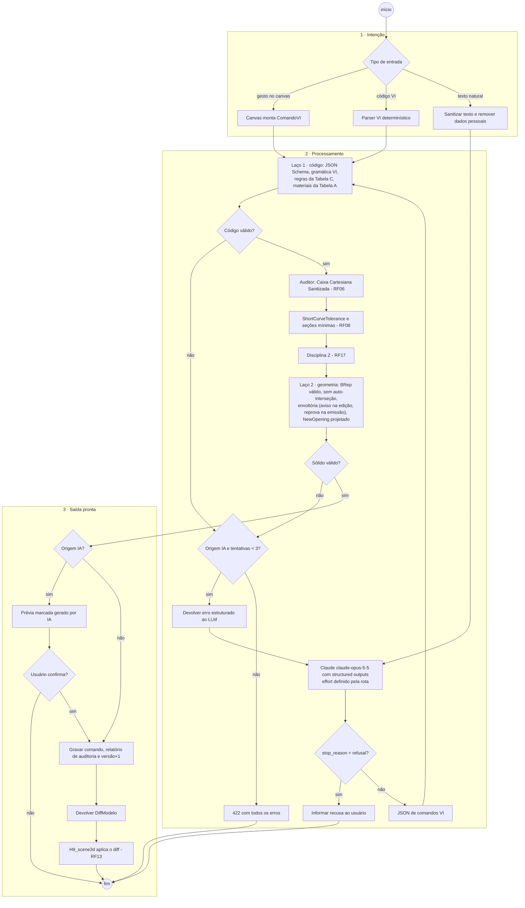
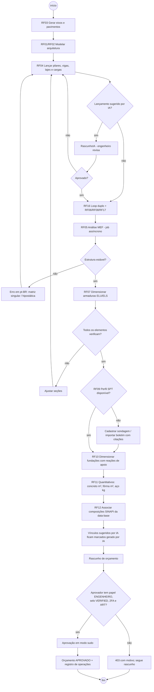
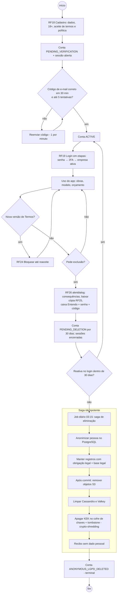

# Diagrama de atividades (fluxos ponta a ponta)

Fluxos que atravessam vários RFs. O fluxo (a) cobre [RF01](rf/RF01-modelagem-vetorial-canvas-webgl.md),
[RF02](rf/RF02-comandos-notacao-vi.md), [RF06](rf/RF06-auditoria-vaos-fencepost.md),
[RF08](rf/RF08-filtro-tolerancias-secoes-minimas.md), [RF13](rf/RF13-renderizacao-cena-3d.md),
[RF16](rf/RF16-loop-duplo-validacao.md) e [RF17](rf/RF17-controle-elevacao-pilares.md); o fluxo (b) cobre
[RF03](rf/RF03-grids-e-pavimentos.md)–[RF12](rf/RF12-associacao-sinapi.md) e
[RF27](rf/RF27-transparencia-ia-revisao-humana.md); o fluxo (c) cobre
[RF18](rf/RF18-cadastro-e-verificacao-email.md), [RF19](rf/RF19-login-2fa-sessao.md),
[RF24](rf/RF24-termos-e-consentimentos.md), [RF25](rf/RF25-direitos-do-titular.md) e
[RF26](rf/RF26-exclusao-conta-carencia.md). As atividades de cada RF isolado estão na seção 7.2 do seu doc.

## (a) Fluxo em três tempos da Notação VI com loop duplo

1. **Intenção (usuário):** desenha no canvas ou digita código VI / texto natural.
2. **Processamento (Função VI / LLM):** parser VI ou Claude com structured outputs produz o comando; a Tabela C
   valida regras e a Tabela A resolve materiais; o auditor Python aplica as correções geométricas.
3. **Saída pronta (JS/JSX/BIM):** o kernel gera o sólido, a versão do modelo é gravada e a cena WebGL recebe o diff.

## (b) Do modelo ao orçamento aprovado

Qualquer mudança no modelo depois da aprovação marca análise, dimensionamento, quantitativo e orçamento como
`OBSOLETO` (ver [MAQUINA_ESTADOS.md](MAQUINA_ESTADOS.md)).

## (c) Ciclo de vida da conta

