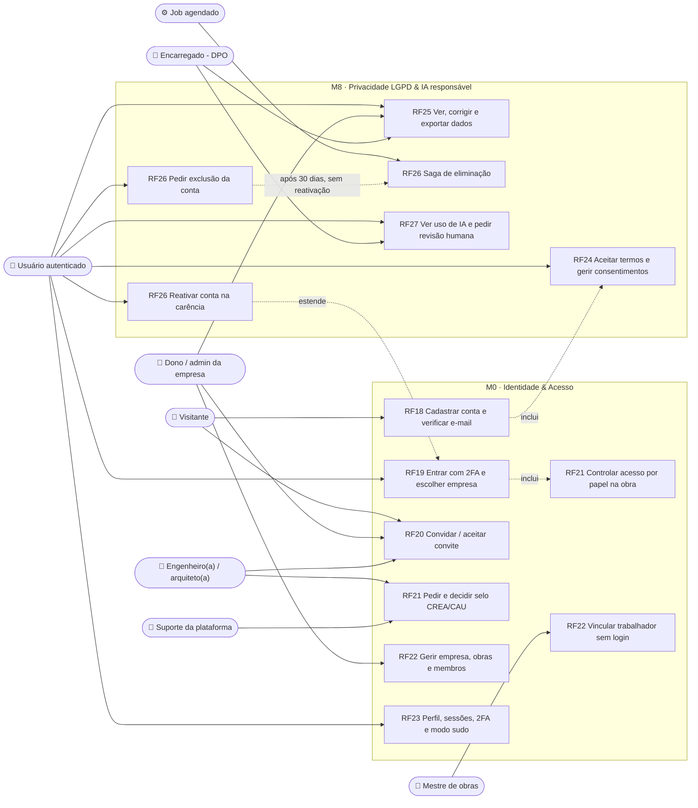
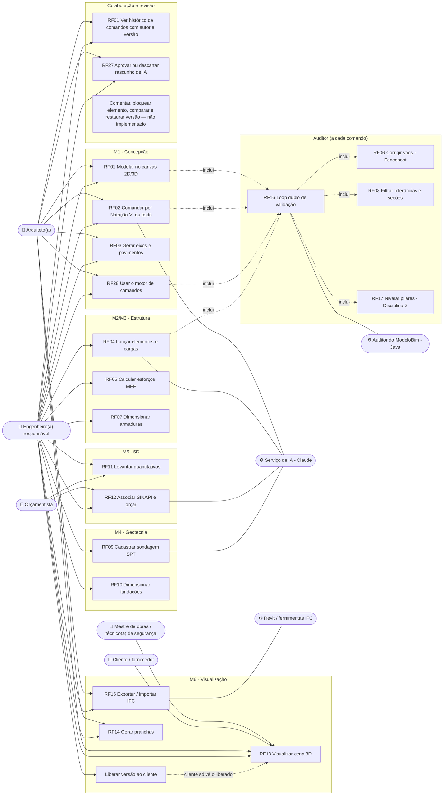

# Diagrama de casos de uso (visão geral)

Visão consolidada de **ator × módulo** do CivilConstructorAI. Cobre todos os RFs do
[catálogo](rf/README.md): M0 Identidade & Acesso ([RF18](rf/RF18-cadastro-e-verificacao-email.md)–[RF23](rf/RF23-perfil-sessoes-modo-sudo.md)),
M1 Concepção ([RF01](rf/RF01-modelagem-vetorial-canvas-webgl.md)–[RF03](rf/RF03-grids-e-pavimentos.md)),
M2 Análise estrutural ([RF04](rf/RF04-lancamento-elementos-e-cargas.md)–[RF06](rf/RF06-auditoria-vaos-fencepost.md)),
M3 Dimensionamento ([RF07](rf/RF07-dimensionamento-armaduras.md)–[RF08](rf/RF08-filtro-tolerancias-secoes-minimas.md)),
M4 Geotecnia ([RF09](rf/RF09-perfil-solo-spt.md)–[RF10](rf/RF10-dimensionamento-fundacoes.md)),
M5 Quantitativos 5D ([RF11](rf/RF11-levantamento-quantitativos.md)–[RF12](rf/RF12-associacao-sinapi.md)),
M6 Visualização ([RF13](rf/RF13-renderizacao-cena-3d.md)–[RF15](rf/RF15-interoperabilidade-openbim.md)),
M7 Middleware IA ([RF16](rf/RF16-loop-duplo-validacao.md)–[RF17](rf/RF17-controle-elevacao-pilares.md)) e
M8 LGPD ([RF24](rf/RF24-termos-e-consentimentos.md)–[RF27](rf/RF27-transparencia-ia-revisao-humana.md)) e o motor de desenho
([RF28](rf/RF28-motor-desenho-comandos.md)).
O detalhe de cada caso de uso está no diagrama 7.1 do doc do RF.

> **Revisão da auditoria 2026-10** ([relatório](auditoria/AUDITORIA_2026-10.md)). Este diagrama descreve o que o código faz hoje;
> o que está só especificado aparece marcado como *não implementado*. Correções desta revisão: atores mestre de obras, técnico(a)
> de segurança, fornecedor e trabalhador entraram nos fluxos com o que o código de fato permite; RF21 passou a ter o nome do doc
> (controle de acesso por papel, que inclui o selo); RF06/RF08 deixaram de ser "middleware" — rodam no auditor do `ModeloBim`
> (Java) a cada comando, junto com RF16/RF17; o auditor e o MEF são Java (não há serviço Python no repositório); a saga de
> eliminação não "estende" a exclusão: é disparada pelo job quando a carência acaba, e a reativação é um caso próprio; a
> visibilidade do cliente deixou de ser pendente (liberação explícita por versão); colaboração e revisão de versões ganharam
> casos de uso, com o que existe e o que falta.

## 1. Identidade, acesso e LGPD (M0 + M8)

## 2. Projeto, cálculo e orçamento (M1–M7)

## 3. Matriz ator × módulo

| Ator | M0 | M1 | M2 | M3 | M4 | M5 | M6 | M7 | M8 |
|---|---|---|---|---|---|---|---|---|---|
| Visitante | cadastro, convite | — | — | — | — | — | — | — | aceite de termos |
| Dono / admin da empresa | empresa, obras, convites (até o próprio nível; nunca DONO) | editar | lançar, calcular | dimensionar, aprovar¹ | sondagem, fundações | aprovar orçamento¹ | pranchas, IFC, liberar ao cliente | — | dados dos trabalhadores |
| Engenheiro(a) responsável | convites para a obra | editar | lançar, calcular | dimensionar, aprovar¹ | sondagem, fundações | aprovar orçamento¹ | pranchas, IFC, liberar ao cliente | — | aprovar rascunho de IA¹ |
| Arquiteto(a) | convites para a obra | editar | ver | ver | ver | ver | pranchas, IFC | — | aprovar rascunho de IA¹ |
| Orçamentista | — | ver | — | — | — | preparar orçamento | ver | — | — |
| Mestre de obras | vincular trabalhador sem login | ver | — | — | — | — | ver | — | — |
| Técnico(a) de segurança | — | ver | — | — | — | — | ver | — | —³ |
| Cliente | — | versão liberada² | — | — | — | totais (ou detalhe) liberados² | versão liberada² | — | — |
| Fornecedor | — | versão liberada² | — | — | — | —⁴ | versão liberada² | — | — |
| Trabalhador | — (sem login) | — | — | — | — | — | — | — | titular dos dados |
| Encarregado (DPO) | — | — | — | — | — | — | — | — | pedidos de titulares, revisão humana |
| Suporte da plataforma | decidir selos (motivo obrigatório na recusa) | — | — | — | — | — | — | — | — |

¹ Exige selo profissional `VERIFIED`, 2FA e ART/RRT da obra ([RF21](rf/RF21-controle-acesso-papel-obra.md), [RF27](rf/RF27-transparencia-ia-revisao-humana.md)).
² Liberação explícita por versão (modelo, quantitativo, orçamento); rascunhos de IA nunca aparecem. Verificado na auditoria
2026-10 (DN-02, jornada j3).
³ `PapelObra.veDadoDeSaude()` existe, mas nenhum caso de uso o consome: permissão sem fluxo (pendência).
⁴ "Pedidos do fornecedor" está na especificação de negócio, mas não há módulo de pedidos: fornecedor hoje só vê o que é liberado.
