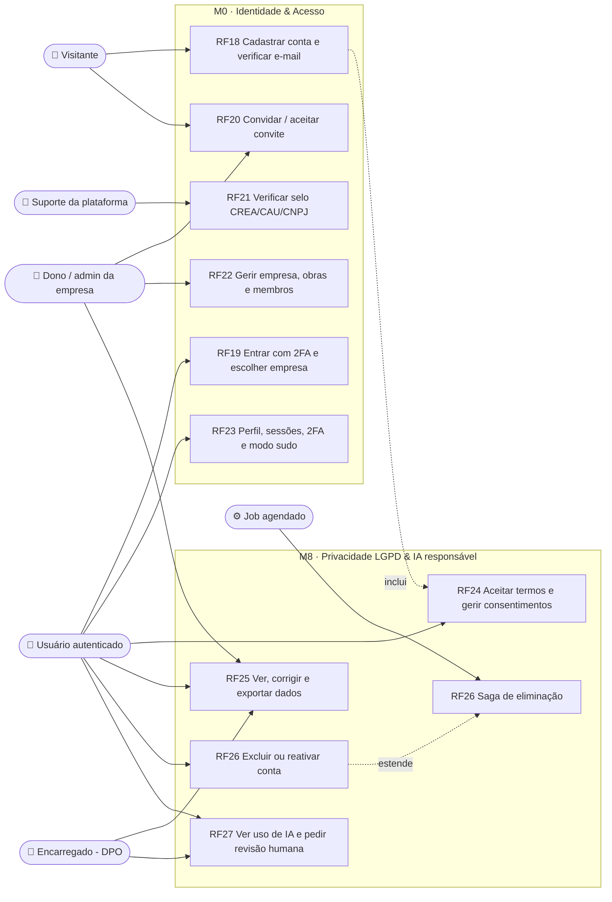
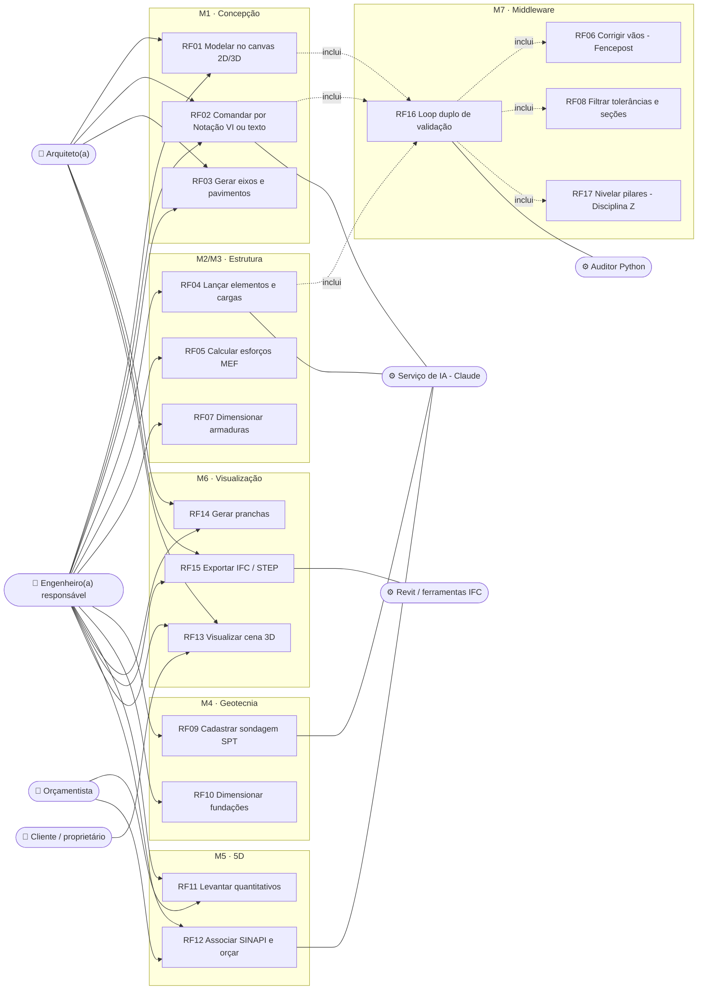

# Diagrama de casos de uso (visão geral)

Visão consolidada de **ator × módulo** do CivilConstructorAI. Cobre todos os RFs do
[catálogo](rf/README.md): M0 Identidade & Acesso ([RF18](rf/RF18-cadastro-e-verificacao-email.md)–[RF23](rf/RF23-perfil-sessoes-modo-sudo.md)),
M1 Concepção ([RF01](rf/RF01-modelagem-vetorial-canvas-webgl.md)–[RF03](rf/RF03-grids-e-pavimentos.md)),
M2 Análise estrutural ([RF04](rf/RF04-lancamento-elementos-e-cargas.md)–[RF06](rf/RF06-auditoria-vaos-fencepost.md)),
M3 Dimensionamento ([RF07](rf/RF07-dimensionamento-armaduras.md)–[RF08](rf/RF08-filtro-tolerancias-secoes-minimas.md)),
M4 Geotecnia ([RF09](rf/RF09-perfil-solo-spt.md)–[RF10](rf/RF10-dimensionamento-fundacoes.md)),
M5 Quantitativos 5D ([RF11](rf/RF11-levantamento-quantitativos.md)–[RF12](rf/RF12-associacao-sinapi.md)),
M6 Visualização ([RF13](rf/RF13-renderizacao-cena-3d.md)–[RF15](rf/RF15-interoperabilidade-openbim.md)),
M7 Middleware IA ([RF16](rf/RF16-loop-duplo-validacao.md)–[RF17](rf/RF17-controle-elevacao-pilares.md)) e
M8 LGPD ([RF24](rf/RF24-termos-e-consentimentos.md)–[RF27](rf/RF27-transparencia-ia-revisao-humana.md)).
O detalhe de cada caso de uso está no diagrama 7.1 do doc do RF.

## 1. Identidade, acesso e LGPD (M0 + M8)

## 2. Projeto, cálculo e orçamento (M1–M7)

## 3. Matriz ator × módulo

| Ator | M0 | M1 | M2 | M3 | M4 | M5 | M6 | M7 | M8 |
|---|---|---|---|---|---|---|---|---|---|
| Visitante | cadastro, convite | — | — | — | — | — | — | — | aceite de termos |
| Dono / admin da empresa | empresa, obras, convites | ver | ver | ver | ver | ver | ver | — | dados dos trabalhadores |
| Engenheiro(a) responsável | convites para a obra | editar | lançar, calcular | dimensionar, aprovar¹ | sondagem, fundações | aprovar orçamento¹ | pranchas, IFC | recebe relatórios | aprovar rascunho de IA¹ |
| Arquiteto(a) | — | editar | ver | ver | ver | ver | pranchas, IFC | recebe relatórios | aprovar rascunho de IA¹ |
| Orçamentista | — | ver | — | — | — | preparar orçamento | ver | — | — |
| Mestre de obras / técnico(a) de segurança | — | ver | — | — | — | — | ver | — | — |
| Cliente / proprietário | — | — | — | — | — | totais liberados² | ver liberado² | — | — |
| Fornecedor | — | — | — | — | — | pedidos dele | — | — | — |
| Encarregado (DPO) | — | — | — | — | — | — | — | — | pedidos de titulares, revisão humana |
| Suporte da plataforma | verificar selos (acesso temporário) | — | — | — | — | — | — | — | — |

¹ Exige selo profissional `VERIFIED`, 2FA e ART/RRT da obra ([RF21](rf/RF21-controle-acesso-papel-obra.md), [RF27](rf/RF27-transparencia-ia-revisao-humana.md)).
² O que o cliente vê é **decisão de negócio pendente** (card ❓ no Trello).
