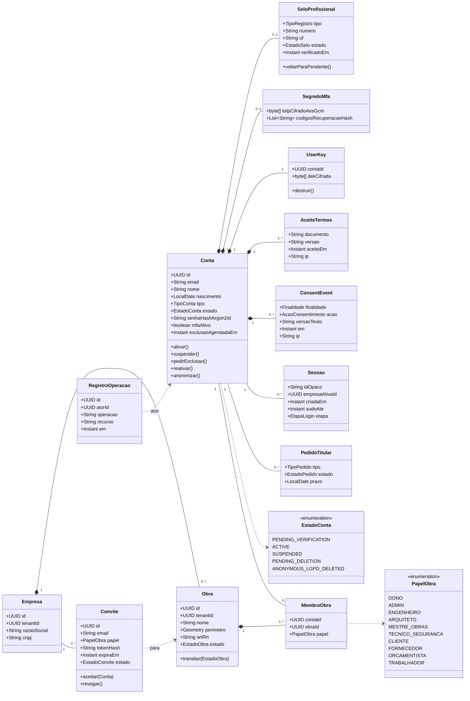
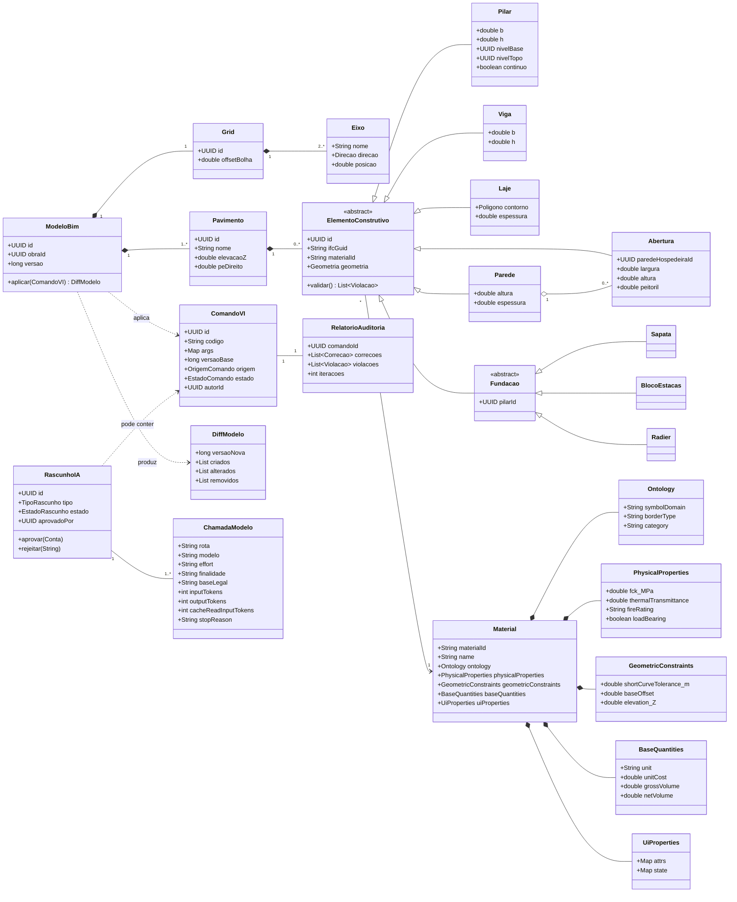
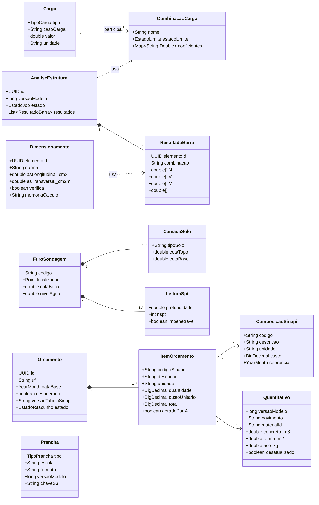

# Diagrama de classes (modelo de domínio consolidado)

Modelo de domínio do CivilConstructorAI dividido em três contextos. Cobre todos os RFs do
[catálogo](rf/README.md): identidade, acesso e LGPD ([RF18](rf/RF18-cadastro-e-verificacao-email.md)–[RF27](rf/RF27-transparencia-ia-revisao-humana.md));
modelo BIM e auditoria ([RF01](rf/RF01-modelagem-vetorial-canvas-webgl.md)–[RF03](rf/RF03-grids-e-pavimentos.md),
[RF06](rf/RF06-auditoria-vaos-fencepost.md), [RF08](rf/RF08-filtro-tolerancias-secoes-minimas.md),
[RF13](rf/RF13-renderizacao-cena-3d.md)–[RF17](rf/RF17-controle-elevacao-pilares.md)); cálculo, geotecnia e
5D ([RF04](rf/RF04-lancamento-elementos-e-cargas.md), [RF05](rf/RF05-diagramas-esforcos-mef.md),
[RF07](rf/RF07-dimensionamento-armaduras.md), [RF09](rf/RF09-perfil-solo-spt.md)–[RF12](rf/RF12-associacao-sinapi.md)).
As classes específicas de cada RF estão na seção 7.3 do seu doc.

Convenções: IDs públicos são **UUID v7**; toda entidade de empresa carrega `tenantId` (RLS no PostgreSQL);
estados são `enum` com transições validadas no domínio ([MAQUINA_ESTADOS.md](MAQUINA_ESTADOS.md)).

## 1. Identidade, acesso e LGPD

## 2. Modelo BIM, Notação VI, auditoria e IA

## 3. Cálculo estrutural, geotecnia, 5D e pranchas

