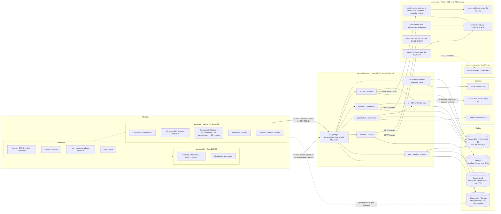
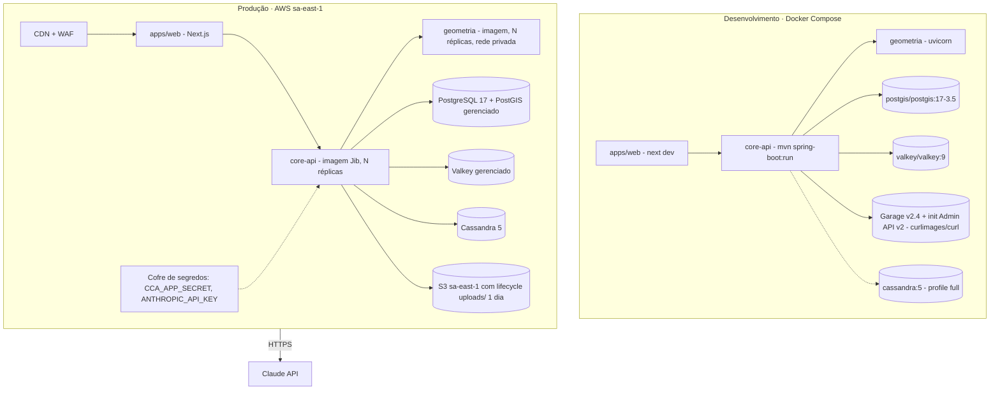

# Diagrama de componentes e implantação

Arquitetura do CivilConstructorAI: três camadas das Diretrizes (Engine visual 3D/CAD, Interpretador semântico
VI/VSL, Backend BIM e motor geométrico) sobre a stack obrigatória do prompt (Spring Boot 4.1, Valkey, PostGIS,
Claude API). Cobre todos os RFs do [catálogo](rf/README.md); o componente de cada RF está na seção 7.6 do seu doc.
As decisões de tecnologia estão registradas como ADRs em [PESQUISA_TECNOLOGIAS.md](PESQUISA_TECNOLOGIAS.md).

## 1. Componentes lógicos



### Responsabilidades dos módulos do core-api

| Módulo | Responsabilidade | RFs |
|---|---|---|
| `identidade` | cadastro, login em etapas, 2FA, sessões, sudo | RF18, RF19, RF23 |
| `acesso` | `ObraAccess` (`hasObraRole`), selo profissional, matriz de acesso, RLS | RF21 |
| `empresa`, `obra` | tenants, obras, membros, convites, ciclo de vida da obra | RF20, RF22 |
| `modelo` | modelo BIM versionado, comandos, diff | RF01, RF03, RF04 |
| `notacao` | parser VI, gramática e validação da Tabela C | RF02, RF16 |
| `ia` | única porta para a Claude API: rotas, `effort`, caching, fallback, `ChamadaModelo` | RF02, RF04, RF09, RF12, RF16, RF27 |
| `estrutura` | cargas, combinações, jobs MEF e dimensionamento | RF04, RF05, RF07 |
| `geotecnia` | sondagens SPT, fundações | RF09, RF10 |
| `quantitativo`, `orcamento` | 5D, SINAPI, aprovação | RF11, RF12 |
| `prancha`, `interop` | pranchas, IFC/STEP, ponte Revit | RF14, RF15 |
| `lgpd` | consentimentos, termos, direitos do titular, saga de eliminação | RF24–RF27 |
| `arquivo` | URLs pré-assinadas S3, limpeza de imagens | RF09, RF14, RF23, RF25 |
| `registro` | registro de operações (Art. 37) e atividades da obra | todos |

Regra de dependência: módulos de negócio nunca chamam a Claude API diretamente, só via `ia`; nenhum módulo
fala com o banco de outro módulo sem passar pelo serviço dele; `geometria` é **sem estado** e não acessa banco.

## 2. Implantação



## 3. Layout do repositório

Mescla o *Git layout* das Diretrizes (`docs/`, `frontend/`, `backend/ai_engine|auditor|data_model|calculations`,
`pyrevit_extension/`, `tests/`) com o monorepo Turborepo do prompt. O front-end das Diretrizes vira `apps/web`, e
a parte Python de `backend/` vira o serviço `geometria/`; a camada de IA sai do Python e vai para o módulo `ia`
do core-api em Java (ADR em [PESQUISA_TECNOLOGIAS.md](PESQUISA_TECNOLOGIAS.md)).

```text
CivilConstructorAI/
├── apps/
│   ├── web/                       # Next.js 16 + React 19
│   │   └── src/
│   │       ├── canvas/            # H9_scene3d, CanvasController, SnapEngine (Three.js)
│   │       ├── components/h/      # componentes da Tabela H (H2…H18, H03)
│   │       └── app/               # rotas: (auth), (app)/obras/[obraId]/…
│   └── mobile/                    # Expo SDK 58 / Expo Router, modo offline no canteiro
├── packages/
│   ├── tokens/                    # DTCG 2025.10 → Style Dictionary 5 → tokens.css / tokens.ts
│   ├── ui-web/                    # shadcn/ui + Radix + Tailwind v4
│   ├── ui-native/                 # react-native-reusables + Uniwind
│   ├── api/                       # cliente gerado do OpenAPI do Spring
│   └── i18n/                      # i18next, pt-BR
├── backend/                       # core-api · Spring Boot 4.1 · Java 21/25
│   └── src/
│       ├── main/java/br/com/civilconstructorai/
│       │   ├── identidade/ acesso/ empresa/ obra/
│       │   ├── modelo/ notacao/ ia/
│       │   ├── estrutura/ geotecnia/ quantitativo/ orcamento/
│       │   └── prancha/ interop/ lgpd/ arquivo/ registro/
│       ├── main/resources/db/migration/   # Flyway V1..Vn (+ schema.sql verificado)
│       └── test/java/…            # *Test (unitário) e *IT (Testcontainers, login real)
├── geometria/                     # serviço Python 3.13 (FastAPI interna, sem estado)
│   ├── api/                       # rotas /auditar, /mef, /dimensionar, /pranchas, /ifc
│   ├── auditor/                   # BoundingBox, ShortCurveTolerance, cotas Z, projeção vetorial
│   ├── data_model/                # schemas JSON da Tabela A (materiais e custos)
│   ├── calculations/              # mef/, armaduras/, fundacoes/
│   ├── kernel/                    # CadQuery / OpenCASCADE
│   ├── pranchas/                  # plantas e cortes
│   ├── interop/                   # IfcOpenShell, STEP
│   └── tests/                     # 15+ testes unitários e de estresse de geometria
├── pyrevit_extension/             # scripts IronPython para a Revit API
├── design/prototype/              # protótipo HTML/CSS/JS + render.mjs (Playwright)
├── docs/
│   ├── rf/                        # RFnn-slug.md + catálogo README.md
│   ├── legal/                     # TERMOS_DE_USO.md, POLITICA_DE_PRIVACIDADE.md
│   ├── DIAGRAMA_*.md, MAQUINA_ESTADOS.md
│   ├── PESQUISA_TECNOLOGIAS.md    # ADRs
│   ├── TAXONOMIA_ATORES_E_CARDS.md
│   └── TRELLO_BACKLOG.md          # espelho do quadro do Trello
├── scripts/                       # check_rf_docs.py, wcag_contrast.py
├── compose.yaml                   # PostGIS, Valkey, Garage (+init), Cassandra (profile full)
├── turbo.json
└── .github/workflows/             # mvn verify JDK 21/25, Docs por RF, CodeQL, Gitleaks, Trivy
```
