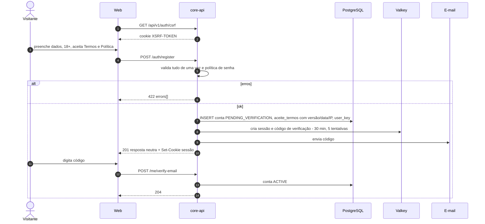
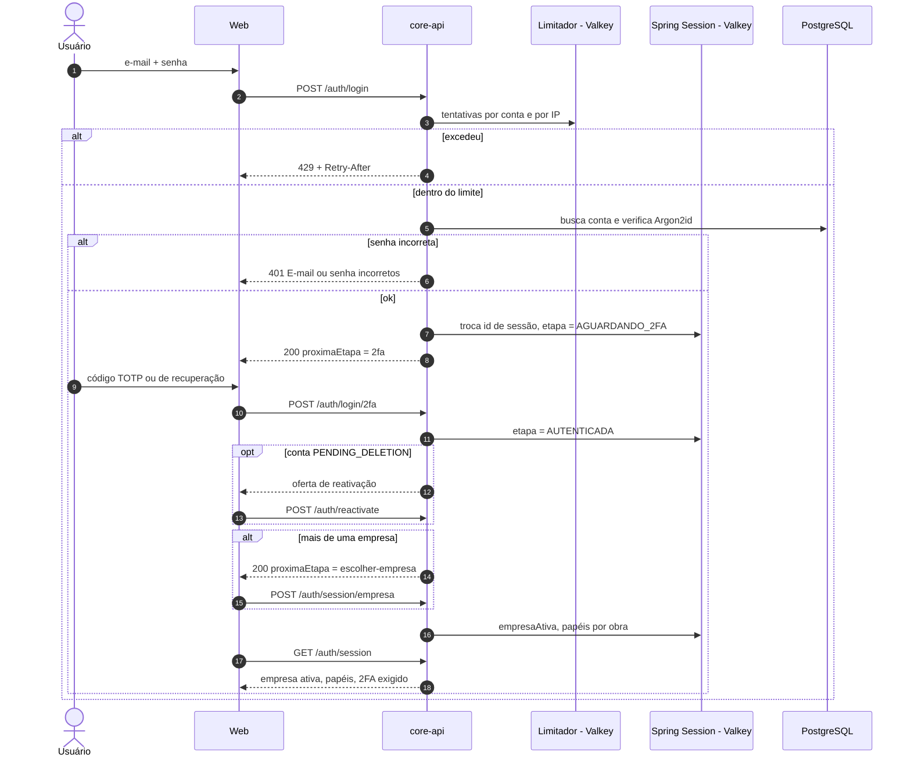
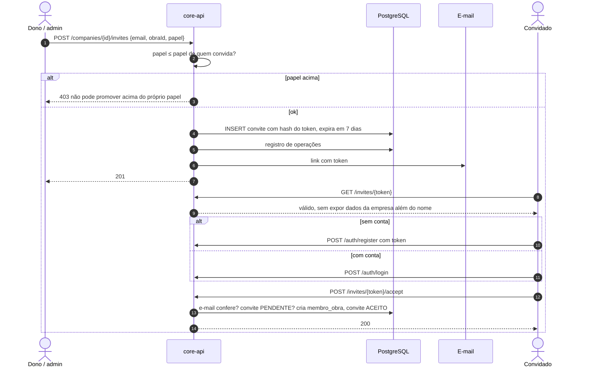
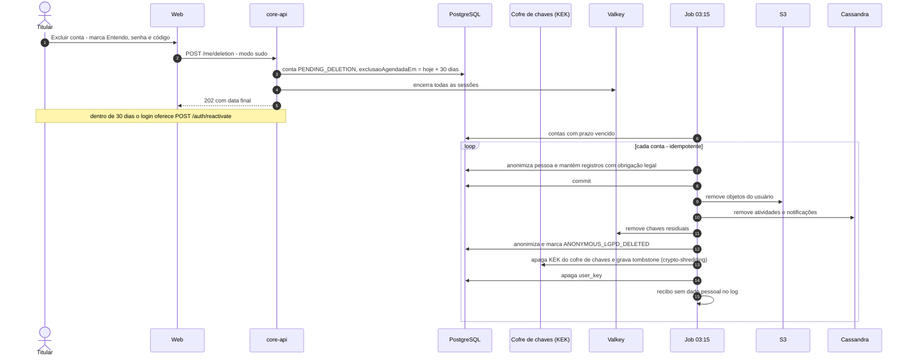
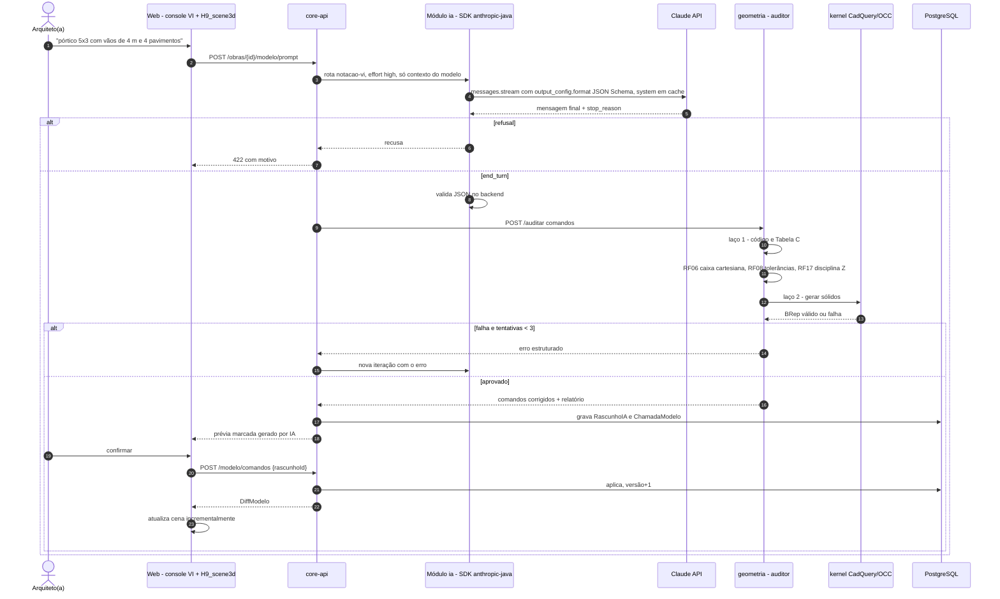
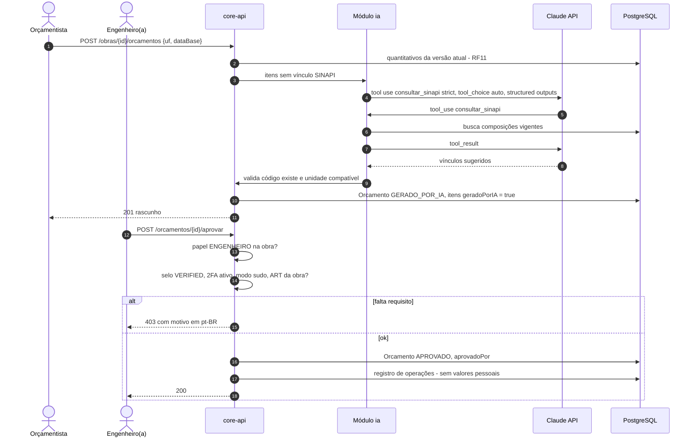

# Diagramas de sequência (transversais)

Sequências obrigatórias e fluxos que cruzam vários RFs, em versão resumida. Cobre
[RF18](rf/RF18-cadastro-e-verificacao-email.md) (cadastro), [RF19](rf/RF19-login-2fa-sessao.md) (login com 2FA e
escolha da empresa), [RF20](rf/RF20-convites-empresa-obra.md) (convite), [RF26](rf/RF26-exclusao-conta-carencia.md)
(exclusão com carência), [RF02](rf/RF02-comandos-notacao-vi.md) + [RF16](rf/RF16-loop-duplo-validacao.md) +
[RF13](rf/RF13-renderizacao-cena-3d.md) (texto natural → cena) e [RF12](rf/RF12-associacao-sinapi.md) +
[RF21](rf/RF21-controle-acesso-papel-obra.md) + [RF27](rf/RF27-transparencia-ia-revisao-humana.md) (orçamento por IA →
aprovação). A versão completa de cada uma está na seção 7.4 do doc do RF.

Todas as escritas levam `X-XSRF-TOKEN`; a sessão é opaca no Valkey (cookie `__Host-cca_session`), nunca JWT.

## 1. Cadastro (RF18)

## 2. Login com 2FA e escolha da empresa (RF19)

## 3. Convite para empresa e obra (RF20)

## 4. Exclusão com carência (RF26)

## 5. Texto natural → Claude → auditor → kernel → cena (RF02, RF16, RF13)

## 6. Rascunho de orçamento por IA → aprovação (RF12, RF21, RF27)

