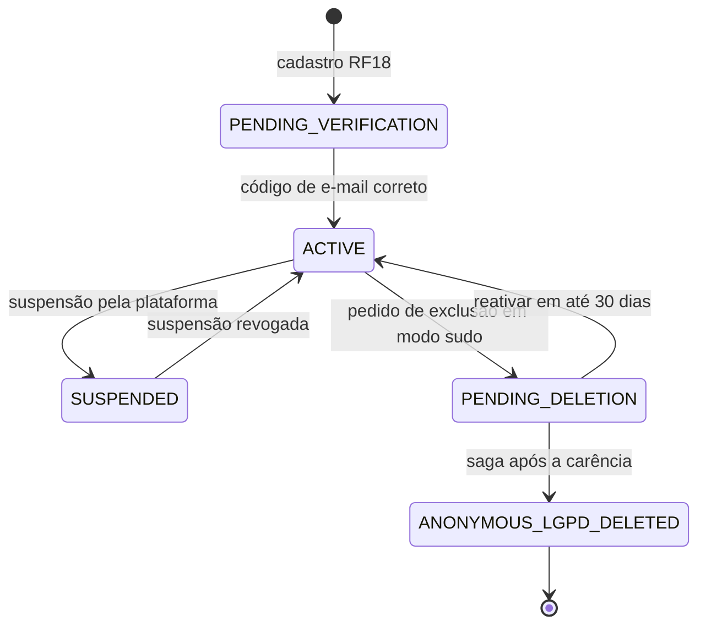
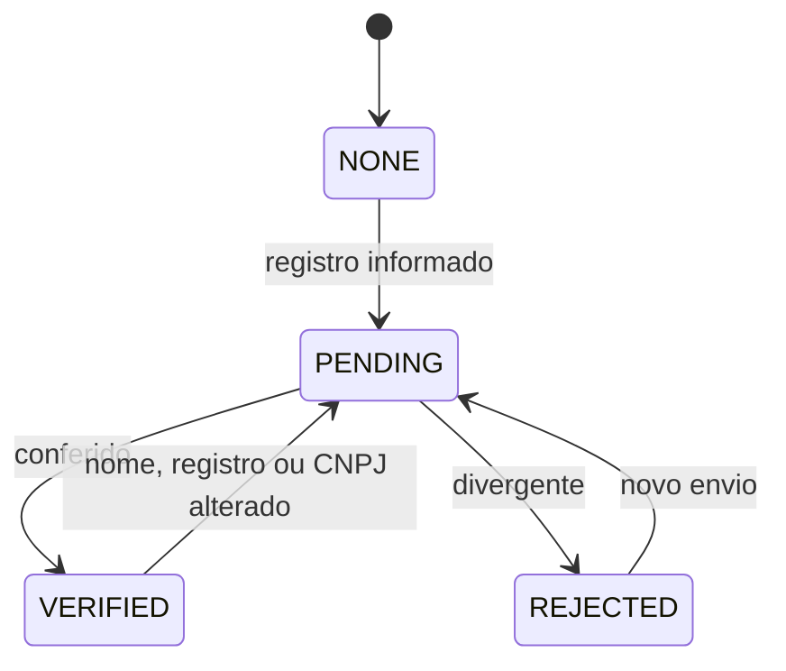
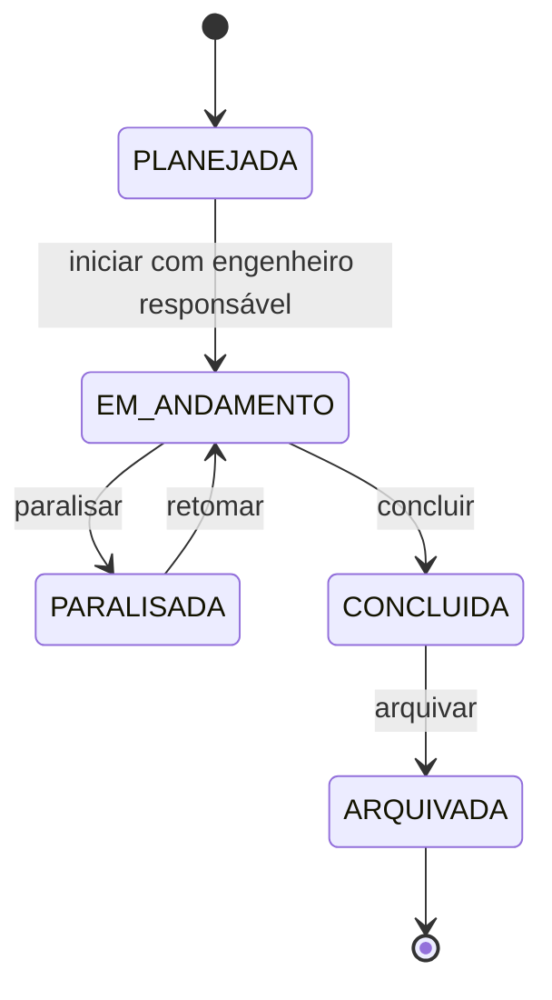
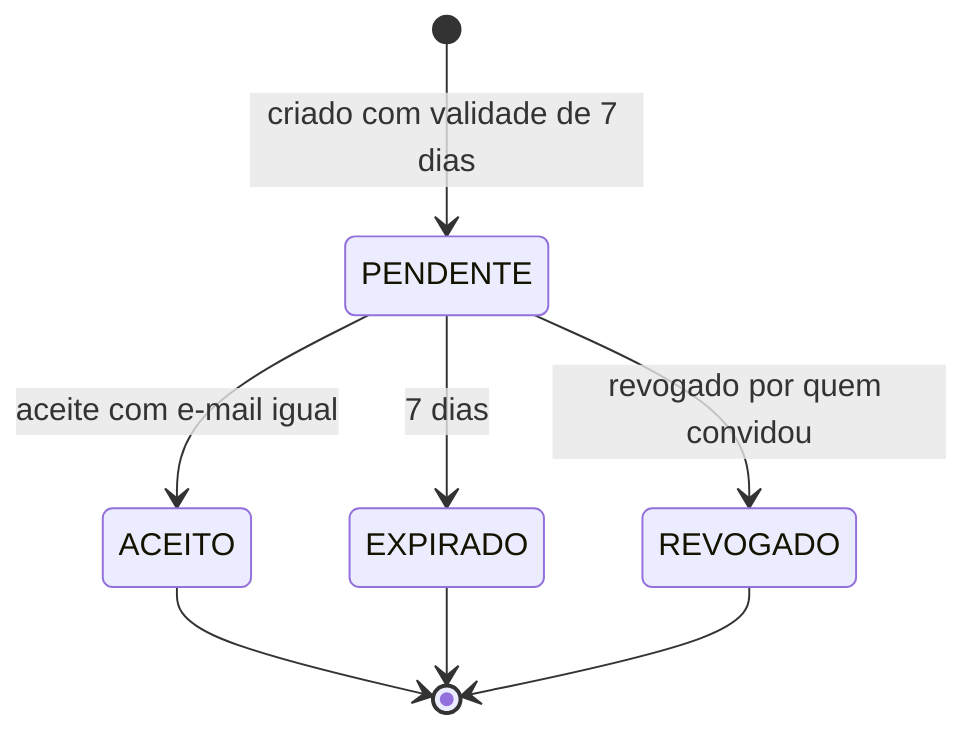
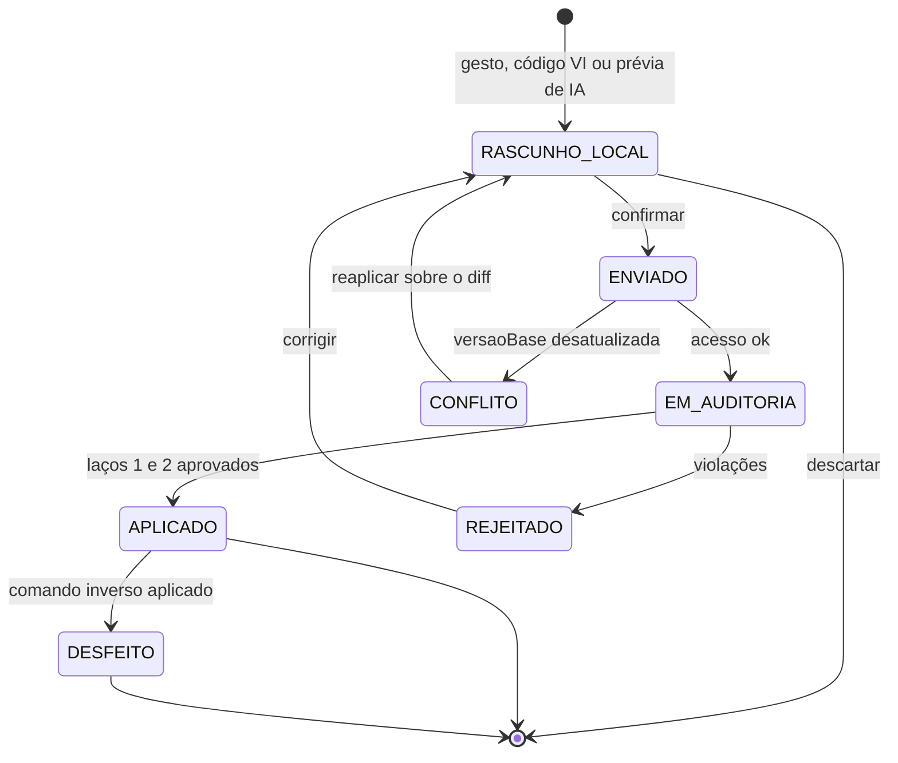
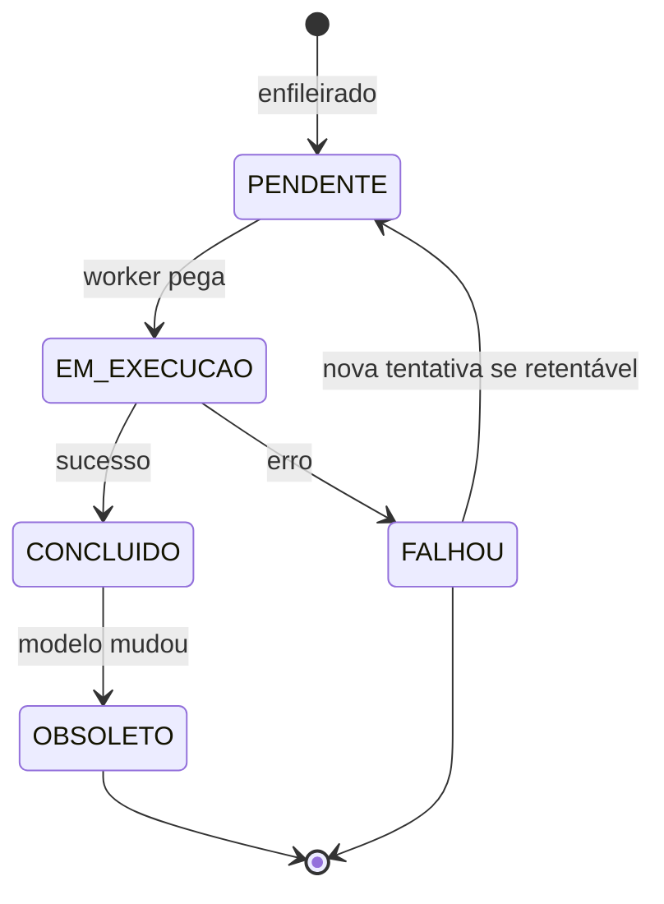
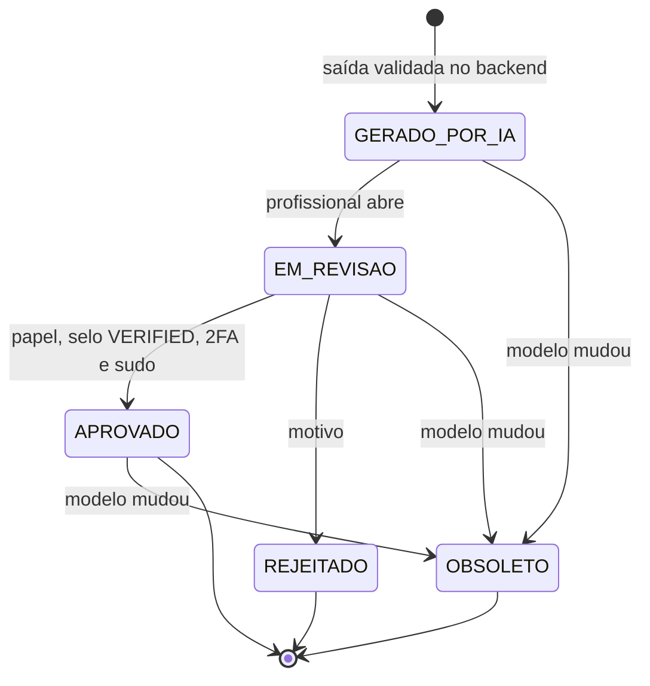
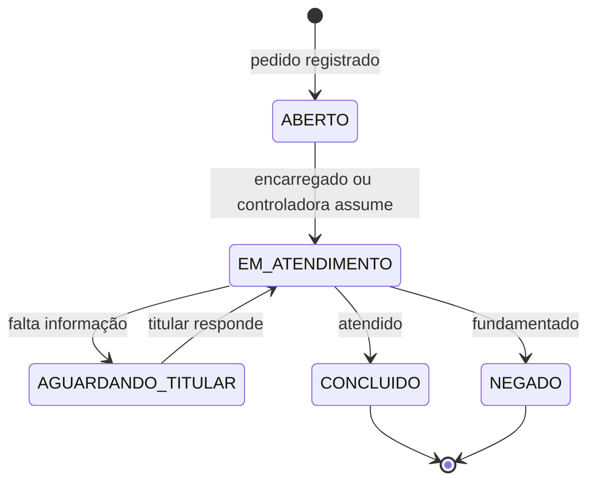
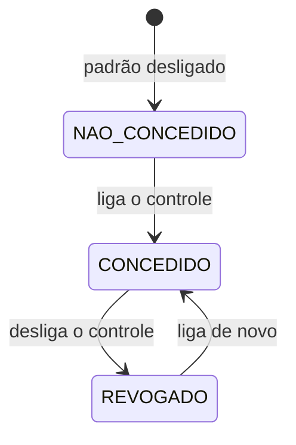

# Máquinas de estado

Todas as máquinas de estado do domínio. Cobre [RF01](rf/RF01-modelagem-vetorial-canvas-webgl.md) e
[RF16](rf/RF16-loop-duplo-validacao.md) (ComandoVI), [RF05](rf/RF05-diagramas-esforcos-mef.md),
[RF07](rf/RF07-dimensionamento-armaduras.md), [RF10](rf/RF10-dimensionamento-fundacoes.md),
[RF11](rf/RF11-levantamento-quantitativos.md), [RF14](rf/RF14-geracao-plantas-cortes.md),
[RF15](rf/RF15-interoperabilidade-openbim.md) e [RF25](rf/RF25-direitos-do-titular.md) (jobs assíncronos),
[RF02](rf/RF02-comandos-notacao-vi.md), [RF04](rf/RF04-lancamento-elementos-e-cargas.md),
[RF09](rf/RF09-perfil-solo-spt.md), [RF12](rf/RF12-associacao-sinapi.md) e
[RF27](rf/RF27-transparencia-ia-revisao-humana.md) (RascunhoIA), [RF18](rf/RF18-cadastro-e-verificacao-email.md),
[RF19](rf/RF19-login-2fa-sessao.md) e [RF26](rf/RF26-exclusao-conta-carencia.md) (Conta),
[RF20](rf/RF20-convites-empresa-obra.md) (Convite), [RF21](rf/RF21-controle-acesso-papel-obra.md) (Selo),
[RF22](rf/RF22-empresas-e-obras.md) (Obra), [RF24](rf/RF24-termos-e-consentimentos.md) (Consentimento) e
[RF25](rf/RF25-direitos-do-titular.md) (Pedido do titular).

## Regra geral

As transições ficam **no domínio** (método da entidade, ex.: `obra.transitar(EM_ANDAMENTO)`), nunca no
controller. Toda transição fora das tabelas abaixo lança `TransicaoInvalidaException`, mapeada para **`409
Conflict`** em Problem Details (RFC 9457) com título e detalhe em pt-BR, por exemplo
"A obra está ARQUIVADA e não pode voltar para EM_ANDAMENTO". Estados terminais não têm saída. Cada transição
relevante (aprovação, mudança de papel, exportação, exclusão) gera um `RegistroOperacao` (LGPD Art. 37) sem
valores pessoais.

## 1. Conta

| De | Para | Gatilho | Condição |
|---|---|---|---|
| — | `PENDING_VERIFICATION` | `POST /auth/register` | 18+, aceite de Termos e Política |
| `PENDING_VERIFICATION` | `ACTIVE` | `POST /me/verify-email` | código válido, ≤ 30 min, ≤ 5 tentativas |
| `ACTIVE` | `SUSPENDED` | ação da plataforma | registrada |
| `SUSPENDED` | `ACTIVE` | ação da plataforma | registrada |
| `ACTIVE` | `PENDING_DELETION` | `POST /me/deletion` | modo sudo |
| `PENDING_DELETION` | `ACTIVE` | `POST /auth/reactivate` | dentro de 30 dias |
| `PENDING_DELETION` | `ANONYMOUS_LGPD_DELETED` | job diário 03:15 | prazo vencido; **terminal** |

## 2. Selo profissional (CREA / CAU / CNPJ)

| De | Para | Gatilho |
|---|---|---|
| `NONE` | `PENDING` | usuário informa CREA/CAU + UF ou CNPJ |
| `PENDING` | `VERIFIED` / `REJECTED` | conferência (plataforma) |
| `REJECTED` | `PENDING` | reenvio |
| `VERIFIED` | `PENDING` | troca de nome, registro ou CNPJ |

Sem `VERIFIED` a pessoa usa o app, mas **não aprova** orçamento, medição, checklist, cálculo nem rascunho de IA.

## 3. Obra

| De | Para | Condição |
|---|---|---|
| `PLANEJADA` | `EM_ANDAMENTO` | ao menos um membro `ENGENHEIRO` e ART/RRT informada |
| `EM_ANDAMENTO` | `PARALISADA` | motivo informado |
| `PARALISADA` | `EM_ANDAMENTO` | — |
| `EM_ANDAMENTO` | `CONCLUIDA` | — |
| `CONCLUIDA` | `ARQUIVADA` | obra passa a ser somente leitura |

## 4. Convite

Uso único: `ACEITO`, `EXPIRADO` e `REVOGADO` são terminais.

## 5. ComandoVI

| De | Para | Condição |
|---|---|---|
| `ENVIADO` | `EM_AUDITORIA` | papel `ARQUITETO`/`ENGENHEIRO` na obra, obra não arquivada |
| `ENVIADO` | `CONFLITO` | `versaoBase` < versão atual e elementos em conflito (409) |
| `EM_AUDITORIA` | `APLICADO` | loop duplo aprovado (RF16), até 3 iterações quando a origem é IA |
| `EM_AUDITORIA` | `REJEITADO` | violação no laço 1 ou 2 (422) |
| `APLICADO` | `DESFEITO` | desfazer gera comando inverso; o histórico não é apagado |

## 6. Job assíncrono (análise MEF, dimensionamento, quantitativos, pranchas, IFC, exportação de dados)

O resultado é vinculado à `versaoModelo`; qualquer nova versão do modelo marca resultados anteriores como
`OBSOLETO` (não são apagados, só deixam de valer).

## 7. RascunhoIA

| De | Para | Condição |
|---|---|---|
| `GERADO_POR_IA` | `EM_REVISAO` | profissional habilitado abre a revisão |
| `EM_REVISAO` | `APROVADO` | papel exigido na obra + selo `VERIFIED` + 2FA + modo sudo; registrado |
| `EM_REVISAO` | `REJEITADO` | motivo obrigatório |
| qualquer não terminal ou `APROVADO` | `OBSOLETO` | nova versão do modelo |

Até `APROVADO`, o conteúdo aparece com o rótulo **"gerado por IA"** (cor + ícone Lucide + texto).

## 8. Pedido do titular (LGPD Art. 18)

Prazo de resposta: 15 dias (Art. 19, II); o prazo aparece no card do pedido.

## 9. Consentimento por finalidade

Finalidades: localização do aparelho no canteiro, uso de fotos para treinar classificadores internos,
comunicação de marketing. Cada transição gera um `consent_event` imutável (finalidade, ação, versão do texto,
data, IP). Revogar tem efeito imediato.
