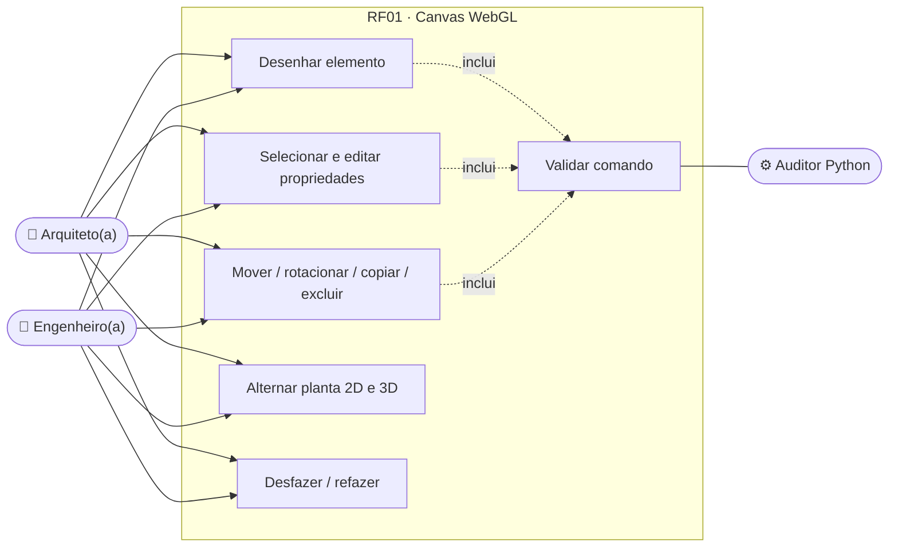
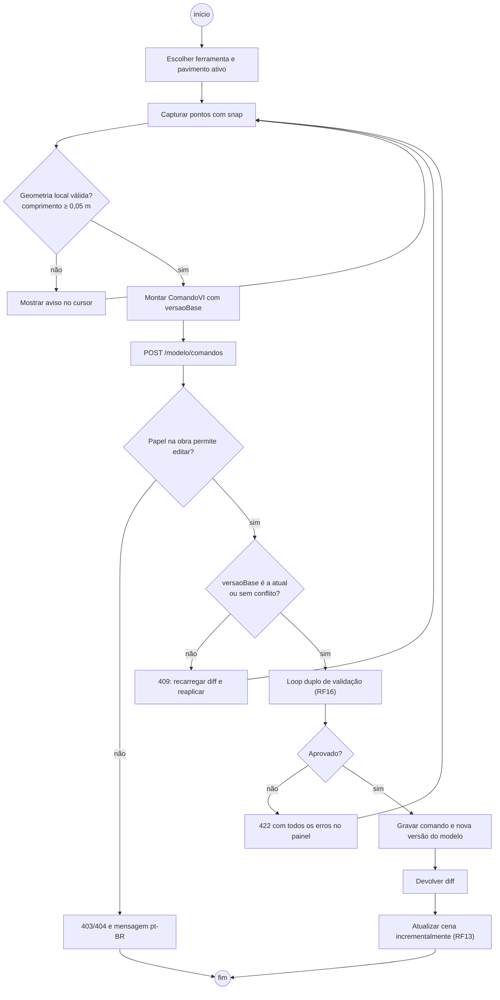
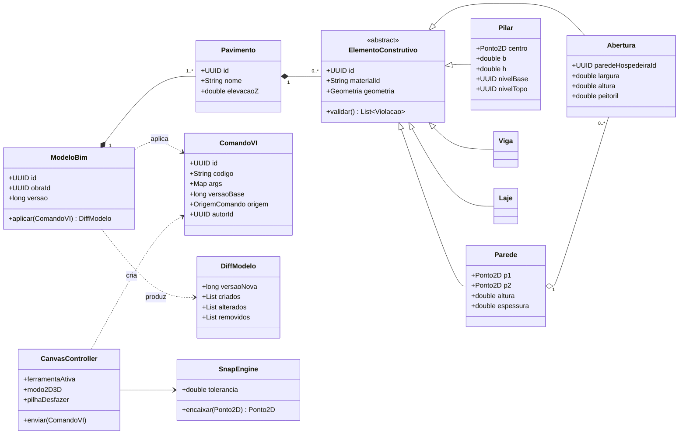
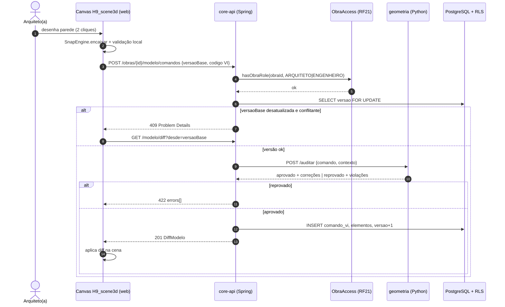
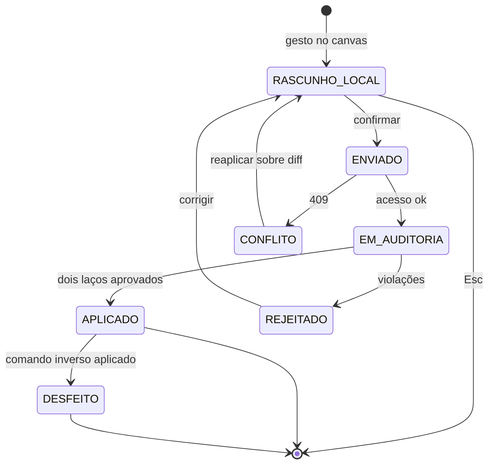
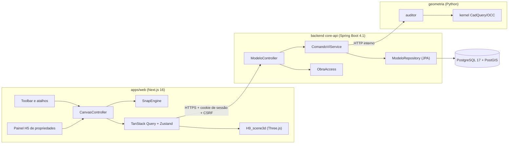

# RF01 · Modelagem vetorial 2D/3D interativa no canvas WebGL

> O projetista desenha e edita o modelo da edificação no navegador, em planta 2D e em 3D, sobre o mesmo
> modelo BIM. Cada gesto vira um **comando VI** (RF02), passa pelo **loop duplo de validação** (RF16) e só
> então é gravado como nova versão do modelo.

## 1. Descrição

O canvas usa Three.js (WebGL 2) com dois modos de câmera sobre a mesma cena: **ortográfica de topo** (planta
do pavimento ativo) e **perspectiva orbital** (3D). As ferramentas de desenho cobrem os elementos do núcleo:
parede, pilar, viga, laje e abertura (porta/janela). O usuário pode selecionar, mover, rotacionar, copiar,
excluir e editar propriedades no painel lateral (formulários H5 da Tabela H).

O canvas **não altera o modelo diretamente**. Cada ação gera um `ComandoVI` (ex.:
`VI(PAREDE, p1=[0,0], p2=[5,0], h=2.8, esp=0.15, mat=MAT_ALV_BLOCO14)`) que o backend valida e aplica. A cena
é atualizada a partir do **diff** devolvido (elementos criados, alterados e removidos), garantindo que o que
aparece na tela é sempre o que está gravado.

Coordenadas em metros (SI), origem no cruzamento dos eixos A/1, eixo Z para cima. O snap prioriza, nesta
ordem: interseção de eixos (RF03), extremidade de elemento, ponto médio, eixo, grade auxiliar.

## 2. Atores

| Ator | Papel na obra | Pode |
|---|---|---|
| Arquiteto(a) | `ARQUITETO` | desenhar e editar elementos de arquitetura (parede, abertura, laje de piso) |
| Engenheiro(a) responsável | `ENGENHEIRO` | desenhar e editar todos os elementos, inclusive estruturais |
| Mestre de obras, Cliente, demais | qualquer outro | apenas visualizar (RF13) |
| Serviço de IA / Auditor | sistema | validar e corrigir o comando (RF02, RF16) |

## 3. Critérios de aceite

- [ ] **CA-01** Alternar planta 2D ⇄ 3D mantém a seleção e o pavimento ativo.
- [ ] **CA-02** Snap a eixo, extremidade e grade com tolerância configurável (padrão 0,10 m na tela, convertida
  pela escala do zoom); coordenadas sempre em metros com 3 casas.
- [ ] **CA-03** Toda edição gera um `ComandoVI` persistido com autor, data e versão resultante do modelo.
- [ ] **CA-04** Desfazer/refazer usa a pilha de comandos do usuário na sessão; desfazer gera um comando inverso
  (o histórico nunca é apagado).
- [ ] **CA-05** Edição concorrente: cada comando carrega `versaoBase`; se o modelo já avançou e o comando
  conflita com elementos alterados, a API responde `409` e o canvas recarrega o diff.
- [ ] **CA-06** Elemento rejeitado pelo auditor não aparece na cena; o motivo aparece no painel em pt-BR.
- [ ] **CA-07** Só `ARQUITETO` e `ENGENHEIRO` da obra editam; os demais recebem `403` (papel insuficiente) ou
  `404` (não membro), conforme RF21. Obra `ARQUIVADA` é somente leitura.
- [ ] **CA-08** Teclado: todas as ferramentas têm atalho; foco visível; alvo de toque ≥ 48 px no painel.
- [ ] **CA-09** A entrada por teclado segue o motor de desenho do **RF28**: linha de comando com os aliases do
  [catálogo de comandos](../CATALOGO_COMANDOS.md) (`WA`/`ML` parede, `CL` pilar, `BM` viga, `SB` laje, `DR`/`WN`
  aberturas, `M`, `CO`, `RO`, `TR`, `EX`, `O`, `MI`…), entrada dinâmica junto ao cursor e modos Osnap/Ortho/Polar
  (F3/F8/F10). A `SnapEngine` deste RF é o `Osnap` do RF28 com os modos `EIX`, `EXT`, `INT`, `MED`, `CEN`,
  `PER`, `PRX` e `NIV`.

## 4. Regras de negócio

- **RN-01** Parede: comprimento ≥ ShortCurveTolerance (0,05 m), espessura entre 0,05 m e 1,00 m.
- **RN-02** Pilar: posicionado preferencialmente em interseção de eixos; base e topo presos a níveis (RF17).
- **RN-03** Abertura só existe hospedada em uma parede; a projeção vetorial gera o vão (`NewOpening`) na face.
- **RN-04** Laje: contorno fechado, sem auto-interseção, apoiada em vigas/paredes do pavimento.
- **RN-05** Todo elemento referencia um material da Tabela A (`materialId`).

## 5. Base legal e normas

- LGPD: o modelo não contém dados pessoais; autoria do comando (id do usuário) segue a retenção do registro de
  operações (Art. 37).
- NBR 6492 (representação de projetos de arquitetura) para a simbologia da planta.
- WCAG 2.2 AA: foco visível (2.4.11), alvo mínimo (2.5.8), cor não é o único sinal (1.4.1).

## 6. API

| Método e rota | Descrição | Respostas |
|---|---|---|
| `GET /api/v1/obras/{obraId}/modelo?versao=` | Modelo completo (ou versão) | 200, 404 |
| `GET /api/v1/obras/{obraId}/modelo/diff?desde={versao}` | Diff desde a versão | 200, 404 |
| `POST /api/v1/obras/{obraId}/modelo/comandos` | Aplica um `ComandoVI` (`versaoBase`, `codigo` ou `json`) | 201 + diff, 403, 404, 409, 422 |
| `POST /api/v1/obras/{obraId}/modelo/comandos/{id}/desfazer` | Gera e aplica o comando inverso | 201, 409 |

Todas as escritas exigem `X-XSRF-TOKEN`. Erros em Problem Details (RFC 9457), `422` com `errors[]` completo.

## 7. Diagramas

### 7.1 Casos de uso

### 7.2 Atividades

### 7.3 Classes

### 7.4 Sequência

### 7.5 Máquina de estados (ComandoVI)

### 7.6 Componentes

## 8. Testes previstos

| Tipo | Caso |
|---|---|
| Unitário (web) | `SnapEngine` encaixa na interseção mais próxima dentro da tolerância |
| Unitário (Java) | `ModeloBim.aplicar` gera diff correto para criar/alterar/remover |
| Integração `*IT` | comando de parede com login real (`ApiClient`) → 201 e versão +1 |
| Integração `*IT` | duas sessões com mesma `versaoBase` editando o mesmo elemento → segunda recebe 409 |
| Integração `*IT` | usuário `MESTRE_OBRAS` tenta editar → 403; usuário de outra empresa → 404 |
| E2E (Playwright + axe) | desenhar parede, desfazer, refazer; sem violação de acessibilidade |

## 9. Rastreabilidade

| Camada | Artefato | Status |
|---|---|---|
| Documento | `docs/rf/RF01-modelagem-vetorial-canvas-webgl.md` | ✅ |
| Card | [Trello 3WgN7lzt](https://trello.com/c/3WgN7lzt) | ✅ |
| Web | `apps/web/src/canvas/CanvasController.ts`, `SnapEngine.ts` | ⏳ |
| Domínio | `cca-domain · modelo/ModeloBim.java` (todas as funções VI do núcleo: PAREDE, PILAR, VIGA, LAJE, PORTA/JANELA, MOVER, COPIAR, ROTACIONAR, APAGAR…, desfazer/refazer), `Elemento.java`, `DiffModelo.java`, `notacao/Geo.java` (snap/osnap, interseções) | ✅ |
| Aplicação | `cca-application · modelo/ModeloService.java` (aplicarComando com trava de versão → 409, lote, desfazer, diff), `AuditorService.java` | ✅ |
| API | `cca-web · api/modelo/ModeloController.java` (`GET /modelo`, `GET /modelo/diff?desde`, `POST /modelo/comandos`, `/comandos/lote`, `/comandos/{id}/desfazer`, `GET /comandos`), `ModeloExceptionHandler.java` (422 `auditoria_reprovada`) | ✅ |
| Banco | `V7__modelo_bim.sql` (modelo_bim, pavimento, elemento, comando_vi) com RLS | ✅ |
| Geometria | laço 2 local em `cca-domain · modelo/ServicoGeometriaLocal.java` (JTS); kernel Python via `ServicoGeometriaHttp` quando `app.geometria.remota=true` | ✅ |
| Testes | `ModeloBimTest` (porte de `modelo.test.ts`), `ModeloComandoIT` (fluxo malha→pilar→viga→diff→desfazer, 409, 422, 403/404); `canvas.spec.ts` | 🟡 |

## Auditoria 2026-10

Auditoria pelo uso real do app ([relatório](../auditoria/AUDITORIA_2026-10.md)). Nota (conclusão 30%, precisão 25%, clareza
20%, feedback 15%, consistência/acessibilidade 10%): **6,6 → 8,6**.

- **Corrigido:** Mudança no modelo agora invalida o que dependia dele (análise, dimensionamento, fundações, quantitativo, pranchas) via `DependentesDoModelo`; rascunhos de IA ficam fora da versão vista por cliente/fornecedor; o histórico expõe autor e correções do auditor. Prévia (TS) e gravação (Java) provadas iguais por fixture compartilhada (36 casos).
- **Evidência:** j2 CA-03/04/05, ModeloComandoIT, paridade TS↔Java.
- **Pendente:** Comparar e restaurar versões; comentários e bloqueio de elemento.

## Auditoria 2026-10 · 2ª rodada

Estrutura, materiais e conformidade ([relatório](../auditoria/AUDITORIA_2026-10_ESTRUTURA_INSTALACOES_MATERIAIS.md)).

- **Corrigido:** códigos de material com ponto (`MAT.CONCRETO.C40`) chegavam ao auditor como `MAT_CONCRETO_C40` e eram recusados (`Sanitizador.codigo`); materiais personalizados da empresa passam pelo auditor nos dois motores; painel de propriedades troca o material por seletor com pesquisa, comparação, prévia dos elementos afetados e desfazer.
- **Evidência:** `CoordenacaoMateriaisIT`; jornada j5.
- **Pendente:** material personalizado criado com o editor aberto só aparece depois de recarregar.

## Auditoria AUD-CC-3D-001

Cenários construtivos, mobiliário, instalações e 3D ([relatório](../auditoria/AUDITORIA_AUD-CC-3D-001.md)). Jornadas `j6-diagnostico` (API) e
`j6-interface` (navegador): antes 6/16, depois 34/34 e 11/13.

- **Corrigido:** mover parede leva parede ligada (nova interseção), porta (distância absoluta), cota sobre a linha e objeto hospedado; divisória de 12 cm (bloco de 9 cm no catálogo); objetos da biblioteca (`OBJETO`) e conexões entre conectores (`CONECTAR`) na planta, com símbolo real, frente, conectores por cor e forma e percurso por sistema.
- **Evidência:** `j6-depois.json` (AUD-01, CT-01…05), telas `aud3d/01`–`05`, paridade TS↔Java.
- **Pendente:** cota associada só a pontos sobre a linha da parede; fachada/corte 2D gerados do 3D.
