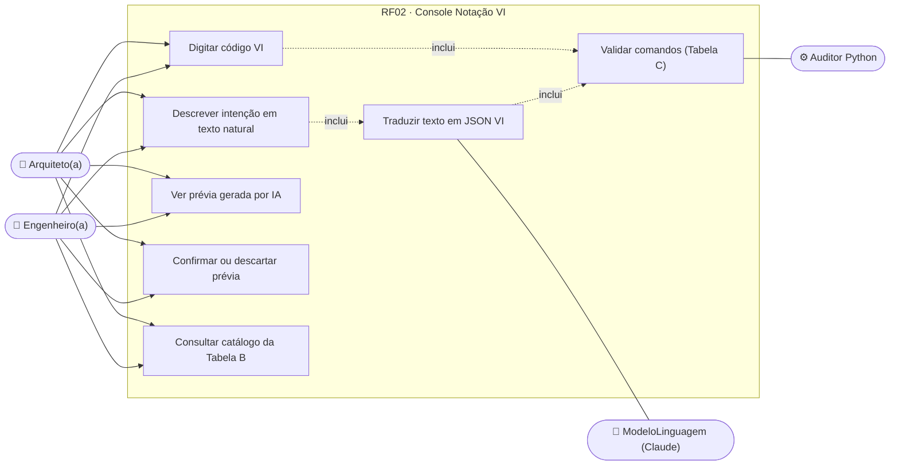
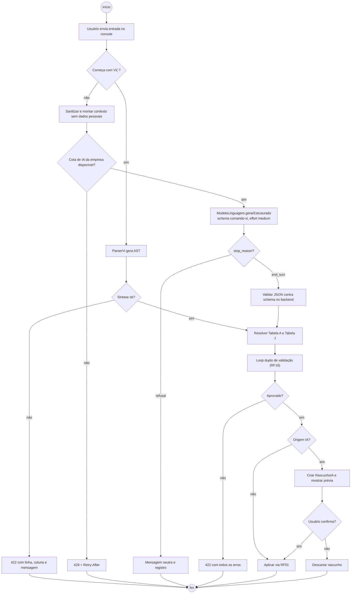
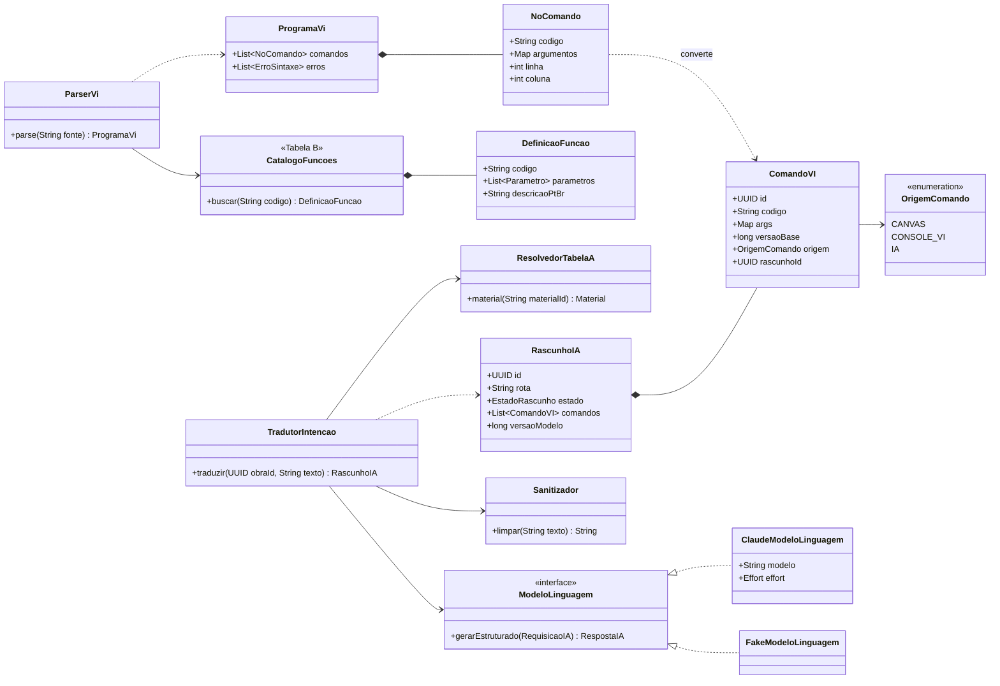
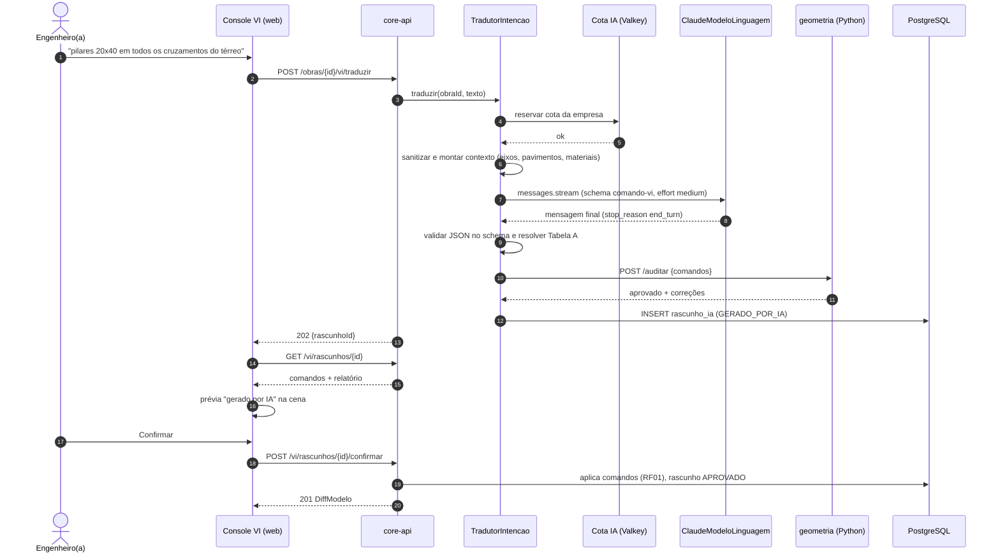
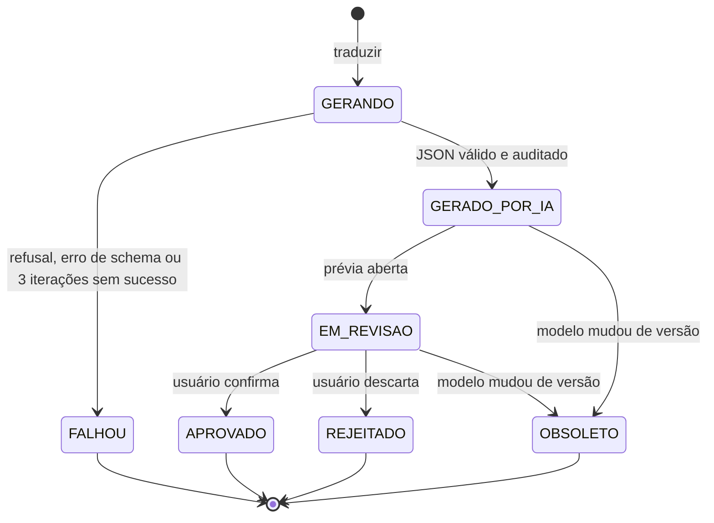
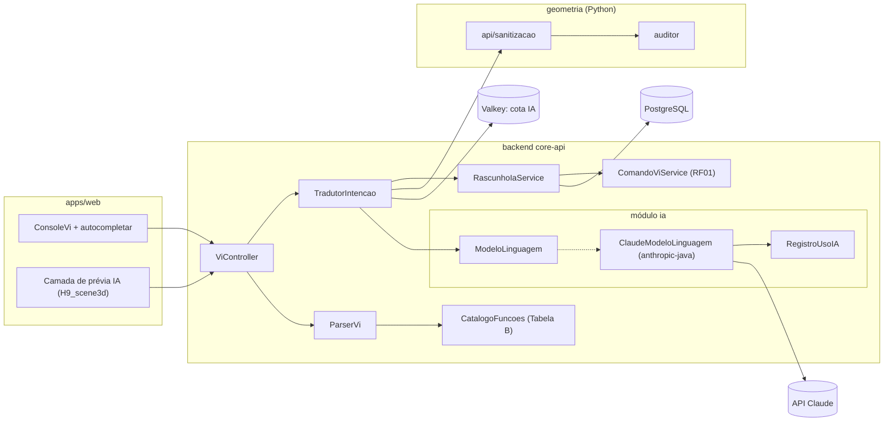

# RF02 · Comandos via Notação VI e prompts de código JSON

> O console aceita código na **Notação VI** (`VI(cod, args...)`) ou **texto natural**. O texto natural é
> traduzido pela camada de IA em comandos VI em JSON tipado; o código VI é interpretado por um parser
> determinístico. Nos dois casos, o resultado passa pelo loop duplo de validação (RF16) antes de virar modelo.

## 1. Descrição

Fluxo em **três tempos** (Diretrizes, seção 1):

1. **Intenção (usuário)**: digita `VI(PILAR, eixo=B2, b=0.20, h=0.40, mat=MAT_CONC_FCK30)` ou
   "coloque pilares 20x40 em todos os cruzamentos do térreo".
2. **Processamento (Função VI / LLM)**:
   - código VI → `ParserVi` (gramática formal, sem IA) → AST → `ComandoVI`;
   - texto natural → rota de IA `comando-vi` → `ModeloLinguagem.gerarEstruturado(...)` com **structured outputs**
     (JSON Schema `comando-vi.schema.json`, `additionalProperties: false`) → lista de `ComandoVI` em JSON → mesma
     validação do parser (Tabela C) e resolução de materiais/objetos (Tabela A, Tabela J).
3. **Saída pronta (JS/JSX/BIM)**: comandos aprovados viram diff do modelo e atualizam a cena (RF13).

A IA **nunca** escreve direto no modelo: o lote gerado é um `RascunhoIA` exibido como **prévia marcada "gerado
por IA"** na cena (camada fantasma, `--ai-draft-*`) até o usuário confirmar. Confirmar envia cada comando ao
endpoint de comandos do RF01, com `origem = IA` e referência ao rascunho.

Antes de seguir ao serviço Python, o texto passa por **sanitização** (Diretrizes, seção 3): normalização Unicode
NFC → remoção de caracteres de controle e símbolos não previstos (º, ª convertidos para `o`/`a`), para evitar
`UnicodeDecodeError` no transporte HTTP e no IronPython (RF15).

Camadas da Notação VI usadas aqui: **Tabela A** (Data Model: materiais), **Tabela B** (Funções: `PAREDE`,
`PILAR`, `VIGA`, `LAJE`, `PORTA`, `JANELA`, `EIXO`/`MALHA`, `PAVIMENTO`, `MOVER`, `COPIAR`, `APAGAR`…), **Tabela C**
(Controle e fluxo: `REPETIR`, `PARA_CADA eixo EM malha`, `SE`), **Tabela H** (UI: componentes que exibem o
comando) e **Tabela J** (objetos nativos do kernel). As camadas D, E e F seguem a decisão DN-05 em
[`docs/DECISOES_DE_NEGOCIO.md`](../DECISOES_DE_NEGOCIO.md).

**A Tabela B é o mesmo catálogo do motor de desenho (RF28).** Cada função tem um alias de teclado herdado do
AutoCAD/Revit ([`docs/CATALOGO_COMANDOS.md`](../CATALOGO_COMANDOS.md)): `WA` → `PAREDE`, `CL` → `PILAR`, `BM` →
`VIGA`, `SB` → `LAJE`, `GR` → `EIXO`, `LL` → `PAVIMENTO`, `M` → `MOVER`, `CO` → `COPIAR`, `O` → `DESLOCAR`…
Assim, "faça três vigas de 5 m a partir do eixo A" no console e `BM` no canvas produzem o mesmo `VI(VIGA, …)`,
validado pelo mesmo parser e pelo mesmo auditor. O autocompletar do console (CA-08) mostra o alias ao lado do
nome da função.

## 2. Atores

| Ator | Papel na obra | Pode |
|---|---|---|
| Arquiteto(a) | `ARQUITETO` | comandos de arquitetura (código ou texto) |
| Engenheiro(a) responsável | `ENGENHEIRO` | todos os comandos, inclusive estruturais |
| Demais papéis | outros | sem acesso ao console (403) |
| Serviço de IA | sistema (`ClaudeModeloLinguagem`) | traduzir texto natural em JSON VI |
| Auditor Python | sistema | validar e corrigir (RF16) |

## 3. Critérios de aceite

- [ ] **CA-01** Parser VI determinístico: a mesma entrada produz sempre a mesma AST; erros de sintaxe trazem
  linha, coluna e mensagem em pt-BR ("Esperado ')' na coluna 42").
- [ ] **CA-02** Lote com vários erros responde `422` (Problem Details) com **todos** os erros em `errors[]`.
- [ ] **CA-03** Texto natural → JSON validado de novo no backend contra `comando-vi.schema.json`; resposta
  com texto discursivo ou fora do schema é descartada e conta como falha da iteração (RF16).
- [ ] **CA-04** Comando gerado por IA aparece como prévia "gerado por IA" (cor + ícone + texto) e só é aplicado
  após confirmação explícita; descartar a prévia não altera o modelo.
- [ ] **CA-05** O contexto enviado ao modelo contém só dados do projeto (eixos, pavimentos, materiais,
  elementos resumidos); nenhum nome, e-mail, CPF ou dado de trabalhador. A rota registra finalidade
  ("tradução de intenção de projeto em comando") e base legal (execução de contrato, Art. 7º, V).
- [ ] **CA-06** `stop_reason` é verificado antes de ler o conteúdo; `refusal` vira mensagem neutra ao usuário e
  o fallback do servidor fica ligado.
- [ ] **CA-07** Sanitização remove acentos/caracteres especiais do payload enviado ao serviço Python sem
  alterar os nomes exibidos ao usuário.
- [ ] **CA-08** Autocompletar de funções e argumentos da Tabela B no console, com descrição em pt-BR.

## 4. Regras de negócio

- **RN-01** Gramática: `comando := 'VI' '(' codigo (',' argumento)* ')'`; `argumento := nome '=' valor`;
  valores numéricos em metros com ponto decimal; listas com `[ ]`; referências a eixo como `B2` (letra × número).
- **RN-02** Código de função desconhecido na Tabela B → erro `VI-001`; argumento obrigatório ausente → `VI-002`;
  tipo inválido → `VI-003`; material inexistente na Tabela A → `VI-010`.
- **RN-03** Rota de IA `comando-vi`: modelo `claude-opus-5-5`, `effort: medium` (tradução de intenção; `high`
  só para lotes com mais de 50 elementos), streaming, prompt caching do system prompt + catálogo da Tabela B.
- **RN-04** Máximo de 200 comandos por lote; acima disso o usuário deve dividir o pedido.
- **RN-05** Sem `temperature`/`top_p`/`top_k` e sem prefill; o determinismo vem do schema + parser + auditor.
- **RN-06** Um rascunho fica `OBSOLETO` se o modelo receber outra versão antes da confirmação.

## 5. Base legal e normas

- LGPD Art. 6º, III (necessidade): só dados do projeto vão ao modelo; Art. 33 (transferência internacional)
  documentada na Política de Privacidade e no ADR da camada de IA; Art. 20 (revisão de decisão automatizada)
  via RF27.
- Responsabilidade técnica: comando gerado por IA é rascunho; a aplicação é ato do profissional (RF27).

## 6. API

| Método e rota | Descrição | Respostas |
|---|---|---|
| `POST /api/v1/obras/{obraId}/vi/interpretar` | Código VI → lista de `ComandoVI` (sem aplicar) | 200, 403, 404, 422 |
| `POST /api/v1/obras/{obraId}/vi/traduzir` | Texto natural → `RascunhoIA` com comandos (stream SSE de progresso) | 202, 403, 404, 422, 429, 503 |
| `GET /api/v1/obras/{obraId}/vi/rascunhos/{id}` | Rascunho com comandos e relatório de auditoria | 200, 404 |
| `POST /api/v1/obras/{obraId}/vi/rascunhos/{id}/confirmar` | Aplica os comandos (via RF01) | 201 + diff, 409, 422 |
| `POST /api/v1/obras/{obraId}/vi/rascunhos/{id}/descartar` | Descarta a prévia | 204 |
| `GET /api/v1/vi/catalogo` | Tabela B (funções e argumentos) para autocompletar | 200 |

`429` quando a cota de IA da empresa (Valkey) acabou, com `Retry-After`.

## 7. Diagramas

### 7.1 Casos de uso

### 7.2 Atividades

### 7.3 Classes

### 7.4 Sequência

### 7.5 Máquina de estados (RascunhoIA de comando)

### 7.6 Componentes

## 8. Testes previstos

| Tipo | Caso |
|---|---|
| Unitário (Java) | `ParserVi` aceita a gramática completa e rejeita 20 entradas inválidas com linha/coluna corretas |
| Unitário (Java) | `Sanitizador` converte `º`/`ª`, remove controles e preserva números |
| Unitário (Java) | contexto montado por `TradutorIntencao` não contém e-mail, CPF nem nome de pessoa |
| Integração `*IT` | `traduzir` com `FakeModeloLinguagem` → rascunho `GERADO_POR_IA`; confirmar → versão +1 |
| Integração `*IT` | fake devolvendo `refusal` → mensagem neutra e nada gravado no modelo |
| Integração `*IT` | cota esgotada → 429 com `Retry-After` |
| Avaliação (fora do CI) | 50 intenções reais com comandos esperados; taxa de acerto registrada por versão de prompt |

## 9. Rastreabilidade

| Camada | Artefato | Status |
|---|---|---|
| Documento | `docs/rf/RF02-comandos-notacao-vi.md` | ✅ |
| Card | [Trello W4pJDtvv](https://trello.com/c/W4pJDtvv) | ✅ |
| Web | `apps/web/src/components/console-vi/ConsoleVi.tsx` | ⏳ |
| Domínio | `cca-domain · notacao/ParserVi.java` (VI-000/VI-003 com linha/coluna, `@dx,dy`, `@d<ang`, `$ref`), `FormatadorVi.java` (serialização canônica), `Sanitizador.java` (ASCII, º→o), `CatalogoComandos.java` | ✅ |
| Aplicação | `cca-application · modelo/ModeloService.java#textoNatural` (rota `COMANDO_VI` → lote de comandos origem IA, camada `ia-rascunho`), `AuditorService.java` (correção LLM até 3 iterações, só origem IA) | ✅ |
| API | `cca-web · api/notacao/CatalogoController.java` (`GET /vi/catalogo`, `POST /vi/validar`), `api/modelo/ModeloController.java` (`POST /modelo/comandos` com `vi` textual, `POST /modelo/texto-natural`) | ✅ |
| IA | `ia/ModeloLinguagem.java`/`RotaIa.COMANDO_VI` (porta do fork de IA), `AuditorService.SCHEMA_COMANDO` | ✅ |
| Geometria | `geometria/api/sanitizacao.py` | ⏳ |
| Testes | `ParserViTest`, `CatalogoComandosTest`, `ModeloComandoIT#textoNaturalCriaRascunhoGeradoPorIa`; `evals/comando-vi/` | 🟡 |

## Auditoria 2026-10

Auditoria pelo uso real do app ([relatório](../auditoria/AUDITORIA_2026-10.md)). Nota (conclusão 30%, precisão 25%, clareza
20%, feedback 15%, consistência/acessibilidade 10%): **6,8 → 8,6**.

- **Corrigido:** Função VI desconhecida devolve VI-001 com sugestões; texto natural vira rascunho de IA (`COMANDO_VI`) em vez de gravar direto; `mat=MAT.<CATEGORIA>.<ID>` aceito pelos dois motores.
- **Evidência:** j2 CA-01/02, equivalência; j3 CA-04.
- **Pendente:** Texto natural com IA real não verificado (dev usa simulação).

## Auditoria 2026-10 · 2ª rodada

Estrutura, materiais e conformidade ([relatório](../auditoria/AUDITORIA_2026-10_ESTRUTURA_INSTALACOES_MATERIAIS.md)).

- **Corrigido:** catálogo de materiais único (`packages/notacao-vi/catalogo/materiais.json`) lido pelo Java (`CatalogoMateriais`) e pelo TS (`tabela-a.ts`); códigos legados resolvem para o canônico; a IA do texto natural só propõe comandos de criação (`ModeloService.COMANDOS_IA`), passa por `ServicoIa` (registro de uso, recusa, truncamento) e o rascunho guarda as versões do modelo.
- **Evidência:** paridade 38 casos (`ModeloBimParidadeTest`) e 51 no TS; `CaminhoIaIT` (4).
- **Pendente:** IA real não exercitada em desenvolvimento.
