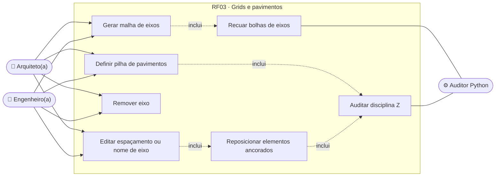
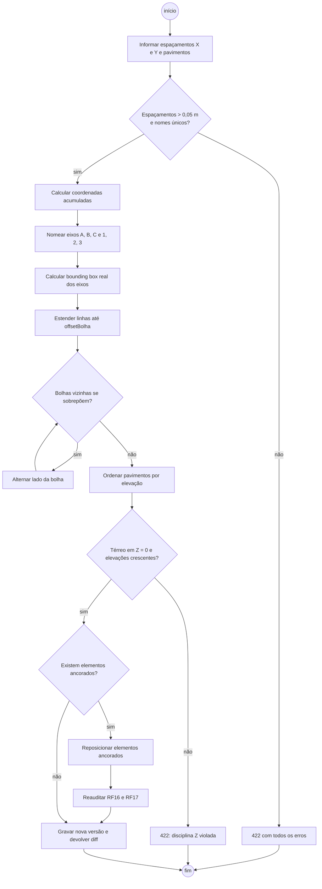
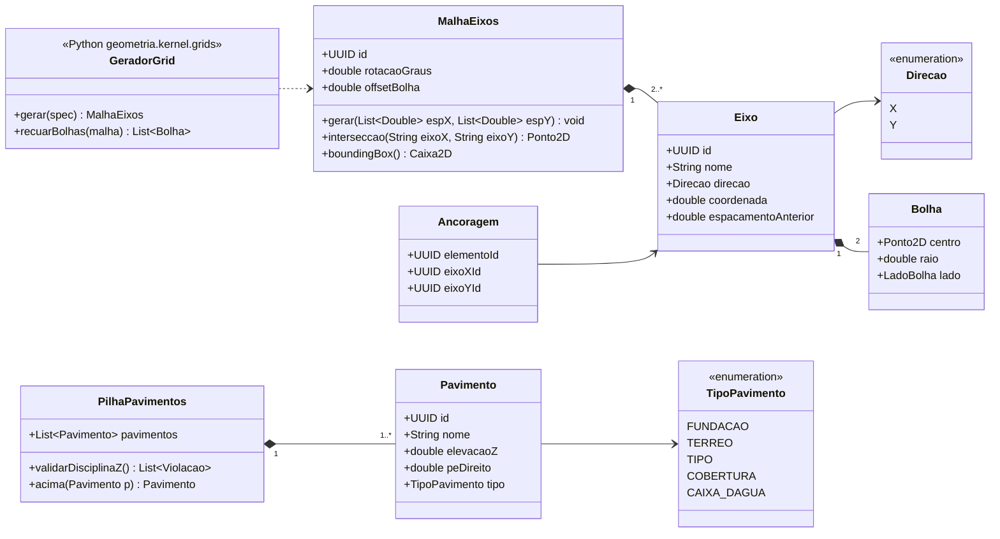
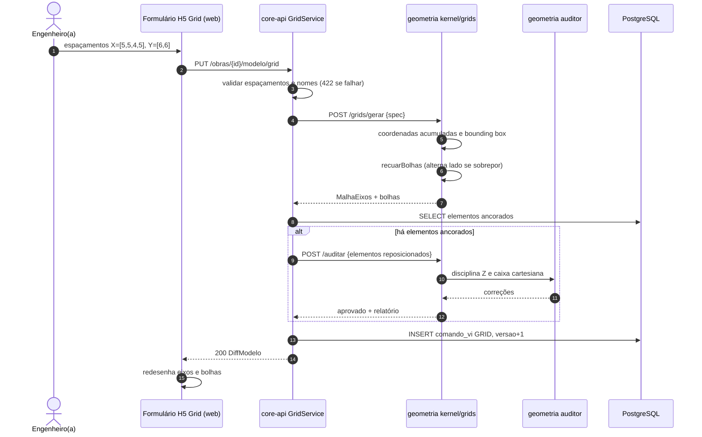
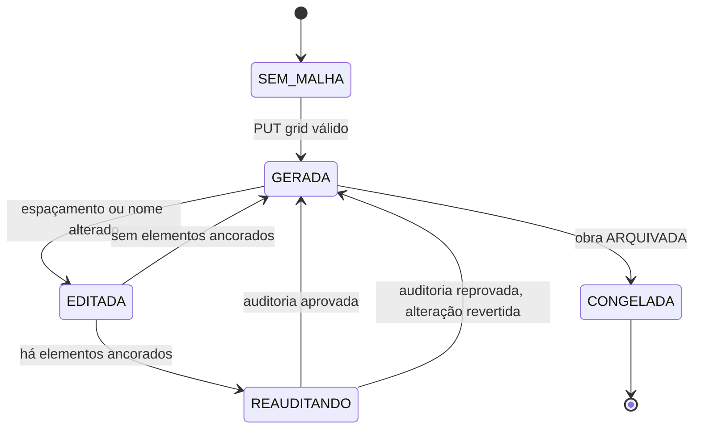
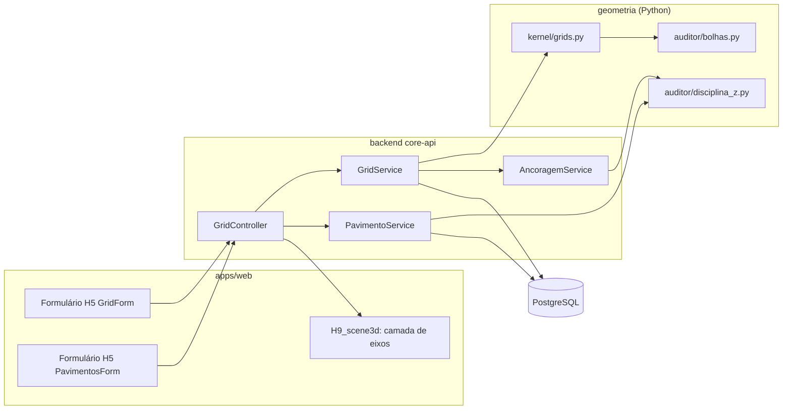

# RF03 · Geração automática de malhas de eixos (Grids) e pavimentos Z

> Gera a malha de eixos (ex.: 5x3 com espaçamentos por direção) e os pavimentos com elevação Z. É o esqueleto
> do modelo: pilares ancoram em interseções de eixos (RF04), elevações de pilares seguem os níveis (RF17) e as
> bolhas recuadas evitam sobreposição nas pranchas (RF14).

## 1. Descrição

O usuário informa, por formulário (H5) ou comando VI (`VI(GRID, x=[5,5,4,5], y=[6,6], rotulo_x=letras,
rotulo_y=numeros)` e `VI(PAVIMENTOS, n=4, pe_direito=3.0, terreo=0.0)`), os espaçamentos entre eixos em cada
direção e a pilha de pavimentos. O sistema:

1. Calcula as coordenadas acumuladas dos eixos a partir da origem (0, 0): x = [0, 5, 10, 14, 19].
2. Nomeia eixos verticais com letras (A, B, C…, AA após Z) e horizontais com números (1, 2, 3…), ou o inverso.
3. Cria pavimentos ordenados por elevação: Térreo em Z = 0,00, demais por pé-direito acumulado (aceita pé-direito
   diferente por pavimento, ex.: térreo comercial com 4,50 m).
4. Calcula a **extensão das linhas de eixo**: bounding box real dos eixos + recuo de bolha (`offsetBolha`,
   padrão 1,50 m) em cada ponta, sem extrapolar a estrutura (base do RF06).
5. Posiciona as **bolhas** no recuo, alternando lado quando duas bolhas vizinhas ficariam a menos de 2× o raio
   (eixos muito próximos), para não se sobreporem.

Alterar o espaçamento de um eixo depois de existirem elementos reposiciona tudo que está **ancorado** ao eixo
(pilares, vigas entre eixos) e dispara nova auditoria (RF16/RF17).

## 2. Atores

| Ator | Papel na obra | Pode |
|---|---|---|
| Arquiteto(a) | `ARQUITETO` | criar/editar malha e pavimentos |
| Engenheiro(a) responsável | `ENGENHEIRO` | criar/editar malha e pavimentos |
| Demais membros | outros | visualizar |
| Auditor Python | sistema | validar disciplina Z e recuo de bolhas |

## 3. Critérios de aceite

- [ ] **CA-01** Eixos nomeados sem duplicidade dentro de cada direção; nome editável manualmente, validado.
- [ ] **CA-02** Espaçamento > 0 e ≥ ShortCurveTolerance (0,05 m); lista vazia rejeitada (422 com todos os erros).
- [ ] **CA-03** Pavimentos ordenados por elevação estritamente crescente; Térreo com elevação 0,00 e
  `BASE_OFFSET = 0` (disciplina Z).
- [ ] **CA-04** Pé-direito por pavimento entre 2,20 m e 12,00 m; fora disso exige confirmação explícita.
- [ ] **CA-05** Alterar espaçamento de eixo reposiciona os elementos ancorados e reaudita; o diff mostra cada
  elemento movido.
- [ ] **CA-06** Bolhas recuadas `offsetBolha` além da última linha de estrutura e nunca sobrepostas entre si.
- [ ] **CA-07** Remover eixo com elementos ancorados exige escolha: remover também os elementos ou desancorar
  (422 se nenhuma for informada).
- [ ] **CA-08** Malha de até 30 × 30 eixos e 60 pavimentos gerada em menos de 1 s no serviço de geometria.

## 4. Regras de negócio

- **RN-01** Coordenada de eixo = soma acumulada dos espaçamentos (precisão de 1 mm, arredondamento meio-par).
- **RN-02** Malha pode ser rotacionada (ângulo em graus em relação ao norte de projeto); elementos ancorados
  giram junto.
- **RN-03** Pavimento tem `nome`, `elevacaoZ`, `peDireito` e `tipo` (`FUNDACAO`, `TERREO`, `TIPO`, `COBERTURA`,
  `CAIXA_DAGUA`); pavimento `FUNDACAO` pode ter elevação negativa, os demais não ficam abaixo do Térreo.
- **RN-04** Elevação do pavimento n+1 = elevação do n + pé-direito do n (salvo edição manual explícita).
- **RN-05** `offsetBolha` padrão 1,50 m, raio da bolha padrão 0,40 m na escala 1:100.

## 5. Base legal e normas

- NBR 6492 (representação de projetos de arquitetura): eixos, cotas de nível e nomenclatura de pavimentos.
- NBR 16752 (desenho técnico, pranchas): legibilidade de bolhas e cotas (RF14).
- LGPD: sem dados pessoais.

## 6. API

| Método e rota | Descrição | Respostas |
|---|---|---|
| `GET /api/v1/obras/{obraId}/modelo/grid` | Malha atual (eixos, coordenadas, bolhas) | 200, 404 |
| `PUT /api/v1/obras/{obraId}/modelo/grid` | Gera ou substitui a malha (`espacamentosX`, `espacamentosY`, `rotacao`, `offsetBolha`) | 200 + diff, 403, 404, 409, 422 |
| `PATCH /api/v1/obras/{obraId}/modelo/grid/eixos/{eixoId}` | Renomeia ou altera espaçamento de um eixo | 200 + diff, 409, 422 |
| `DELETE /api/v1/obras/{obraId}/modelo/grid/eixos/{eixoId}?elementos=remover\|desancorar` | Remove eixo | 200 + diff, 422 |
| `GET/PUT /api/v1/obras/{obraId}/modelo/pavimentos` | Lista ou substitui a pilha de pavimentos | 200, 403, 404, 409, 422 |

Todas as escritas viram `ComandoVI` (`GRID`, `PAVIMENTOS`) e passam pelo RF16.

## 7. Diagramas

### 7.1 Casos de uso

### 7.2 Atividades

### 7.3 Classes

### 7.4 Sequência

### 7.5 Máquina de estados (MalhaEixos)

### 7.6 Componentes

## 8. Testes previstos

| Tipo | Caso |
|---|---|
| Unitário (Python) | `gerar` com X=[5,5,4,5] produz coordenadas [0,5,10,14,19] |
| Unitário (Python) | nomeação após Z gera AA, AB… sem duplicidade |
| Unitário (Python) | eixos a 0,50 m de distância têm bolhas em lados alternados |
| Unitário (Java) | `PilhaPavimentos.validarDisciplinaZ` rejeita elevação fora de ordem e Térreo ≠ 0 |
| Integração `*IT` | alterar espaçamento do eixo B move os pilares ancorados em B e gera nova versão |
| Integração `*IT` | remover eixo com pilares sem informar `elementos` → 422 |

## 9. Rastreabilidade

| Camada | Artefato | Status |
|---|---|---|
| Documento | `docs/rf/RF03-grids-e-pavimentos.md` | ✅ |
| Card | [Trello 5aEYPZHD](https://trello.com/c/5aEYPZHD) | ✅ |
| Web | `apps/web/src/components/h/grid/GridForm.tsx`, `PavimentosForm.tsx` | ⏳ |
| API | `modelo/grid/GridService.java`, `modelo/pavimento/PavimentoService.java` | ⏳ |
| Banco | `V3__modelo_bim.sql` (eixo, pavimento, ancoragem) | ⏳ |
| Geometria | `geometria/kernel/grids.py`, `geometria/auditor/bolhas.py` | ⏳ |
| Testes | `test_grids.py`, `GridIT` | ⏳ |
