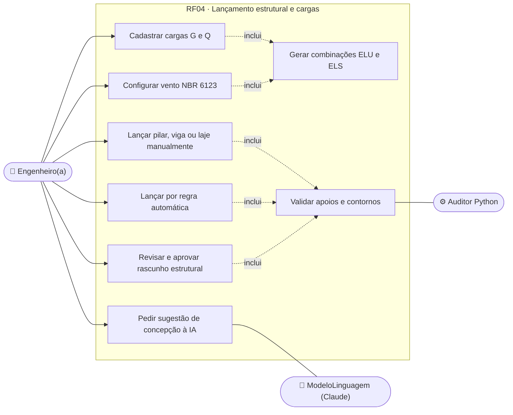
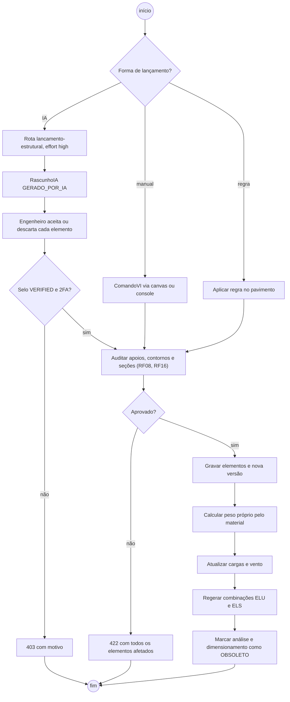
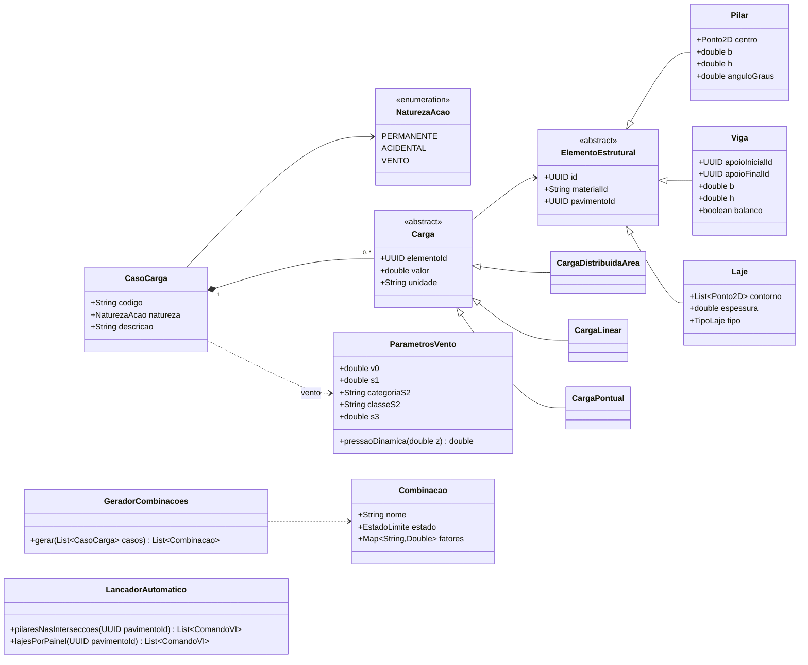
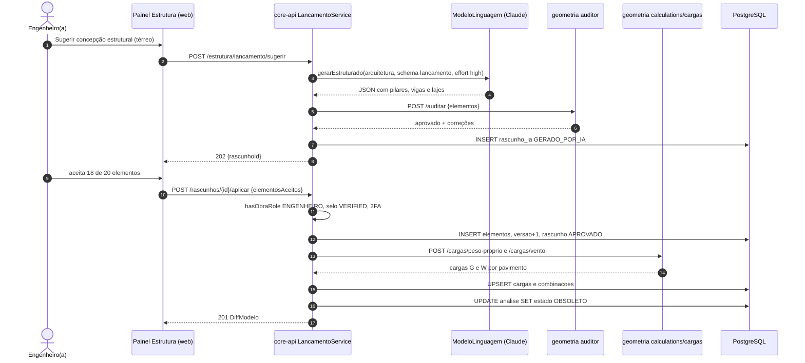
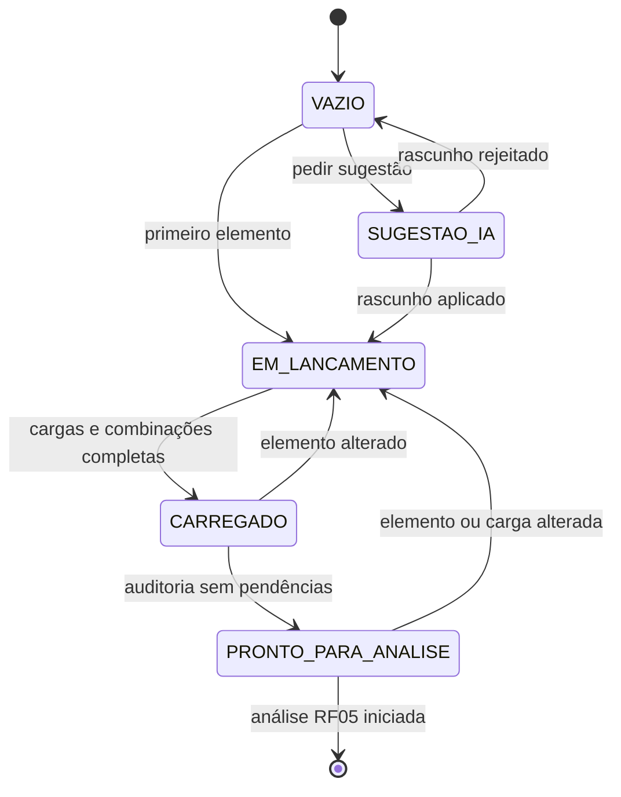
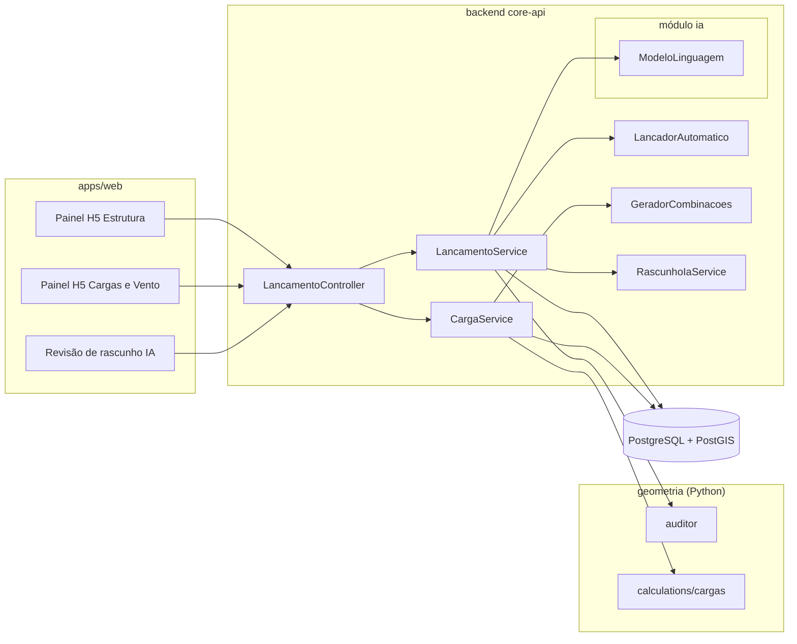

# RF04 · Lançamento de pilares, vigas, lajes e cargas (permanentes/vento)

> Monta o modelo estrutural sobre a malha de eixos (RF03): pilares nas interseções, vigas entre apoios, lajes por
> contorno fechado, e as ações — permanentes, acidentais e vento — com as combinações de cálculo. É a entrada do
> MEF (RF05).

## 1. Descrição

Três formas de lançar, todas convergindo para `ComandoVI` auditado:

1. **Manual** no canvas (RF01) ou console VI: `VI(PILAR, eixo=B2, b=0.20, h=0.40, mat=MAT_CONC_FCK30)`,
   `VI(VIGA, de=B2, ate=C2, b=0.15, h=0.50)`, `VI(LAJE, contorno=[B2,C2,C3,B3], h=0.12, tipo=MACICA)`.
2. **Automático por regra**: "pilar em todas as interseções do pavimento", "vigas sobre todas as paredes
   estruturais", "laje em cada painel fechado por vigas". Determinístico, sem IA.
3. **Sugestão por IA** (rota `lancamento-estrutural`, `effort: high`): a partir da arquitetura (paredes, vãos,
   aberturas), o modelo propõe a concepção estrutural em JSON (structured outputs). O resultado é um `RascunhoIA`
   que o engenheiro revisa elemento a elemento antes de aplicar.

**Cargas** (`CasoCarga`):

- **G — permanentes**: peso próprio calculado pelo volume × peso específico do material (Tabela A,
  `physicalProperties`); revestimento (kN/m²), alvenaria sobre viga (kN/m = γ × espessura × altura).
- **Q — acidentais**: por uso do ambiente conforme NBR 6120 (ex.: residencial dormitório 1,5 kN/m²; escritório
  2,5 kN/m²).
- **W — vento**: NBR 6123: V0 pela isopleta da localização da obra (PostGIS), S1 (topográfico), S2 (rugosidade,
  classe e altura), S3 (estatístico, grupo da edificação); pressão dinâmica q = 0,613·Vk² aplicada como forças
  nodais por pavimento em 0°, 90°, 180° e 270°.

As **combinações** seguem a NBR 8681/NBR 6118: ELU normais (γg = 1,4, γq = 1,4, ψ0 por ação) e ELS
(quase permanente com ψ2, frequente com ψ1), geradas automaticamente a partir dos casos existentes.

## 2. Atores

| Ator | Papel na obra | Pode |
|---|---|---|
| Engenheiro(a) responsável | `ENGENHEIRO` | lançar, editar, gerar combinações, aprovar sugestão da IA (com selo `VERIFIED`) |
| Arquiteto(a) | `ARQUITETO` | visualizar estrutura; não lança elementos estruturais (403) |
| Serviço de IA | sistema | sugerir concepção estrutural |
| Auditor Python | sistema | validar apoios, contornos e seções mínimas (RF08) |

## 3. Critérios de aceite

- [ ] **CA-01** Todo elemento estrutural referencia material da Tabela A (ex.: `MAT_CONC_FCK30`); sem material
  → `422 VI-010`.
- [ ] **CA-02** Viga só existe com os dois extremos apoiados em pilar, viga ou parede estrutural; balanço
  explícito (`balanco=true`) permite um extremo livre até 3,0 m.
- [ ] **CA-03** Laje com contorno fechado, sem auto-interseção, e todas as bordas apoiadas ou declaradas livres.
- [ ] **CA-04** Cargas sempre com unidade (kN/m², kN/m, kN) e caso (`G`, `Q`, `W0`, `W90`, `W180`, `W270`);
  valor negativo para gravitacional rejeitado.
- [ ] **CA-05** Combinações ELU e ELS geradas automaticamente e recalculadas quando um caso é criado/removido.
- [ ] **CA-06** Vento calculado com V0 obtido pela localização da obra; parâmetros S1, S2, S3 e categoria editáveis
  e registrados na memória.
- [ ] **CA-07** Sugestão da IA entra como `RascunhoIA` (`GERADO_POR_IA`); cada elemento pode ser aceito ou
  descartado; nada vira modelo sem aprovação do engenheiro.
- [ ] **CA-08** Qualquer alteração no lançamento marca a análise (RF05) e o dimensionamento (RF07/RF10) como
  `OBSOLETO`.

## 4. Regras de negócio

- **RN-01** Pilar lançado por regra automática usa seção padrão do projeto (padrão 20 × 40 cm), orientação pelo
  maior vão adjacente.
- **RN-02** Viga entre eixos herda ancoragem dos eixos (move quando o eixo muda, RF03).
- **RN-03** Peso próprio nunca é digitado: é derivado da geometria e do material (`fck`, γ = 25 kN/m³ para
  concreto armado).
- **RN-04** Carga de alvenaria só em viga ou laje; parede sem apoio estrutural gera alerta.
- **RN-05** Rota de IA envia somente geometria de arquitetura e uso dos ambientes, nunca dados de pessoas.
- **RN-06** Aprovar rascunho estrutural exige papel `ENGENHEIRO`, selo `VERIFIED` e 2FA ativo (RF21/RF27).

## 5. Base legal e normas

- NBR 6118:2023 (projeto de estruturas de concreto), NBR 6120:2019 (ações), NBR 6123 (vento),
  NBR 8681:2003 (ações e segurança), NBR 8800 (aço).
- Lei 6.496/1977 (ART): o lançamento aprovado é de responsabilidade do engenheiro com ART da obra.
- LGPD Art. 6º, III: contexto da IA sem dados pessoais.

## 6. API

| Método e rota | Descrição | Respostas |
|---|---|---|
| `POST /api/v1/obras/{obraId}/estrutura/lancamento/automatico` | Lança por regra (`regra`, `pavimentoId`) | 201 + diff, 403, 404, 422 |
| `POST /api/v1/obras/{obraId}/estrutura/lancamento/sugerir` | Sugestão por IA → `RascunhoIA` | 202, 403, 429 |
| `POST /api/v1/obras/{obraId}/estrutura/lancamento/rascunhos/{id}/aplicar` | Aplica elementos aceitos (`elementosAceitos[]`) | 201 + diff, 403, 409, 422 |
| `GET/POST /api/v1/obras/{obraId}/estrutura/cargas` | Lista/cria cargas | 200, 201, 422 |
| `PUT /api/v1/obras/{obraId}/estrutura/vento` | Parâmetros de vento (V0, S1, S2, S3) | 200, 422 |
| `GET /api/v1/obras/{obraId}/estrutura/combinacoes` | Combinações ELU/ELS geradas | 200 |

## 7. Diagramas

### 7.1 Casos de uso

### 7.2 Atividades

### 7.3 Classes

### 7.4 Sequência

### 7.5 Máquina de estados (LancamentoEstrutural do pavimento)

### 7.6 Componentes

## 8. Testes previstos

| Tipo | Caso |
|---|---|
| Unitário (Java) | `GeradorCombinacoes` com G, Q, W0, W90 gera as combinações ELU e ELS esperadas (tabela de referência) |
| Unitário (Python) | peso próprio de viga 15 × 50 × 5 m em concreto = 9,375 kN |
| Unitário (Python) | pressão dinâmica para V0 = 40 m/s, S1 = 1, S2 cat. IV classe B a 10 m, S3 = 1 |
| Integração `*IT` | viga sem apoio no extremo → 422 com o id da viga |
| Integração `*IT` | aplicar rascunho com engenheiro sem selo `VERIFIED` → 403 `selo_nao_verificado` |
| Integração `*IT` | alterar pilar marca análise existente como `OBSOLETO` |

## 9. Rastreabilidade

| Camada | Artefato | Status |
|---|---|---|
| Documento | `docs/rf/RF04-lancamento-elementos-e-cargas.md` | ✅ |
| Card | [Trello WOIUHFDD](https://trello.com/c/WOIUHFDD) | ✅ |
| Web | `apps/web/src/components/h/estrutura/` | ⏳ |
| API | `cca-web/api/estrutura/EstruturaController.java` (`/estrutura/cargas`, `/vento/{pav}`, `/combinacoes`, `/lancamentos`, `/lancamento/sugerir|rascunhos`), `cca-application/estrutura/CargasService.java`, `LancadorAutomatico.java` (rota `LANCAMENTO_ESTRUTURAL`, rascunho gated por `podeAprovar`) | ✅ |
| IA | prompt e JSON Schema fixos em `LancadorAutomatico.SYSTEM`/`SCHEMA`; validação determinística das seções mínimas antes de virar `RascunhoLancamento` | ✅ |
| Banco | `V9__estrutura.sql` (carga, lancamento_estrutural, rascunho_lancamento; RLS via `app_aplicar_rls`) | ✅ |
| Geometria | `geometria/calculations/cargas/` | ⏳ |
| Testes | `GeradorCombinacoesTest` (NBR 8681/6123), `AnaliseIT` (lançamento de carga, combinações, 422 em carga inválida), `test_vento.py` | ✅ backend · ⏳ python |