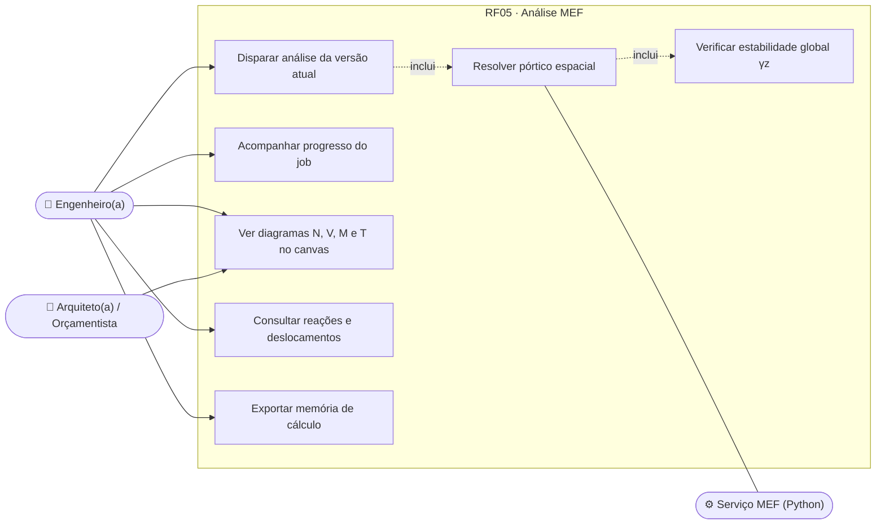
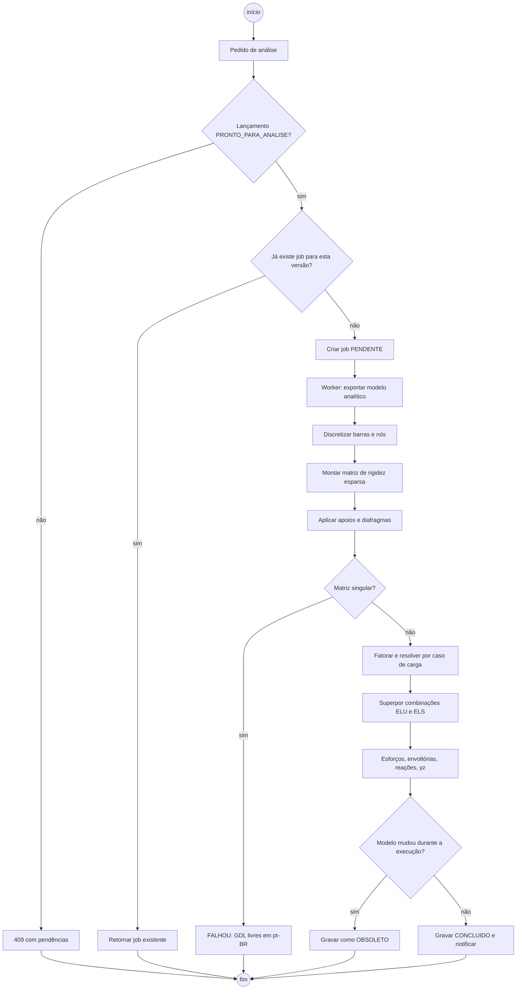
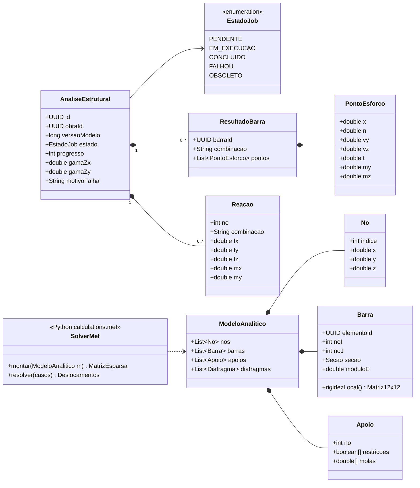
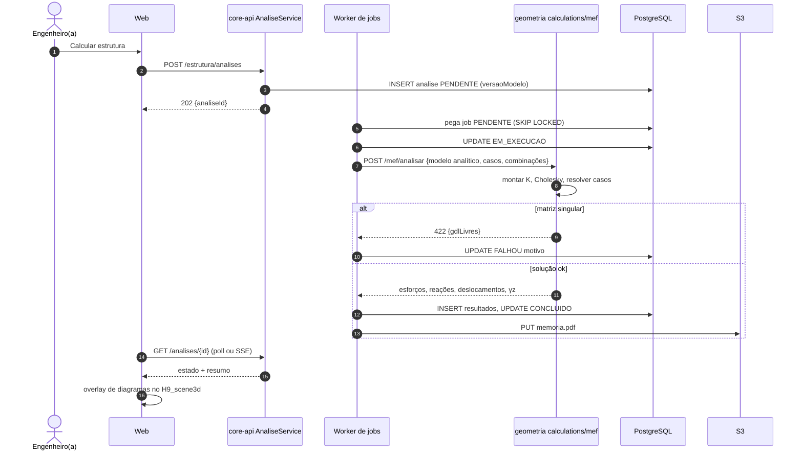
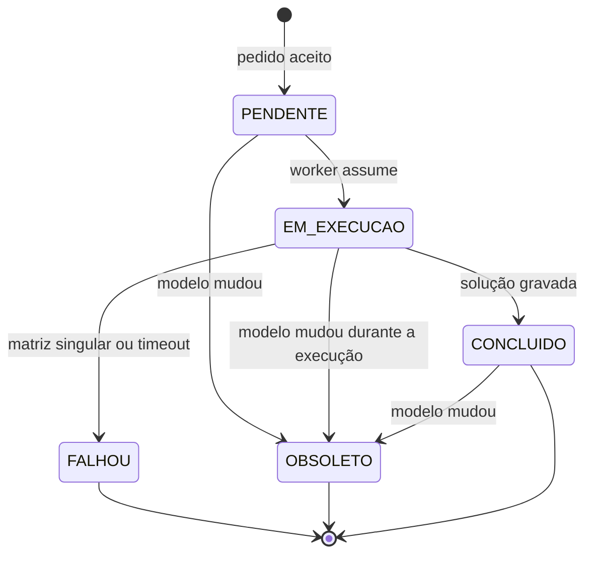
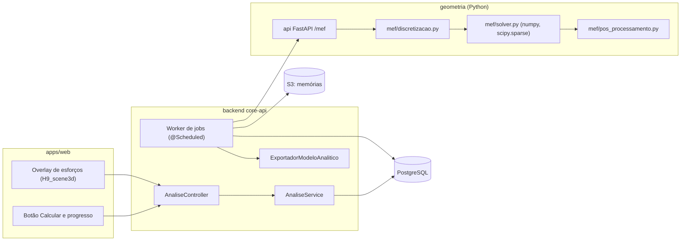

# RF05 · Cálculo de diagramas de momentos, cortantes, normais e torção (MEF)

> Converte o modelo estrutural lançado (RF04) em um **pórtico espacial** de barras 3D e resolve pelo Método dos
> Elementos Finitos (rigidez direta), devolvendo esforços N, Vy, Vz, T, My, Mz por barra e por combinação,
> deslocamentos nodais e reações de apoio (entrada do RF07 e do RF10).

## 1. Descrição

O cálculo roda no serviço `geometria` (Python, `calculations/mef`) como **job assíncrono** disparado pelo
core-api. Etapas:

1. **Discretização**: cada pilar e viga vira barra entre nós; nós nas interseções e nos pontos de carga
   concentrada; vigas subdivididas em no máximo 0,50 m para traçado dos diagramas. Lajes entram como
   **diafragma rígido** por pavimento (nó mestre com 3 GDL no plano) e suas cargas são distribuídas às vigas
   pelas charneiras plásticas / áreas de influência (NBR 6118, 14.7.6).
2. **Propriedades**: E = Ecs do material (Tabela A, `fck` → Eci = 5600·√fck MPa, Ecs = αi·Eci), seções
   retangulares (A, Iy, Iz, J); não linearidade física simplificada (NBR 6118, 15.7.3: 0,4EI vigas, 0,8EI pilares)
   para ELU global.
3. **Montagem e solução**: matriz de rigidez local 12×12 por barra, rotação para o sistema global, montagem
   esparsa (`scipy.sparse`), aplicação de apoios (engaste na fundação por padrão; mola quando RF10 informar),
   solução `K·u = F` por caso de carga (fatoração Cholesky reutilizada para todos os casos) e superposição nas
   combinações (RF04).
4. **Pós-processamento**: esforços nas extremidades e pontos intermediários, envoltórias por barra, reações,
   deslocamentos; parâmetro γz (estabilidade global) por direção de vento.

Resultado gravado por **versão do modelo**: se o modelo muda, a análise fica `OBSOLETO` e o canvas mostra o
aviso. Os diagramas são exibidos como overlay no canvas 3D (RF13), com valores máximos rotulados.

## 2. Atores

| Ator | Papel na obra | Pode |
|---|---|---|
| Engenheiro(a) responsável | `ENGENHEIRO` | disparar análise, ver resultados, exportar memória |
| Arquiteto(a), Orçamentista | `ARQUITETO`, `ORCAMENTISTA` | ver resultado resumido |
| Serviço de cálculo | sistema (`geometria`) | executar o MEF |

## 3. Critérios de aceite

- [ ] **CA-01** Análise é job assíncrono (`PENDENTE → EM_EXECUCAO → CONCLUIDO/FALHOU`) com progresso consultável
  e notificação ao concluir.
- [ ] **CA-02** Resultado vinculado à versão do modelo; mudança no modelo marca `OBSOLETO` e o canvas avisa.
- [ ] **CA-03** Estrutura hipostática ou mecanismo (matriz singular ou pivô ≤ 1e-12·max) → `FALHOU` com mensagem
  em pt-BR indicando os nós/GDL livres; nenhum resultado parcial é gravado.
- [ ] **CA-04** Casos de referência com erro < 1 %: viga biapoiada com carga distribuída (M = qL²/8), viga
  engastada com carga pontual, pórtico plano de um vão (resultado de literatura), treliça espacial.
- [ ] **CA-05** Diagramas N, V, M e T por barra e combinação; envoltória com máximos destacados (cor + valor +
  ícone).
- [ ] **CA-06** Reações de apoio por combinação disponíveis para RF10; esforços por seção disponíveis para RF07.
- [ ] **CA-07** γz calculado por direção; γz > 1,3 gera alerta "estrutura de nós móveis, revisar".
- [ ] **CA-08** Modelo com 2.000 barras e 20 combinações resolve em menos de 30 s no hardware de referência.

## 4. Regras de negócio

- **RN-01** Unidades internas: kN, m, kN·m. Convenção de sinais: tração positiva; momentos pela regra da mão
  direita no sistema local da barra.
- **RN-02** Só uma análise `EM_EXECUCAO` por obra; novo pedido com a mesma versão retorna o job existente
  (idempotente).
- **RN-03** Análise só começa se o lançamento estiver `PRONTO_PARA_ANALISE` (RF04) e a auditoria sem pendências.
- **RN-04** Timeout do job: 10 min; acima disso `FALHOU` com motivo "tempo excedido".
- **RN-05** Sem IA neste RF: o cálculo é determinístico e reprodutível.

## 5. Base legal e normas

- NBR 6118:2023: análise estrutural (cap. 14), estabilidade global e γz (cap. 15), não linearidade física.
- NBR 8681: combinações das ações. NBR 6123: forças de vento.
- Responsabilidade técnica (Lei 6.496/1977): resultado é apoio ao cálculo; a memória assinada é do engenheiro.

## 6. API

| Método e rota | Descrição | Respostas |
|---|---|---|
| `POST /api/v1/obras/{obraId}/estrutura/analises` | Dispara análise da versão atual | 202 `{analiseId}`, 403, 404, 409 (lançamento incompleto) |
| `GET /api/v1/obras/{obraId}/estrutura/analises/{id}` | Estado, progresso e resumo (γz, máximos) | 200, 404 |
| `GET /api/v1/obras/{obraId}/estrutura/analises/{id}/barras/{barraId}?combinacao=` | Diagramas da barra | 200, 404 |
| `GET /api/v1/obras/{obraId}/estrutura/analises/{id}/reacoes` | Reações por apoio e combinação | 200 |
| `GET /api/v1/obras/{obraId}/estrutura/analises/{id}/memoria.pdf` | Memória de cálculo (URL pré-assinada) | 302, 404 |
| interno `POST geometria:/mef/analisar` | Executa o MEF (chamado pelo worker) | 200, 422 |

## 7. Diagramas

### 7.1 Casos de uso

### 7.2 Atividades

### 7.3 Classes

### 7.4 Sequência

### 7.5 Máquina de estados (AnaliseEstrutural)

### 7.6 Componentes

## 8. Testes previstos

| Tipo | Caso |
|---|---|
| Unitário (Python) | viga biapoiada L = 6 m, q = 10 kN/m → Mmáx = 45 kN·m, V = 30 kN (erro < 1 %) |
| Unitário (Python) | balanço L = 3 m, P = 20 kN → M engaste = 60 kN·m, flecha = PL³/3EI |
| Unitário (Python) | pórtico plano de referência (literatura) com momentos nos nós |
| Unitário (Python) | estrutura sem apoio → exceção `EstruturaHipostatica` com GDL livres |
| Integração `*IT` | disparar duas vezes na mesma versão retorna o mesmo `analiseId` |
| Integração `*IT` | alterar pilar durante `EM_EXECUCAO` → resultado gravado como `OBSOLETO` |
| Desempenho | 2.000 barras e 20 combinações < 30 s |

## 9. Rastreabilidade

| Camada | Artefato | Status |
|---|---|---|
| Documento | `docs/rf/RF05-diagramas-esforcos-mef.md` | ✅ |
| Card | [Trello mNjp8fP4](https://trello.com/c/mNjp8fP4) | ✅ |
| Web | `apps/web/src/canvas/overlays/esforcos/` | ⏳ |
| API | `cca-web/api/estrutura/AnaliseController.java` (`POST /analises` → 202, `GET /analises/{id}`, `/diagramas`), `cca-application/estrutura/AnaliseService.java` | ✅ |
| Banco | `V11__analise_estrutural.sql` (analise_estrutural com resultado/resumo JSON, estado `EstadoJob`) | ✅ |
| Geometria | solver em Java: `cca-domain/estrutura/mef/SolverMef.java` (pórtico espacial 12×12, Gauss com pivotamento, singular → `EstruturaHipostaticaException`), `MontadorModeloAnalitico.java`; `geometria/calculations/mef/` fica como alternativa futura | ✅ Java · ⏳ python |
| Testes | `SolverMefTest` (viga biapoiada qL²/8 e 5qL⁴/384EI, pórtico plano, hipostática), `AnaliseIT` (job → CONCLUIDO; viga solta → FALHOU) | ✅ |

## Auditoria 2026-10

Auditoria pelo uso real do app ([relatório](../auditoria/AUDITORIA_2026-10.md)). Nota (conclusão 30%, precisão 25%, clareza
20%, feedback 15%, consistência/acessibilidade 10%): **7,2 → 8,6**.

- **Corrigido:** RN-03 aplicada: análise exige lançamento `PRONTO_PARA_ANALISE` (422 com o pavimento que falta); equilíbrio conferido na jornada (ΣRz = 1,4·ΣG).
- **Evidência:** j2 equilíbrio ΣRz = 1,4·ΣG; SolverMefTest.
- **Pendente:** Este doc descreve o MEF num serviço Python; o cálculo roda em Java (`cca-domain/estrutura/mef`).

## Auditoria 2026-10 · 2ª rodada

Estrutura, materiais e conformidade ([relatório](../auditoria/AUDITORIA_2026-10_ESTRUTURA_INSTALACOES_MATERIAIS.md)).

- **Corrigido (falha crítica):** inércia do pilar trocada entre X e Y; laje repartida pelas charneiras a 45° quando retangular e apoiada; carga concentrada na posição; contraventamento como treliça; equilíbrio global obrigatório (resíduo ≤ 1e-6); avisos de exclusão, aproximação e premissa (inclusive extremidade livre de viga analisada como balanço); metadados com natureza CALCULADO, método, hipóteses, unidades e convenção; base de cálculo gravada; rótulos automáticos iguais aos do BIM (antes todos os pilares apareciam como "P-01a174"); tela com grandeza, unidade, combinação, convenção, extremos, equilíbrio e deformada amplificada.
- **Evidência:** 13 casos de referência calculados à mão; j5.
- **Pendente:** 2ª ordem global, lajes como placas, vento além de +X.
