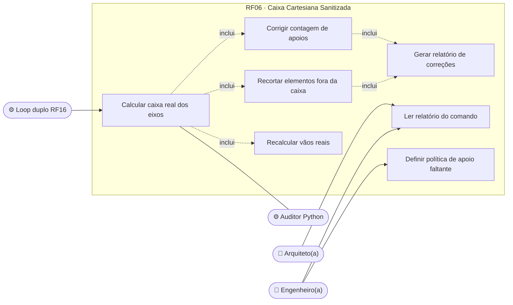
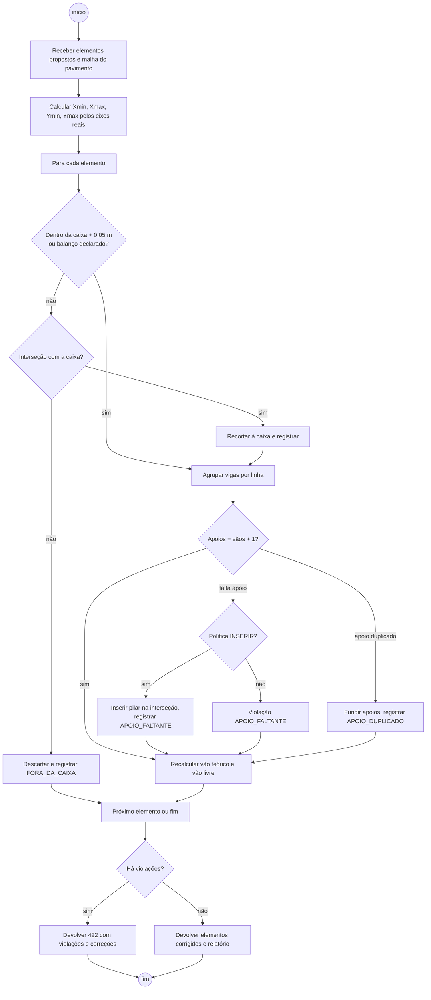
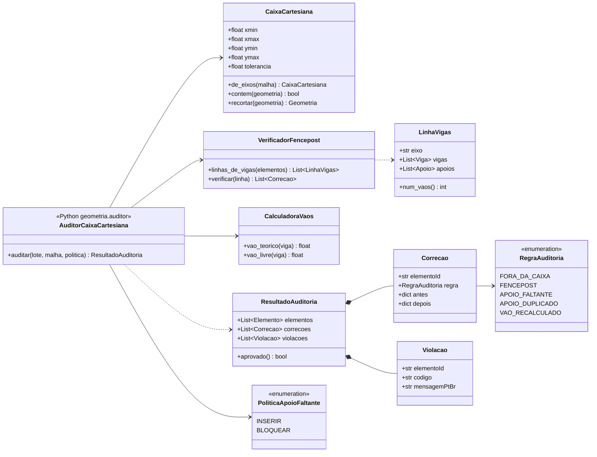
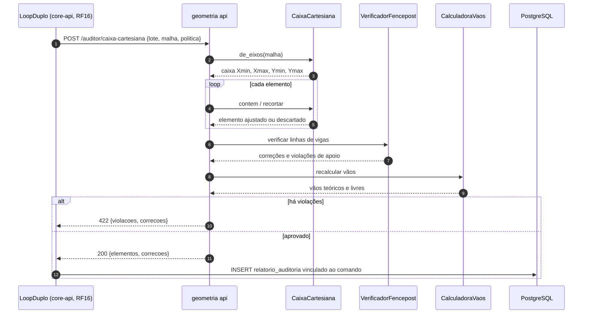
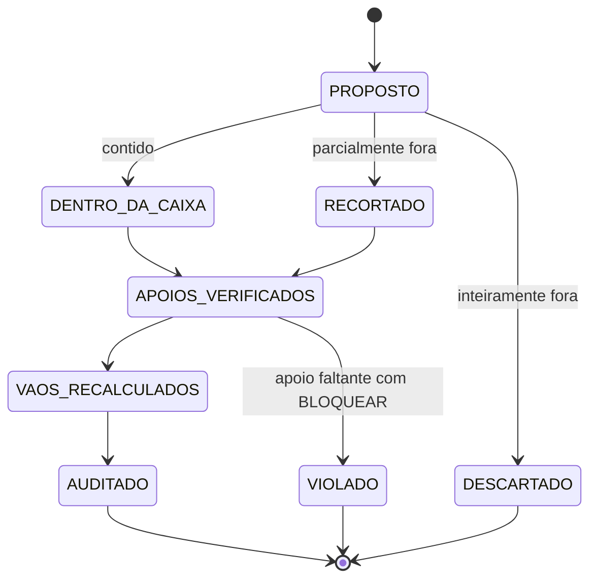
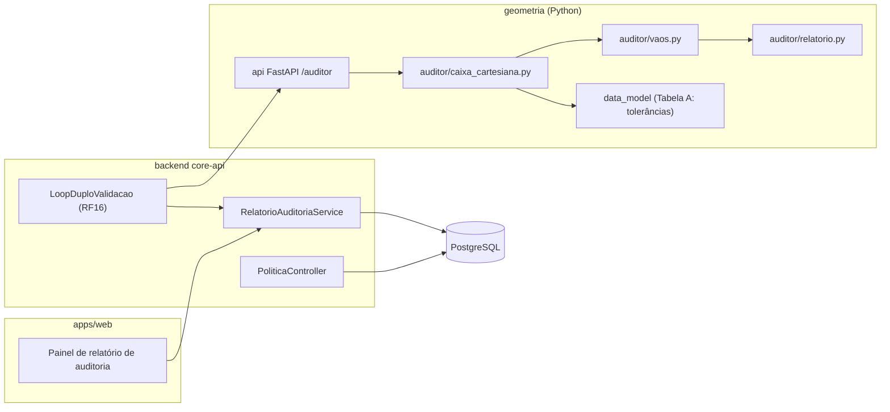

# RF06 · Auditoria de vãos reais corrigindo o Fencepost Error

> **Caixa Cartesiana Sanitizada**: o auditor ignora o perímetro que a IA (ou o usuário) propôs e recalcula vãos
> e envoltória pelas extremidades reais (Xmin, Xmax, Ymin, Ymax) dos eixos e apoios, corrigindo o **erro do poste
> e cerca** (n vãos exigem n + 1 apoios) e a extrapolação de elementos além da estrutura.

## 1. Descrição

Nos testes experimentais das Diretrizes (seção 5), a geração não supervisionada extrapolou a estrutura em 4 m numa
malha 4x4: o LLM somou "4 vãos de 4 m = 16 m" a partir do primeiro eixo e lançou um quinto vão, ou contou
4 pilares para 4 vãos. O auditor corrige isso de forma determinística, no serviço Python
(`geometria/auditor/caixa_cartesiana.py`), sempre dentro do loop duplo (RF16):

1. **Caixa de referência**: calcula a bounding box real a partir das coordenadas dos eixos (RF03) e dos apoios
   existentes — nunca do perímetro informado no comando. `Xmin = min(eixos X)`, `Xmax = max(eixos X)`, idem Y.
2. **Recorte**: todo elemento proposto cuja geometria ultrapasse a caixa (+ tolerância de 0,05 m e marquises
   explicitamente declaradas como `balanco`) é **recortado** à caixa ou **descartado** se ficar inteiramente fora.
3. **Contagem de apoios**: para uma linha de vigas com n vãos, exige n + 1 apoios nas coordenadas dos eixos.
   Apoio faltante é inserido (pilar na interseção) se a regra do projeto permitir, senão vira violação; apoio
   duplicado (dois pilares a < 0,05 m) é fundido.
4. **Vãos reais**: recalcula o comprimento de cada viga e laje pela distância entre faces de apoio
   (vão livre) e entre eixos (vão teórico, NBR 6118 14.6.2.4), substituindo valores informados pela IA.
5. **Relatório**: cada correção é registrada (`antes`, `depois`, regra, elemento), vinculada ao `ComandoVI` e
   exibida ao engenheiro.

A auditoria é **idempotente**: aplicada a um resultado já auditado, não gera correções.

## 2. Atores

| Ator | Papel na obra | Pode |
|---|---|---|
| Auditor Python | sistema | executar a caixa cartesiana e corrigir |
| Engenheiro(a) responsável | `ENGENHEIRO` | ler o relatório, configurar se apoios faltantes são inseridos ou bloqueiam |
| Arquiteto(a) | `ARQUITETO` | ler o relatório dos seus comandos |

## 3. Critérios de aceite

- [ ] **CA-01** Nenhum elemento fica além da bounding box real da malha (exceto balanços declarados); caso de
  teste: comando da IA com extrapolação de 4 m em malha 4x4 é recortado à caixa.
- [ ] **CA-02** Em toda linha de vigas, número de apoios = número de vãos + 1, em cada direção.
- [ ] **CA-03** Vão teórico e vão livre recalculados a partir da geometria; valor de vão vindo da IA é ignorado.
- [ ] **CA-04** Relatório lista cada correção com antes/depois, regra (`FENCEPOST`, `FORA_DA_CAIXA`,
  `APOIO_DUPLICADO`, `APOIO_FALTANTE`) e fica vinculado ao comando VI.
- [ ] **CA-05** Idempotência: auditar duas vezes produz o mesmo modelo e relatório vazio na segunda.
- [ ] **CA-06** Apoio faltante com política `BLOQUEAR` gera violação `422`; com política `INSERIR` insere pilar
  padrão e registra a correção.
- [ ] **CA-07** Auditoria de malha 30x30 com 900 pilares em menos de 500 ms.

## 4. Regras de negócio

- **RN-01** A caixa é calculada por pavimento; pavimentos com projeção diferente (ex.: cobertura menor)
  usam os eixos ativos daquele pavimento.
- **RN-02** Balanço/marquise só passa da caixa se declarado (`balanco=true`) e até 3,0 m (marquises escalonadas de
  1,0 m a 2,0 m dos testes de estresse passam).
- **RN-03** Tolerância de coincidência = ShortCurveTolerance (0,05 m, Tabela A `geometricConstraints`).
- **RN-04** Política de apoio faltante por obra: `INSERIR` (padrão para comandos de IA) ou `BLOQUEAR`.
- **RN-05** O auditor não chama IA; as correções voltam ao LLM apenas como texto de erro no RF16.

## 5. Base legal e normas

- NBR 6118:2023, 14.6.2.4 (vão efetivo de vigas) e 14.7.2 (vãos de lajes).
- Responsabilidade técnica: correções automáticas são informadas ao engenheiro, que aprova o modelo.
- LGPD: sem dados pessoais.

## 6. API

| Método e rota | Descrição | Respostas |
|---|---|---|
| interno `POST geometria:/auditor/caixa-cartesiana` | Audita lote de elementos contra a malha | 200 `{elementos, correcoes, violacoes}`, 422 |
| `GET /api/v1/obras/{obraId}/modelo/comandos/{id}/auditoria` | Relatório de auditoria do comando | 200, 404 |
| `PUT /api/v1/obras/{obraId}/modelo/politicas/apoio-faltante` | `INSERIR` ou `BLOQUEAR` | 200, 403, 422 |

## 7. Diagramas

### 7.1 Casos de uso

### 7.2 Atividades

### 7.3 Classes

### 7.4 Sequência

### 7.5 Máquina de estados (ElementoProposto na auditoria)

### 7.6 Componentes

## 8. Testes previstos

| Tipo | Caso |
|---|---|
| Unitário (Python) | malha 4x4 de 4 m com viga proposta até x = 20 m → recortada a x = 16 m, correção `FORA_DA_CAIXA` |
| Unitário (Python) | linha de 4 vãos com 4 pilares → insere o 5º pilar (`INSERIR`) ou violação (`BLOQUEAR`) |
| Unitário (Python) | dois pilares a 0,02 m → fundidos (`APOIO_DUPLICADO`) |
| Unitário (Python) | idempotência: `auditar(auditar(x)) == auditar(x)` com relatório vazio (teste por propriedade, Hypothesis) |
| Unitário (Python) | marquise escalonada de 1,5 m declarada como balanço passa sem recorte |
| Integração `*IT` | comando de IA com extrapolação gera relatório consultável em `/comandos/{id}/auditoria` |
| Desempenho | malha 30x30 com 900 pilares < 500 ms |

## 9. Rastreabilidade

| Camada | Artefato | Status |
|---|---|---|
| Documento | `docs/rf/RF06-auditoria-vaos-fencepost.md` | ✅ |
| Card | [Trello OGjcAg5E](https://trello.com/c/OGjcAg5E) | ✅ |
| Geometria | `geometria/auditor/caixa_cartesiana.py`, `vaos.py`, `relatorio.py` | ⏳ |
| API | `modelo/auditoria/RelatorioAuditoriaService.java` | ⏳ |
| Banco | `V7__modelo_bim.sql` (relatorio_auditoria, correcao_auditoria) | ⏳ |
| Web | painel de relatório em `apps/web/src/components/h/auditoria/` | ⏳ |
| Testes | `test_caixa_cartesiana.py`, `test_fencepost.py`, `AuditoriaComandoIT` | ⏳ |
