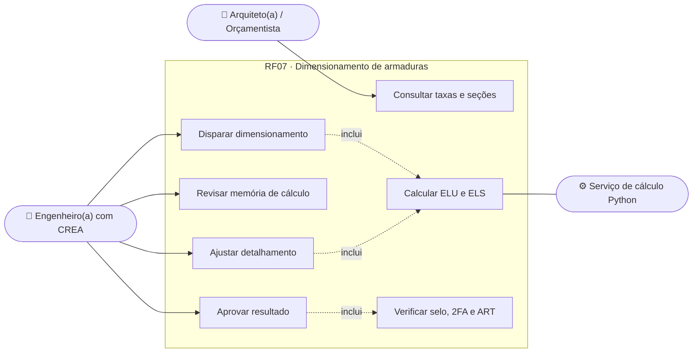
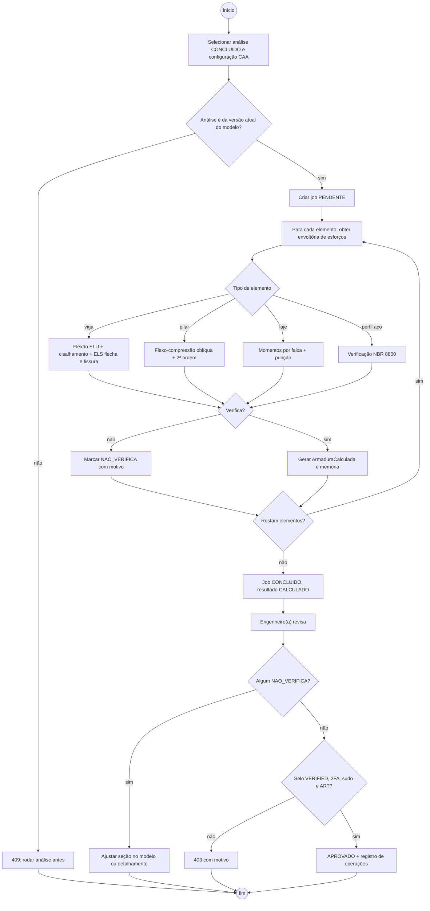
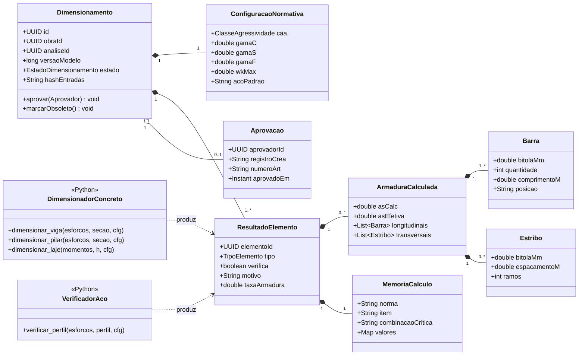
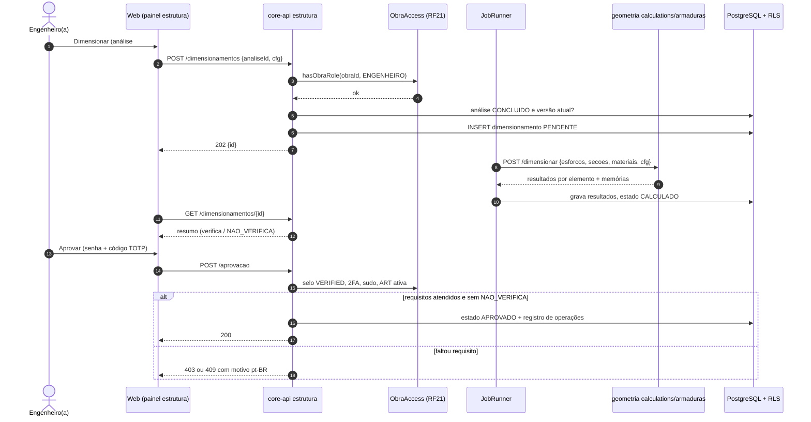
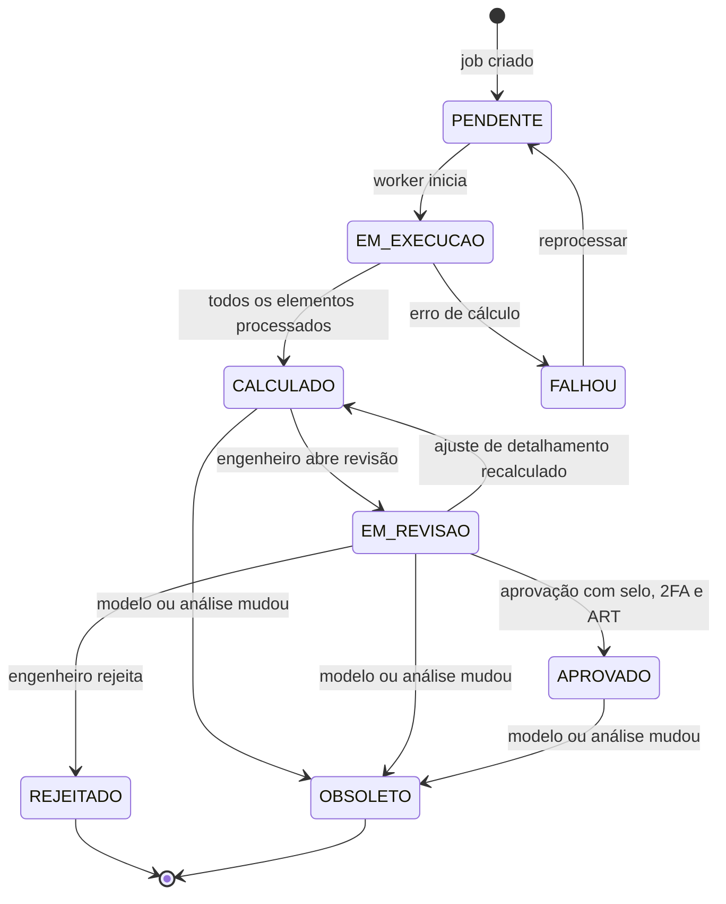
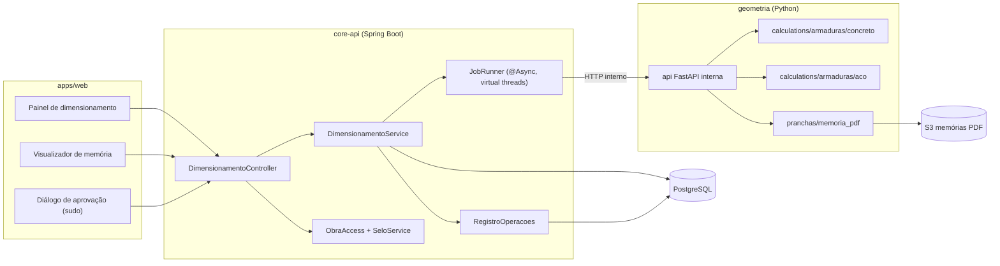

# RF07 · Dimensionamento de armaduras (ELU/ELS) em concreto/aço

> A partir dos esforços da análise MEF (RF05), o sistema dimensiona as armaduras de vigas, pilares e lajes de
> concreto armado (NBR 6118) e verifica perfis de aço (NBR 8800). O resultado é um **rascunho com memória de
> cálculo** que só vale depois de aprovado por engenheiro(a) com CREA verificado, 2FA e ART da obra.

## 1. Descrição

O dimensionamento roda como **job assíncrono** no serviço `geometria/calculations/armaduras/`, consumindo a
`AnaliseEstrutural` concluída de uma versão do modelo e as combinações ELU/ELS geradas no RF04. Para cada
elemento:

- **Vigas**: flexão simples no ELU (domínios 2 e 3, linha neutra limitada a x/d ≤ 0,45 para fck ≤ 50 MPa),
  cisalhamento pelo Modelo de Cálculo I (verificação da biela VRd2 e armadura transversal Asw/s), ancoragem e
  decalagem do diagrama; ELS de flecha (Branson, com fluência αf) e de abertura de fissuras (wk ≤ 0,3 mm para
  CAA II).
- **Pilares**: flexo-compressão oblíqua com efeitos de 2ª ordem locais (pilar-padrão com curvatura aproximada
  para λ ≤ 90), excentricidade mínima de 1ª ordem e verificação da armadura por envoltória de interação.
- **Lajes**: momentos por faixa (resultado da malha MEF de placa ou tabelas de Bares/Czerny quando a laje é
  armada em cruz e retangular), armadura positiva e negativa por metro, verificação de punção nos apoios em
  pilar quando lisa.
- **Perfis de aço**: verificação de esforço axial, flexão (FLA, FLM, FLT) e cortante pela NBR 8800 (razão de
  utilização ≤ 1,0).

A saída por elemento é uma `ArmaduraCalculada` (bitolas, quantidades, espaçamentos, comprimentos, As,calc e
As,ef) e uma `MemoriaCalculo` com norma, item e coeficientes aplicados (γc = 1,4, γs = 1,15, γf = 1,4 por
padrão, configuráveis só para combinações especiais). Elementos que não verificam ficam `NAO_VERIFICA` com o
motivo (ex.: "VRd2 excedido: aumentar seção da viga V12").

## 2. Atores

| Ator | Papel na obra | Pode |
|---|---|---|
| Engenheiro(a) responsável | `ENGENHEIRO` (selo `VERIFIED` + 2FA + ART) | disparar, revisar, ajustar detalhamento e aprovar |
| Engenheiro(a) sem selo verificado | `ENGENHEIRO` (selo ≠ `VERIFIED`) | disparar e revisar; **não aprova** |
| Arquiteto(a), Orçamentista | `ARQUITETO`, `ORCAMENTISTA` | ver resultado aprovado (seções e taxas) |
| Serviço de cálculo | sistema (`geometria`) | executar o dimensionamento |

## 3. Critérios de aceite

- [ ] **CA-01** O dimensionamento só inicia sobre uma `AnaliseEstrutural` `CONCLUIDO` da mesma versão do modelo;
  caso contrário `409` com "Rode a análise estrutural da versão atual antes de dimensionar".
- [ ] **CA-02** Cada elemento tem memória de cálculo com norma, item (ex.: "NBR 6118:2023 · 17.3.5.2.1"),
  coeficientes γc, γs, γf, combinação crítica e valores intermediários (Md, x/d, As,calc).
- [ ] **CA-03** Armadura mínima (ρmin da Tabela 17.3) e máxima (4 % de Ac fora da emenda) respeitadas; espaçamento
  máximo e mínimo entre barras verificado.
- [ ] **CA-04** Elemento que não verifica fica `NAO_VERIFICA` com motivo em pt-BR e sugestão de ação; o lote
  inteiro não pode ser aprovado enquanto houver `NAO_VERIFICA`.
- [ ] **CA-05** O resultado nasce como rascunho (`GERADO_POR_IA` quando a IA sugeriu o detalhamento, senão
  `CALCULADO`) e só passa a `APROVADO` por engenheiro(a) com selo `VERIFIED`, 2FA na sessão, modo sudo e ART
  ativa na obra; a aprovação vai para o registro de operações.
- [ ] **CA-06** Qualquer mudança na versão do modelo ou na análise marca o dimensionamento como `OBSOLETO`;
  pranchas (RF14) e quantitativos (RF11) mostram aviso.
- [ ] **CA-07** Casos de referência (viga biapoiada fck 30, pilar intermediário 20x40, laje 4x5 m) batem com o
  cálculo manual com erro ≤ 1 % em As.
- [ ] **CA-08** Ajuste manual de detalhamento (troca de bitola) é revalidado; não é possível reduzir As,ef
  abaixo de As,calc.

## 4. Regras de negócio

- **RN-01** Classe de agressividade ambiental (CAA) definida por obra; define cobrimento nominal e fck mínimo
  (NBR 6118 Tab. 6.1 e 7.2). fck do material da Tabela A abaixo do mínimo da CAA bloqueia o cálculo.
- **RN-02** Bitolas comerciais de aço CA-50/CA-60 (5,0 a 32 mm); peso linear usado no RF11.
- **RN-03** Pilares com λ > 90 exigem método do pilar-padrão com rigidez κ aproximada; λ > 140 é bloqueado.
- **RN-04** O cálculo é determinístico: mesma versão do modelo + mesma configuração = mesmo resultado (hash
  das entradas guardado).
- **RN-05** A IA pode **sugerir** detalhamento (arranjo de barras) via structured outputs, mas os valores de
  As e as verificações são sempre recalculados pelo código Python; a sugestão nunca dispensa a verificação.

## 5. Base legal e normas

- NBR 6118:2023 (projeto de estruturas de concreto), NBR 8800:2024 (estruturas de aço), NBR 8681 (combinações),
  NBR 7480 (barras de aço).
- Lei 6.496/1977 e Resolução CONFEA 1.137/2023: responsabilidade técnica por ART — por isso a aprovação exige
  selo CREA verificado e ART vinculada.
- LGPD: a memória de cálculo guarda apenas o id e o registro profissional do aprovador (Art. 7º, II —
  obrigação legal de identificar o responsável técnico); nenhum dado pessoal é enviado à IA.

## 6. API

| Método e rota | Descrição | Respostas |
|---|---|---|
| `POST /api/v1/obras/{obraId}/dimensionamentos` | Cria job sobre `analiseId` e configuração (CAA, aço, critérios ELS) | 202 + id, 403, 404, 409, 422 |
| `GET /api/v1/obras/{obraId}/dimensionamentos/{id}` | Estado do job e resumo (verifica / não verifica) | 200, 404 |
| `GET /api/v1/obras/{obraId}/dimensionamentos/{id}/elementos/{elementoId}` | Armadura e memória de cálculo do elemento | 200, 404 |
| `PATCH /api/v1/obras/{obraId}/dimensionamentos/{id}/elementos/{elementoId}` | Ajuste manual de detalhamento | 200, 409, 422 |
| `POST /api/v1/obras/{obraId}/dimensionamentos/{id}/aprovacao` | Aprova (sudo + 2FA + selo + ART) | 200, 403, 409 |
| `GET /api/v1/obras/{obraId}/dimensionamentos/{id}/memoria.pdf` | URL pré-assinada (15 min) da memória | 200, 404 |

Escritas com `X-XSRF-TOKEN`; erros em Problem Details (RFC 9457) pt-BR.

## 7. Diagramas

### 7.1 Casos de uso

### 7.2 Atividades

### 7.3 Classes

### 7.4 Sequência

### 7.5 Máquina de estados (Dimensionamento)

### 7.6 Componentes

## 8. Testes previstos

| Tipo | Caso |
|---|---|
| Unitário (Python) | viga 20x50, fck 30, Md = 120 kN·m → As ≈ 6,8 cm² (cálculo manual de referência) |
| Unitário (Python) | pilar com λ = 95 usa pilar-padrão com rigidez κ; λ = 150 é bloqueado |
| Unitário (Python) | viga com VSd > VRd2 → `NAO_VERIFICA` com motivo |
| Unitário (Java) | máquina de estados: `APROVADO` → `OBSOLETO` ao mudar versão do modelo |
| Integração `*IT` | engenheiro com selo `PENDING` tenta aprovar → 403 "selo profissional não verificado" |
| Integração `*IT` | aprovar com `NAO_VERIFICA` pendente → 409 |
| Integração `*IT` | usuário de outra empresa → 404 em todas as rotas |

## 9. Rastreabilidade

| Camada | Artefato | Status |
|---|---|---|
| Documento | `docs/rf/RF07-dimensionamento-armaduras.md` | ✅ |
| Card | [Trello 0VapxWRZ](https://trello.com/c/0VapxWRZ) | ✅ |
| Web | `apps/web/src/app/(app)/obras/[obraId]/estrutura/dimensionamento/` | ⏳ |
| API | `cca-web/api/estrutura/AnaliseController.java` (`POST /dimensionamentos` → 202, `/resultados`, `/aprovar` com ART/RRT, `/rejeitar`), `cca-application/estrutura/DimensionamentoService.java` (envoltória ELU das combinações) | ✅ |
| Banco | `V12__dimensionamento.sql` (dimensionamento com resultados JSON por elemento, aço total, aprovação) | ✅ |
| Cálculo | `cca-domain/estrutura/dimensionamento/Nbr6118.java` (flexão, cisalhamento modelo I, pilar simplificado, flecha Branson, fissuração), `Bitolas.java` | ✅ |
| Testes | `Nbr6118Test`, `DimensionamentoIT` (memória por elemento; aprovar sem selo/2FA → 403; sem ART → 422) | ✅ |