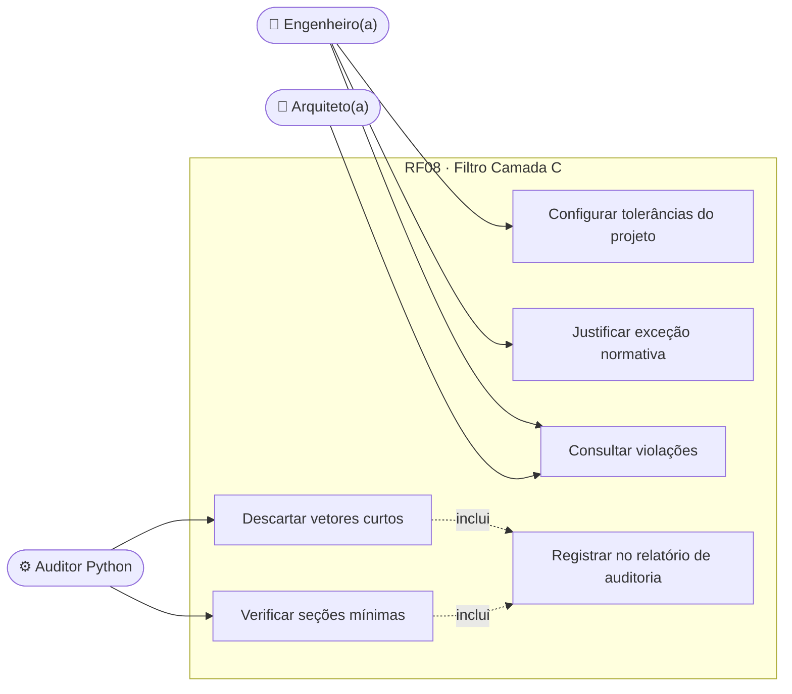
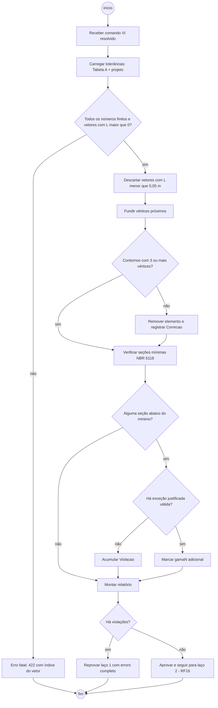
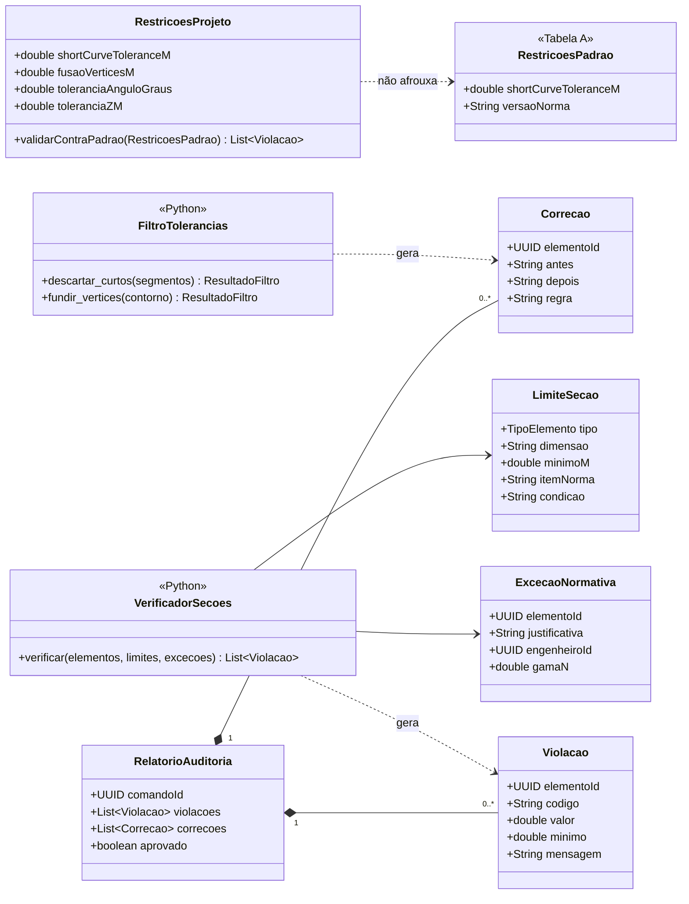
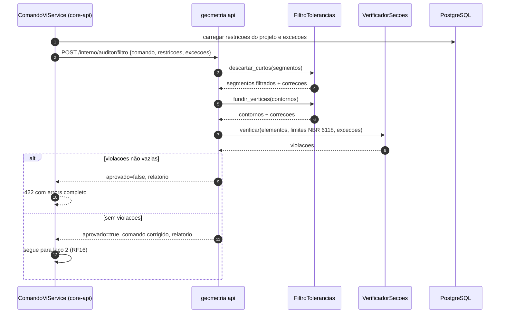
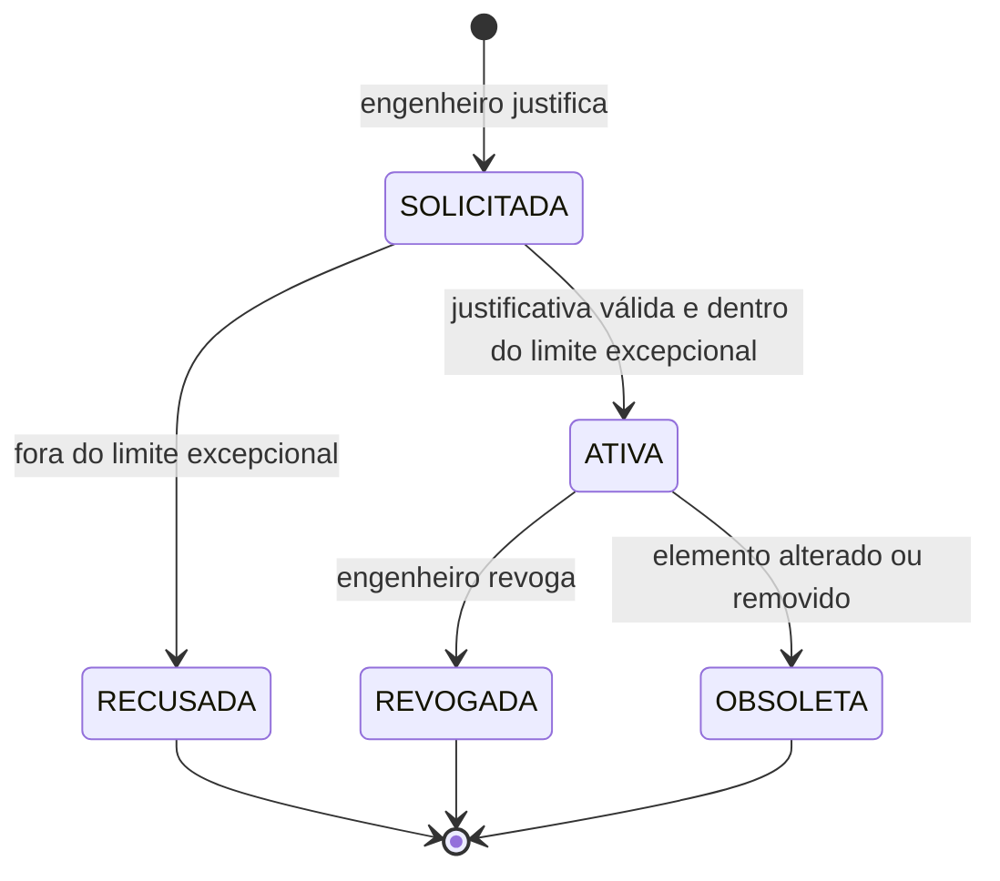
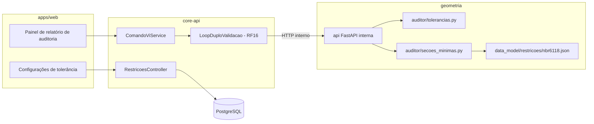

# RF08 · Filtro de tolerâncias geométricas e seções mínimas

> Filtro da **Camada C (Regras e Restrições Construtivas)** da Notação VI: antes de qualquer geometria chegar
> ao kernel, o auditor descarta vetores curtos ou nulos (ShortCurveTolerance = 0,05 m) e bloqueia seções
> abaixo do mínimo normativo da NBR 6118. É o que evita o travamento do script por vetores de comprimento zero
> observado nos testes experimentais.

## 1. Descrição

O filtro roda no **laço 1** do loop duplo de validação (RF16), dentro de `geometria/auditor/`, sobre o comando
VI já resolvido para coordenadas absolutas. Ele tem duas partes:

1. **Tolerâncias geométricas** (`tolerancias.py`): para cada segmento, aresta de contorno ou eixo de elemento
   linear calcula o comprimento euclidiano; se `L < shortCurveTolerance_m` o vetor é **descartado** (e o
   elemento que dependia só dele é removido do comando); se `L == 0` ou o vetor tem componente `NaN`, é um erro
   fatal do comando. Pontos de contorno de laje mais próximos que a tolerância são **fundidos** (snap de
   vértices) e contornos com menos de 3 vértices restantes são rejeitados. Também verifica nivelamento: base de
   elemento fora de `elevation_Z ± tolerânciaZ` é encaminhada ao RF17.
2. **Seções mínimas** (`secoes_minimas.py`): compara as dimensões de cada elemento estrutural com os limites da
   NBR 6118 (seção 13.2):
   - pilar: menor dimensão ≥ 19 cm (admite 14 cm com coeficiente adicional γn, Tab. 13.1) e área ≥ 360 cm²;
   - viga: largura ≥ 12 cm (≥ 10 cm em casos excepcionais com justificativa), altura ≥ vão/20 como alerta;
   - laje maciça: h ≥ 7 cm (cobertura não em balanço), ≥ 8 cm (piso), ≥ 10 cm (balanço), ≥ 12 cm (veículos
     ≤ 30 kN), ≥ 14 cm (laje lisa), ≥ 16 cm (cogumelo);
   - parede de concreto/alvenaria estrutural: espessura mínima conforme material da Tabela A.

As tolerâncias têm padrão na Tabela A (`geometricConstraints.shortCurveTolerance_m`) e podem ser **endurecidas**
por projeto (nunca afrouxadas abaixo do padrão normativo). Toda ação do filtro gera uma `Violacao` ou
`Correcao` no relatório de auditoria.

## 2. Atores

| Ator | Papel na obra | Pode |
|---|---|---|
| Auditor Python | sistema | aplicar o filtro em todo comando VI |
| Engenheiro(a) responsável | `ENGENHEIRO` | configurar tolerâncias do projeto, ler o relatório, justificar exceção (viga 10 cm) |
| Arquiteto(a) | `ARQUITETO` | ler violações dos próprios comandos |

## 3. Critérios de aceite

- [ ] **CA-01** Nenhum vetor de comprimento nulo ou `NaN` chega ao kernel; o comando é rejeitado com `422` e o
  índice do vetor.
- [ ] **CA-02** Vetores com `0 < L < 0,05 m` são descartados e registrados como `Correcao` (antes/depois);
  vértices de contorno mais próximos que a tolerância são fundidos.
- [ ] **CA-03** Violação de seção mínima retorna `422` com **todos** os elementos afetados de uma vez
  (`errors[]` com `elementoId`, dimensão, valor, mínimo e item da norma).
- [ ] **CA-04** Tolerâncias por projeto só podem ser iguais ou mais restritivas que o padrão; tentativa de
  afrouxar → `422`.
- [ ] **CA-05** Exceção normativa (pilar 14–19 cm, viga 10–12 cm) só é aceita com justificativa do engenheiro
  e aplica o coeficiente γn adicional no RF07.
- [ ] **CA-06** O filtro é idempotente: aplicar duas vezes no mesmo comando produz o mesmo resultado.
- [ ] **CA-07** Tempo do filtro ≤ 50 ms para comando com 1.000 segmentos.

## 4. Regras de negócio

- **RN-01** Ordem: validação de números (finitos) → descarte de curtos → fusão de vértices → seções mínimas.
- **RN-02** Descartar um vetor que deixa uma parede sem eixo remove a parede e suas aberturas hospedadas.
- **RN-03** Tolerância angular de ortogonalidade (padrão 0,5°) alinha segmentos quase ortogonais aos eixos.
- **RN-04** Limites normativos ficam em `geometria/data_model/restricoes/nbr6118.json` versionado; mudar o
  arquivo exige atualizar este doc.

## 5. Base legal e normas

- NBR 6118:2023, seção 13.2 (dimensões-limite) e Tab. 13.1 (γn para pilares com dimensão < 19 cm).
- NBR 15961 / NBR 16868 (alvenaria estrutural) para espessura mínima de paredes estruturais.
- Sem dados pessoais envolvidos.

## 6. API

| Método e rota | Descrição | Respostas |
|---|---|---|
| `GET /api/v1/obras/{obraId}/modelo/restricoes` | Tolerâncias vigentes do projeto | 200, 404 |
| `PUT /api/v1/obras/{obraId}/modelo/restricoes` | Atualiza tolerâncias (só mais restritivas) | 200, 403, 404, 422 |
| `POST /api/v1/obras/{obraId}/modelo/excecoes` | Justificativa de exceção normativa para um elemento | 201, 403, 422 |
| `POST /interno/auditor/filtro` (geometria) | Aplica o filtro ao comando resolvido (chamado pelo RF16) | 200 + relatório |

## 7. Diagramas

### 7.1 Casos de uso

### 7.2 Atividades

### 7.3 Classes

### 7.4 Sequência

### 7.5 Máquina de estados (ExcecaoNormativa)

### 7.6 Componentes

## 8. Testes previstos

| Tipo | Caso |
|---|---|
| Unitário (Python) | segmento de 0,03 m descartado; de 0,05 m mantido (limite inclusivo) |
| Unitário (Python) | vetor nulo e coordenada `NaN` → erro fatal com índice |
| Unitário (Python) | pilar 15x30 sem exceção → violação; com exceção ativa → aceito com γn = 1,25 |
| Unitário (Python) | três lajes abaixo do mínimo → três violações numa só resposta |
| Propriedade (Hypothesis) | filtro idempotente para contornos aleatórios |
| Integração `*IT` | `PUT /restricoes` com shortCurveTolerance 0,01 → 422 (afrouxar) |

## 9. Rastreabilidade

| Camada | Artefato | Status |
|---|---|---|
| Documento | `docs/rf/RF08-filtro-tolerancias-secoes-minimas.md` | ✅ |
| Card | [Trello Dgtma9TN](https://trello.com/c/Dgtma9TN) | ✅ |
| Geometria | `geometria/auditor/tolerancias.py`, `secoes_minimas.py` | ⏳ |
| Dados | `geometria/data_model/restricoes/nbr6118.json` | ⏳ |
| API | `EstruturaController` (`GET/PUT /estrutura/restricoes`, `/excecoes-normativas` → propor, `decidir?aprovar`, `revogar`), `cca-application/estrutura/RestricoesService.java`; `LancadorAutomatico.validar` aplica as seções mínimas às sugestões da IA | ✅ |
| Banco | `V10__restricoes_projeto.sql` (restricoes_projeto só mais restritivas que o padrão; excecao_normativa com justificativa ≥ 20 caracteres e aprovação por `podeAprovar`) | ✅ |
| Testes | `test_tolerancias.py`, `test_secoes_minimas.py`; backend coberto por `RestricoesProjeto`/`ExcecaoNormativa` nas validações de domínio (IT dedicado ⏳) | ✅ domínio · ⏳ IT |