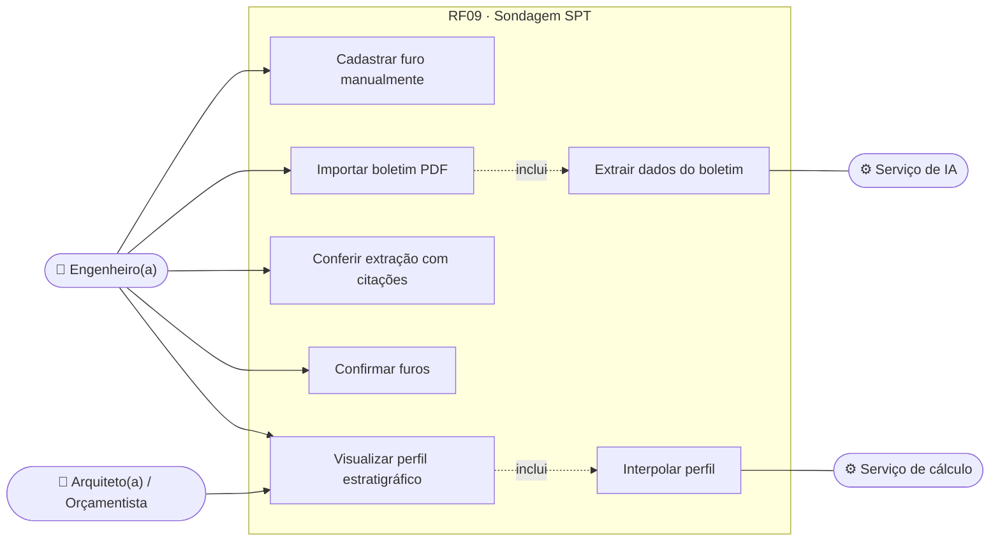
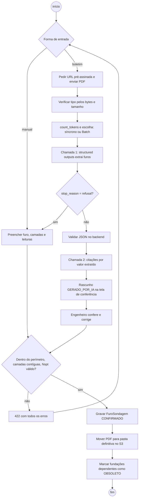
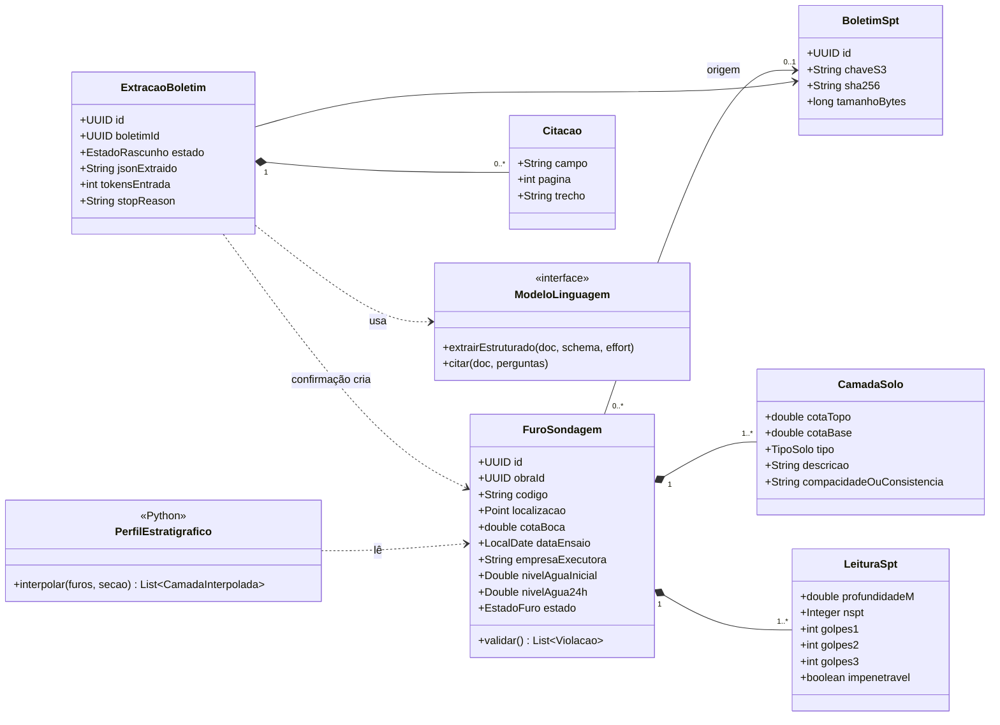
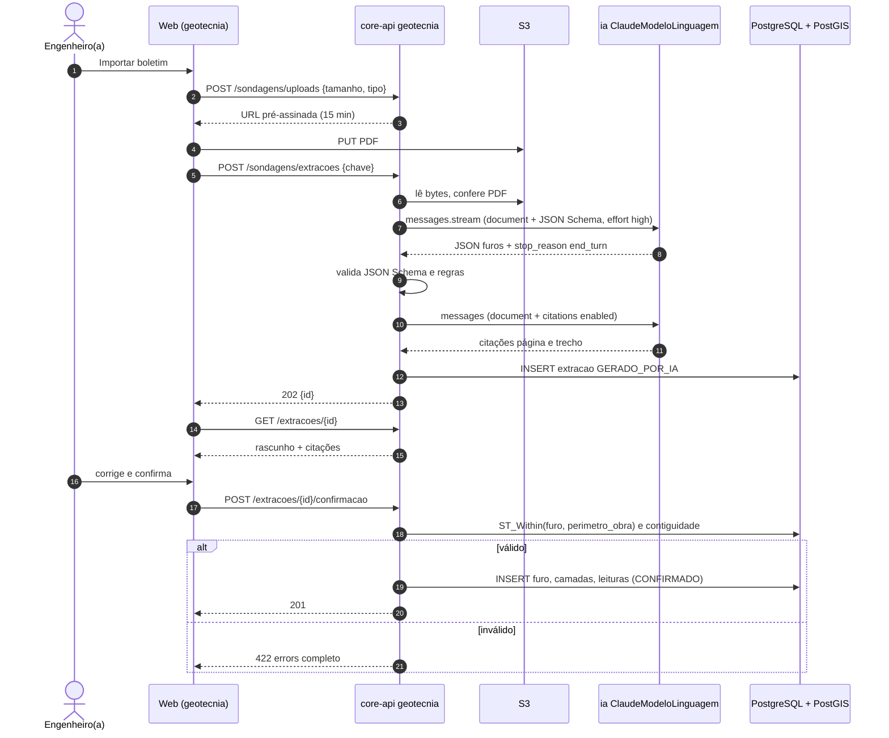
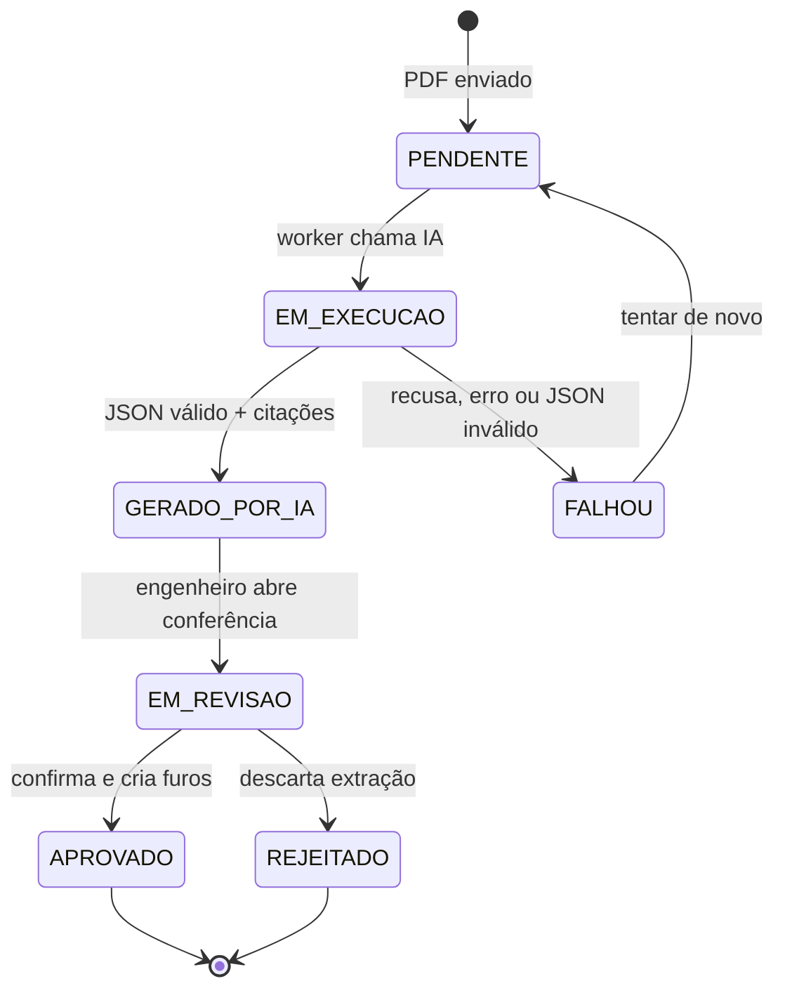
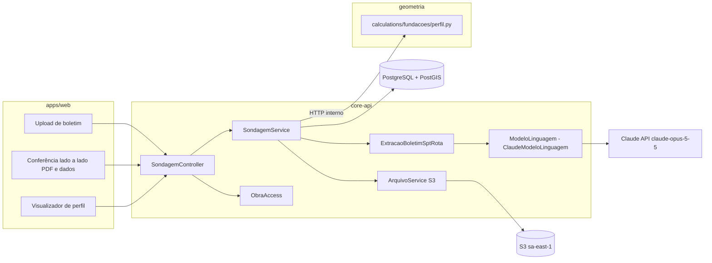

# RF09 · Cadastro de perfil estratigráfico de solo e ensaio SPT

> O engenheiro cadastra os furos de sondagem SPT da obra (posição, cota, nível d'água, camadas e Nspt por
> metro), digitando ou importando o boletim em PDF. A IA lê o boletim **com citações** de página e trecho, e
> nada é gravado sem conferência humana. Os furos alimentam o perfil estratigráfico interpolado usado no
> dimensionamento de fundações (RF10).

## 1. Descrição

Cada `FuroSondagem` tem código (SP-01…), localização `geometry(Point, 4674)` (SIRGAS 2000) que precisa estar
dentro do perímetro da obra (`ST_Within`), cota da boca do furo, data do ensaio, empresa executora, nível
d'água (inicial e após 24 h) e critério de paralisação. As `CamadaSolo` registram cota de topo e base, tipo
(argila, silte, areia, pedregulho, rocha, com adjetivos de cor e consistência/compacidade) e as `LeituraSpt`
registram por metro o Nspt (soma dos golpes dos dois últimos 15 cm) e os golpes/penetração de cada trecho.
"Impenetrável" e "limite de sondagem" são registrados explicitamente, não como número.

**Importação do boletim**: o PDF sobe por URL pré-assinada para o S3 (`uploads/` com expiração de 1 dia até
ser confirmado; depois movido para `obras/{id}/sondagens/`). A extração usa duas chamadas separadas à IA,
porque citações não combinam com structured outputs:

1. **Extrair dados** (`effort: high`, structured outputs com o JSON Schema de `FuroSondagemExtraido`), PDF
   como bloco `document`.
2. **Apontar fontes** (`citations: {enabled: true}`) para cada camada/leitura extraída, retornando página e
   trecho, exibidos lado a lado na tela de conferência.

O resultado é um `RascunhoIA` (`GERADO_POR_IA`) que o engenheiro confere campo a campo e confirma; só então os
dados viram `FuroSondagem` com estado `CONFIRMADO`. O perfil estratigráfico entre furos é interpolado no
serviço Python (`calculations/fundacoes/perfil.py`) por cotas de topo das camadas correlacionadas.

## 2. Atores

| Ator | Papel na obra | Pode |
|---|---|---|
| Engenheiro(a) responsável | `ENGENHEIRO` | cadastrar, importar, conferir, confirmar e editar furos |
| Arquiteto(a), Orçamentista | `ARQUITETO`, `ORCAMENTISTA` | visualizar perfil confirmado |
| Serviço de IA | sistema (`ia`) | extrair dados do boletim e apontar citações |
| Serviço de cálculo | sistema (`geometria`) | interpolar perfil estratigráfico |

## 3. Critérios de aceite

- [ ] **CA-01** Furo fora do perímetro PostGIS da obra → `422` "Furo SP-03 fora do perímetro da obra".
- [ ] **CA-02** Camadas de um furo são contíguas (base de uma = topo da próxima), sem sobreposição nem lacuna,
  e a última termina na cota final do furo.
- [ ] **CA-03** Nspt é inteiro ≥ 0; leituras com "impenetrável" usam o marcador `IMPENETRAVEL` e encerram o
  furo; todos os erros de um furo voltam juntos em `422`.
- [ ] **CA-04** A extração por IA mostra para cada valor a página e o trecho citado; o engenheiro precisa
  confirmar (ou corrigir) antes de gravar; nada vai para `FuroSondagem` sem confirmação.
- [ ] **CA-05** O boletim original fica no S3 e é baixado por URL pré-assinada de 15 min; o tipo é conferido
  pelos bytes (PDF) e o tamanho máximo é 32 MB.
- [ ] **CA-06** A chamada à IA registra rota, finalidade ("extração de boletim SPT"), base legal, tokens e
  `stop_reason`; recusa (`refusal`) devolve ao usuário a opção de cadastro manual.
- [ ] **CA-07** Alterar um furo confirmado marca como `OBSOLETO` os dimensionamentos de fundação (RF10) que o
  usaram.

## 4. Regras de negócio

- **RN-01** Mínimo de furos segundo NBR 8036: 2 furos até 200 m² de projeção, 3 até 400 m², +1 a cada 200 m²
  até 1.200 m²; abaixo do mínimo o RF10 mostra alerta (não bloqueia o cadastro).
- **RN-02** Nível d'água ausente deve ser declarado "não encontrado até a cota X".
- **RN-03** Classificação de compacidade/consistência derivada do Nspt pela NBR 6484 (Anexo A) é calculada,
  não digitada.
- **RN-04** Antes de enviar PDF grande, `count_tokens` estima o custo; acima do limite da rota a extração vai
  para a Batch API (processamento noturno) com aviso ao usuário.
- **RN-05** O boletim pode conter nome/CREA do sondador: esses campos não são extraídos nem enviados em
  prompts além do próprio documento; o registro guarda apenas a empresa executora.

## 5. Base legal e normas

- NBR 6484:2020 (SPT — método de ensaio), NBR 8036 (programação de sondagens), NBR 6502 (terminologia de
  solos).
- LGPD: o PDF pode conter dados pessoais do responsável pela sondagem; tratamento para execução de contrato
  (Art. 7º, V) e envio ao modelo com transferência internacional documentada (Art. 33); finalidade registrada.
- Responsabilidade técnica: dados confirmados pelo engenheiro(a) da obra.

## 6. API

| Método e rota | Descrição | Respostas |
|---|---|---|
| `POST /api/v1/obras/{obraId}/sondagens/uploads` | URL pré-assinada para o PDF (tipo e tamanho na assinatura) | 201, 403, 404 |
| `POST /api/v1/obras/{obraId}/sondagens/extracoes` | Inicia extração por IA do boletim enviado | 202 + id, 403, 422 |
| `GET /api/v1/obras/{obraId}/sondagens/extracoes/{id}` | Rascunho extraído + citações | 200, 404 |
| `POST /api/v1/obras/{obraId}/sondagens/extracoes/{id}/confirmacao` | Confirma (com correções) e cria furos | 201, 409, 422 |
| `POST /api/v1/obras/{obraId}/sondagens` | Cadastro manual de furo | 201, 403, 422 |
| `PUT /api/v1/obras/{obraId}/sondagens/{furoId}` | Edição de furo confirmado | 200, 409, 422 |
| `GET /api/v1/obras/{obraId}/perfil-estratigrafico?secao=` | Perfil interpolado em uma seção | 200, 404 |

## 7. Diagramas

### 7.1 Casos de uso

### 7.2 Atividades

### 7.3 Classes

### 7.4 Sequência

### 7.5 Máquina de estados (ExtracaoBoletim)

### 7.6 Componentes

## 8. Testes previstos

| Tipo | Caso |
|---|---|
| Unitário (Java) | camadas com lacuna de 0,20 m → violação "camadas não contíguas" |
| Unitário (Java) | furo com `ST_Within` falso → 422 |
| Unitário (Java) | `FakeModeloLinguagem` devolve JSON fixo → rascunho com citações mapeadas |
| Unitário (Java) | `stop_reason = refusal` → extração `FALHOU` com sugestão de cadastro manual |
| Integração `*IT` | upload com bytes de PNG declarado como PDF → 422 |
| Integração `*IT` | confirmar extração cria furo e marca fundação dependente `OBSOLETO` |
| Avaliação (fora do CI) | 30 boletins reais conferidos: acurácia de Nspt ≥ 98 % |

## 9. Rastreabilidade

| Camada | Artefato | Status |
|---|---|---|
| Documento | `docs/rf/RF09-perfil-solo-spt.md` | ✅ |
| Card | [Trello LzHFBr6H](https://trello.com/c/LzHFBr6H) | ✅ |
| Web | `apps/web/src/app/(app)/obras/[obraId]/geotecnia/` | ⏳ |
| API | `geotecnia/SondagemController.java`, `SondagemService.java` | ⏳ |
| IA | `ia/rotas/ExtracaoBoletimSptRota.java` + schema JSON | ⏳ |
| Banco | `V13__geotecnia.sql` (furo_sondagem, camada_solo, leitura_spt, extracao_boletim) | ⏳ |
| Cálculo | `geometria/calculations/fundacoes/perfil.py` | ⏳ |
| Testes | `SondagemIT`, `ExtracaoBoletimSptRotaTest`, `test_perfil.py` | ⏳ |
