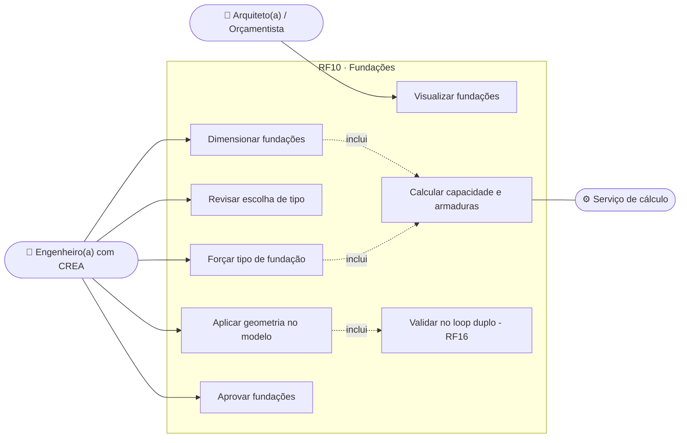
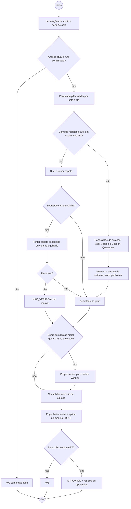
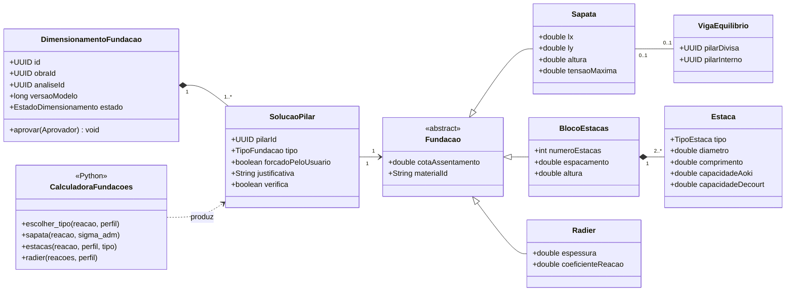
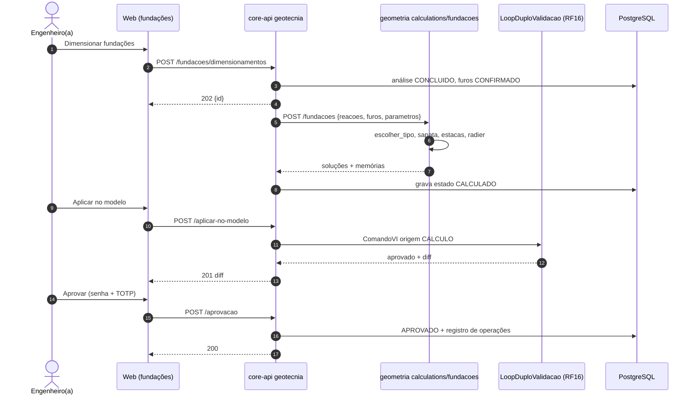
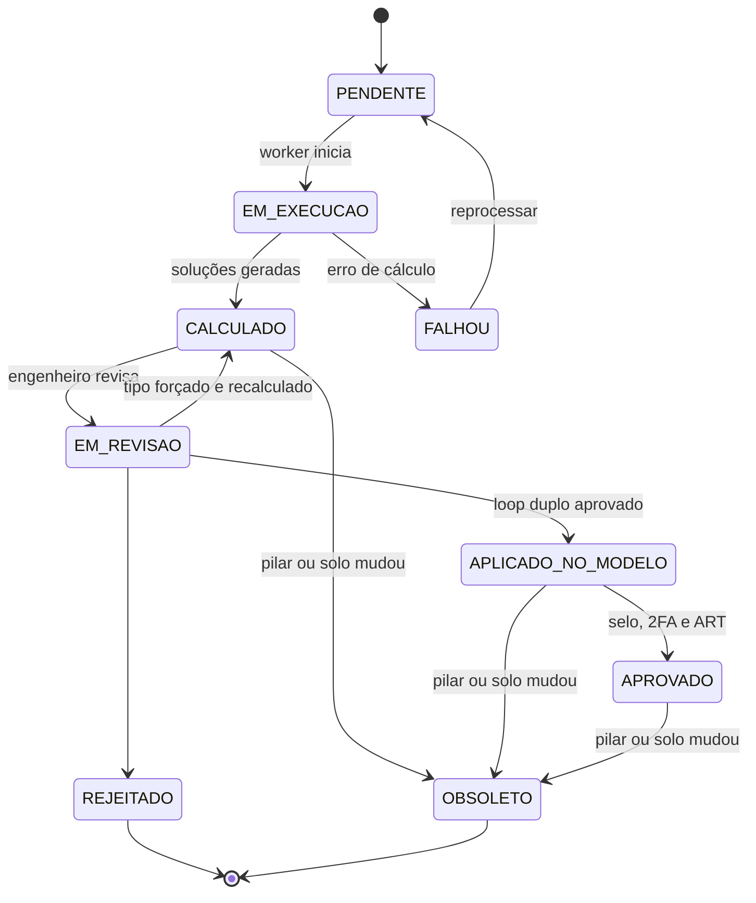
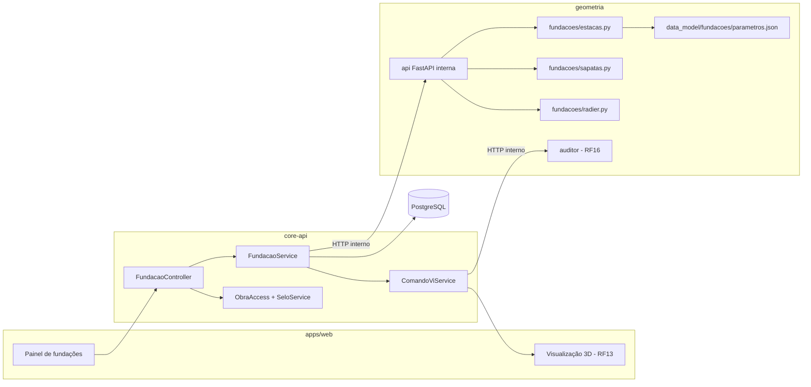

# RF10 · Dimensionamento de sapatas, blocos sobre estacas e radier

> Com as reações de apoio da análise estrutural (RF05) e o perfil de solo confirmado (RF09), o sistema propõe
> o tipo de fundação de cada pilar, dimensiona geotécnica e estruturalmente (NBR 6122 e NBR 6118) e gera a
> geometria no modelo BIM. Tudo nasce como rascunho e só vale após aprovação do engenheiro(a) com CREA.

## 1. Descrição

O job `DimensionamentoFundacao` roda em `geometria/calculations/fundacoes/` e tem três etapas:

1. **Escolha do tipo** por pilar (ou grupo), justificada: tensão admissível na cota de assentamento
   (σadm estimada por correlação com Nspt médio do bulbo, ex.: σadm ≈ Nspt/50 MPa para 5 ≤ Nspt ≤ 20, ou por
   prova de carga quando informada), carga característica, presença de nível d'água e profundidade da camada
   resistente. Regras: sapata quando a camada com σadm suficiente está a ≤ 3 m e acima do NA; estacas quando
   não; **radier** quando a soma das áreas de sapatas excede 50 % da projeção.
2. **Dimensionamento geotécnico**: sapata — área `A ≥ (Nk + peso próprio) / σadm` com balanços iguais e
   verificação de excentricidade (núcleo central, tensão máx ≤ 1,3 σadm); estacas — capacidade de carga por
   **Aoki-Velloso** e **Décourt-Quaresma** (adota o menor), fator de segurança global FS = 2,0 (NBR 6122), número
   de estacas e arranjo padrão (2, 3, 4… com espaçamento ≥ 3φ); radier — placa sobre base elástica
   (Winkler, coeficiente de reação do solo derivado do Nspt) resolvida pelo MEF de placa.
3. **Dimensionamento estrutural**: sapata rígida (método das bielas, verificação à punção), bloco sobre estacas
   (bielas e tirantes, Blévot), radier (armaduras por faixa a partir do MEF).

A geometria resultante (sapatas, blocos, estacas, radier) é inserida no modelo como **comando VI de origem
`CALCULO`** e passa pelo loop duplo (RF16) — garantindo que sapatas vizinhas não se sobrepõem. Se houver
sobreposição o algoritmo tenta **sapata associada** ou **viga de equilíbrio** (pilar de divisa) antes de
reportar falha.

## 2. Atores

| Ator | Papel na obra | Pode |
|---|---|---|
| Engenheiro(a) responsável | `ENGENHEIRO` (selo `VERIFIED` + 2FA + ART para aprovar) | disparar, trocar tipo sugerido, aprovar |
| Arquiteto(a), Orçamentista | `ARQUITETO`, `ORCAMENTISTA` | visualizar fundações aprovadas |
| Serviço de cálculo | sistema (`geometria`) | escolher tipo e dimensionar |

## 3. Critérios de aceite

- [ ] **CA-01** O job exige análise estrutural `CONCLUIDO` da versão atual e ao menos um furo `CONFIRMADO`;
  número de furos abaixo da NBR 8036 gera alerta visível na revisão.
- [ ] **CA-02** Para cada pilar a escolha do tipo traz a justificativa (σadm, cota, NA, carga) em pt-BR.
- [ ] **CA-03** Sapatas vizinhas não se sobrepõem; conflito resolvido por sapata associada/viga de equilíbrio ou
  reportado como `NAO_VERIFICA`.
- [ ] **CA-04** Memória de cálculo com método (Aoki-Velloso, Décourt-Quaresma, bielas, Winkler), parâmetros e
  fatores de segurança.
- [ ] **CA-05** Mudança no pilar (posição, seção, carga) ou no perfil de solo marca o resultado `OBSOLETO` e
  oferece recálculo.
- [ ] **CA-06** Aprovação somente por engenheiro(a) com selo CREA `VERIFIED`, 2FA, modo sudo e ART ativa;
  registrada no registro de operações.
- [ ] **CA-07** Fundações aprovadas entram no quantitativo (RF11): concreto, fôrma, aço e metros de estaca.

## 4. Regras de negócio

- **RN-01** Dimensão mínima de sapata 0,60 m e altura mínima 0,25 m; cota de assentamento ≥ 1,5 m da
  superfície em divisa (NBR 6122).
- **RN-02** Estacas: tipos suportados no MVP — hélice contínua, escavada, pré-moldada de concreto; parâmetros
  K e α (Aoki-Velloso) e C (Décourt-Quaresma) tabelados em `data_model/fundacoes/parametros.json`.
- **RN-03** O engenheiro pode forçar o tipo; o cálculo continua obrigatório e a justificativa automática
  registra a escolha manual.
- **RN-04** O resultado é determinístico; a IA não participa do cálculo de fundações no MVP.

## 5. Base legal e normas

- NBR 6122:2022 (projeto e execução de fundações), NBR 6118:2023 (concreto), NBR 6484 e NBR 8036 (sondagem).
- Responsabilidade técnica: aprovação vinculada à ART da obra (Lei 6.496/1977).
- Sem dados pessoais além do id/registro do aprovador (Art. 7º, II).

## 6. API

| Método e rota | Descrição | Respostas |
|---|---|---|
| `POST /api/v1/obras/{obraId}/fundacoes/dimensionamentos` | Cria job (análise, furos, tipos de estaca permitidos) | 202 + id, 403, 404, 409 |
| `GET /api/v1/obras/{obraId}/fundacoes/dimensionamentos/{id}` | Estado, sugestões por pilar e alertas | 200, 404 |
| `PATCH /api/v1/obras/{obraId}/fundacoes/dimensionamentos/{id}/pilares/{pilarId}` | Força tipo de fundação | 200, 409, 422 |
| `POST /api/v1/obras/{obraId}/fundacoes/dimensionamentos/{id}/aplicar-no-modelo` | Gera comando VI de origem CALCULO | 201 + diff, 409, 422 |
| `POST /api/v1/obras/{obraId}/fundacoes/dimensionamentos/{id}/aprovacao` | Aprova (sudo, 2FA, selo, ART) | 200, 403, 409 |

## 7. Diagramas

### 7.1 Casos de uso

### 7.2 Atividades

### 7.3 Classes

### 7.4 Sequência

### 7.5 Máquina de estados (DimensionamentoFundacao)

### 7.6 Componentes

## 8. Testes previstos

| Tipo | Caso |
|---|---|
| Unitário (Python) | sapata isolada Nk = 800 kN, σadm = 0,25 MPa → A ≥ 3,36 m² (com 5 % de peso próprio) |
| Unitário (Python) | estaca hélice φ40 em perfil de referência: Aoki-Velloso e Décourt-Quaresma contra planilha conferida |
| Unitário (Python) | duas sapatas sobrepostas → sapata associada gerada |
| Unitário (Python) | soma de sapatas > 50 % da projeção → radier sugerido |
| Integração `*IT` | alterar furo confirmado → dimensionamento `OBSOLETO` |
| Integração `*IT` | aprovar sem ART ativa → 403 com motivo |

## 9. Rastreabilidade

| Camada | Artefato | Status |
|---|---|---|
| Documento | `docs/rf/RF10-dimensionamento-fundacoes.md` | ✅ |
| Card | [Trello C7Lgejlv](https://trello.com/c/C7Lgejlv) | ✅ |
| Web | `apps/web/src/app/(app)/obras/[obraId]/fundacoes/` | ⏳ |
| API | `GeotecniaController` (`POST /fundacoes {analiseId, cotaAssentamento, diametroEstaca}`, `/propostas`, `/aprovar|rejeitar|aplicado`), `cca-application/geotecnia/FundacaoService.java` (SAPATAS / MISTA / RADIER) | ✅ |
| Banco | `V14__fundacoes.sql` (dimensionamento_fundacao, fundacao_proposta) | ✅ |
| Cálculo | `cca-domain/geotecnia/CalculoFundacoes.java` (σadm = 20·Nspt ≤ 400 kPa, Aoki-Velloso, Décourt-Quaresma, FS = 2, sobreposição de sapatas) | ✅ |
| Testes | `CalculoFundacoesTest`; `FundacaoIT` ⏳ | ✅ domínio · ⏳ IT |