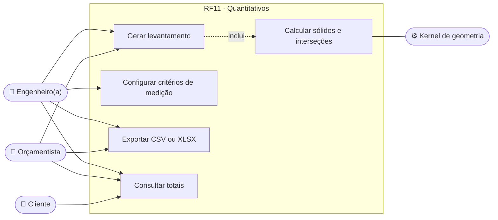
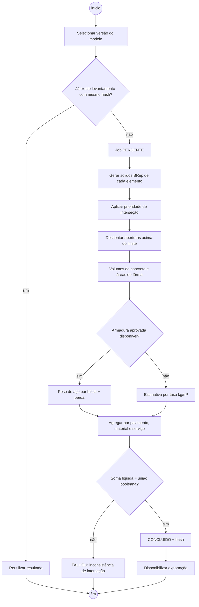
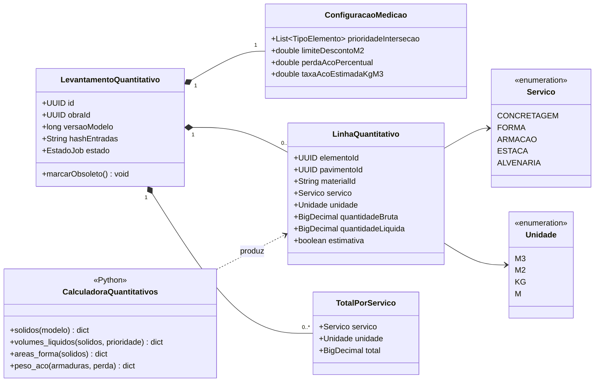
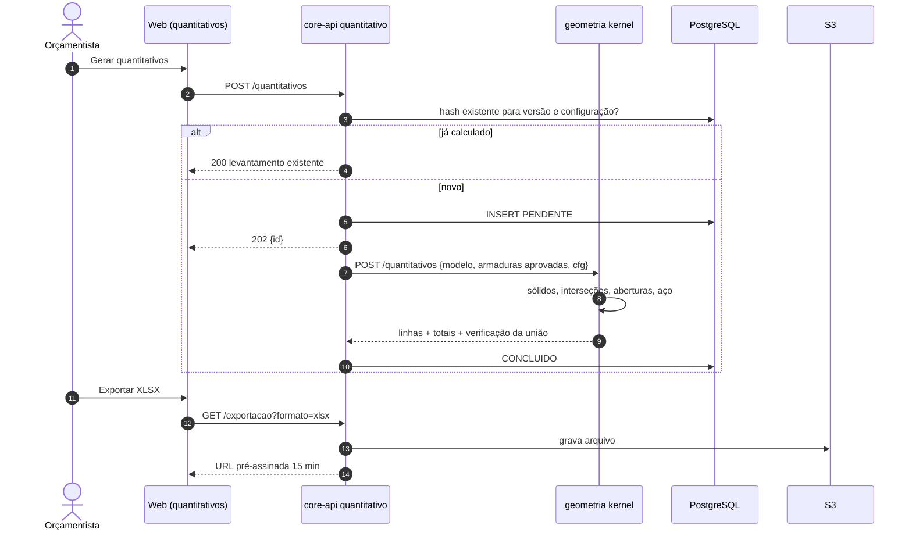
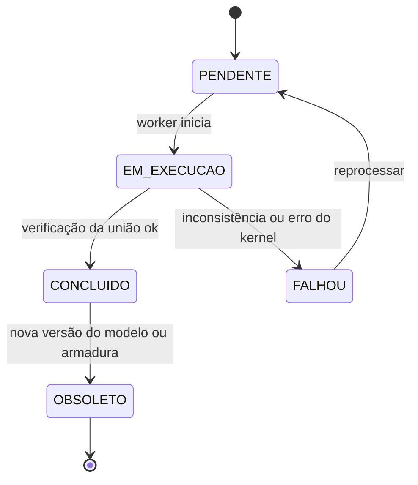
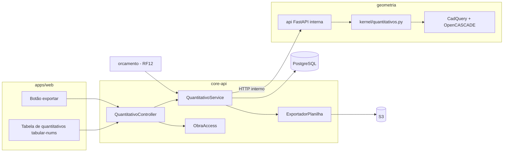

# RF11 · Levantamento automatizado de concreto (m³), fôrma (m²) e aço (kg)

> Extração **determinística** (sem IA) dos quantitativos do modelo BIM auditado: volume de concreto bruto e
> líquido, área de fôrma por face e peso de aço por bitola, organizados por pavimento, elemento e material
> (`baseQuantities` da Tabela A). É a ponte entre o modelo 3D e o orçamento (RF12).

## 1. Descrição

O `LevantamentoQuantitativo` é um job sobre uma **versão** do modelo. O kernel (`geometria/kernel/`,
CadQuery/OpenCASCADE) gera o sólido de cada elemento e calcula:

- **Concreto**: volume bruto (sólido do elemento isolado) e **líquido** — após a regra de prioridade nas
  interseções (pilar > viga > laje: o nó pilar×viga é contado no pilar; o trecho viga×laje é contado na
  laje) e descontando aberturas (`NewOpening`) com área > 0,25 m² (critério de desconto configurável). Unidade
  m³ com 3 casas.
- **Fôrma**: área das faces em contato com fôrma — laterais e fundo de vigas, laterais de pilares, fundo e
  bordas de lajes; faces em contato com outro elemento ou com o solo (sapatas assentadas em lastro) não
  entram. Unidade m².
- **Aço**: a partir da armadura **aprovada** (RF07/RF10): Σ comprimento × peso linear por bitola (ex.:
  φ10 = 0,617 kg/m, φ12,5 = 0,963 kg/m) + perda configurável (padrão 10 %). Sem dimensionamento aprovado,
  usa taxa de armadura estimada (kg/m³) marcada como **estimativa**.
- **Estacas**: metros lineares por tipo e diâmetro.
- **Alvenaria e revestimento** (arquitetura): área de parede líquida de vãos, por material.

O resultado é imutável e ligado à `versaoModelo` e ao `hashEntradas`; nova versão do modelo marca o
levantamento como `OBSOLETO`. A exportação CSV/XLSX usa números tabulares e unidade em coluna própria.

## 2. Atores

| Ator | Papel na obra | Pode |
|---|---|---|
| Engenheiro(a) responsável | `ENGENHEIRO` | gerar, configurar critérios de desconto, exportar |
| Orçamentista | `ORCAMENTISTA` | gerar, exportar, usar no orçamento (RF12) |
| Cliente / proprietário | `CLIENTE` | ver totais liberados pelo engenheiro (decisão de negócio pendente) |
| Serviço de geometria | sistema | calcular sólidos e quantidades |

## 3. Critérios de aceite

- [ ] **CA-01** Mesmo modelo (versão + configuração) gera exatamente o mesmo quantitativo (hash idêntico).
- [ ] **CA-02** Interseções pilar×viga×laje não são contadas duas vezes: soma dos volumes líquidos = volume da
  união booleana dos sólidos (tolerância 0,001 m³).
- [ ] **CA-03** Aberturas acima do limite de desconto são descontadas do volume/área; abaixo, não.
- [ ] **CA-04** Aço usa armaduras aprovadas; quando ausentes, a linha mostra "estimativa por taxa" e o
  orçamento herda o aviso.
- [ ] **CA-05** Exportação CSV/XLSX com colunas pavimento, elemento, material, serviço, unidade, quantidade;
  números tabulares; arquivo no S3 com URL pré-assinada de 15 min.
- [ ] **CA-06** Mudança no modelo marca o levantamento `OBSOLETO` e o RF12 mostra aviso no orçamento.
- [ ] **CA-07** Modelo de 4 pavimentos com malha 5x3 processado em ≤ 30 s.

## 4. Regras de negócio

- **RN-01** Regra de prioridade de interseção configurável por obra, padrão pilar > viga > laje > parede.
- **RN-02** Critério de desconto de vãos padrão 0,25 m² para fôrma e alvenaria (alinhado ao critério SINAPI de
  medição); para concreto, desconta sempre.
- **RN-03** Quantitativos agregam por `materialId` e por "serviço" (concretagem, fôrma, armação), chaves usadas
  na associação SINAPI.
- **RN-04** Nenhuma IA participa do cálculo (resultado auditável e reprodutível).

## 5. Base legal e normas

- NBR 12721 (avaliação de custos e quantitativos para incorporação), critérios de medição do SINAPI (cadernos
  técnicos da Caixa).
- NBR 7480 (massa linear nominal das barras).
- Sem dados pessoais.

## 6. API

| Método e rota | Descrição | Respostas |
|---|---|---|
| `POST /api/v1/obras/{obraId}/quantitativos` | Gera levantamento da versão atual (ou `versao`) | 202 + id, 403, 404 |
| `GET /api/v1/obras/{obraId}/quantitativos/{id}` | Estado, totais e linhas (filtro por pavimento/material) | 200, 404 |
| `GET /api/v1/obras/{obraId}/quantitativos/{id}/exportacao?formato=csv\|xlsx` | URL pré-assinada | 200, 404 |
| `PUT /api/v1/obras/{obraId}/quantitativos/configuracao` | Prioridade de interseção, desconto, perda de aço | 200, 403, 422 |

## 7. Diagramas

### 7.1 Casos de uso

### 7.2 Atividades

### 7.3 Classes

### 7.4 Sequência

### 7.5 Máquina de estados (LevantamentoQuantitativo)

### 7.6 Componentes

## 8. Testes previstos

| Tipo | Caso |
|---|---|
| Unitário (Python) | viga 20x50x500 cm → 0,500 m³ e fôrma 6,0 m² (2 laterais + fundo) |
| Unitário (Python) | nó pilar×viga contado só no pilar; soma = união booleana |
| Unitário (Python) | janela 1,2x1,0 m descontada da alvenaria; vão 0,4x0,4 m não descontado |
| Unitário (Python) | 100 m de φ10 com 10 % de perda → 67,87 kg |
| Integração `*IT` | gerar duas vezes a mesma versão reaproveita (mesmo id) |
| Integração `*IT` | comando VI novo marca levantamento `OBSOLETO` |
| Desempenho | prédio de 4 pavimentos, malha 5x3 ≤ 30 s |

## 9. Rastreabilidade

| Camada | Artefato | Status |
|---|---|---|
| Documento | `docs/rf/RF11-levantamento-quantitativos.md` | ✅ |
| Card | [Trello ty5wWDp9](https://trello.com/c/ty5wWDp9) | ✅ |
| Web | `apps/web/src/app/(app)/obras/[obraId]/quantitativos/` | ⏳ |
| API | `cca-web/api/quantitativo/QuantitativoController.java` (`GET /quantitativos`, `/export?formato=csv|xlsx`, `/{id}/liberar-cliente`), `cca-application/quantitativo/QuantitativoService.java` | ✅ |
| Banco | `V15__quantitativos.sql` (levantamento_quantitativo com linhas/totais JSON, hash FNV-1a, liberado_cliente) | ✅ |
| Geometria | port fiel de `packages/notacao-vi/src/quantitativos.ts` em `cca-domain/quantitativo/Quantificador.java` (mesmo hash FNV-1a e prioridade pilar > viga > laje) | ✅ Java · ⏳ python |
| Testes | `QuantificadorTest` (hash igual ao TS, rascunho IA não entra, aço aprovado substitui taxa), `OrcamentoIT.quantitativosDoModeloEExportacao` (CSV/XLSX, DN-02 para CLIENTE) | ✅ |

## Auditoria 2026-10 · 2ª rodada

Estrutura, materiais e conformidade ([relatório](../auditoria/AUDITORIA_2026-10_ESTRUTURA_INSTALACOES_MATERIAIS.md)).

- **Corrigido:** pilar circular quantificado por π·d²/4 e perímetro π·d; contraventamento com prefixo C; aço do dimensionamento = Σ massas das posições detalhadas.
- **Evidência:** `QuantificadorTest`, `DimensionamentoReferenciaTest`.
- **Pendente:** perdas de corte só no orçamento.
