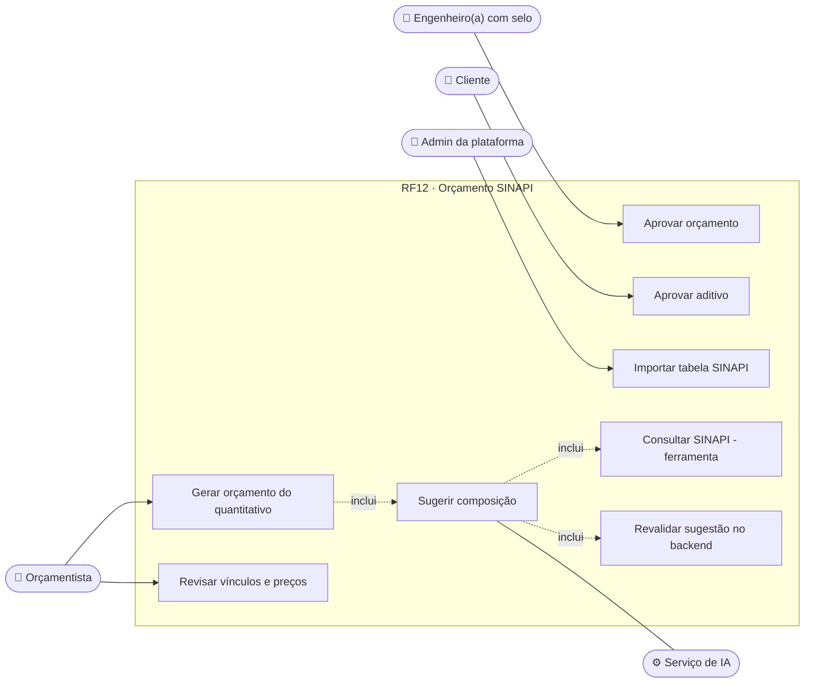
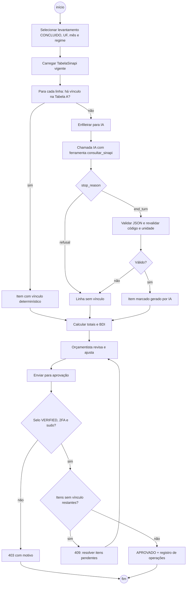
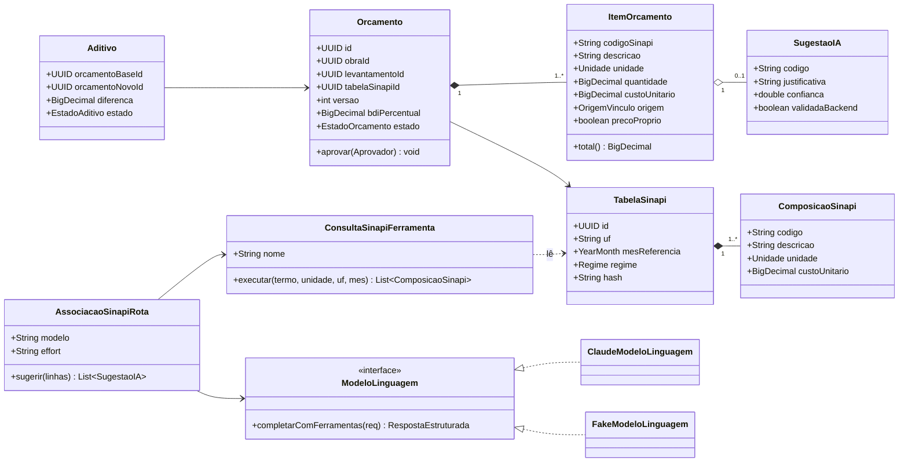
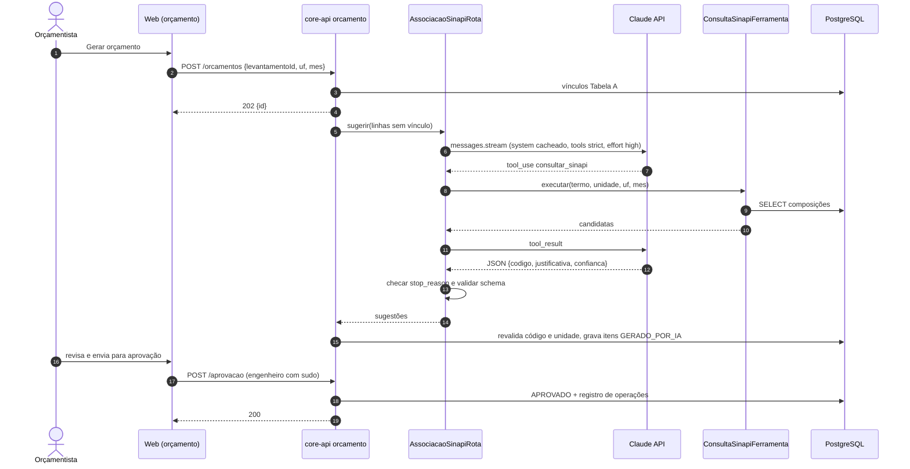
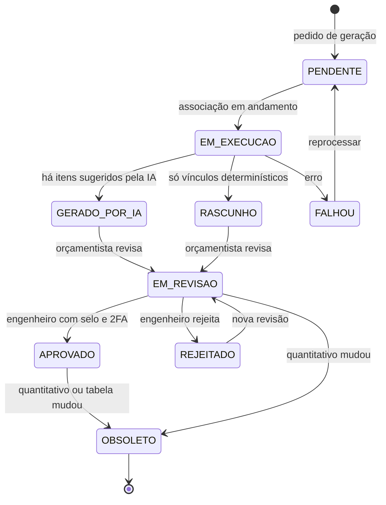
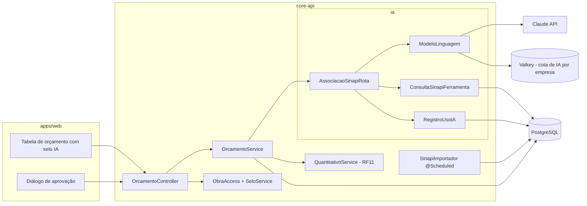

# RF12 · Associação automática a tabelas orçamentárias (SINAPI / Tabela A)

> Cada linha do quantitativo (RF11) é associada a uma composição SINAPI vigente — primeiro pelo vínculo
> determinístico da Tabela A, depois, quando não houver, por **sugestão da IA** usando uma ferramenta de busca
> na tabela SINAPI interna. O resultado é o **rascunho de orçamento**, marcado "gerado por IA" onde couber, que
> só vale após aprovação de profissional habilitado.

## 1. Descrição

**Base SINAPI**: importação mensal (job agendado + upload manual pelo admin da plataforma) das planilhas de
composições e insumos da Caixa por UF, mês de referência e regime (desonerado / não desonerado). Cada
importação é uma `TabelaSinapi` versionada e imutável; o orçamento guarda a versão usada.

**Associação em duas etapas:**

1. **Determinística**: o material da Tabela A pode trazer `baseQuantities.sinapi` por serviço (ex.:
   `MAT_CONC_FCK30` + `CONCRETAGEM` → composição de concreto usinado fck 30 com lançamento e adensamento).
   Linhas com vínculo direto não passam pela IA.
2. **Sugestão por IA** (rota `AssociacaoSinapiRota`, `claude-opus-5-5`, `effort: high`, streaming): para as
   linhas restantes, o modelo recebe descrição do serviço, material e unidade (sem dados de pessoas) e usa a
   ferramenta `consultar_sinapi` (`strict: true`, `additionalProperties: false`; parâmetros: termo, unidade,
   UF, mês) para buscar candidatas; `tool_choice` fica `auto`, com instrução no system prompt para sempre
   consultar antes de responder. A resposta final vem em **structured outputs** (`codigo`, `justificativa`,
   `confianca`). O system prompt e o catálogo de unidades usam **prompt caching**.

O backend **revalida** toda sugestão: código existe na versão da tabela, unidade compatível com a linha
(m³↔m³, m²↔m², kg↔kg) e serviço coerente. Sugestões inválidas viram "sem vínculo" para o orçamentista.

O `Orcamento` nasce em `GERADO_POR_IA` (se algum item veio da IA) ou `RASCUNHO`; itens vindos da IA levam o
selo visual "gerado por IA" (token `--ai-draft-*`). A aprovação exige papel `ENGENHEIRO`, selo `VERIFIED`, 2FA
e modo sudo. Cliente aprova **aditivos** (diferenças entre orçamento aprovado e nova versão).

## 2. Atores

| Ator | Papel na obra | Pode |
|---|---|---|
| Orçamentista | `ORCAMENTISTA` | gerar, revisar vínculos, editar BDI e preços, enviar para aprovação |
| Engenheiro(a) responsável | `ENGENHEIRO` (selo `VERIFIED` + 2FA) | aprovar o orçamento |
| Cliente / proprietário | `CLIENTE` | ver orçamento liberado, aprovar aditivos |
| Admin da plataforma | plataforma | importar tabela SINAPI mensal |
| Serviço de IA | sistema (`ia`) | sugerir composições via ferramenta |

## 3. Critérios de aceite

- [ ] **CA-01** Item de orçamento contém código SINAPI, descrição, unidade, quantidade, custo unitário, total,
  UF, mês de referência e regime; totais por etapa e geral com BDI.
- [ ] **CA-02** Vínculo da Tabela A tem precedência e não consome IA.
- [ ] **CA-03** Sugestão da IA é marcada "gerado por IA", traz justificativa e confiança, e é rejeitada pelo
  backend se o código não existir na versão da tabela ou a unidade for incompatível.
- [ ] **CA-04** A ferramenta `consultar_sinapi` só lê a tabela vigente da UF da obra e respeita o escopo da
  obra (mesma checagem de permissão de um endpoint).
- [ ] **CA-05** Orçamento só passa a `APROVADO` com engenheiro(a) de selo `VERIFIED`, 2FA e modo sudo;
  registro de operações sem valores pessoais.
- [ ] **CA-06** Orçamento guarda `tabelaSinapiId` e `levantamentoId`; quantitativo `OBSOLETO` gera aviso e
  permite nova versão do orçamento; diferença com o aprovado vira proposta de aditivo.
- [ ] **CA-07** Cada chamada à IA registra rota, finalidade, base legal, tokens (incluindo
  `cache_read_input_tokens`) e `stop_reason`; `refusal` deixa as linhas sem vínculo, sem quebrar o orçamento.
- [ ] **CA-08** Avaliação: conjunto de 50 projetos com orçamento conferido; acurácia de código SINAPI ≥ 90 %
  antes de mudar prompt, modelo ou `effort`.

## 4. Regras de negócio

- **RN-01** Importação SINAPI é idempotente por (UF, mês, regime); reimportar substitui só se o hash mudar,
  criando nova versão.
- **RN-02** Custo unitário do item congela no momento da geração; mudança de tabela exige nova versão do
  orçamento.
- **RN-03** BDI padrão por obra (faixas de referência do TCU, Acórdão 2622/2013), editável pelo orçamentista
  com justificativa.
- **RN-04** Preço editado manualmente fica marcado "preço próprio" e sai da referência SINAPI.
- **RN-05** Sem `temperature`, `top_p`, `top_k` nem prefill; erros da API tratados pela cadeia de exceções do
  SDK (limite de taxa → nova tentativa com backoff; requisição inválida → falha imediata); fallback do servidor
  ligado.

## 5. Base legal e normas

- Decreto 7.983/2013 (SINAPI como referência de custos em obras com recursos federais), Acórdão TCU
  2622/2013 (BDI), NBR 12721.
- LGPD: nenhum dado pessoal no contexto enviado à IA (Art. 6º, III — necessidade); transferência internacional
  documentada (Art. 33); conteúdo "gerado por IA" com revisão humana (Art. 20).
- Responsabilidade técnica pelo orçamento: profissional habilitado com ART/RRT.

## 6. API

| Método e rota | Descrição | Respostas |
|---|---|---|
| `POST /api/v1/obras/{obraId}/orcamentos` | Gera orçamento a partir de `levantamentoId` (UF, mês, regime) | 202 + id, 403, 404, 409 |
| `GET /api/v1/obras/{obraId}/orcamentos/{id}` | Itens, totais, marcações de IA | 200, 404 |
| `PATCH /api/v1/obras/{obraId}/orcamentos/{id}/itens/{itemId}` | Troca código, preço próprio, aceita sugestão | 200, 409, 422 |
| `POST /api/v1/obras/{obraId}/orcamentos/{id}/aprovacao` | Aprova (selo, 2FA, sudo) | 200, 403, 409 |
| `POST /api/v1/obras/{obraId}/orcamentos/{id}/aditivos/{aditivoId}/aprovacao` | Cliente aprova aditivo | 200, 403, 409 |
| `GET /api/v1/sinapi/composicoes?uf=&mes=&termo=` | Busca na tabela (usada pela UI e pela ferramenta) | 200 |
| `POST /api/v1/plataforma/sinapi/importacoes` | Importa tabela mensal (admin da plataforma) | 202, 403 |

## 7. Diagramas

### 7.1 Casos de uso

### 7.2 Atividades

### 7.3 Classes

### 7.4 Sequência

### 7.5 Máquina de estados (Orcamento)

### 7.6 Componentes

## 8. Testes previstos

| Tipo | Caso |
|---|---|
| Unitário (Java) | linha com vínculo na Tabela A não chama `ModeloLinguagem` |
| Unitário (Java) | `FakeModeloLinguagem` sugere código inexistente → item sem vínculo |
| Unitário (Java) | sugestão m² para linha em m³ → rejeitada |
| Unitário (Java) | `stop_reason = refusal` → orçamento segue com linhas sem vínculo |
| Integração `*IT` | ferramenta chamada com UF diferente da obra → resultado vazio |
| Integração `*IT` | orçamentista tenta aprovar → 403; engenheiro sem sudo → 403 `sudo_required` |
| Integração `*IT` | reimportar SINAPI com mesmo hash não cria versão |
| Avaliação (fora do CI) | 50 projetos conferidos, acurácia ≥ 90 %, chamada real à API |

## 9. Rastreabilidade

| Camada | Artefato | Status |
|---|---|---|
| Documento | `docs/rf/RF12-associacao-sinapi.md` | ✅ |
| Card | [Trello 64v8Sq35](https://trello.com/c/64v8Sq35) | ✅ |
| Web | `apps/web/src/app/(app)/obras/[obraId]/orcamento/` | ⏳ |
| API | `orcamento/OrcamentoController.java`, `OrcamentoService.java`, `SinapiImportador.java` | ⏳ |
| IA | `ia/rotas/AssociacaoSinapiRota.java`, `ia/ferramentas/ConsultaSinapiFerramenta.java` | ⏳ |
| Banco | `V11__sinapi.sql`, `V12__orcamento.sql` | ⏳ |
| Testes | `OrcamentoIT`, `AssociacaoSinapiRotaTest`, avaliação `eval/sinapi/` | ⏳ |
