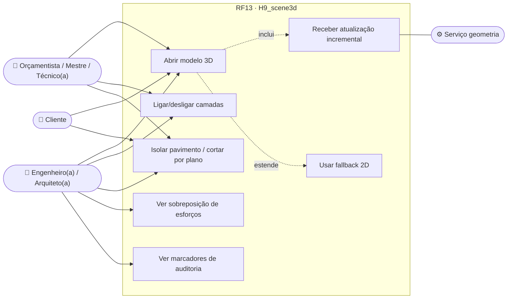
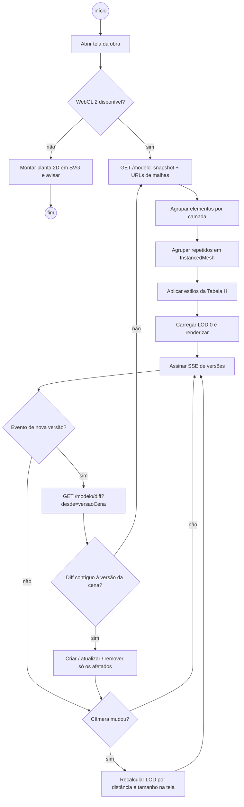
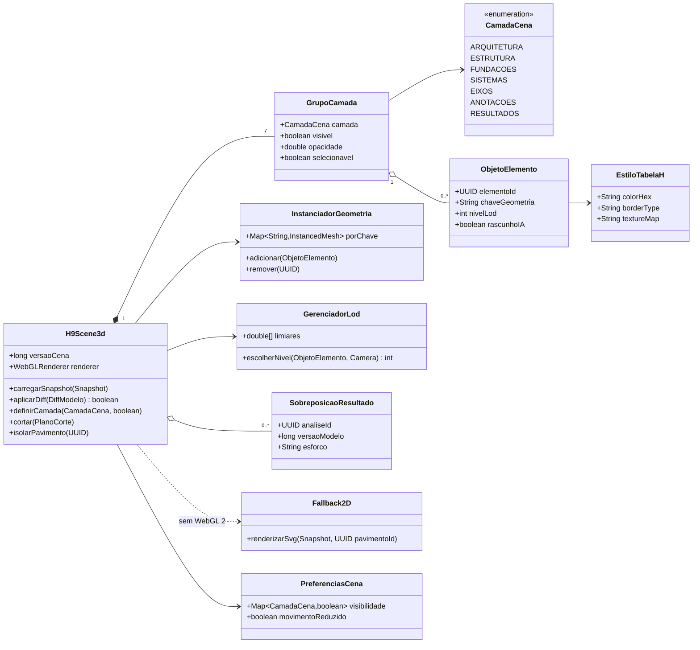
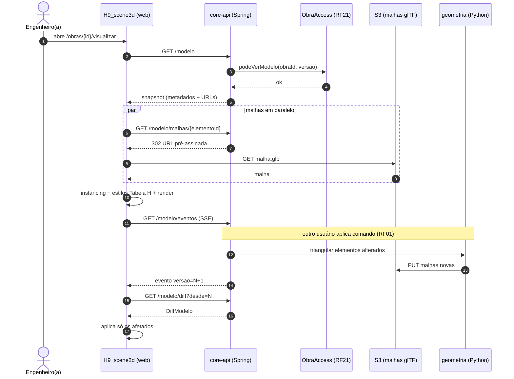
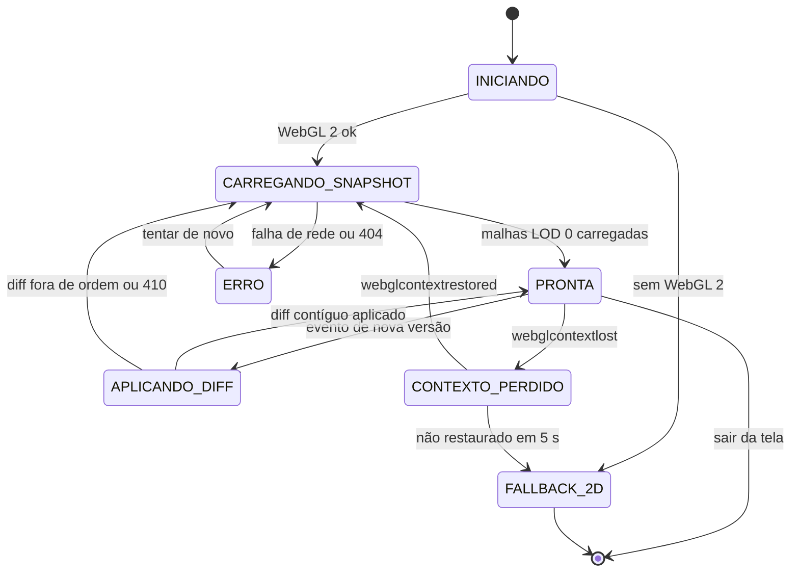
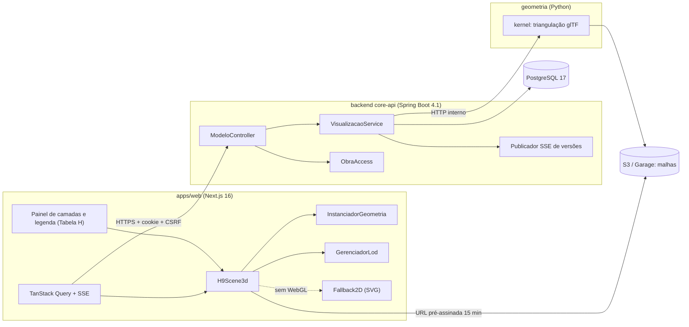

# RF13 · Renderização WebGL com gerenciador de cena 3D (H9_scene3d)

> O `H9_scene3d` é o gerenciador de cena único do web app: recebe o modelo BIM e os diffs de versão, monta a cena
> Three.js por camadas, aplica os estilos da Tabela H e sobrepõe resultados (esforços do RF05, correções da
> auditoria do RF16). É a "Saída pronta" do fluxo em três tempos da Notação VI.

## 1. Descrição

O gerenciador recebe um **snapshot** do modelo (`GET /modelo`) na abertura e depois só **diffs** (`DiffModelo`
do RF01), aplicando-os de forma incremental: cria, atualiza ou remove apenas os objetos afetados, sem
reconstruir a cena.

Organização da cena:

- **Camadas** (`CamadaCena`): `ARQUITETURA`, `ESTRUTURA`, `FUNDACOES`, `SISTEMAS`, `EIXOS`, `ANOTACOES`,
  `RESULTADOS`. Cada camada é um `THREE.Group` com visibilidade, opacidade e bloqueio de seleção próprios.
- **Instancing**: elementos repetidos com a mesma geometria-base (pilares de mesma seção, estacas, blocos) usam
  `InstancedMesh`; a geometria-base é chave `tipo + seção + material`.
- **LOD**: três níveis por elemento (caixa delimitadora, sólido simplificado, sólido completo com aberturas),
  escolhidos pela distância da câmera e pelo tamanho projetado na tela.
- **Estilos da Tabela H**: `colorHex`, `borderType` (`professional`, `dashed`, `hidden`) e `textureMap` vêm de
  `uiProperties`/Tabela H do material; nenhuma cor é fixada no código.
- **Cortes e isolamento**: planos de corte (`clippingPlanes`) horizontais por pavimento e verticais livres; isolar
  um pavimento esconde os demais.
- **Sobreposições**: diagramas N/V/M/T (RF05) como fitas sobre as barras, com valor máximo rotulado; marcadores da
  auditoria (RF06/RF16/RF17) com ícone + texto.
- **Fallback 2D**: sem WebGL 2 (ou com perda de contexto não recuperada), a tela troca para planta 2D em SVG gerada
  do mesmo modelo, com aviso.
- **Movimento**: com `prefers-reduced-motion: reduce`, transições de câmera viram cortes secos e não há animação
  de fitas de resultado.

A cena é **somente leitura** aqui; a edição é do RF01, que usa o mesmo gerenciador.

## 2. Atores

| Ator | Papel na obra | Pode |
|---|---|---|
| Engenheiro(a), Arquiteto(a) | `ENGENHEIRO`, `ARQUITETO` | ver todas as camadas e resultados, inclusive rascunhos |
| Orçamentista, Mestre de obras, Técnico(a) de segurança | `ORCAMENTISTA`, `MESTRE_OBRAS`, `TECNICO_SEGURANCA` | ver o modelo da versão aprovada mais recente |
| Cliente / proprietário | `CLIENTE` | ver só versões liberadas pela empresa (sem resultados de cálculo) |
| Fornecedor, Trabalhador | `FORNECEDOR`, `TRABALHADOR` | sem acesso à cena (403) |

## 3. Critérios de aceite

- [ ] **CA-01** 60 fps estáveis (p95 do tempo de quadro ≤ 16,7 ms) com 10 mil elementos em hardware de referência
  (GPU integrada classe Intel Iris Xe, Chrome estável), medidos por teste de desempenho no Playwright.
- [ ] **CA-02** Aplicar um diff de até 200 elementos leva ≤ 50 ms e não recria objetos não afetados (verificado
  pelo `uuid` dos `Object3D`).
- [ ] **CA-03** Visibilidade e opacidade por camada persistem por usuário e obra (preferências, `localStorage`
  só como cache).
- [ ] **CA-04** Cor nunca é o único sinal: legenda com ícone Lucide + texto para estado de elemento, risco e
  "gerado por IA" (WCAG 1.4.1).
- [ ] **CA-05** Com `prefers-reduced-motion: reduce`, nenhuma animação acima de 0 ms.
- [ ] **CA-06** Sem WebGL 2, o fallback 2D aparece em ≤ 1 s com a mensagem "Seu navegador não suporta 3D; mostrando a
  planta 2D".
- [ ] **CA-07** Elementos de `RascunhoIA` não aprovado aparecem com o estilo `--ai-draft-*` + selo "gerado por IA".
- [ ] **CA-08** Cliente só recebe versões com `liberadaCliente = true`; pedir outra versão → 404.
- [ ] **CA-09** Perda de contexto WebGL (`webglcontextlost`) é recuperada sem recarregar a página.
- [ ] **CA-10** Comandos de vista e visibilidade do motor de desenho (RF28, [catálogo](../CATALOGO_COMANDOS.md))
  agem só na cena e por sessão, sem gerar `ComandoVI`: `Z`/`ZE`/`ZA` zoom e enquadrar, `P` pan, `RE` reconstruir
  a cena do modelo, `HH` ocultar, `HI` isolar, `EU`/`VU` reexibir elemento/categoria, `VG` painel de
  visibilidade e estilos (Tabela H), `LA` camadas (`arquitetura`, `estrutura`, `fundacao`, `desenho`,
  `anotacao`, `ia-rascunho`), `MA` copiar propriedades visuais.

## 4. Regras de negócio

- **RN-01** A cena nunca é fonte da verdade: toda geometria vem do backend (snapshot + diffs ordenados por versão).
- **RN-02** Diff fora de ordem (`versaoBase` ≠ versão da cena) → descarta e pede `GET /modelo/diff?desde=`.
- **RN-03** Geometria triangulada vem do serviço `geometria` (malha glTF binária por elemento, cacheada no S3 por
  `hash(elemento, versão)`); o web não tria sólidos BRep.
- **RN-04** Resultados de cálculo só aparecem se forem da mesma versão do modelo; se não, a camada mostra
  "Resultado desatualizado".
- **RN-05** Seleção e destaque usam contorno (outline) + rótulo, não só cor.

## 5. Base legal e normas

- LGPD: a cena não traz dados pessoais; nome do responsável técnico aparece só no carimbo de pranchas (RF14).
- WCAG 2.2 AA: 1.4.1 (uso de cor), 1.4.11 (contraste não textual ≥ 3:1), 2.3.3 (animação a partir de interações),
  2.4.11 (foco visível nos controles de camada).
- NBR 6492 para simbologia nas vistas 2D do fallback.

## 6. API

| Método e rota | Descrição | Respostas |
|---|---|---|
| `GET /api/v1/obras/{obraId}/modelo?versao=` | Snapshot (metadados + URLs das malhas glTF) | 200, 403, 404 |
| `GET /api/v1/obras/{obraId}/modelo/diff?desde={versao}` | Diffs desde a versão | 200, 404, 410 (versão compactada → pedir snapshot) |
| `GET /api/v1/obras/{obraId}/modelo/malhas/{elementoId}?versao=` | Redireciona (302) para URL pré-assinada (15 min) da malha | 302, 404 |
| `GET /api/v1/obras/{obraId}/resultados/{analiseId}/sobreposicao` | Fitas N/V/M/T e máximos (RF05) | 200, 404, 409 (versão diferente) |
| `GET /api/v1/obras/{obraId}/modelo/eventos` | SSE com número da nova versão | 200 (stream) |

## 7. Diagramas

### 7.1 Casos de uso

### 7.2 Atividades

### 7.3 Classes

### 7.4 Sequência

### 7.5 Máquina de estados (H9Scene3d)

### 7.6 Componentes

## 8. Testes previstos

| Tipo | Caso |
|---|---|
| Unitário (web) | `aplicarDiff` com diff contíguo altera só os objetos afetados; fora de ordem retorna `false` |
| Unitário (web) | `InstanciadorGeometria` agrupa 500 pilares iguais em um `InstancedMesh` |
| Unitário (web) | `GerenciadorLod` troca de nível nos limiares configurados |
| Integração `*IT` | `CLIENTE` pede versão não liberada → 404; `FORNECEDOR` → 403 |
| Integração `*IT` | `GET /diff` de versão compactada → 410 |
| Desempenho (Playwright) | modelo sintético de 10 mil elementos: p95 do quadro ≤ 16,7 ms |
| E2E (Playwright + axe) | legenda com ícone + texto; `prefers-reduced-motion` sem animações; fallback 2D com WebGL desligado |

## 9. Rastreabilidade

| Camada | Artefato | Status |
|---|---|---|
| Documento | `docs/rf/RF13-renderizacao-cena-3d.md` | ✅ |
| Card | [Trello S0TACTtJ](https://trello.com/c/S0TACTtJ) | ✅ |
| Web | `apps/web/src/canvas/H9Scene3d.ts`, `scene/InstanciadorGeometria.ts`, `scene/GerenciadorLod.ts`, `fallback2d/` | ⏳ |
| Aplicação | `cca-application · modelo/ModeloService.java#snapshot` (por camada, CLIENTE/FORNECEDOR só versão liberada → 404, sem `ia-rascunho`), `#diffDesde`, `#liberarCliente` | ✅ |
| API | `cca-web · api/modelo/ModeloController.java` (`GET /modelo/snapshot?versao`, `GET /modelo/diff?desde`, `PATCH /modelo/liberar-cliente`); publicador SSE | 🟡 |
| Geometria | `geometria/kernel/triangulacao.py` (glTF) | ⏳ |
| Testes | `SnapshotClienteIT` (CA-08: 404 antes da liberação, FORNECEDOR 403, cliente sem `ia-rascunho`); `scene.perf.spec.ts`, `scene.a11y.spec.ts` | 🟡 |

## Auditoria 2026-10

Auditoria pelo uso real do app ([relatório](../auditoria/AUDITORIA_2026-10.md)). Nota (conclusão 30%, precisão 25%, clareza
20%, feedback 15%, consistência/acessibilidade 10%): **7,0 → 7,5**.

- **Corrigido:** Cliente e fornecedor veem só a versão liberada, sem rascunhos de IA (antes viam a atual).
- **Evidência:** j3 CA-08, liberado; SnapshotClienteIT.
- **Pendente:** 3D só inspeciona e seleciona; sem corte interativo.

## Auditoria 2026-10 · 2ª rodada

Estrutura, materiais e conformidade ([relatório](../auditoria/AUDITORIA_2026-10_ESTRUTURA_INSTALACOES_MATERIAIS.md)).

- **Corrigido:** vigas e lajes com a face superior na elevação do pavimento (a mesma convenção da análise; antes apareciam no pavimento de cima); contraventamento sólido; rotação do pilar também no 2D; raio X, corte horizontal e armaduras do último dimensionamento (polilinhas do detalhamento, com estado do resultado).
- **Evidência:** j5 `j5-06-3d-armaduras-raio-x.png`.
- **Pendente:** filtros por sistema de instalações (não há instalações no modelo).

## Auditoria AUD-CC-3D-001

([relatório](../auditoria/AUDITORIA_AUD-CC-3D-001.md))

- **Corrigido/novo:** dez modos (realista dia/noite, luzes apagadas, unlit, sólido, linhas ocultas, wireframe, malha, nós, pontos — os três últimos avisam que não são MEF nem nuvem de pontos); sol pela hora, data e latitude (declinação de Cooper, norte = +y); luminárias com fluxo e temperatura de cor do catálogo, desligáveis sem mexer no circuito; exposição; sombras do sol; paredes recortadas pelos vãos com folha e vidro; vistas de fachada e topo; corte vertical; objetos e pessoas por formas procedurais; percursos de instalações por cor de sistema; 1ª pessoa com colisão; isolamento por disciplina; link de conflito abre em Raio X enquadrando os elementos.
- **Evidência:** `j6-interface.json`, telas `aud3d/06`–`18`.
- **Pendente:** luminárias não projetam sombra (a luz atravessa paredes); desempenho a medir com GPU (sem GPU: ~9 qps realista, ~26 qps sólido).

### 2ª rodada (2026-10-31)

Escadas e rampas como sólidos (perfil extrudado, o mesmo do IFC); em 1ª pessoa a pessoa sobe e desce lances, fica na altura do degrau e para na borda da laje de cima; "Gravar posição da pessoa" leva ponto, direção e nível ao modelo pelo auditor; à noite as 4 primeiras luminárias acesas projetam sombra ([§10 do relatório](../auditoria/AUDITORIA_AUD-CC-3D-001.md)). **Pendente:** sombra de luminárias de dia; edição de luz por instância.
