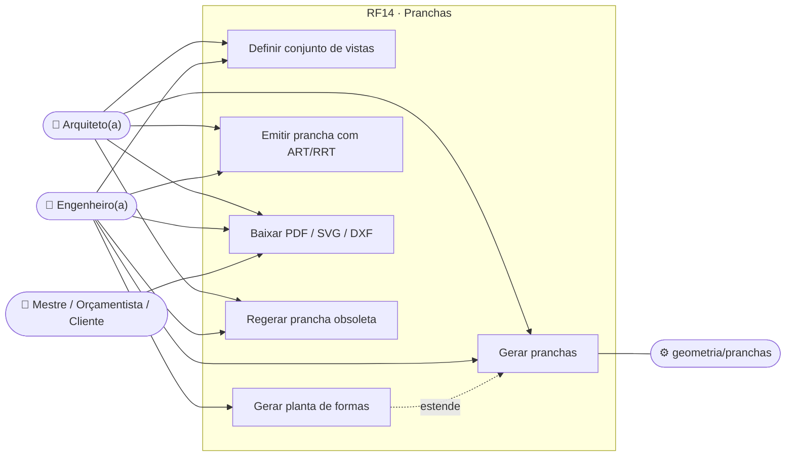
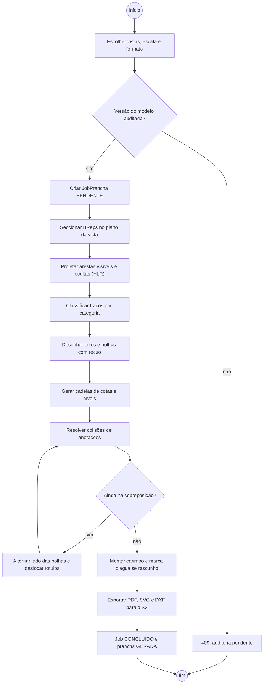
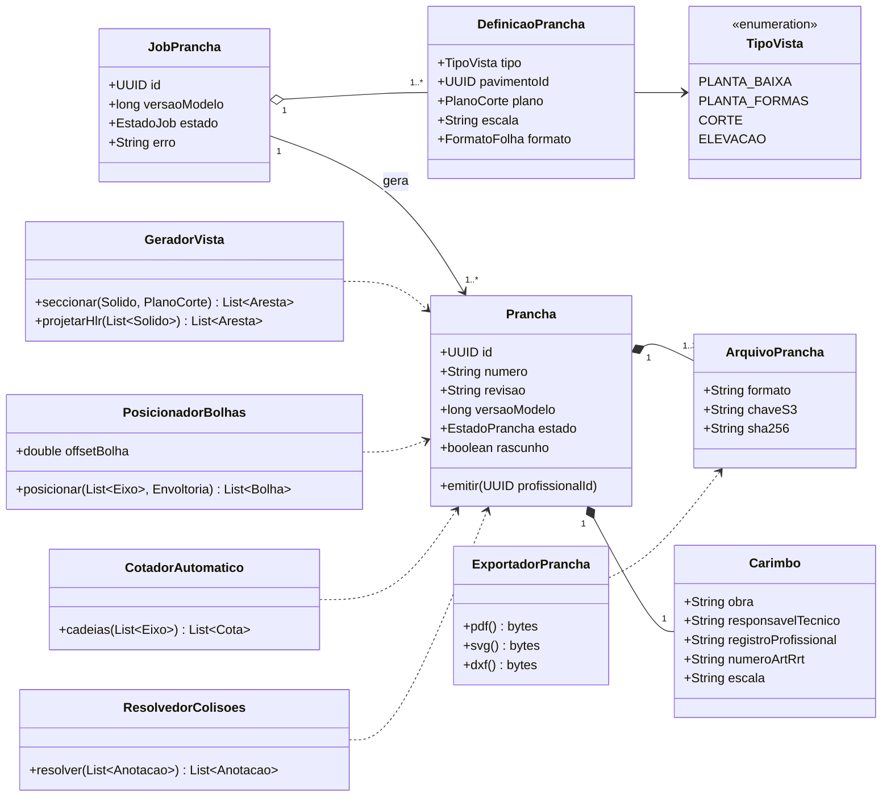
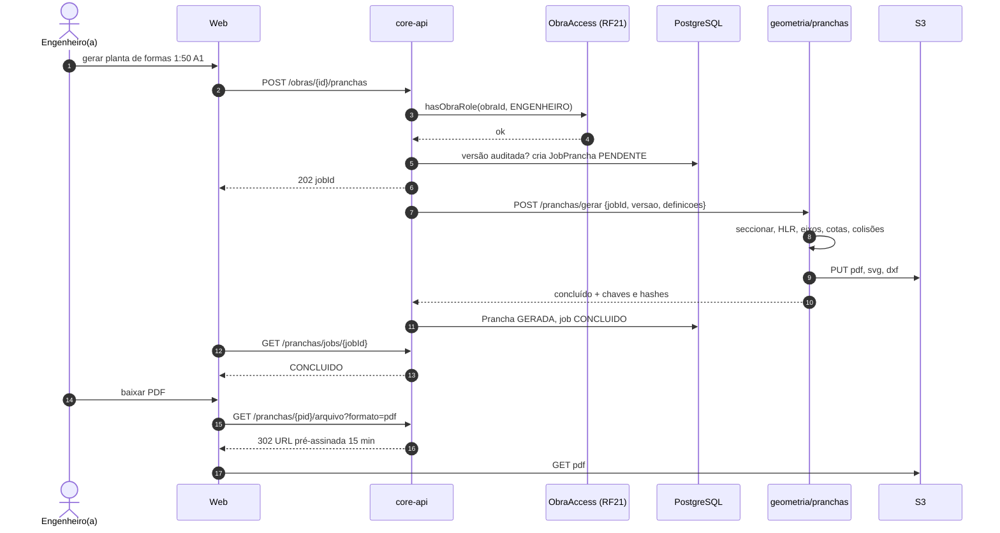
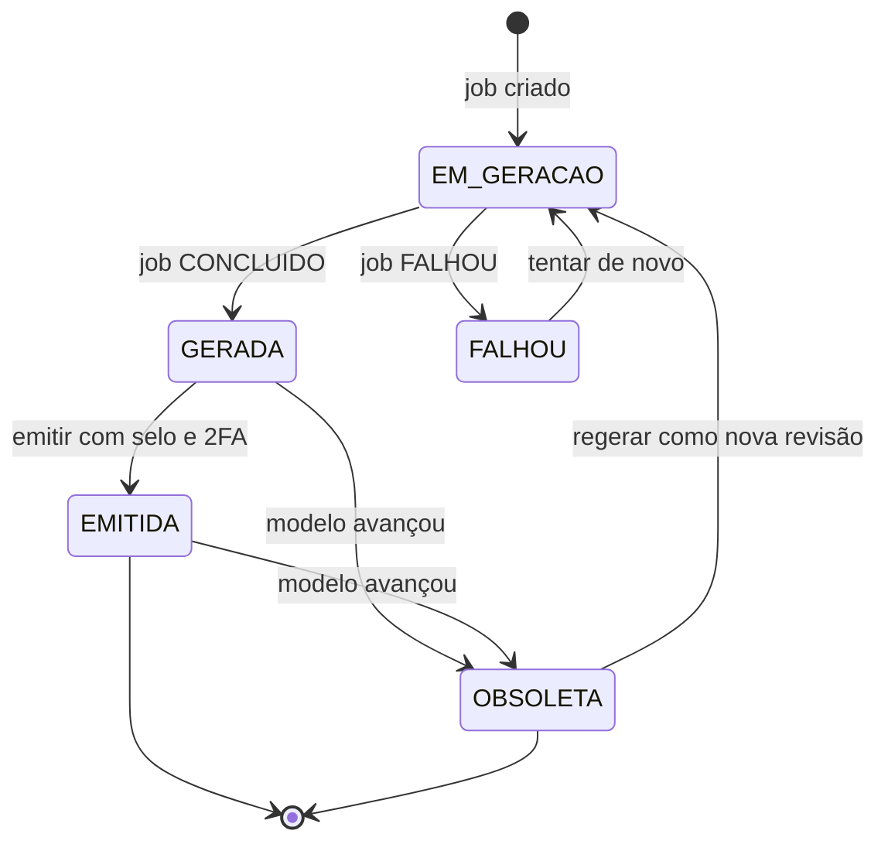
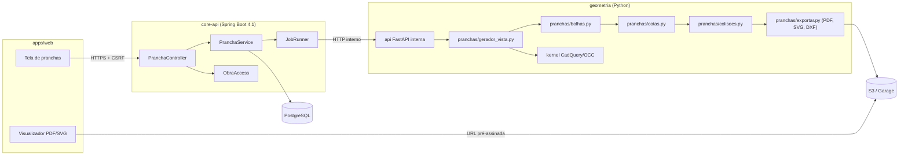

# RF14 · Geração autônoma de plantas e cortes com recuo de eixos

> A partir de uma versão **auditada** do modelo BIM, o sistema gera pranchas técnicas prontas para impressão
> (planta baixa, planta de formas, cortes e elevações) com cotas, eixos com bolhas recuadas, legenda e carimbo
> com o responsável técnico e o número da ART/RRT, exportadas em PDF, SVG e DXF.

## 1. Descrição

O usuário escolhe um **conjunto de vistas** (`DefinicaoPrancha`): tipo de vista, pavimento ou plano de corte,
escala (1:20, 1:25, 1:50, 1:75, 1:100, 1:200) e formato de folha (A0–A4, NBR 16752). O core-api cria um
`JobPrancha` (`PENDENTE`) e o serviço `geometria/pranchas` executa:

1. **Seção do sólido**: corta os BReps do kernel (CadQuery/OpenCASCADE) no plano da vista (planta: plano
   horizontal a 1,50 m acima do piso do pavimento; corte: plano vertical definido pelo usuário) e projeta as
   arestas visíveis e ocultas (`HLRBRep`).
2. **Classificação de traço** por categoria do elemento: cortado (traço grosso), em vista (médio), oculto
   (tracejado), conforme NBR 6492 e `borderType` da Tabela H.
3. **Eixos e bolhas**: desenha os eixos do RF03 estendidos além da envoltória real (Xmin…Xmax, Ymin…Ymax do RF06)
   e posiciona as bolhas com **recuo** (`offsetBolha`, padrão 1,5 m na escala real ou 15 mm no papel, o maior),
   evitando sobreposição entre bolhas e com a geometria.
4. **Cotas**: cadeias de cotas automáticas entre eixos, totais por direção, cotas de vãos de aberturas e níveis
   (cota de piso acabado) nos cortes.
5. **Anti-colisão de anotações**: resolve sobreposição de textos, cotas e bolhas por deslocamento incremental em
   uma grade de prioridade (bolha > cota total > cota parcial > rótulo).
6. **Carimbo**: nome da obra, endereço, prancha n/N, escala, data, versão do modelo, responsável técnico,
   CREA/CAU e número de ART/RRT (RF22). Enquanto o modelo ou o cálculo vinculado for rascunho, marca d'água
   **"RASCUNHO — NÃO APROVADO"**.
7. **Exportação**: PDF vetorial (folha ABNT com margens), SVG e DXF (camadas por categoria). Arquivos vão para o
   S3 e são servidos por URL pré-assinada de 15 min.

A prancha fica vinculada à `versaoModelo`; se o modelo avançar, ela passa para `OBSOLETA` e a tela sugere
regerar.

## 2. Atores

| Ator | Papel na obra | Pode |
|---|---|---|
| Arquiteto(a) | `ARQUITETO` | gerar plantas baixas, cortes e elevações de arquitetura; emitir com RRT |
| Engenheiro(a) responsável | `ENGENHEIRO` | gerar todas as pranchas, incluindo planta de formas; emitir com ART |
| Mestre de obras, Orçamentista | `MESTRE_OBRAS`, `ORCAMENTISTA` | baixar pranchas emitidas |
| Cliente | `CLIENTE` | baixar pranchas emitidas e liberadas |
| Serviço geometria | sistema | executar o job de geração |

## 3. Critérios de aceite

- [ ] **CA-01** Nenhuma bolha de eixo sobrepõe outra bolha, cota ou geometria (teste geométrico de interseção das
  caixas de texto na prancha gerada).
- [ ] **CA-02** Escala e formato ABNT respeitados: folha A0–A4 com margens da NBR 16752; escala impressa no carimbo
  e verificada por medição de uma cota conhecida no PDF (erro ≤ 0,1 mm).
- [ ] **CA-03** Prancha guarda `versaoModelo`; mudança no modelo marca a prancha como `OBSOLETA`.
- [ ] **CA-04** Marca d'água "RASCUNHO — NÃO APROVADO" enquanto houver `RascunhoIA` não aprovado ou cálculo não
  aprovado vinculado; some só na emissão por profissional com selo `VERIFIED` e 2FA (RF21/RF27).
- [ ] **CA-05** Geração em job assíncrono com estado acompanhável; arquivo no S3 com URL pré-assinada de 15 min.
- [ ] **CA-06** Cotas totais por direção batem com a envoltória real auditada (RF06) com erro 0.
- [ ] **CA-07** DXF abre no AutoCAD/LibreCAD com camadas `EIXOS`, `COTAS`, `CORTADO`, `VISTA`, `OCULTO`, `TEXTO`.
- [ ] **CA-08** Planta de formas só para `ENGENHEIRO`; pedido por outro papel → 403 com motivo em pt-BR.
- [ ] **CA-09** A prancha gerada pode ser complementada à mão com os comandos de anotação do motor de desenho
  (RF28, [catálogo](../CATALOGO_COMANDOS.md)): `DLI` cota linear, `DAL`/`DI` cota alinhada, `DCO` cota
  contínua, `D` estilo de cota (NBR 10126), `EL` cota de nível, `DL` linha de detalhe, `TX`/`MT` texto, `TG`
  etiqueta por categoria, `H` hachura por material, `B`/`I` blocos (símbolos e carimbo), `BREAKLINE` linha de
  quebra, `FIND` busca e substitui em textos. Anotações manuais ficam em camada própria (`anotacao`) e
  sobrevivem à regeneração da prancha quando o elemento referenciado ainda existe.

## 4. Regras de negócio

- **RN-01** Só gera a partir de versão do modelo com auditoria aprovada (RF16); senão `409` "Modelo com auditoria
  pendente".
- **RN-02** Plano de corte da planta baixa: 1,50 m acima da elevação do pavimento (configurável por projeto).
- **RN-03** `offsetBolha` = max(1,5 m × fator, 15 mm no papel); bolhas alternam lados quando o espaçamento entre
  eixos no papel for < 2 × diâmetro da bolha.
- **RN-04** Numeração das pranchas por obra e disciplina (`ARQ-01`, `EST-01`…), sem reuso de número.
- **RN-05** Emissão (`EMITIDA`) é imutável: alteração gera nova revisão (`R01`, `R02`) com histórico.

## 5. Base legal e normas

- NBR 16752 (desenho técnico — folhas, margens e legenda), NBR 6492 (representação de projetos de arquitetura),
  NBR 7191 (desenho de estruturas de concreto, para a planta de formas).
- Lei 6.496/1977 e Resolução CONFEA 1.137/2023 (ART); Lei 12.378/2010 e resoluções do CAU (RRT): carimbo com
  responsável técnico e número do registro.
- LGPD: o carimbo contém nome e registro profissional do responsável técnico — tratamento por cumprimento de
  obrigação legal (Art. 7º, II); nenhum outro dado pessoal na prancha.

## 6. API

| Método e rota | Descrição | Respostas |
|---|---|---|
| `POST /api/v1/obras/{obraId}/pranchas` | Cria job (`definicoes[]`, `versaoModelo`, `formatos[]`) | 202 + `jobId`, 403, 404, 409, 422 |
| `GET /api/v1/obras/{obraId}/pranchas/jobs/{jobId}` | Estado do job | 200, 404 |
| `GET /api/v1/obras/{obraId}/pranchas` | Lista pranchas com estado e versão | 200 |
| `GET /api/v1/obras/{obraId}/pranchas/{pranchaId}/arquivo?formato=pdf` | 302 para URL pré-assinada (15 min) | 302, 404 |
| `POST /api/v1/obras/{obraId}/pranchas/{pranchaId}/emitir` | Emite (requer selo + 2FA) | 200, 403, 409 |

## 7. Diagramas

### 7.1 Casos de uso

### 7.2 Atividades

### 7.3 Classes

### 7.4 Sequência

### 7.5 Máquina de estados (Prancha)

### 7.6 Componentes

## 8. Testes previstos

| Tipo | Caso |
|---|---|
| Unitário (Python) | `PosicionadorBolhas`: malha 5x3 com espaçamento 1,0 m a 1:100 alterna lados e não sobrepõe |
| Unitário (Python) | `CotadorAutomatico`: soma das cotas parciais = cota total = envoltória real |
| Unitário (Python) | `ResolvedorColisoes`: nenhuma interseção entre caixas de texto após resolver |
| Unitário (Python) | PDF A1 1:50: cota de 5,00 m mede 100,0 mm ± 0,1 mm |
| Integração `*IT` | `ARQUITETO` pede planta de formas → 403; versão sem auditoria → 409 |
| Integração `*IT` | comando aplicado após a geração → prancha `OBSOLETA` |
| Integração `*IT` | emitir sem selo `VERIFIED` ou sem 2FA → 403 |

## 9. Rastreabilidade

| Camada | Artefato | Status |
|---|---|---|
| Documento | `docs/rf/RF14-geracao-plantas-cortes.md` | ✅ |
| Card | [Trello MCxqnKl2](https://trello.com/c/MCxqnKl2) | ✅ |
| Geometria | `cca-application · prancha/GeradorPrancha.java` (SVG/DXF R12 determinísticos: eixos e bolhas recuadas, cotas totais pela envoltória real, camadas EIXOS/COTAS/CORTADO/VISTA/OCULTO/TEXTO, carimbo, marca d'água RASCUNHO); `geometria/pranchas/` (Python) | 🟡 |
| Aplicação | `cca-application · prancha/PranchaService.java` (solicitar exige conclusão RF16; PLANTA_FORMAS só ENGENHEIRO/DONO/ADMIN; job `processarPendentes` como sistema; download pré-assinado 15 min; emitir exige 2FA + selo + ART/RRT) | ✅ |
| API | `cca-web · api/prancha/PranchaController.java` (`POST /pranchas` 202, `GET /pranchas`, `GET /pranchas/{id}`, `GET /{id}/download`, `POST /{id}/emitir`) | ✅ |
| Banco | `V7__modelo_bim.sql` (prancha: EM_GERACAO→GERADA→EMITIDA/OBSOLETA, FALHOU) | ✅ |
| Web | `apps/web/src/app/(app)/obras/[obraId]/pranchas/` | ⏳ |
| Testes | `PranchaIT` (envoltória aberta → 422, arquiteto não pede formas, SVG/DXF, emissão sem 2FA → 403, emitida sem marca d'água); `test_bolhas.py`, `test_cotas.py` | 🟡 |

## Auditoria 2026-10

Auditoria pelo uso real do app ([relatório](../auditoria/AUDITORIA_2026-10.md)). Nota (conclusão 30%, precisão 25%, clareza
20%, feedback 15%, consistência/acessibilidade 10%): **4,7 → 8,0**.

- **Corrigido:** Toda prancha com porta ou janela falhava (`%.1f` com inteiro) — corrigido e coberto por `GeradorPranchaTest`; falha de geração registra a causa e mostra mensagem clara.
- **Evidência:** j3 CA-03/04/05/07; GeradorPranchaTest, PranchaIT.
- **Pendente:** Sem PDF (só SVG e DXF).
