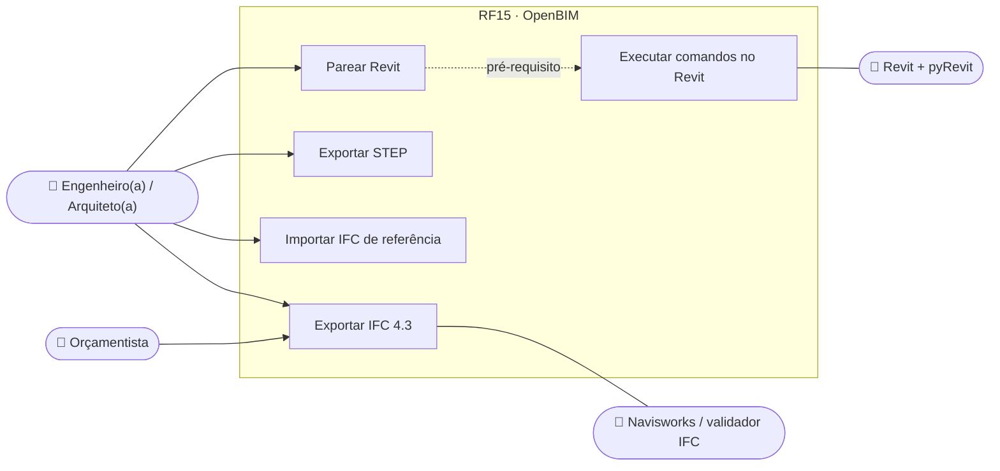
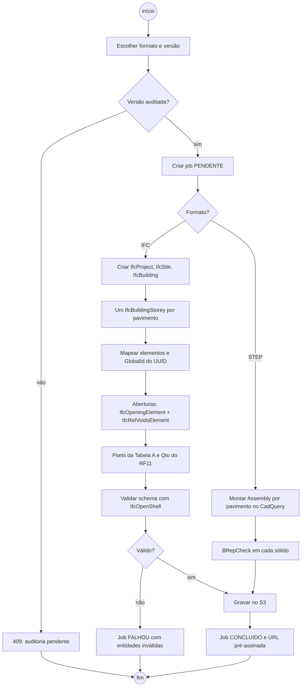
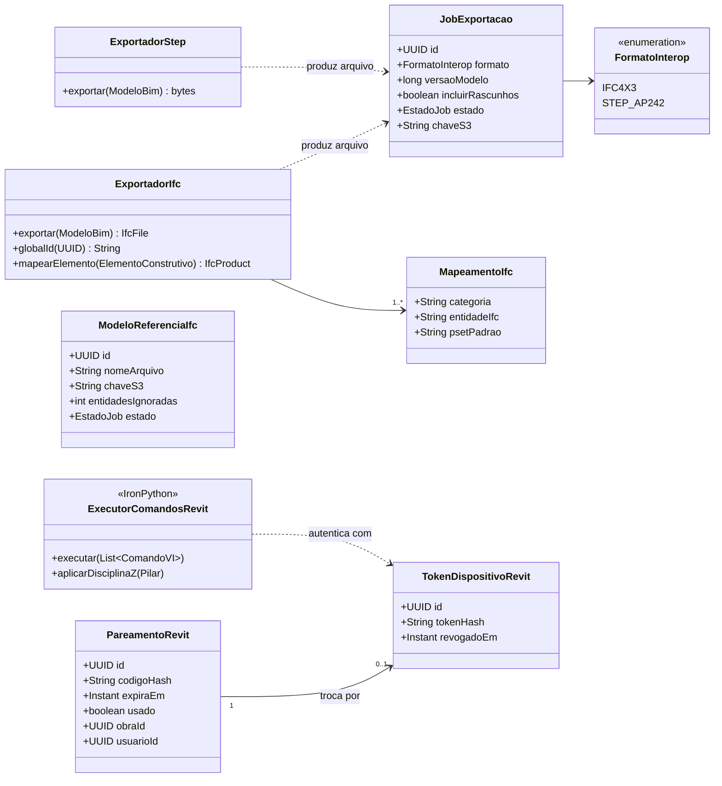
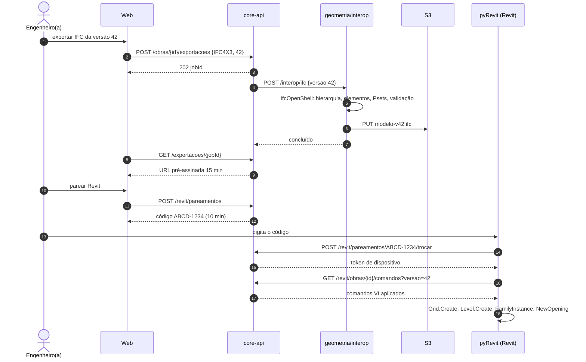
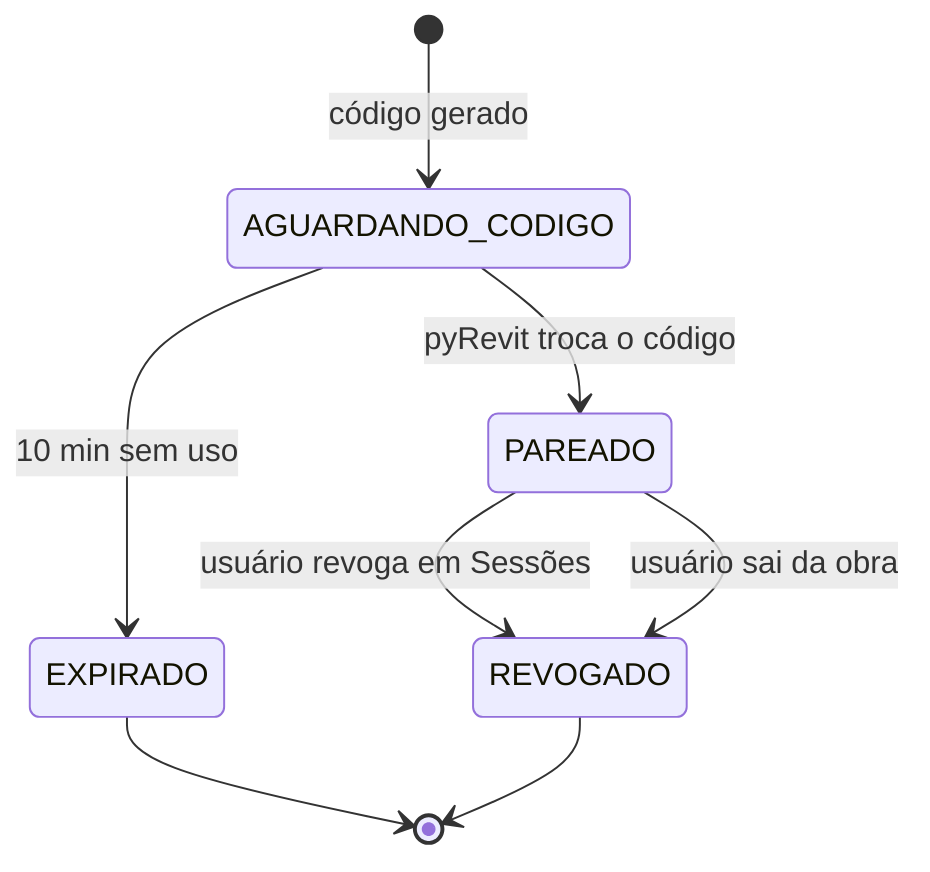
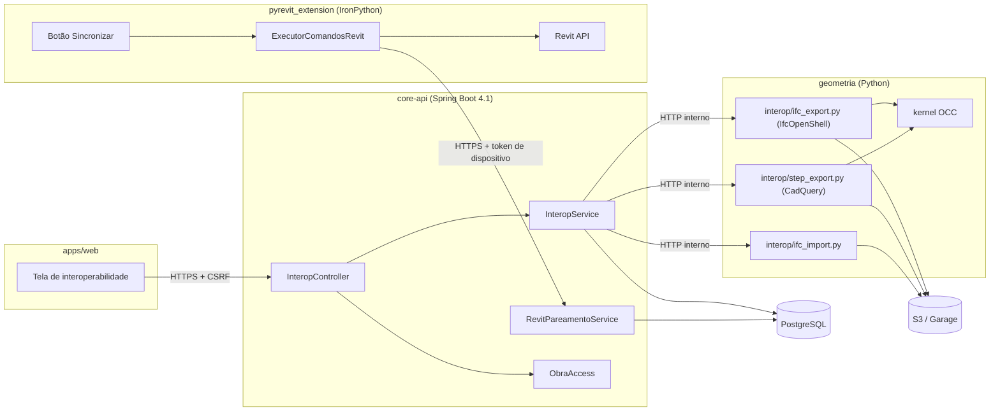

# RF15 · Interoperabilidade OpenBIM (exportação IFC / CadQuery STEP)

> O modelo do CivilConstructorAI sai e entra por formatos abertos: **IFC 4.3** (IfcOpenShell) para troca BIM com
> qualquer ferramenta, **STEP AP242** (CadQuery/OpenCASCADE) para sólidos, e uma **ponte pyRevit** que leva os
> comandos auditados para dentro do Autodesk Revit pela Revit API.

## 1. Descrição

**Exportação IFC 4.3** (`geometria/interop/ifc_export.py`, IfcOpenShell):

- Hierarquia espacial: `IfcProject` → `IfcSite` (localização da obra em `RefLatitude`/`RefLongitude` a partir do
  PostGIS) → `IfcBuilding` → `IfcBuildingStorey` (um por pavimento, `Elevation` = elevação Z do RF03).
- Elementos: `IfcWall`, `IfcColumn`, `IfcBeam`, `IfcSlab`, `IfcOpeningElement` + `IfcRelVoidsElement`,
  `IfcDoor`/`IfcWindow` + `IfcRelFillsElement`, `IfcFooting`, `IfcPile`, `IfcGrid`/`IfcGridAxis`.
- Geometria: `IfcExtrudedAreaSolid` quando o elemento é prismático; `IfcFacetedBrep` como fallback.
- Propriedades: Psets padrão (`Pset_ColumnCommon`, `Pset_WallCommon`…) + `Pset_CivilConstructor_TabelaA` com os
  campos do material (`materialId`, `fck_MPa`, `fireRating`, `thermalTransmittance`, `loadBearing`) e
  `Qto_*BaseQuantities` com as quantidades do RF11.
- `GlobalId`: derivado deterministicamente do UUID v7 do elemento (compressão base64 IFC de 22 caracteres), então
  o mesmo elemento mantém o mesmo `GlobalId` entre exportações.

**Exportação STEP** (`geometria/interop/step_export.py`, CadQuery): um `Assembly` por pavimento com os sólidos
BRep do kernel, nomes = código do elemento, cores da Tabela H.

**Importação IFC (referência)**: um IFC externo (ex.: arquitetura feita em outro software) entra como **modelo de
referência** somente leitura, exibido como camada no RF13 e usado para detecção de interferências; não vira
elemento editável sem conversão explícita (que gera comandos VI e passa pelo RF16).

**Ponte pyRevit** (`pyrevit_extension/CivilConstructor.extension/`): botão no Revit que, autenticado por código de
pareamento de uso único (sem guardar senha), baixa os comandos VI aplicados de uma versão e os executa via Revit
API (`Grid.Create`, `Level.Create`, `FamilyInstance` para pilares/vigas, `Wall.Create`, `NewOpening`), aplicando
as mesmas regras do auditor (Disciplina Z do RF17, ShortCurveTolerance do RF08) em IronPython. O sentido
Revit → CivilConstructorAI é por IFC.

## 2. Atores

| Ator | Papel na obra | Pode |
|---|---|---|
| Engenheiro(a), Arquiteto(a) | `ENGENHEIRO`, `ARQUITETO` | exportar IFC/STEP, importar IFC de referência, parear o Revit |
| Orçamentista | `ORCAMENTISTA` | exportar IFC (quantitativos) |
| Revit / Navisworks / validadores | sistemas externos | consumir IFC e STEP |
| pyRevit | sistema externo | puxar comandos VI de uma versão pareada |

## 3. Critérios de aceite

- [ ] **CA-01** IFC gerado passa no validador buildingSMART (schema IFC4X3_ADD2 e regras normativas) sem erros.
- [ ] **CA-02** `GlobalId` estável: exportar duas vezes a mesma versão produz os mesmos `GlobalId`; elemento alterado
  mantém o `GlobalId`.
- [ ] **CA-03** Ida e volta (exportar → importar como referência) preserva quantidade e tipo de elementos por
  pavimento e volumes com erro ≤ 0,1 %.
- [ ] **CA-04** Nenhum dado pessoal no IFC/STEP além do responsável técnico em `IfcOwnerHistory`/`IfcPerson`, e só
  quando a prancha/modelo foi emitido; caso contrário `IfcOwnerHistory` usa a organização (empresa).
- [ ] **CA-05** STEP abre no FreeCAD com um sólido válido por elemento (`BRepCheck` ok).
- [ ] **CA-06** Pareamento pyRevit: código de 8 caracteres, uso único, expira em 10 min, vinculado a uma obra e a um
  usuário; token resultante revogável na tela de sessões (RF23).
- [ ] **CA-07** Executar no Revit os comandos de um prédio de 4 pavimentos e malha 5x3 gera pilares com
  `BASE_OFFSET = 0` e `TOP_OFFSET = 0` em todos os níveis.
- [ ] **CA-08** Exportação é job assíncrono; arquivo no S3 com URL pré-assinada de 15 min.

## 4. Regras de negócio

- **RN-01** Só exporta versão do modelo com auditoria aprovada (RF16).
- **RN-02** Elementos de `RascunhoIA` não aprovado são exportados com `Pset_CivilConstructor_Status.Rascunho = TRUE`
  ou excluídos, conforme escolha do usuário (padrão: excluir).
- **RN-03** IFC importado tem tamanho máx. 200 MB; entidades desconhecidas são ignoradas e listadas no relatório.
- **RN-04** Unidades sempre SI (metro, quilograma, segundo) declaradas em `IfcUnitAssignment`.
- **RN-05** A ponte pyRevit nunca escreve de volta no CivilConstructorAI; o caminho de retorno é IFC importado.

## 5. Base legal e normas

- ISO 16739-1:2024 (IFC 4.3), ISO 10303-242 (STEP AP242), NBR ISO 12006-2 (classificação).
- Decreto 11.888/2024 (Estratégia BIM BR) e Decreto 10.306/2020: uso de BIM e formatos abertos em obras públicas.
- LGPD: minimização (Art. 6º, III) — o arquivo exportado não leva dados de usuários além do responsável técnico
  exigido por lei (Art. 7º, II).

## 6. API

| Método e rota | Descrição | Respostas |
|---|---|---|
| `POST /api/v1/obras/{obraId}/exportacoes` | Job de exportação (`formato`: `IFC4X3`, `STEP`; `versaoModelo`; `incluirRascunhos`) | 202, 403, 404, 409 |
| `GET /api/v1/obras/{obraId}/exportacoes/{id}` | Estado + URL pré-assinada quando concluído | 200, 404 |
| `POST /api/v1/obras/{obraId}/referencias-ifc` | Upload pré-assinado de IFC de referência | 201, 413, 422 |
| `POST /api/v1/obras/{obraId}/revit/pareamentos` | Gera código de pareamento | 201, 403 |
| `POST /api/v1/revit/pareamentos/{codigo}/trocar` | pyRevit troca o código por token de dispositivo | 200, 404, 410 |
| `GET /api/v1/revit/obras/{obraId}/comandos?versao=` | pyRevit baixa comandos VI aplicados até a versão | 200, 401, 404 |

## 7. Diagramas

### 7.1 Casos de uso

### 7.2 Atividades

### 7.3 Classes

### 7.4 Sequência

### 7.5 Máquina de estados (PareamentoRevit)

### 7.6 Componentes

## 8. Testes previstos

| Tipo | Caso |
|---|---|
| Unitário (Python) | `globalId(uuid)` é determinístico e tem 22 caracteres do alfabeto IFC |
| Unitário (Python) | parede com janela gera `IfcOpeningElement` + `IfcRelVoidsElement` + `IfcRelFillsElement` |
| Integração (Python) | IFC do prédio de 4 pavimentos passa em `ifcopenshell.validate` sem erros |
| Integração (Python) | ida e volta: contagem por tipo e volume total iguais (≤ 0,1 %) |
| Integração `*IT` | código de pareamento reutilizado → 410; expirado → 410; token revogado → 401 |
| Integração `*IT` | exportar versão sem auditoria → 409; `MESTRE_OBRAS` exportar → 403 |
| Manual / CI Windows opcional | script pyRevit em modelo vazio cria níveis, eixos e pilares com offsets zerados |

## 9. Rastreabilidade

| Camada | Artefato | Status |
|---|---|---|
| Documento | `docs/rf/RF15-interoperabilidade-openbim.md` | ✅ |
| Card | [Trello aLnGEB4O](https://trello.com/c/aLnGEB4O) | ✅ |
| Geometria | `cca-application · interop/EscritorIfc.java` (IFC4X3_ADD2 STEP: Project→Site→Building→Storey→Wall/Column/Beam/Slab/Door/Window/Footing + Pset Tabela A), `LeitorIfc.java` (leitura/validação de referência); `geometria/interop/*.py` | 🟡 |
| pyRevit | `pyrevit_extension/CivilConstructor.extension/`; backend: pareamento por código de uso único (6 dígitos, 10 min) → token de dispositivo (hash SHA-256), `GET /revit/comandos?desde` | 🟡 |
| Aplicação | `cca-application · interop/InteropService.java` (exportação exige conclusão por pavimento, job como sistema, download pré-assinado, importação ≤ 32 MB, pareamento/revogação) | ✅ |
| API | `cca-web · api/interop/InteropController.java` (`POST /obras/{id}/exportacoes` 202, `GET`, `/download`, `POST /importacoes/ifc`, `POST /revit/pareamentos`, `/revogar`, `POST /api/v1/revit/parear`, `GET /api/v1/revit/comandos`) | ✅ |
| Banco | `V7__modelo_bim.sql` (exportacao_modelo, pareamento_revit) | ✅ |
| Pendente | STEP AP242 é esboço (mesmo gerador, cabeçalho AP242); `/api/v1/revit/**` precisa de `permitAll` em `SegurancaConfig` (hoje atrás da sessão) | 🟡 |
| Testes | `EscritorIfcTest`, `ExportacaoIfcIT` (exporta, lê de volta, importa referência, pareia Revit e rejeita reuso do código); `test_ifc_export.py`, `test_roundtrip.py` | 🟡 |

## Auditoria 2026-10

Auditoria pelo uso real do app ([relatório](../auditoria/AUDITORIA_2026-10.md)). Nota (conclusão 30%, precisão 25%, clareza
20%, feedback 15%, consistência/acessibilidade 10%): **5,5 → 7,4**.

- **Corrigido:** IFC não leva a camada `ia-rascunho`; exportação para o S3 local corrigida (região e checksum).
- **Evidência:** j3 CA-02/08, conteúdo IFC; EscritorIfcTest, ExportacaoIfcIT.
- **Pendente:** IFC sem materiais; STEP citado no título, sem escritor no código.

## Auditoria 2026-10 · 2ª rodada

Estrutura, materiais e conformidade ([relatório](../auditoria/AUDITORIA_2026-10_ESTRUTURA_INSTALACOES_MATERIAIS.md)).

- **Corrigido:** IFC deixa de exportar "FireRating" como propriedade do material (depende do elemento) e passa a exportar a versão do catálogo.
- **Evidência:** `EscritorIfcTest`, `ExportacaoIfcIT`.
- **Pendente:** —
