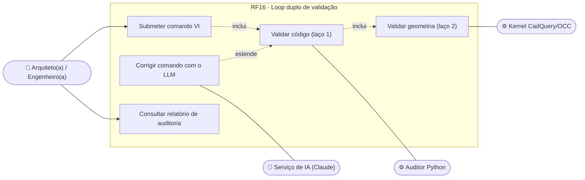
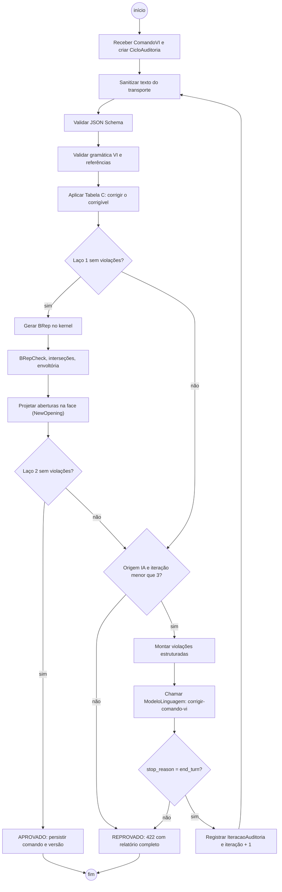
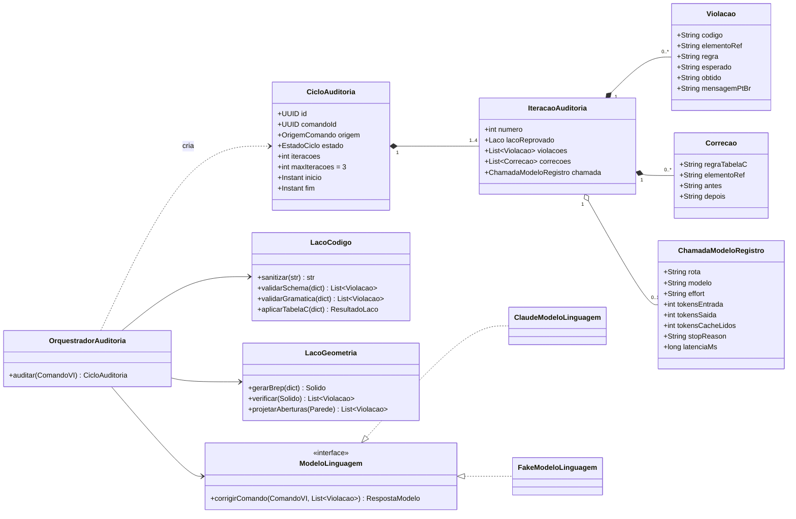
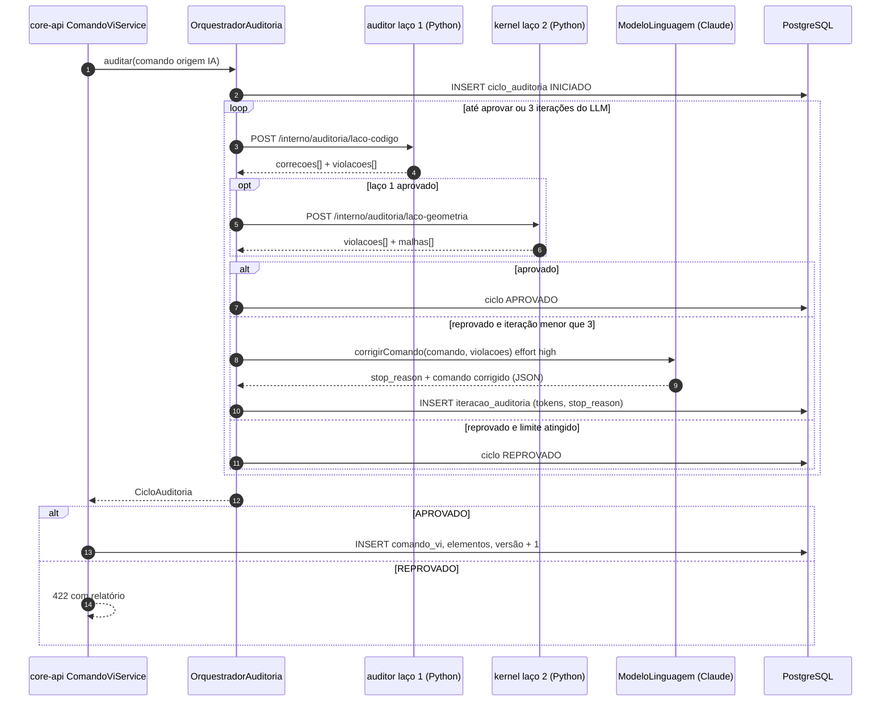
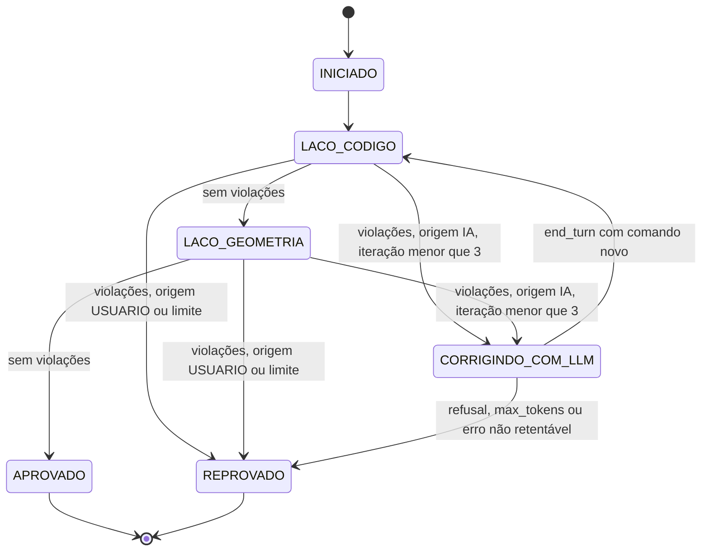
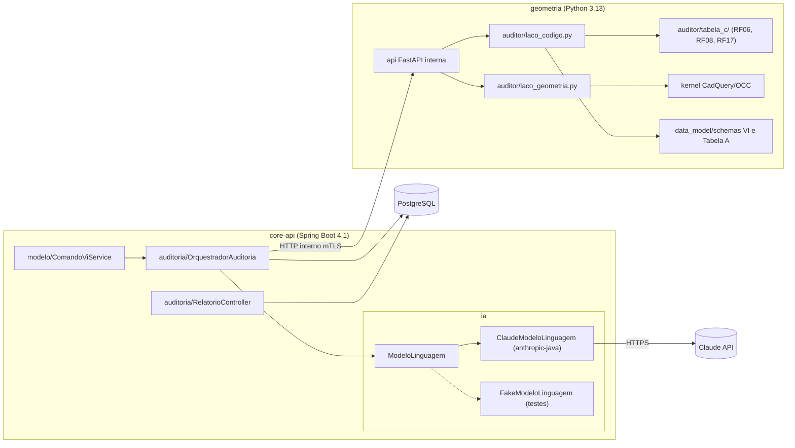

# RF16 · Loop duplo de validação (código e geometria de sólido)

> Coração da **Auditoria Paramétrica Híbrida**: LLMs são bons extratores semânticos, mas erram raciocínio
> espacial euclidiano. Nada entra no modelo sem passar por **dois laços** — o do **código** (o comando está bem
> formado e respeita as regras?) e o da **geometria** (o sólido resultante existe e é válido no kernel?). Quando o
> comando veio da IA, o erro estruturado volta ao modelo de linguagem para correção, no máximo 3 vezes.

## 1. Descrição

Entrada: um ou mais `ComandoVI` (RF01/RF02) em JSON, com `origem` = `USUARIO` (canvas/console) ou `IA` (texto
natural traduzido pelo Claude).

**Laço 1 — código** (`geometria/auditor/laco_codigo.py`):

1. **Sanitização do transporte**: normaliza Unicode (NFC), remove caracteres de controle, troca `º`/`ª` e
   símbolos fora do alfabeto VI por equivalentes ASCII em identificadores, evitando `UnicodeDecodeError` no
   middleware (texto livre de descrição é preservado em UTF-8).
2. **JSON Schema** do comando (draft 2020-12, `additionalProperties: false`), por código VI.
3. **Gramática VI**: código existe na Tabela B (funções), aridade e tipos dos argumentos, referências resolvidas
   (pavimento, eixo, material da Tabela A, parede hospedeira).
4. **Tabela C (controle e regras construtivas)**: ShortCurveTolerance (RF08), seções mínimas (RF08), Caixa
   Cartesiana Sanitizada e contagem de apoios (RF06), Disciplina Z (RF17). Essas regras **corrigem** o que é
   corrigível de forma determinística (ex.: zerar `BASE_OFFSET`, recortar à envoltória real) e **reprovam** o que
   não é (ex.: pilar de 10 cm).

**Laço 2 — geometria** (`geometria/auditor/laco_geometria.py`, kernel CadQuery/OpenCASCADE):

1. Gera os sólidos BRep dos elementos novos/alterados no contexto do pavimento.
2. `BRepCheck_Analyzer` válido; sem faces degeneradas; volume > 0.
3. Sem auto-interseção e sem interpenetração indevida entre elementos (pilar×pilar, parede×parede; pilar×viga e
   viga×laje são juntas esperadas e tratadas pela regra de prioridade de corte).
4. **Fechamento da envoltória** (tolerância 1 mm): durante a edição incremental o modelo pode estar
   **incompleto** (a primeira parede externa não forma anel), então aqui a regra gera só um **aviso**
   `ENVOLTORIA_ABERTA` com o ponto e a folga, e o comando é aprovado. A mesma regra **reprova** (`422`) nas
   **verificações de conclusão**, que rodam o laço 2 sobre o pavimento inteiro: análise estrutural (RF05),
   emissão de prancha (RF14), exportação IFC/STEP (RF15) e passagem da obra para `EM_ANDAMENTO` (RF22).
5. **Projeção vetorial de aberturas**: cada abertura é projetada na face da parede hospedeira (`NewOpening`); a
   abertura precisa caber inteira na face, com afastamento ≥ 0,10 m das bordas.

**Correção com o LLM**: se a origem é `IA` e algum laço reprova, o core-api monta uma mensagem com as violações
estruturadas (`codigo`, `elementoRef`, `regra`, `esperado`, `obtido`) e pede ao modelo uma nova versão do comando
(structured outputs, mesmo JSON Schema). Máximo de **3 iterações**; depois, `REPROVADO` com o relatório completo
para o usuário. Comandos de origem `USUARIO` não vão ao LLM: reprovação volta direto com `422`.

Cada iteração gera uma `IteracaoAuditoria` registrada: número, laço que falhou, violações, e — quando houve
chamada ao modelo — rota, modelo, `effort`, tokens de entrada/saída/cache, `stop_reason` e latência, **sem o
conteúdo** do prompt (que não contém dado pessoal, mas pode conter dado de projeto do cliente).

## 2. Atores

| Ator | Tipo | Responsabilidade |
|---|---|---|
| Arquiteto(a), Engenheiro(a) | `ARQUITETO`, `ENGENHEIRO` | originam comandos; recebem o relatório de auditoria |
| Serviço de IA (`ia.ModeloLinguagem`, impl. Claude) | sistema | traduz intenção e corrige o comando a partir das violações |
| Auditor Python (`geometria/auditor`) | sistema | executa laço 1 e regras da Tabela C |
| Kernel BIM (`geometria/kernel`, CadQuery/OCC) | sistema | executa laço 2 |

## 3. Critérios de aceite

- [ ] **CA-01** Nada é persistido no modelo sem `CicloAuditoria` em `APROVADO` para aquele comando (garantido por
  constraint `comando_vi.ciclo_auditoria_id NOT NULL` + estado verificado na transação).
- [ ] **CA-02** No máximo 3 iterações de correção com o LLM; a 4ª reprovação não chama o modelo e devolve `422` com
  o relatório completo.
- [ ] **CA-03** Cada iteração registrada com laço, violações, tokens, `stop_reason`, `effort` e latência; o
  registro não contém o texto do prompt nem dados pessoais.
- [ ] **CA-04** `stop_reason = refusal` ou `max_tokens` encerra o ciclo como `REPROVADO` com motivo explícito, sem
  tentar ler conteúdo parcial.
- [ ] **CA-05** Suíte de estresse com **15+ cenários** passa 100 %, incluindo: prédio de 4 pavimentos; malha 5x3;
  marquises escalonadas de 1,0 m a 2,0 m por andar; aberturas no térreo; extrapolação de 4 m numa malha 4x4
  (RF06); pilares com offset negativo, o "Efeito Z=0" (RF17); vetor de comprimento nulo (RF08).
- [ ] **CA-06** Auditoria idempotente: auditar de novo um comando aprovado não produz correções.
- [ ] **CA-07** Laço 1 + laço 2 de um comando de até 50 elementos em ≤ 2 s (p95), sem contar a chamada ao LLM.
- [ ] **CA-08** O relatório de auditoria lista cada correção automática com antes/depois e a regra da Tabela C.
- [ ] **CA-09** Edição incremental nunca é bloqueada por envoltória aberta: desenhar paredes externas uma a uma
  (ou abrir temporariamente uma delas) aprova cada comando com o aviso `ENVOLTORIA_ABERTA`; o aviso desaparece
  quando o anel fecha. Análise, prancha, exportação e `EM_ANDAMENTO` com envoltória aberta → `422`
  `ENVOLTORIA_ABERTA` listando pavimento, ponto e folga.

## 4. Regras de negócio

- **RN-01** Ordem fixa: sanitização → schema → gramática → Tabela C → geometria. Falha em uma etapa interrompe as
  seguintes da mesma iteração, mas a etapa reúne **todas** as violações dela (o usuário vê todos os erros de uma
  vez).
- **RN-02** Correção determinística (Tabela C) não conta como iteração do LLM.
- **RN-03** A IA nunca recebe dados pessoais: o contexto enviado contém só geometria, códigos e materiais.
- **RN-04** Rota `correcao-auditoria`: `claude-opus-5-5`, `effort: high`, structured outputs com o schema do
  comando, prompt de sistema fixo em cache (prompt caching), sem `temperature`; fallback do servidor ligado.
- **RN-05** Comando aprovado vindo da IA continua `RascunhoIA` (`GERADO_POR_IA`) até o profissional confirmar
  (RF27); auditoria aprovada ≠ aprovação técnica.

## 5. Base legal e normas

- LGPD Art. 6º, III (necessidade) e Art. 33 (transferência internacional ao provedor do modelo): só dado de projeto
  sem dado pessoal; finalidade e base legal da rota registradas.
- LGPD Art. 20: resultado de IA sujeito a revisão humana (RF27).
- NBR 6118 (seções mínimas, via RF08), NBR 6492, ISO 10303 (validade de BRep).

## 6. API

Interna (core-api → geometria, rede privada, mTLS):

| Método e rota | Descrição | Respostas |
|---|---|---|
| `POST /interno/auditoria/laco-codigo` | Sanitização, schema, gramática VI, Tabela C | 200 `{aprovado, correcoes[], violacoes[]}` |
| `POST /interno/auditoria/laco-geometria` | BRep, interseções, envoltória, aberturas | 200 `{aprovado, violacoes[], malhas[]}` |

Pública:

| Método e rota | Descrição | Respostas |
|---|---|---|
| `GET /api/v1/obras/{obraId}/auditorias/{cicloId}` | Relatório do ciclo com iterações e correções | 200, 404 |
| `GET /api/v1/obras/{obraId}/auditorias?comandoId=` | Ciclos de um comando | 200 |

## 7. Diagramas

### 7.1 Casos de uso

### 7.2 Atividades

### 7.3 Classes

### 7.4 Sequência

### 7.5 Máquina de estados (CicloAuditoria)

### 7.6 Componentes

## 8. Testes previstos

Suíte de estresse em `geometria/tests/estresse/` (cada cenário é um conjunto de comandos VI + resultado esperado),
executada também no core-api com `FakeModeloLinguagem` determinístico:

| # | Cenário | Esperado |
|---|---|---|
| E01 | Prédio de 4 pavimentos, malha 5x3, pé-direito 3,0 m | aprovado; 60 pilares com base/topo nos níveis |
| E02 | Marquises escalonadas de 1,0 a 2,0 m por andar | aprovado; balanços conferidos por pavimento |
| E03 | Aberturas no térreo (portas e vitrines) | todas projetadas na face hospedeira |
| E04 | Extrapolação de 4 m numa malha 4x4 (Fencepost) | corrigido pela Caixa Cartesiana (RF06) |
| E05 | Pilares com offset negativo (Efeito Z=0) | `BASE_OFFSET` zerado (RF17) |
| E06 | Pilar transpassando dois andares sem marcação de contínuo | corrigido e dividido (RF17) |
| E07 | Vetor de comprimento nulo | descartado antes do kernel (RF08) |
| E08 | Parede de 0,03 m | descartada por ShortCurveTolerance |
| E09 | Pilar 15x15 cm | reprovado: seção mínima (RF08) |
| E10 | Janela maior que a parede | reprovado no laço 2 |
| E11 | Envoltória com folga de 2 cm | aviso `ENVOLTORIA_ABERTA` na edição; reprovado ao emitir prancha ou rodar análise |
| E11b | Desenhar o térreo parede a parede, uma por comando | todas aprovadas com aviso; aviso some quando o anel fecha |
| E12 | Dois pilares sobrepostos | reprovado: interpenetração |
| E13 | Comando com material inexistente | reprovado no laço 1 (gramática) |
| E14 | Texto com `º`, `ª` e emojis nos identificadores | sanitizado; sem `UnicodeDecodeError` |
| E15 | LLM corrige na 2ª iteração (fake) | aprovado com 2 iterações registradas |
| E16 | LLM falha 3 vezes (fake) | reprovado; 4ª chamada não acontece |
| E17 | Fake retorna `refusal` | reprovado com motivo; conteúdo não lido |
| E18 | Reauditar comando aprovado | zero correções (idempotência) |

Outros: `CicloAuditoriaIT` verifica que nenhum `comando_vi` existe sem ciclo `APROVADO`; teste de log garante que
`iteracao_auditoria` não guarda texto de prompt.

## 9. Rastreabilidade

| Camada | Artefato | Status |
|---|---|---|
| Documento | `docs/rf/RF16-loop-duplo-validacao.md` | ✅ |
| Card | [Trello o2wBmxKy](https://trello.com/c/o2wBmxKy) | ✅ |
| Domínio | `cca-domain · modelo/Auditor.java` (laço 1: Tabela C mínimos 0,19/0,036/0,12/0,08/0,05, `C-SHORT_CURVE`, Caixa Cartesiana RECORTAR/BLOQUEAR, Disciplina Z), `ServicoGeometriaLocal.java` (laço 2 JTS: G-AUTO_INTERSECAO, G-INTERPENETRACAO, G-SEM_HOSPEDEIRA, ENVOLTORIA_ABERTA aviso→violação na conclusão), `RelatorioAuditoria.java` | ✅ |
| Aplicação | `cca-application · modelo/AuditorService.java` (ciclo APROVADO/REPROVADO persistido mesmo no rollback do 422, correção LLM ≤ 3 iterações só para origem IA), `ModeloService#verificarConclusao/#exigirConclusao` | ✅ |
| Geometria | `cca-infrastructure · modelo/ServicoGeometriaHttp.java` (kernel Python com fallback local + aviso `G-KERNEL_INDISPONIVEL`); `geometria/auditor/*.py` | 🟡 |
| IA | `ia/ModeloLinguagem.java`/`RotaIa.CORRECAO_AUDITORIA` (fork de IA) | ✅ |
| API | `cca-web · api/modelo/ModeloExceptionHandler.java` (422 `auditoria_reprovada` com relatório completo + `errors`), `ModeloController` (`POST /modelo/verificar-conclusao`) | ✅ |
| Banco | `V7__modelo_bim.sql` (ciclo_auditoria com iterações em jsonb) | ✅ |
| Testes | `EstresseAuditoriaTest` (E01–E18 em Java), `ModeloBimTest`, `ModeloComandoIT#reprovacaoDevolve422ComRelatorioCompleto`; `geometria/tests/estresse/` (Python) | 🟡 |
