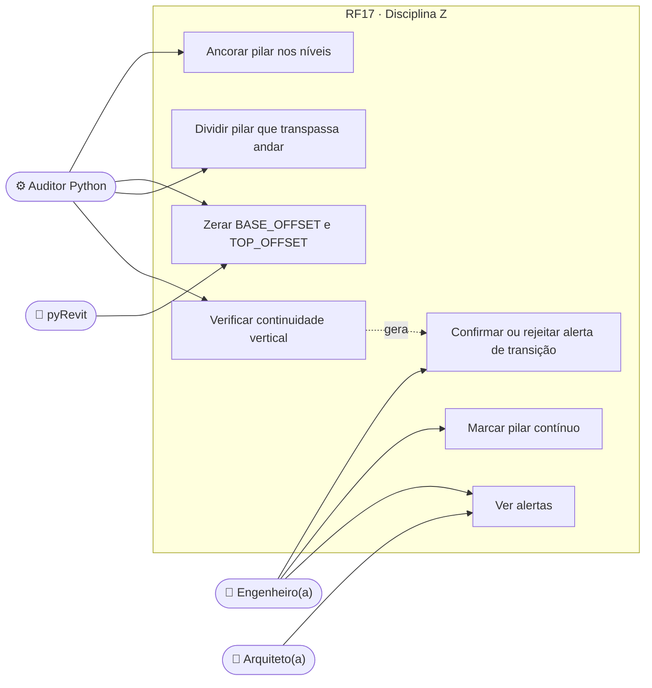
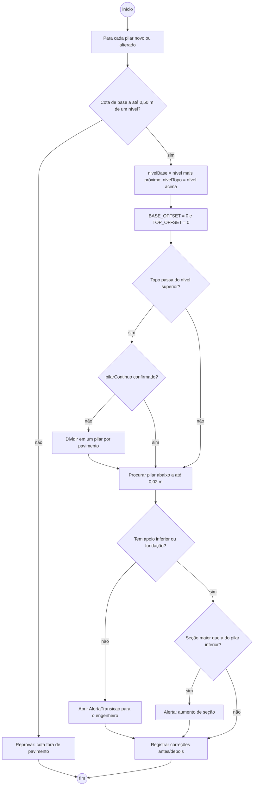
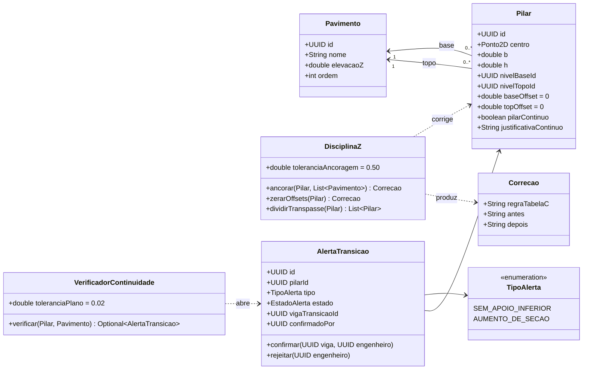
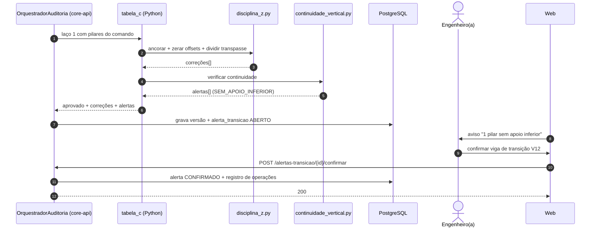
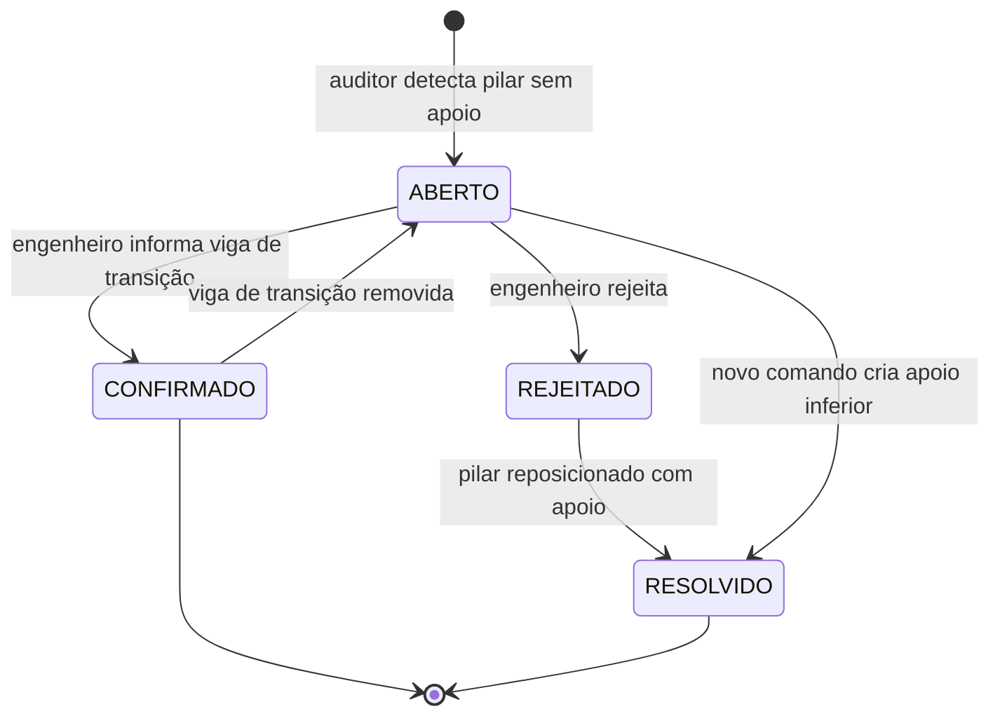
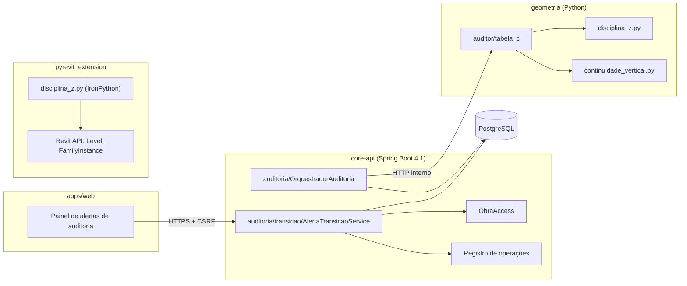

# RF17 · Controle rígido de elevação e nivelamento de pilares

> **Disciplina Z**: todo pilar nasce e morre em níveis. A base fica presa à elevação do pavimento onde está
> (`Level.Elevation`), o topo à elevação do pavimento superior, com `BASE_OFFSET = 0` e `TOP_OFFSET = 0`. Isso
> elimina o "Efeito Z=0" (offsets negativos que afundam pilares no Revit) e o transpasse de pilares entre andares
> observados nos testes sem auditoria.

## 1. Descrição

Regra da Tabela C executada no laço 1 do RF16 (`geometria/auditor/tabela_c/disciplina_z.py`) e espelhada na
ponte pyRevit (RF15) para que o Revit receba o mesmo resultado.

Para cada pilar novo ou alterado:

1. **Ancoragem**: identifica o `nivelBase` (pavimento cuja elevação está mais próxima da cota de base proposta) e o
   `nivelTopo` = pavimento imediatamente acima. Se a IA propôs cotas absolutas (ex.: base em -0,35 m por erro de
   referência), elas são descartadas e substituídas pelos níveis.
2. **Zeramento de offsets**: `BASE_OFFSET = 0`, `TOP_OFFSET = 0`. A única exceção é o pilar do pavimento mais baixo
   apoiado em fundação, cuja base vai ao topo do bloco/sapata (RF10) por regra própria, também sem offset livre.
3. **Transpasse**: um pilar cujo topo passa da elevação do pavimento superior é **dividido** em um pilar por
   pavimento, mantendo seção e eixo, salvo se marcado explicitamente como `pilarContinuo = true` (ex.: pilar de
   pé-direito duplo, átrio) e houver justificativa.
4. **Continuidade vertical**: para cada pilar do pavimento n+1 procura-se o apoio no pavimento n na mesma posição
   (tolerância 0,02 m no plano). Pilar sem pilar abaixo (nasce em viga) gera **alerta de transição** para o
   engenheiro, que precisa confirmar a viga de transição — não é corrigido automaticamente.
5. **Variação de seção**: pilar superior com seção maior que o inferior gera alerta (redução de seção para cima é
   normal; aumento é suspeito).

Toda correção entra no relatório de auditoria com antes/depois (cota base, cota topo, offsets, divisão).

## 2. Atores

| Ator | Tipo | Responsabilidade |
|---|---|---|
| Auditor Python | sistema | aplicar a Disciplina Z e a verificação de continuidade |
| Engenheiro(a) responsável | `ENGENHEIRO` | confirmar ou rejeitar alertas de transição; marcar pilar contínuo |
| Arquiteto(a) | `ARQUITETO` | ver alertas (sem confirmar) |
| pyRevit | sistema externo | reaplicar a regra ao criar `FamilyInstance` no Revit |

## 3. Critérios de aceite

- [ ] **CA-01** 100 % dos pilares com base = elevação do seu pavimento e topo = elevação do pavimento superior (ou topo
  da fundação, no nível mais baixo), verificado por consulta em todas as versões aprovadas.
- [ ] **CA-02** Nenhum pilar atravessa mais de um pavimento sem `pilarContinuo = true` e justificativa preenchida.
- [ ] **CA-03** Pilar sem apoio inferior gera `AlertaTransicao` `ABERTO`; enquanto houver alerta aberto, o cálculo
  estrutural (RF05) não é liberado para aprovação.
- [ ] **CA-04** Correções no relatório com antes/depois e a regra `TABELA_C.DISCIPLINA_Z.*` aplicada.
- [ ] **CA-05** Mudar a elevação de um pavimento (RF03) reaplica a regra a todos os pilares ancorados nele, em um único
  comando, e gera nova versão.
- [ ] **CA-06** A ponte pyRevit cria os pilares com `FAMILY_BASE_LEVEL_OFFSET_PARAM` e
  `FAMILY_TOP_LEVEL_OFFSET_PARAM` = 0 (cenário E01 do RF16).
- [ ] **CA-07** Regra idempotente: reaplicar sobre modelo nivelado não gera correções.

## 4. Regras de negócio

- **RN-01** Tolerância de ancoragem: cota proposta a até 0,50 m de um nível é ancorada nele; acima disso, o comando é
  reprovado com "Cota de base fora de qualquer pavimento".
- **RN-02** Tolerância de continuidade no plano: 0,02 m entre centros de pilares sobrepostos.
- **RN-03** Pilar contínuo exige justificativa (texto) e confirmação do `ENGENHEIRO`; IA não pode marcar sozinha.
- **RN-04** Alerta de transição confirmado registra a viga de transição (`vigaTransicaoId`), que passa a ter verificação
  obrigatória no RF07.
- **RN-05** Ninguém edita offsets manualmente pelo canvas: o campo não existe na UI; vem só dos níveis.

## 5. Base legal e normas

- NBR 6118: continuidade de pilares, vigas de transição e consideração de cargas concentradas.
- NBR 15575 (desempenho) indiretamente, via correção de pé-direito.
- LGPD: não se aplica a dados de geometria; confirmação de alerta registra o id do engenheiro no registro de
  operações (Art. 37).

## 6. API

| Método e rota | Descrição | Respostas |
|---|---|---|
| `GET /api/v1/obras/{obraId}/auditorias/alertas-transicao?estado=ABERTO` | Lista alertas | 200, 404 |
| `POST /api/v1/obras/{obraId}/auditorias/alertas-transicao/{id}/confirmar` | Confirma com `vigaTransicaoId` | 200, 403, 409, 422 |
| `POST /api/v1/obras/{obraId}/auditorias/alertas-transicao/{id}/rejeitar` | Rejeita: exige reposicionar o pilar | 200, 403, 409 |
| `POST /api/v1/obras/{obraId}/modelo/comandos` com `VI(PILAR_CONTINUO, id, justificativa)` | Marca pilar contínuo | 201, 403, 422 |

## 7. Diagramas

### 7.1 Casos de uso

### 7.2 Atividades

### 7.3 Classes

### 7.4 Sequência

### 7.5 Máquina de estados (AlertaTransicao)

### 7.6 Componentes

## 8. Testes previstos

| Tipo | Caso |
|---|---|
| Unitário (Python) | pilar com base em -0,35 m no térreo (Efeito Z=0) → ancorado em 0,00 com offset 0 |
| Unitário (Python) | pilar de 0,00 a 6,00 m com pavimentos a 0 e 3 m → dividido em dois pilares |
| Unitário (Python) | mesmo pilar com `pilarContinuo = true` e justificativa → mantido inteiro |
| Unitário (Python) | pilar do 2º andar deslocado 0,30 m do inferior → `SEM_APOIO_INFERIOR` |
| Unitário (Python) | reaplicar a regra em modelo nivelado → zero correções |
| Estresse (RF16 E01, E05, E06) | prédio de 4 pavimentos e malha 5x3 com offsets aleatórios → 100 % nivelado |
| Integração `*IT` | confirmar alerta por `ARQUITETO` → 403; por `ENGENHEIRO` sem selo → 403 |
| Integração `*IT` | alterar elevação do pavimento 2 reancora todos os pilares ligados a ele |

## 9. Rastreabilidade

| Camada | Artefato | Status |
|---|---|---|
| Documento | `docs/rf/RF17-controle-elevacao-pilares.md` | ✅ |
| Card | [Trello VVTtHXnO](https://trello.com/c/VVTtHXnO) | ✅ |
| Geometria | `geometria/auditor/tabela_c/disciplina_z.py`, `continuidade_vertical.py` | ⏳ |
| pyRevit | `pyrevit_extension/.../disciplina_z.py` | ⏳ |
| API | `auditoria/transicao/AlertaTransicaoService.java` | ⏳ |
| Banco | `Vn__auditoria.sql` (alerta_transicao) | ⏳ |
| Web | painel de alertas em `obras/[obraId]/auditoria/` | ⏳ |
| Testes | `test_disciplina_z.py`, `AlertaTransicaoIT` | ⏳ |
