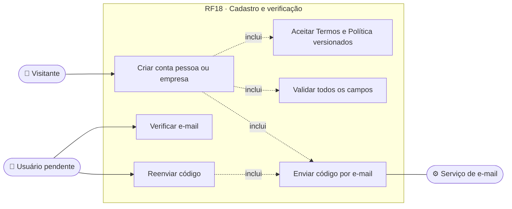
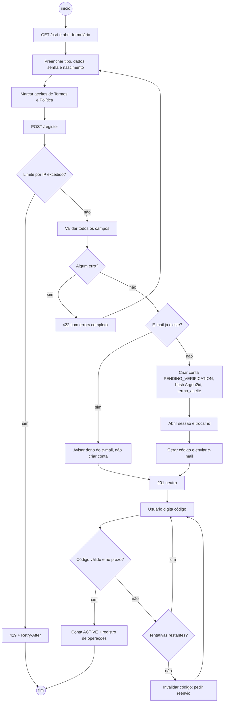
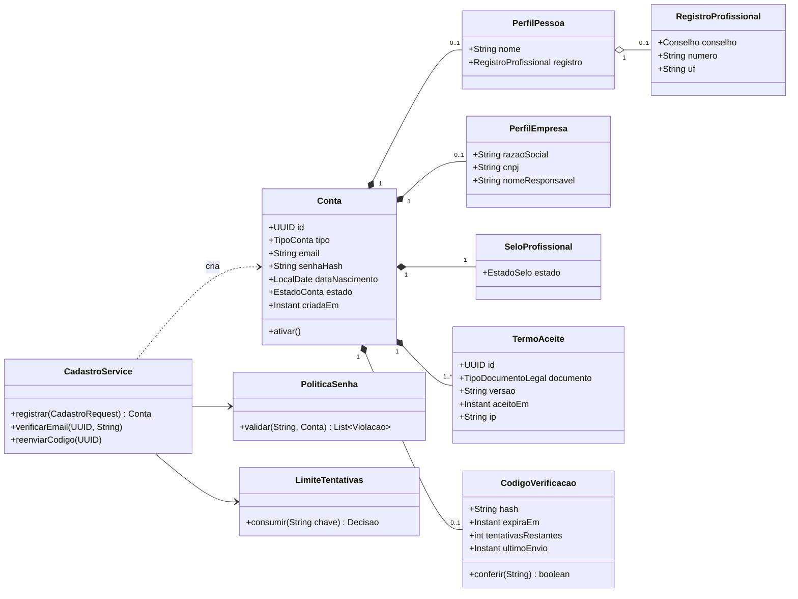
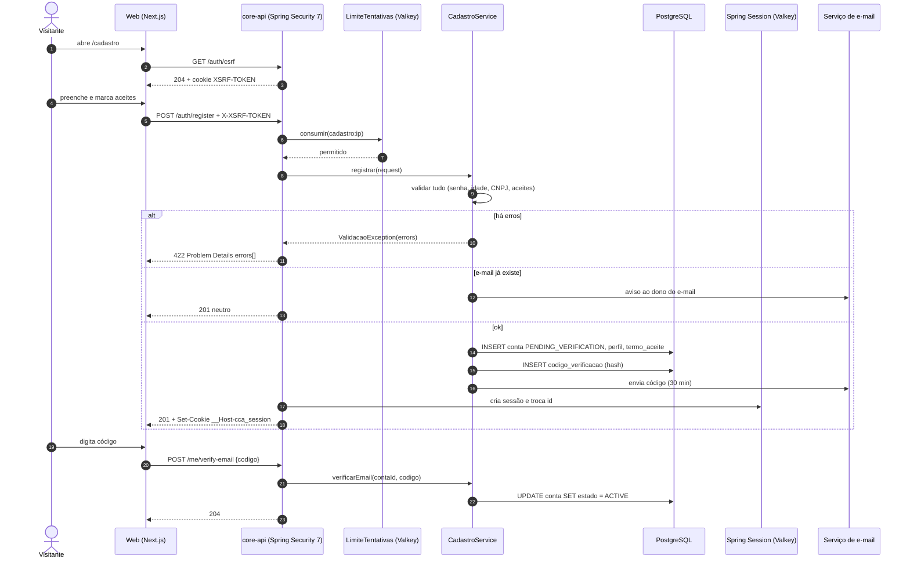
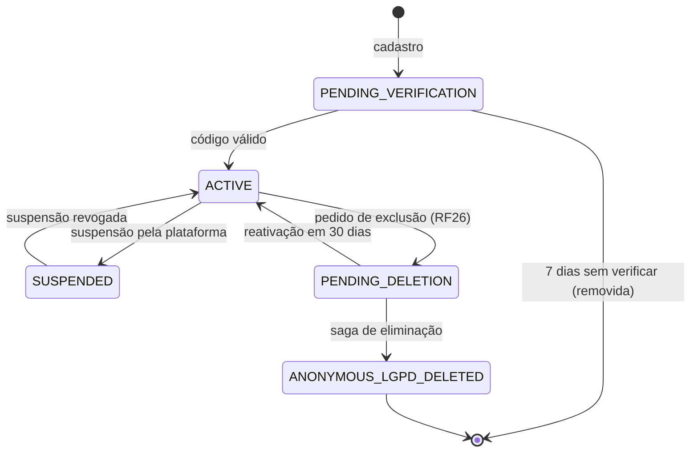
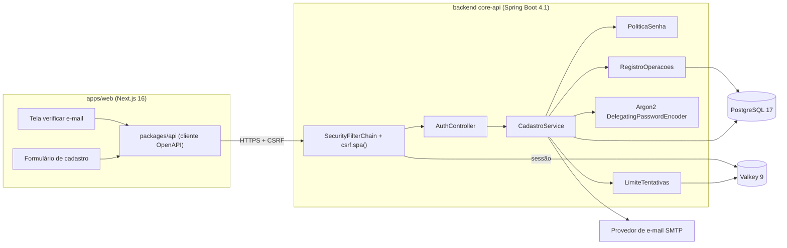

# RF18 · Cadastro de conta e verificação de e-mail

> O visitante cria a conta (pessoa ou empresa), aceita Termos e Política com versão registrada e confirma o
> e-mail por código. A conta nasce `PENDING_VERIFICATION` e só passa a `ACTIVE` depois da verificação.

## 1. Descrição

`POST /api/v1/auth/register` recebe o **tipo** da conta e os campos de cada tipo:

| Tipo | Campos obrigatórios | Opcionais |
|---|---|---|
| `PESSOA` | nome, e-mail, senha, data de nascimento | registro profissional (`CREA` ou `CAU`) + número + UF |
| `EMPRESA` | razão social, CNPJ, nome e e-mail do responsável, senha, data de nascimento do responsável | nome fantasia |

O app é profissional: **só maiores de 18 anos** (data de nascimento validada no servidor). As caixas de aceite
dos **Termos de Uso** e da **Política de Privacidade** vêm **desmarcadas**; o aceite grava a versão vigente
(configurada em `app.legal.termos-versao` / `app.legal.politica-versao`), data/hora e IP.

O cadastro valida **todos** os campos e devolve **todos** os erros juntos (`422`, Problem Details com
`errors[]`). Em caso de sucesso cria a conta `PENDING_VERIFICATION`, abre a sessão (mesmo cookie do login,
RF19) e envia um **código de 6 dígitos** por e-mail, válido por **30 min**, com **5 tentativas** e reenvio
limitado a **1 por minuto**. `POST /api/v1/me/verify-email` com o código ativa a conta (`ACTIVE`).

Se o e-mail já existir, a resposta é a mesma de sucesso para quem está de fora (sem enumeração de contas): o
dono do e-mail recebe uma mensagem "alguém tentou criar uma conta com seu e-mail" e nenhuma conta nova é criada.

Quando há registro profissional ou CNPJ informado, o selo nasce `PENDING` (verificação em RF21); sem registro,
`NONE`.

## 2. Atores

| Ator | Papel | Pode |
|---|---|---|
| Visitante | — | criar conta, aceitar convite (RF20) |
| Usuário em `PENDING_VERIFICATION` | — | verificar e-mail, reenviar código, sair; nada mais |
| Serviço de e-mail | sistema | entregar o código |
| Admin da plataforma | `SUPORTE_PLATAFORMA` | verificar selo (RF21), nunca ver a senha |

## 3. Critérios de aceite

- [ ] **CA-01** `POST /register` inválido devolve `422` com **todos** os erros (campo, código, mensagem pt-BR) de
  uma vez, em Problem Details (RFC 9457).
- [ ] **CA-02** Senha: mínimo **12** caracteres, máximo **128**, rejeitada se estiver na lista de senhas comuns,
  se contiver o e-mail (parte local) ou o @usuário; gravada com **Argon2id** (`DelegatingPasswordEncoder`, prefixo
  `{argon2id}`, BouncyCastle).
- [ ] **CA-03** Menor de 18 anos → `422` no campo `dataNascimento`; data no futuro idem.
- [ ] **CA-04** CNPJ e CPF (quando houver) validados por dígito verificador; CREA/CAU exige UF válida.
- [ ] **CA-05** Termos e Política: sem aceite → `422`; aceite grava `termo_aceite` (versão, data, IP, user-agent).
- [ ] **CA-06** Sucesso cria conta `PENDING_VERIFICATION` com id **UUID v7**, abre sessão (cookie
  `__Host-cca_session`) e envia o código.
- [ ] **CA-07** Código: 6 dígitos, 30 min, 5 tentativas; na 6ª o código é invalidado; reenvio só após 60 s
  (`429` + `Retry-After`).
- [ ] **CA-08** E-mail já cadastrado: mesma resposta `201` ao cliente, sem criar conta, e aviso ao dono do e-mail.
- [ ] **CA-09** Limite de cadastros por IP no Valkey (padrão 10/h) → `429` + `Retry-After`.
- [ ] **CA-10** Conta `PENDING_VERIFICATION` só acessa `/me/verify-email`, reenvio, `/session` e `/logout`
  (demais rotas `403` com `type=/problemas/email-nao-verificado`).
- [ ] **CA-11** Toda escrita exige `X-XSRF-TOKEN` (CSRF SPA, RF19).
- [ ] **CA-12** Cadastro e verificação geram evento no registro de operações (sem valores pessoais).

## 4. Regras de negócio

- **RN-01** E-mail normalizado (minúsculas, trim, NFC) e único entre contas não anonimizadas.
- **RN-02** O código é guardado só como hash (HMAC-SHA-256 com subchave `verificacao-email`), nunca em texto.
- **RN-03** Mudar e-mail depois (RF23) repete a verificação e exige modo sudo.
- **RN-04** Conta `PENDING_VERIFICATION` sem verificação por 7 dias é removida pelo job diário (dado mínimo).
- **RN-05** A empresa criada por cadastro `EMPRESA` vira tenant (RF22) com a pessoa como `DONO`; o 2FA será
  exigido no próximo login (RF19).
- **RN-06** Nova versão dos Termos/Política exige reaceite (RF24).

## 5. Base legal e normas

- LGPD Art. 7º, V (execução de contrato) para os dados de cadastro; Art. 8º (consentimento destacado e
  comprovável, ônus da prova do controlador); Art. 14 não se aplica (só maiores de 18).
- LGPD Art. 6º, III (necessidade): CPF não é pedido no cadastro de pessoa.
- OWASP ASVS 5.0 V6 (autenticação: senhas, lista de senhas comuns, limite de tentativas) e V2 (validação).
- NIST SP 800-63B (frase-senha, sem regra de composição).
- RFC 9457 (Problem Details).

## 6. API

| Método e rota | Descrição | Respostas |
|---|---|---|
| `GET /api/v1/auth/csrf` | Entrega o token CSRF (cookie `XSRF-TOKEN`) | 204 |
| `POST /api/v1/auth/register` | Cria conta, abre sessão, envia código | 201, 422, 429 |
| `POST /api/v1/me/verify-email` | `{codigo}` ativa a conta | 204, 422 (código errado, com tentativas restantes), 410 (expirado), 429 |
| `POST /api/v1/me/verify-email/resend` | Reenvia código | 204, 429 + `Retry-After` |
| `GET /api/v1/legal/versoes` | Versões vigentes de Termos e Política | 200 |

## 7. Diagramas

### 7.1 Casos de uso

### 7.2 Atividades

### 7.3 Classes

### 7.4 Sequência (cadastro)

### 7.5 Máquina de estados (Conta)

### 7.6 Componentes

## 8. Testes previstos

| Tipo | Caso |
|---|---|
| Unitário | `PoliticaSenha` rejeita 11 caracteres, senha comum, senha contendo o e-mail |
| Unitário | validador de CNPJ/CPF e cálculo de idade na virada do aniversário |
| Integração `*IT` | cadastro com 5 campos inválidos → `422` com 5 itens em `errors[]` |
| Integração `*IT` | cadastro válido com `ApiClient` (CSRF real) → `201`, cookie `__Host-` e conta `PENDING_VERIFICATION` |
| Integração `*IT` | e-mail repetido → `201`, nenhuma linha nova em `conta` |
| Integração `*IT` | 6ª tentativa de código → código invalidado; reenvio em < 60 s → `429` + `Retry-After` |
| Integração `*IT` | conta pendente chamando `/obras` → `403` email-nao-verificado |
| E2E (Playwright + axe) | caixas de aceite desmarcadas por padrão; erros anunciados por leitor de tela |

## 9. Rastreabilidade

| Camada | Artefato | Status |
|---|---|---|
| Documento | `docs/rf/RF18-cadastro-e-verificacao-email.md` | ✅ |
| Card | [Trello v3Z3WzgD](https://trello.com/c/v3Z3WzgD) | ✅ |
| Web | `apps/web/src/app/(auth)/cadastro/page.tsx`, `verificar-email/page.tsx` | ⏳ |
| API | `identidade/AuthController.java`, `identidade/CadastroService.java`, `identidade/PoliticaSenha.java` | ⏳ |
| Banco | `V1__contas_empresas_obras.sql` (conta, perfil, termo_aceite, codigo_verificacao) | ⏳ |
| Testes | `CadastroIT`, `VerificacaoEmailIT`, `PoliticaSenhaTest` | ⏳ |
