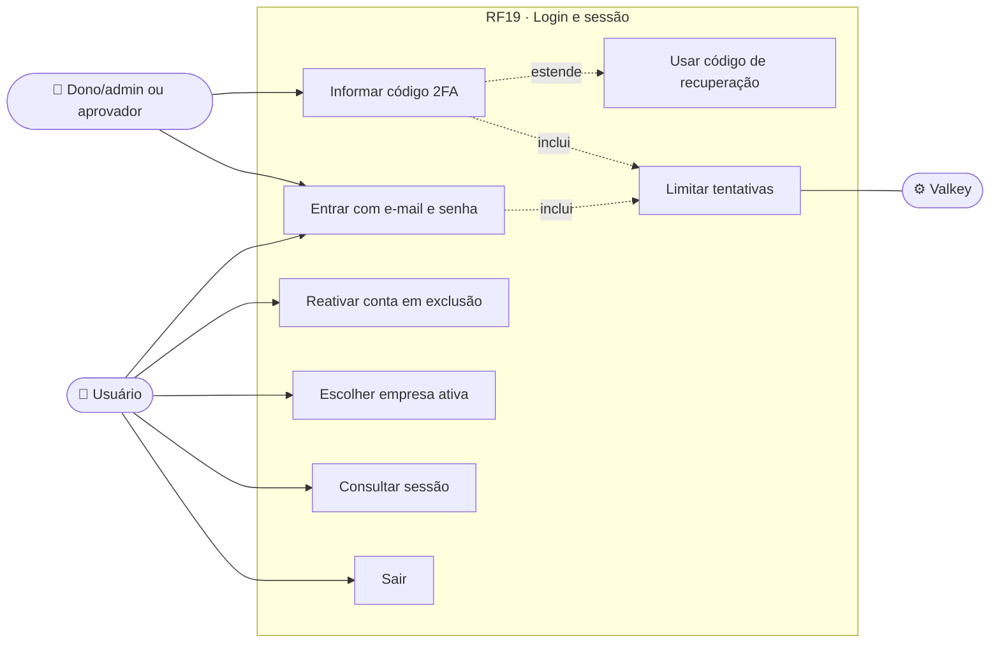
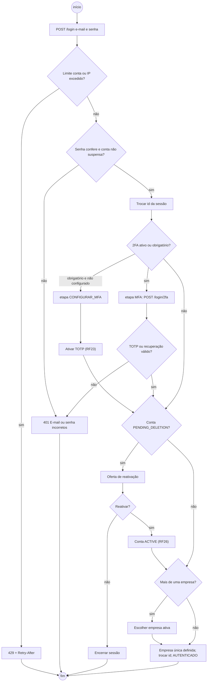
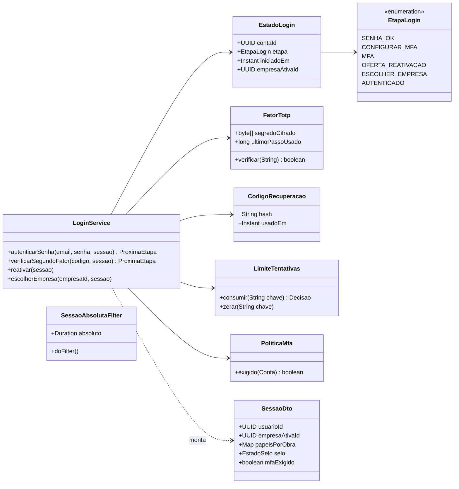
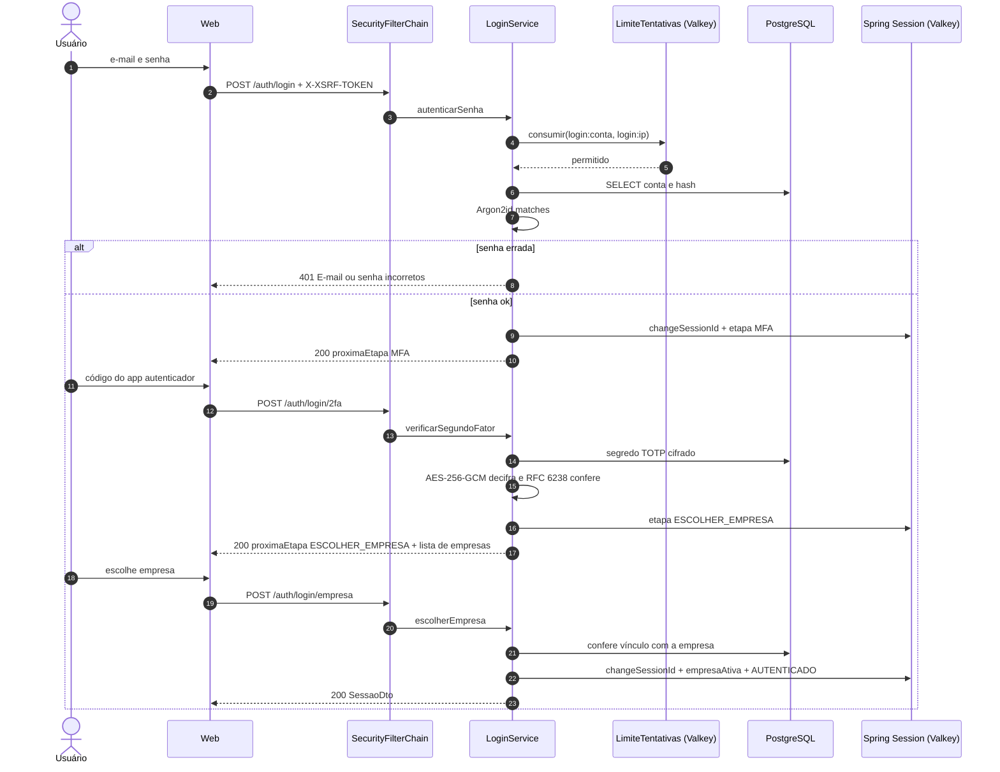
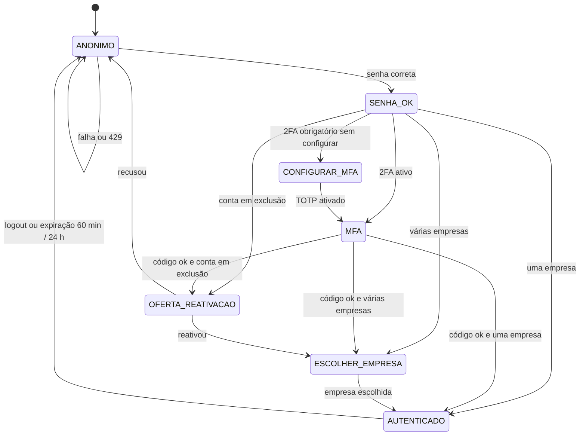
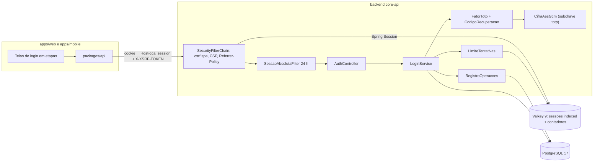

# RF19 · Login em etapas com 2FA (TOTP), sessão Valkey e escolha da empresa ativa

> O login é uma pequena máquina de estados guardada **na sessão do servidor**: senha → 2FA (quando exigido) →
> oferta de reativação (se a conta estiver em exclusão) → escolha da empresa ativa. Nenhum token vai para o
> cliente além do cookie de sessão opaco.

## 1. Descrição

**Sessão.** Spring Session Data Redis sobre **Valkey 9**, repositório `indexed` (permite listar e encerrar as
sessões de um usuário, RF23). Cookie `__Host-cca_session`: `HttpOnly`, `Secure`, `SameSite=Lax`, `Path=/`,
**sem `Max-Age`** (cookie de sessão do navegador). Expiração **ociosa de 60 min** (deslizante) e **absoluta de
24 h** (filtro `SessaoAbsolutaFilter` compara `criadaEm` gravado na sessão). **Nunca JWT, nunca token em
`localStorage`.** O app mobile usa o mesmo cookie, guardado no armazenamento seguro do SO.

**CSRF.** Spring Security 7 `csrf.spa()`: cookie `XSRF-TOKEN` legível pelo JS + cabeçalho `X-XSRF-TOKEN` em
toda escrita. Cabeçalhos: CSP `default-src 'none'; frame-ancestors 'none'` na API, `Referrer-Policy: no-referrer`.

**Etapas.**

1. `POST /api/v1/auth/login {email, senha}`. Falha → `401` com a mensagem **neutra** "E-mail ou senha
   incorretos" (mesmo tempo de resposta para e-mail inexistente: hash Argon2id de referência). Sucesso troca o
   id da sessão e grava `etapaLogin` na sessão.
2. Se a conta tem 2FA ativo **ou** o 2FA é obrigatório (dono/admin de empresa, quem aprova orçamento ou
   medição, suporte da plataforma) → `etapa = MFA`. `POST /login/2fa {codigo}` aceita TOTP (RFC 6238, passo
   30 s, janela ±1) ou um dos 10 códigos de recuperação (uso único). Se o 2FA é obrigatório e ainda não foi
   configurado → `etapa = CONFIGURAR_MFA` (só rotas `/me/mfa/**` liberadas).
3. Conta `PENDING_DELETION` → `etapa = OFERTA_REATIVACAO`; `POST /reactivate` volta a `ACTIVE` (RF26); recusar
   encerra a sessão.
4. Pessoa com mais de uma empresa → `etapa = ESCOLHER_EMPRESA`; `POST /login/empresa {empresaId}`. Com uma só,
   a empresa é escolhida automaticamente. A empresa ativa define o `tenant_id` usado pela RLS (RF21).
5. `etapa = AUTENTICADO`. `GET /session` devolve usuário, empresa ativa, papéis por obra, estado do selo e se o
   2FA é exigido. `POST /logout` invalida a sessão e remove do índice.

**Limite de tentativas.** Contadores no Valkey por **conta** (5 falhas/15 min) e por **IP** (30/15 min) →
`429` + `Retry-After`. Mensagem continua neutra. Conta `SUSPENDED` recebe a mesma mensagem neutra no passo 1 e
um e-mail explicando a suspensão.

## 2. Atores

| Ator | Pode |
|---|---|
| Usuário cadastrado | entrar, informar 2FA, reativar conta, escolher empresa, sair |
| Dono/admin, aprovador de orçamento/medição, suporte | idem, com 2FA **obrigatório** |
| Valkey | guardar sessão, índice por usuário e contadores de tentativas |

## 3. Critérios de aceite

- [ ] **CA-01** Credencial errada ou e-mail inexistente → `401` "E-mail ou senha incorretos", tempo de resposta
  equivalente (diferença < 50 ms na mediana).
- [ ] **CA-02** 6ª falha por conta em 15 min ou 31ª por IP → `429` + `Retry-After` (segundos).
- [ ] **CA-03** O id da sessão muda depois da senha e de novo ao concluir o login (fixação de sessão).
- [ ] **CA-04** Etapa intermediária (`MFA`, `CONFIGURAR_MFA`, `OFERTA_REATIVACAO`, `ESCOLHER_EMPRESA`) fica só na
  sessão do servidor; qualquer rota protegida nessa etapa → `401` com `type=/problemas/login-incompleto`.
- [ ] **CA-05** TOTP válido na janela ±1 passo; código de recuperação consumido não serve de novo; código TOTP
  já usado no mesmo passo é rejeitado (replay).
- [ ] **CA-06** 2FA obrigatório para `DONO`, `ADMIN`, aprovadores e `SUPORTE_PLATAFORMA`; sem 2FA configurado,
  só `/me/mfa/**` responde.
- [ ] **CA-07** Cookie `__Host-cca_session` com `HttpOnly; Secure; SameSite=Lax; Path=/` e sem `Max-Age`/`Expires`.
- [ ] **CA-08** Sessão expira após 60 min sem uso e após 24 h desde o login, mesmo em uso.
- [ ] **CA-09** Toda escrita sem `X-XSRF-TOKEN` válido → `403`.
- [ ] **CA-10** `GET /session` traz empresa ativa, papéis por obra, estado do selo, `mfaExigido`, `mfaAtivo`.
- [ ] **CA-11** Login bem-sucedido, falhas em sequência e novo aparelho geram evento no registro de operações e
  alerta de login por e-mail (RF23).
- [ ] **CA-12** Nenhum JWT emitido; nenhuma resposta contém o id real da sessão no corpo.

## 4. Regras de negócio

- **RN-01** A empresa ativa só pode ser trocada por `POST /session/empresa` (gera novo id de sessão).
- **RN-02** Escolher empresa em que a pessoa não é membro → `404`.
- **RN-03** Usuário `PENDING_VERIFICATION` entra, mas cai na tela de verificação (RF18).
- **RN-04** Falha de 2FA conta no limite por conta, com o mesmo contador da senha.
- **RN-05** Logout de uma sessão não derruba as outras; troca de senha derruba (RF23).

## 5. Base legal e normas

- LGPD Art. 46 (medidas de segurança) e Art. 49 (sistemas estruturados para segurança).
- RFC 6238 (TOTP), RFC 4226 (HOTP), RFC 6265bis (prefixo `__Host-`, `SameSite`), RFC 9457 (erros).
- OWASP ASVS 5.0 V6 (autenticação), V7 (gestão de sessão), V3 (cookies), V4 (CSRF).
- OWASP Session Management Cheat Sheet (timeout ocioso e absoluto, troca de id).

## 6. API

| Método e rota | Descrição | Respostas |
|---|---|---|
| `GET /api/v1/auth/csrf` | Token CSRF | 204 |
| `POST /api/v1/auth/login` | Etapa senha | 200 `{proximaEtapa}`, 401, 429 |
| `POST /api/v1/auth/login/2fa` | TOTP ou código de recuperação | 200 `{proximaEtapa}`, 401, 429 |
| `POST /api/v1/auth/reactivate` | Reativa conta em exclusão | 200, 409 |
| `POST /api/v1/auth/login/empresa` | Escolhe empresa ativa | 200, 404 |
| `POST /api/v1/session/empresa` | Troca a empresa ativa depois do login | 200, 404 |
| `GET /api/v1/auth/session` | Estado da sessão | 200, 401 |
| `POST /api/v1/auth/logout` | Encerra a sessão | 204 |

## 7. Diagramas

### 7.1 Casos de uso

### 7.2 Atividades

### 7.3 Classes

### 7.4 Sequência (login com 2FA e escolha da empresa)

### 7.5 Máquina de estados (EstadoLogin)

### 7.6 Componentes

## 8. Testes previstos

| Tipo | Caso |
|---|---|
| Unitário | `FatorTotp` aceita passo atual e ±1, rejeita ±2 e replay no mesmo passo |
| Unitário | `PoliticaMfa` exige 2FA para DONO, ADMIN e aprovadores |
| Integração `*IT` | login real com `ApiClient` (CSRF + cookie) → `/session` 200 com empresa ativa |
| Integração `*IT` | id da sessão diferente antes e depois do login |
| Integração `*IT` | 6 senhas erradas → `429` com `Retry-After`; e-mail inexistente → mesma mensagem 401 |
| Integração `*IT` | chamar `/obras` na etapa MFA → `401` login-incompleto |
| Integração `*IT` | sessão com `criadaEm` há 24 h + 1 min → `401` |
| Integração `*IT` | POST sem `X-XSRF-TOKEN` → `403` |
| E2E | login com TOTP gerado no teste e escolha entre 2 empresas |

## 9. Rastreabilidade

| Camada | Artefato | Status |
|---|---|---|
| Documento | `docs/rf/RF19-login-2fa-sessao.md` | ✅ |
| Card | [Trello IEf3vByh](https://trello.com/c/IEf3vByh) | ✅ |
| Web | `apps/web/src/app/(auth)/entrar/` (etapas senha, 2fa, reativar, empresa) | ⏳ |
| API | `identidade/login/LoginService.java`, `acesso/SecurityConfig.java`, `identidade/sessao/SessaoAbsolutaFilter.java` | ⏳ |
| Banco | `V1__contas_empresas_obras.sql` (fator_totp, codigo_recuperacao) | ⏳ |
| Infra | `compose.yaml` (Valkey 9), `application.yml` (timeout 60 min) | ⏳ |
| Testes | `LoginIT`, `SessaoIT`, `CsrfIT`, `FatorTotpTest` | ⏳ |
