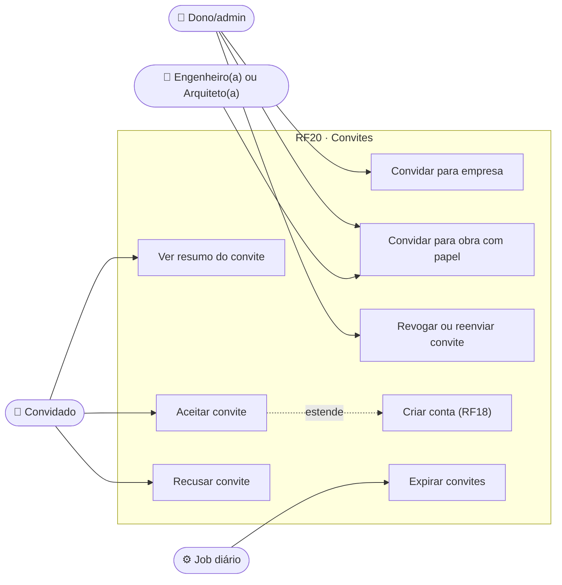
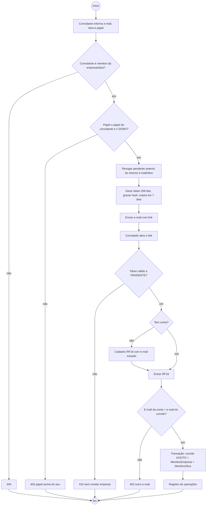
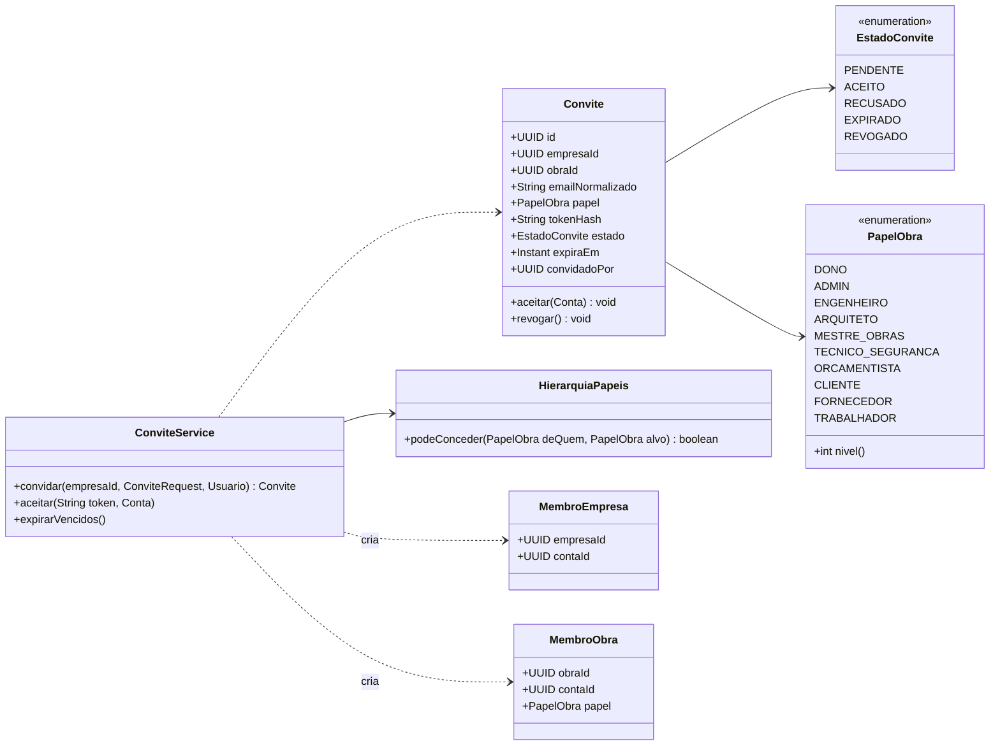
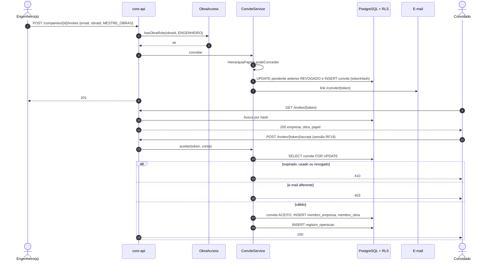
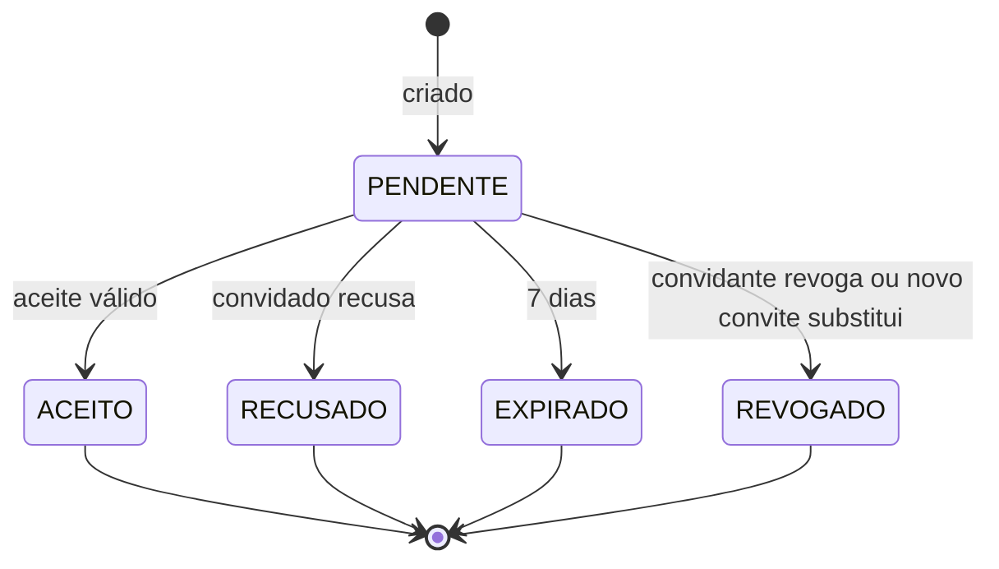
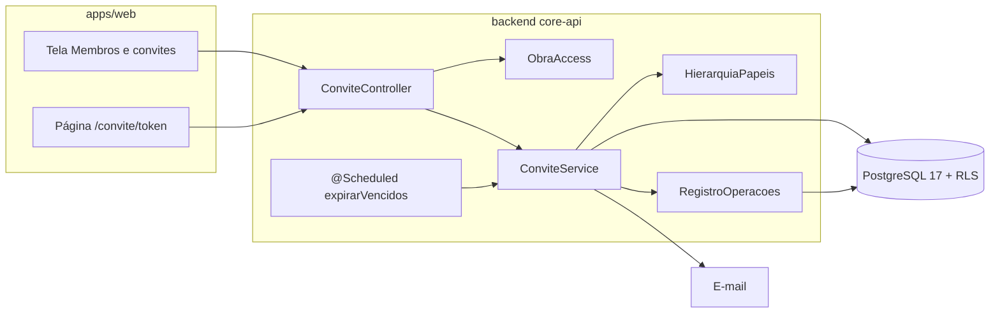

# RF20 · Convites para empresa e obra

> Pessoas entram em uma empresa e em uma obra **somente por convite**. O convite tem e-mail, obra e papel,
> expira em 7 dias, é de uso único e nunca dá a alguém um papel acima do de quem convidou.

## 1. Descrição

`POST /api/v1/companies/{empresaId}/invites {email, obraId?, papel}` cria um convite e envia por e-mail um link
`/convite/{token}`. O **token** tem 256 bits aleatórios (`SecureRandom`), vai só no e-mail e é guardado apenas
como **hash** (SHA-256). O convite pode ser para a **empresa** (papel `ADMIN`, sem obra) ou para uma **obra**
(papel de obra).

Quem abre o link vê só o nome da empresa, da obra e o papel (`GET /invites/{token}`); sem token válido, nada
é revelado. Para aceitar:

- **sem conta**: cadastra-se (RF18) com o e-mail do convite já preenchido e travado; ao verificar o e-mail, o
  convite é aceito;
- **com conta**: entra (RF19) e confirma `POST /invites/{token}/accept`.

O e-mail da conta deve ser **igual** ao do convite (normalizado). O aceite cria o vínculo `MembroEmpresa` e,
quando há obra, `MembroObra` com o papel; tudo na mesma transação que marca o convite `ACEITO`.

**Hierarquia de papéis** (quem convida só concede papel de nível menor ou igual ao seu na mesma obra/empresa):

| Nível | Papéis |
|---|---|
| 4 | `DONO` |
| 3 | `ADMIN` |
| 2 | `ENGENHEIRO`, `ARQUITETO` |
| 1 | `MESTRE_OBRAS`, `TECNICO_SEGURANCA`, `ORCAMENTISTA`, `CLIENTE`, `FORNECEDOR`, `TRABALHADOR` |

`DONO` não é concedido por convite (transferência de titularidade é fluxo próprio, RF22). Engenheiro(a) e
arquiteto(a) convidam apenas para obras em que são membros.

## 2. Atores

| Ator | Pode |
|---|---|
| Dono/admin da empresa | convidar para empresa ou qualquer obra, revogar, reenviar |
| Engenheiro(a) / Arquiteto(a) responsável | convidar para a sua obra, papel de nível ≤ 2 |
| Convidado | ver resumo do convite, aceitar, recusar |
| Job diário | marcar convites vencidos como `EXPIRADO` |

## 3. Critérios de aceite

- [ ] **CA-01** Convite expira em **7 dias**; aceite depois disso → `410` "Este convite expirou. Peça um novo a
  quem convidou."
- [ ] **CA-02** Uso único: segundo aceite do mesmo token → `410` (convite já usado).
- [ ] **CA-03** Token de 256 bits, guardado só como hash; o token nunca aparece em log nem em resposta da API.
- [ ] **CA-04** Papel acima do de quem convida, ou `DONO` → `403` com motivo em pt-BR.
- [ ] **CA-05** Convidante sem vínculo com a obra/empresa informada → `404`.
- [ ] **CA-06** E-mail da conta diferente do convite → `403` "Este convite foi enviado para outro e-mail."
- [ ] **CA-07** Token inválido, expirado, revogado ou usado não revela nome da empresa nem da obra.
- [ ] **CA-08** Já existe convite `PENDENTE` para o mesmo e-mail e obra → o novo substitui o anterior (anterior
  `REVOGADO`).
- [ ] **CA-09** Pessoa já membro da obra → `409` com o papel atual.
- [ ] **CA-10** Criação, reenvio, aceite, recusa e revogação vão para o registro de operações (Art. 37), com ids e
  papel, **sem o e-mail em claro**.
- [ ] **CA-11** Limite de 50 convites por empresa por hora (`429` + `Retry-After`).

## 4. Regras de negócio

- **RN-01** O aceite e a criação do vínculo são atômicos (uma transação com `SELECT ... FOR UPDATE` no convite).
- **RN-02** Papéis que aprovam orçamento ou medição exigem 2FA no próximo login (RF19) e selo `VERIFIED` para
  aprovar (RF21); o convite é aceito mesmo sem selo.
- **RN-03** Convite para `TRABALHADOR` é opcional: trabalhador pode existir sem login (cadastrado pela empresa).
- **RN-04** Revogar convite aceito não é possível; remove-se o membro (RF22).

## 5. Base legal e normas

- LGPD Art. 7º, V (contrato com a construtora) para o e-mail do convidado; Art. 6º, III (necessidade): só o
  e-mail é coletado antes do aceite; Art. 37 (registro das operações).
- OWASP ASVS 5.0 V6.3 (tokens de uso único com entropia ≥ 128 bits) e V8 (autorização).
- RFC 9457 (erros).

## 6. API

| Método e rota | Descrição | Respostas |
|---|---|---|
| `POST /api/v1/companies/{empresaId}/invites` | Cria convite | 201, 403, 404, 409, 422, 429 |
| `GET /api/v1/companies/{empresaId}/invites?estado=` | Lista convites | 200, 403, 404 |
| `POST /api/v1/companies/{empresaId}/invites/{id}/resend` | Reenvia (novo token, mesmo prazo) | 204, 410 |
| `DELETE /api/v1/companies/{empresaId}/invites/{id}` | Revoga | 204, 409 |
| `GET /api/v1/convites/{token}/publico` | Resumo público do convite (sem sessão; rota liberada na SecurityFilterChain) | 200, 410 |
| `POST /api/v1/invites/{token}/accept` | Aceita (sessão autenticada) | 200, 403, 409, 410 |
| `POST /api/v1/invites/{token}/decline` | Recusa | 204, 410 |

## 7. Diagramas

### 7.1 Casos de uso

### 7.2 Atividades

### 7.3 Classes

### 7.4 Sequência (convite)

### 7.5 Máquina de estados (Convite)

### 7.6 Componentes

## 8. Testes previstos

| Tipo | Caso |
|---|---|
| Unitário | `HierarquiaPapeis`: ENGENHEIRO concede MESTRE_OBRAS, não concede ADMIN; ninguém concede DONO |
| Integração `*IT` | convite aceito com login real → membro da obra com o papel certo |
| Integração `*IT` | segundo aceite → `410`; aceite após 7 dias (relógio fixo) → `410` |
| Integração `*IT` | aceite por conta com outro e-mail → `403` |
| Integração `*IT` | engenheiro de outra empresa convidando → `404` |
| Integração `*IT` | tabela `convite` não contém o token em claro; logs não contêm o token |

## 9. Rastreabilidade

| Camada | Artefato | Status |
|---|---|---|
| Documento | `docs/rf/RF20-convites-empresa-obra.md` | ✅ |
| Card | [Trello 22GiOPjC](https://trello.com/c/22GiOPjC) | ✅ |
| Web | `apps/web/src/app/(auth)/convite/[token]/page.tsx`, `(app)/empresa/membros/` | ⏳ |
| Domínio | `empresa/Convite.java` (7 dias, token só como hash, e-mail deve bater, nunca promove acima — `PapelObra.podeConvidar`), `EstadoConvite.java` | ✅ |
| Aplicação | `empresa/ConviteService.java` (criar/listar/reenviar/revogar; público, aceitar e recusar em modo sistema + tenant do convite; registro de operações) | ✅ |
| API | `api/empresa/EmpresaController.java` (`/companies/{id}/invites`), `ConviteController.java` (`/convites/{token}/publico`, `/invites/{token}/accept|decline`, 410 quando indisponível) | ✅ |
| Banco | `V1__contas_empresas_obras.sql` (convite) | ✅ |
| Testes | `ConviteEAcessoIT` (não promove acima, e-mail diferente → 403, uso único, revogado → 410), `DominioIdentidadeTest` | ✅ |
