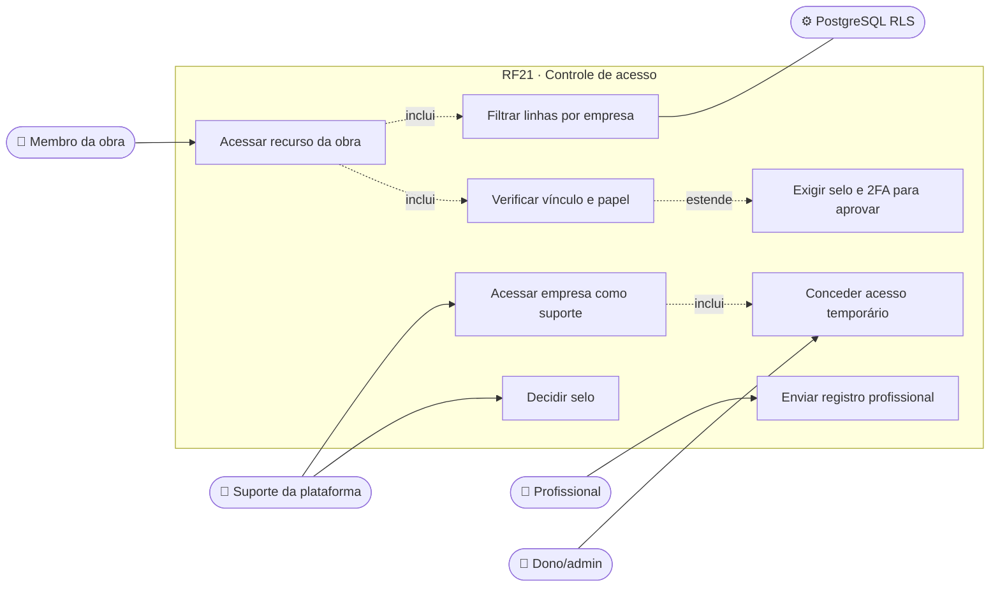
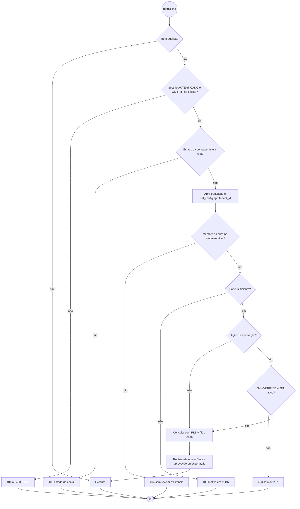
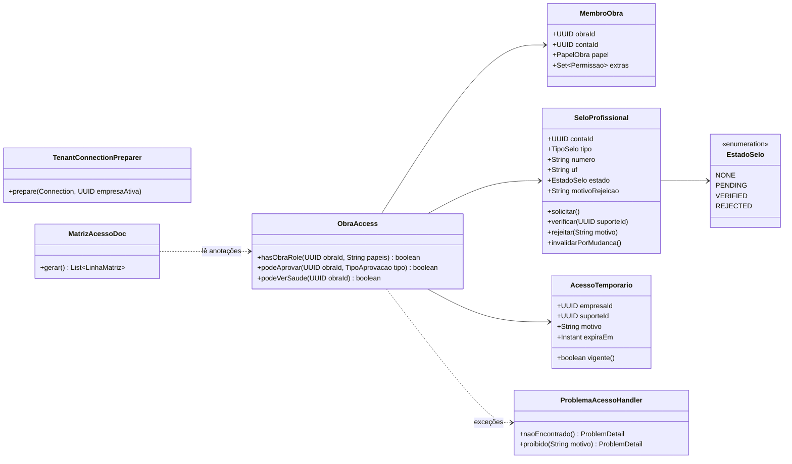
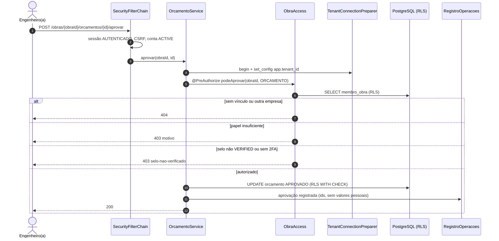
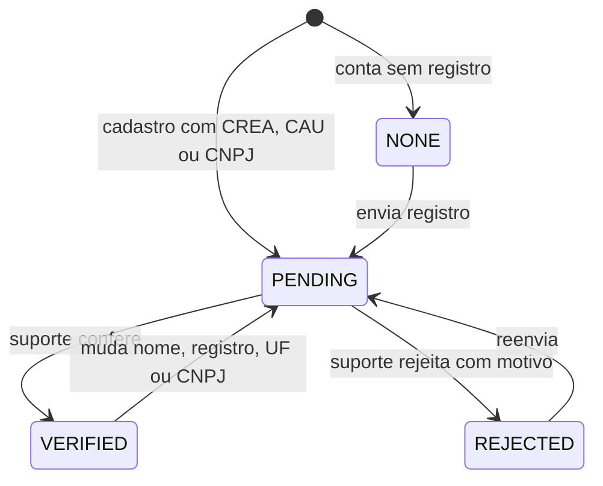
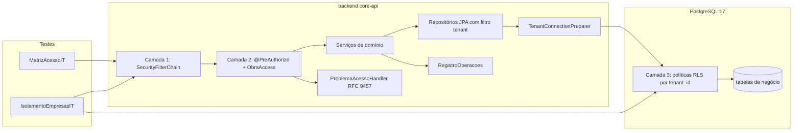

# RF21 · Controle de acesso por papel na obra, selo profissional e RLS

> Três camadas, todas obrigatórias: **(1)** `SecurityFilterChain` decide quem está autenticado e quais rotas
> são públicas; **(2)** o serviço confere o **papel na obra** com `@PreAuthorize` e um avaliador próprio;
> **(3)** o PostgreSQL aplica **Row-Level Security** por empresa. A tela nunca é a única barreira.

## 1. Descrição

**Camada 1 – autenticação.** Rotas públicas: `GET /auth/csrf`, `POST /auth/register`, `POST /auth/login*`,
`GET /invites/{token}`, `GET /legal/versoes`, página pública. Todo o resto exige sessão em etapa
`AUTENTICADO` (RF19) e conta em estado que permita a rota (tabela 1.2).

**Camada 2 – papel na obra e selo.** Métodos de serviço anotados, por exemplo:

```java
@PreAuthorize("@obraAccess.hasObraRole(#obraId, 'ENGENHEIRO')")
@PreAuthorize("@obraAccess.podeAprovar(#obraId, T(...TipoAprovacao).ORCAMENTO)")
```

`ObraAccess` resolve o vínculo `MembroObra` da pessoa na **empresa ativa**:

- não é membro da obra, ou a obra é de outra empresa → `ObraNaoEncontradaException` → **`404`** (não revela que
  existe);
- é membro, mas o papel não basta → **`403`** com `detail` em pt-BR (ex.: "Só o(a) engenheiro(a) responsável
  pode aprovar este orçamento.");
- aprovar (orçamento, medição, checklist, cálculo estrutural, rascunho de IA) exige também **selo `VERIFIED`** e
  **2FA ativo** → senão `403` com `type=/problemas/selo-nao-verificado` ou `/problemas/mfa-obrigatorio`.

**Camada 3 – RLS.** Toda tabela de negócio tem `tenant_id`. A cada transação o `TenantConnectionPreparer`
executa `SELECT set_config('app.tenant_id', :empresaAtiva, true)` (escopo da transação). Política:

```sql
ALTER TABLE obra ENABLE ROW LEVEL SECURITY;
ALTER TABLE obra FORCE ROW LEVEL SECURITY;
CREATE POLICY obra_tenant ON obra
  USING (tenant_id = current_setting('app.tenant_id')::uuid)
  WITH CHECK (tenant_id = current_setting('app.tenant_id')::uuid);
```

A aplicação conecta com um papel **sem** `BYPASSRLS`; migrações rodam com outro papel. Além da RLS, os
repositórios filtram por `tenant_id` (defesa em profundidade).

**Selo profissional** (CREA, CAU ou CNPJ): `NONE → PENDING → VERIFIED | REJECTED`. O suporte da plataforma confere
o registro no conselho (consulta pública/documento enviado) e decide. Trocar nome, número de registro, UF ou CNPJ
de conta `VERIFIED` volta o selo para `PENDING`. Profissional sem selo usa o app normalmente, mas **não aprova**.

**Dado de saúde** (ASO, afastamento): só `TECNICO_SEGURANCA` e RH (papel `ADMIN` com permissão `RH`) **daquela
obra**; nunca em logs, URLs, analytics, push ou contexto de IA.

**Suporte da plataforma**: acessa dados de uma empresa só com `AcessoTemporario` concedido pelo dono/admin
(motivo, prazo ≤ 72 h), sempre registrado.

### 1.1 Matriz de acesso (rota × papel na obra)

Legenda: ✅ permitido · 🔏 permitido só com selo `VERIFIED` + 2FA · 👁 só leitura do que foi liberado · ⛔ `403` ·
— não se aplica. Não membro / outra empresa: sempre `404`.

| Rota / ação | DONO | ADMIN | ENGENHEIRO | ARQUITETO | MESTRE_OBRAS | TECNICO_SEGURANCA | ORCAMENTISTA | CLIENTE | FORNECEDOR | TRABALHADOR |
|---|---|---|---|---|---|---|---|---|---|---|
| `GET /obras/{id}` | ✅ | ✅ | ✅ | ✅ | ✅ | ✅ | ✅ | 👁 | 👁 | 👁 |
| `POST /obras` (criar obra) | ✅ | ✅ | ⛔ | ⛔ | ⛔ | ⛔ | ⛔ | ⛔ | ⛔ | ⛔ |
| `PATCH /obras/{id}/estado` | ✅ | ✅ | ✅ | ⛔ | ⛔ | ⛔ | ⛔ | ⛔ | ⛔ | ⛔ |
| `POST /companies/{id}/invites` | ✅ | ✅ | ✅ nível ≤ 2 | ✅ nível ≤ 2 | ⛔ | ⛔ | ⛔ | ⛔ | ⛔ | ⛔ |
| `POST /obras/{id}/modelo/comandos` (RF01/RF02) | ⛔ | ⛔ | ✅ | ✅ arquitetura | ⛔ | ⛔ | ⛔ | ⛔ | ⛔ | ⛔ |
| `GET /obras/{id}/modelo` (RF13) | ✅ | ✅ | ✅ | ✅ | ✅ | ✅ | ✅ | 👁 | ⛔ | ⛔ |
| `POST /obras/{id}/analises` (RF05) | ⛔ | ⛔ | ✅ | ⛔ | ⛔ | ⛔ | ⛔ | ⛔ | ⛔ | ⛔ |
| Aprovar dimensionamento (RF07/RF10) | ⛔ | ⛔ | 🔏 | ⛔ | ⛔ | ⛔ | ⛔ | ⛔ | ⛔ | ⛔ |
| `GET /obras/{id}/orcamentos` (RF12) | ✅ | ✅ | ✅ | ✅ | ⛔ | ⛔ | ✅ | 👁 totais | ⛔ | ⛔ |
| Editar orçamento | ⛔ | ⛔ | ✅ | ⛔ | ⛔ | ⛔ | ✅ | ⛔ | ⛔ | ⛔ |
| Aprovar orçamento / medição | ⛔ | ⛔ | 🔏 | ⛔ | ⛔ | ⛔ | ⛔ | ⛔ | ⛔ | ⛔ |
| Aprovar aditivo | ✅ | ✅ | ⛔ | ⛔ | ⛔ | ⛔ | ⛔ | ✅ | ⛔ | ⛔ |
| Aprovar projeto de arquitetura / pranchas (RF14) | ⛔ | ⛔ | 🔏 | 🔏 | ⛔ | ⛔ | ⛔ | ⛔ | ⛔ | ⛔ |
| Checklist NR-18 (preencher) | ⛔ | ⛔ | ✅ | ⛔ | ✅ | ✅ | ⛔ | ⛔ | ⛔ | ⛔ |
| Checklist NR-18 (aprovar) | ⛔ | ⛔ | 🔏 | ⛔ | ⛔ | 🔏 | ⛔ | ⛔ | ⛔ | ⛔ |
| ASO / afastamento (dado de saúde) | ⛔ | ✅ só com permissão RH | ⛔ | ⛔ | ⛔ | ✅ | ⛔ | ⛔ | ⛔ | 👁 os próprios |
| Pedidos e entregas | ✅ | ✅ | ✅ | ⛔ | ✅ | ⛔ | ✅ | ⛔ | 👁 os seus | ⛔ |
| Exportar IFC/STEP (RF15) | ✅ | ✅ | ✅ | ✅ | ⛔ | ⛔ | ⛔ | ⛔ | ⛔ | ⛔ |

### 1.2 Matriz de acesso (estado da conta × selo)

| Estado da conta | Selo | Efeito |
|---|---|---|
| `PENDING_VERIFICATION` | qualquer | só `/me/verify-email`, reenvio, `/session`, `/logout` (403 nas demais) |
| `ACTIVE` | `NONE`, `PENDING`, `REJECTED` | tudo o que o papel permite, **exceto** ações 🔏 (403 selo-nao-verificado) |
| `ACTIVE` | `VERIFIED` | tudo o que o papel permite; 🔏 exige 2FA ativo |
| `SUSPENDED` | qualquer | login recusado (mensagem neutra); sessões existentes encerradas |
| `PENDING_DELETION` | qualquer | só oferta de reativação no login (RF26) |
| `ANONYMOUS_LGPD_DELETED` | — | não autentica |

## 2. Atores

| Ator | Pode |
|---|---|
| Todos os usuários | ter o acesso avaliado em cada requisição |
| Profissional (engenheiro, arquiteto, empresa) | enviar documento do registro, acompanhar o selo |
| `SUPORTE_PLATAFORMA` | verificar/rejeitar selo; acessar empresa só com acesso temporário |
| Dono/admin da empresa | conceder e revogar acesso temporário do suporte |

## 3. Critérios de aceite

- [ ] **CA-01** Recurso de outra empresa ou obra sem vínculo → `404`, corpo idêntico ao de id inexistente.
- [ ] **CA-02** Papel insuficiente na obra certa → `403` com `detail` em pt-BR explicando o papel necessário.
- [ ] **CA-03** A matriz 1.1 e 1.2 é gerada a partir das anotações (`MatrizAcessoDoc`) e coberta por um teste
  parametrizado `MatrizAcessoIT` (uma linha por célula), com login real.
- [ ] **CA-04** Teste de isolamento: com sessão da empresa A, (a) API para obra da empresa B → `404`; (b) SQL
  direto com `app.tenant_id = A` em todas as tabelas com `tenant_id` → zero linhas de B; (c) `INSERT` com
  `tenant_id = B` → falha pela política `WITH CHECK`.
- [ ] **CA-05** Sem `app.tenant_id` definido na transação, consultas retornam zero linhas (falha fechada).
- [ ] **CA-06** Ação 🔏 com selo ≠ `VERIFIED` → `403` selo-nao-verificado; sem 2FA → `403` mfa-obrigatorio.
- [ ] **CA-07** Alterar nome, registro, UF ou CNPJ com selo `VERIFIED` → selo `PENDING` na mesma transação.
- [ ] **CA-08** Dado de saúde nunca aparece em log (teste com appender de captura), URL, evento de analytics,
  push ou prompt de IA.
- [ ] **CA-09** Acesso do suporte sem `AcessoTemporario` vigente → `404`; com acesso, cada leitura é registrada.
- [ ] **CA-10** Toda aprovação, mudança de papel, decisão de selo e exportação vai para o registro de operações
  (Art. 37), sem valores pessoais.

## 4. Regras de negócio

- **RN-01** `404` tem precedência sobre `403`: primeiro se verifica o vínculo, depois o papel.
- **RN-02** Papéis são por obra; o mesmo usuário pode ser `ENGENHEIRO` numa obra e `CLIENTE` em outra.
- **RN-03** Obra `ARQUIVADA`: só leitura para todos (escritas `409`).
- **RN-04** O avaliador `ObraAccess` usa cache por requisição; mudança de papel vale na requisição seguinte.
- **RN-05** Ferramentas da IA (tool use) passam pelo mesmo `ObraAccess` que os endpoints (RF02, RF12).

## 5. Base legal e normas

- LGPD Art. 6º, VII (segurança) e VIII (prevenção), Art. 11 (dado sensível de saúde), Art. 37 (registro das
  operações), Art. 46 (medidas técnicas), Art. 47 (sigilo dos agentes de tratamento).
- Lei 5.194/1966 e Lei 12.378/2010 (atribuições de engenheiros e arquitetos; ART/RRT) — motivam o selo.
- NR-7 (ASO) e NR-18 (checklists de segurança).
- OWASP ASVS 5.0 V8 (autorização), OWASP Top 10 A01 (Broken Access Control), CWE-639 (IDOR).

## 6. API

| Método e rota | Descrição | Respostas |
|---|---|---|
| `POST /api/v1/me/selo` | Envia registro e documento (upload pré-assinado) | 202, 422 |
| `GET /api/v1/me/selo` | Estado do selo | 200 |
| `GET /api/v1/plataforma/selos?estado=PENDING` | Fila de verificação (suporte) | 200, 403 |
| `POST /api/v1/plataforma/selos/{id}/decisao` | `VERIFIED` ou `REJECTED` + motivo | 204, 409 |
| `POST /api/v1/companies/{id}/acessos-suporte` | Concede acesso temporário | 201 |
| `DELETE /api/v1/companies/{id}/acessos-suporte/{aid}` | Revoga | 204 |
| `GET /api/v1/acesso/matriz` | Matriz gerada (só em `dev`/docs) | 200 |

## 7. Diagramas

### 7.1 Casos de uso



### 7.2 Atividades



### 7.3 Classes



### 7.4 Sequência



### 7.5 Máquina de estados (SeloProfissional)



### 7.6 Componentes



## 8. Testes previstos

| Tipo | Caso |
|---|---|
| Unitário | `ObraAccess` para cada papel × ação da matriz 1.1 (mock do repositório) |
| Unitário | `SeloProfissional.invalidarPorMudanca` volta para `PENDING` só a partir de `VERIFIED` |
| Integração `*IT` | `MatrizAcessoIT` parametrizado: papel × rota × estado da conta × selo com login real |
| Integração `*IT` | `IsolamentoEmpresasIT`: API → 404, SQL direto → zero linhas, INSERT de outro tenant → erro |
| Integração `*IT` | sem `app.tenant_id` → zero linhas em `obra` |
| Integração `*IT` | engenheiro com selo `PENDING` aprovando orçamento → 403 selo-nao-verificado |
| Integração `*IT` | suporte sem acesso temporário → 404; com acesso → 200 e registro |
| Integração `*IT` | log capturado durante leitura de ASO não contém dado de saúde |

## 9. Rastreabilidade

| Camada | Artefato | Status |
|---|---|---|
| Documento | `docs/rf/RF21-controle-acesso-papel-obra.md` | ✅ |
| Card | [Trello BUNJmEJI](https://trello.com/c/BUNJmEJI) | ✅ |
| Camada 1 | `cca-web · config/SegurancaConfig.java` (SecurityFilterChain, rotas públicas) | ✅ |
| Camada 2 | `cca-application · acesso/AcessoObraImpl.java` (bean `obraAccess`: `hasObraRole`, 404 fora do escopo, 403 com motivo), `@PreAuthorize` em `ObraService`; `acesso/PapelObra.java` (níveis, aprovador, exigeMfa) | ✅ |
| Camada 3 | `cca-infrastructure · persistencia/TenantJpaTransactionManager.java` (`set_config('app.tenant_id', …, true)` a cada transação) + `V2__rls.sql` (políticas, papel `cca_app` sem bypass) | ✅ |
| Selo | `identidade/Conta.java` (NONE→PENDING→VERIFIED/REJECTED, volta a PENDING ao mudar nome/registro/CNPJ), `PerfilService.solicitarSelo/decidirSelo`, `MeController` (`/me/selo`, `/plataforma/selos`) | ✅ |
| Web | `apps/web/src/app/(app)/conta/selo/` | ⏳ |
| Testes | `ConviteEAcessoIT` (404 outra empresa, 403 papel insuficiente, isolamento por RLS via API e SQL direto como `cca_app`) | ✅ |
| Pendente | acesso temporário do suporte da plataforma (`/companies/{id}/acessos-suporte`) e `/acesso/matriz` gerada | 🟡 |

## Auditoria 2026-10

Auditoria pelo uso real do app ([relatório](../auditoria/AUDITORIA_2026-10.md)). Nota (conclusão 30%, precisão 25%, clareza
20%, feedback 15%, consistência/acessibilidade 10%): **5,5 → 8,7**.

- **Corrigido:** Papel de empresa só vale nas obras da empresa ativa (antes um DONO de outra empresa gravava no modelo alheio); recusa de selo exige motivo, guardado e mostrado (V20); invariante "todo aprovador exige 2FA" testada.
- **Evidência:** j1 CA-01/02/04a; j3 selo; EscopoEmpresaIT.
- **Pendente:** `veDadoDeSaude()` sem caso de uso.
