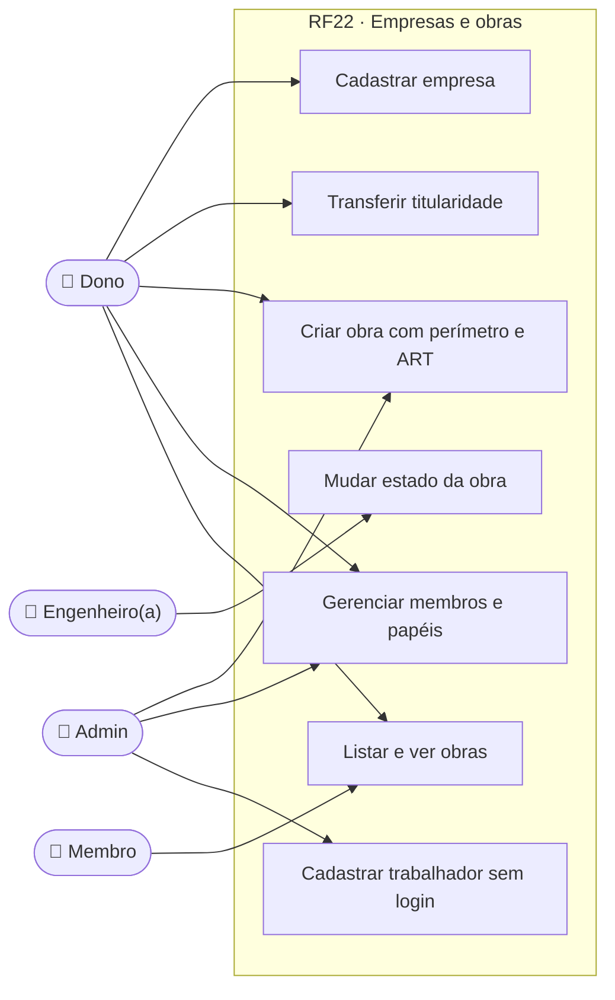
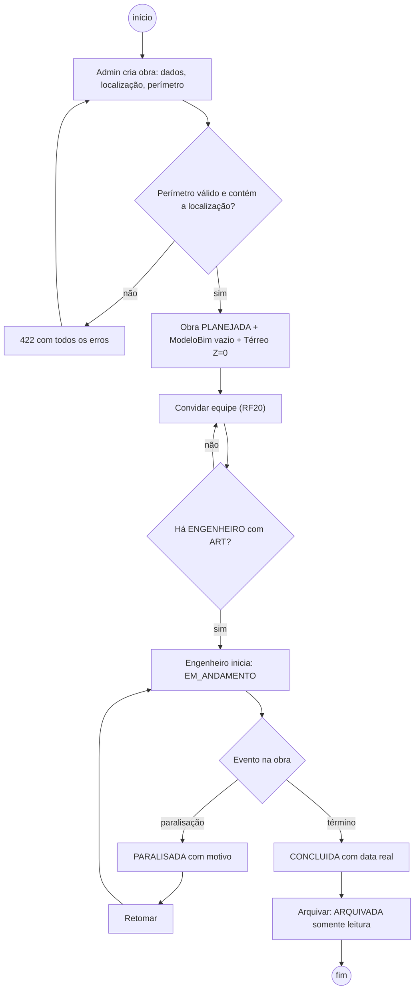
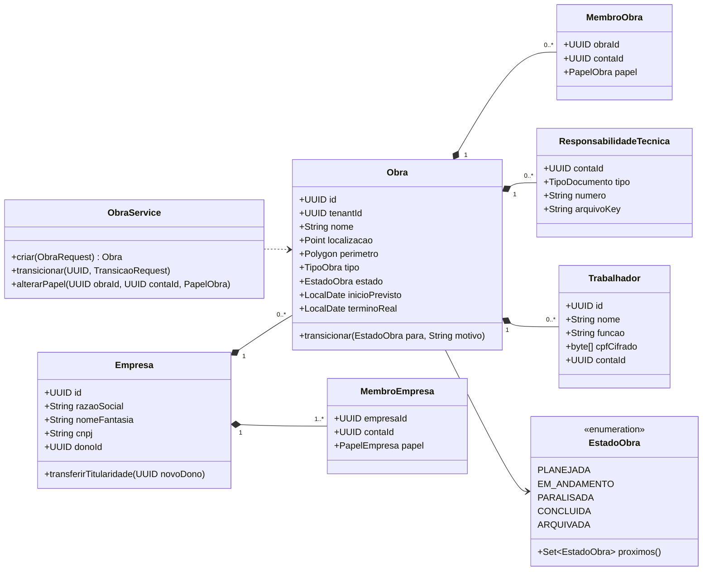
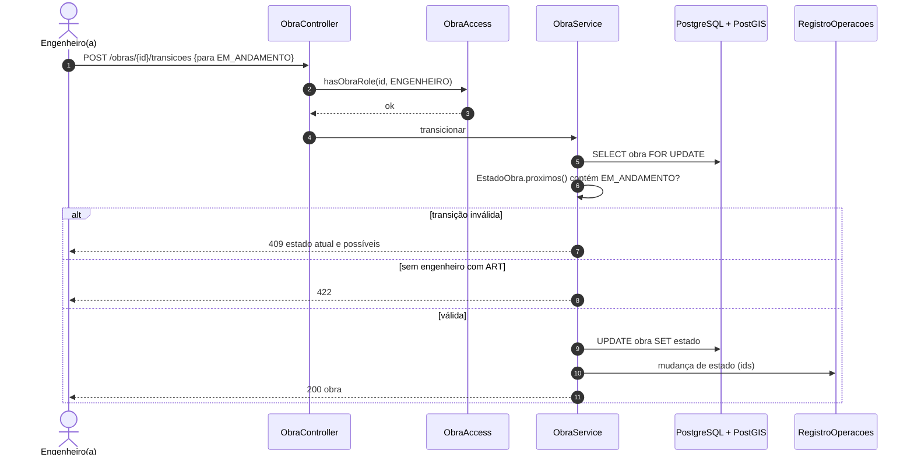
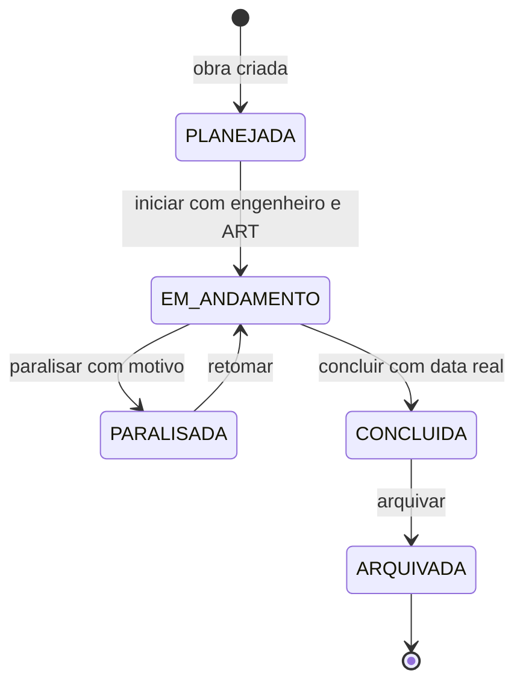
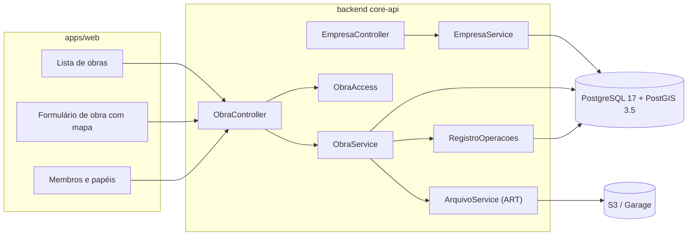

# RF22 · Gestão de empresas, obras e membros da obra

> Modelo multiempresa: **Empresa (tenant) → Obras → Membros da obra**. Uma pessoa pode estar em várias empresas
> e ter um papel diferente em cada obra. A obra tem ciclo de vida explícito e transições inválidas são erro de
> domínio.

## 1. Descrição

**Empresa.** Criada no cadastro do tipo `EMPRESA` (RF18) ou por uma pessoa já cadastrada
(`POST /api/v1/companies`). Dados: razão social, nome fantasia, **CNPJ** (dígito verificador + conferência do
selo, RF21), endereço. Quem cria é `DONO`. A empresa é o **tenant**: seu id é o `tenant_id` de todas as linhas
de negócio e define a RLS (RF21). Transferir a titularidade (`DONO`) exige modo sudo dos dois lados.

**Obra.** `POST /api/v1/obras` (empresa ativa da sessão): nome, endereço, **localização e perímetro** (PostGIS
`geometry(Polygon, 4674)` — SIRGAS 2000), tipo (residencial, comercial, industrial, infraestrutura), área
prevista, datas previstas, **ART/RRT** do responsável técnico (número e arquivo). A obra nasce `PLANEJADA` com
um `ModeloBim` vazio (RF01) e um pavimento Térreo (RF03).

**Ciclo de vida da obra:** `PLANEJADA → EM_ANDAMENTO ⇄ PARALISADA → CONCLUIDA → ARQUIVADA`. Sair de `PLANEJADA`
exige ao menos um membro `ENGENHEIRO` com ART informada. Paralisar exige motivo. `ARQUIVADA` é somente leitura
(escritas `409`). Transição inválida → `TransicaoInvalidaException` → `409` em Problem Details.

**Membros.** Entram por convite (RF20). Dono/admin altera papel e remove membro; ninguém remove o último
`ENGENHEIRO` de obra em andamento. Trabalhadores podem ser cadastrados **sem login** pela empresa (nome, função,
CPF opcional cifrado, ASO em módulo à parte com acesso restrito, RF21).

## 2. Atores

| Ator | Pode |
|---|---|
| Dono da empresa | tudo da empresa, inclusive cobrança e transferência de titularidade |
| Admin da empresa | criar obras, gerenciar membros e papéis, cadastrar trabalhadores |
| Engenheiro(a) responsável | mudar estado da obra, editar dados técnicos, informar ART |
| Demais membros | ver a obra conforme o papel (matriz RF21) |

## 3. Critérios de aceite

- [ ] **CA-01** Empresa com CNPJ inválido → `422`; CNPJ já usado por outra empresa ativa → `409`.
- [ ] **CA-02** Obra criada com id UUID v7, `tenant_id` da empresa ativa, estado `PLANEJADA`, modelo vazio e
  Térreo em Z = 0,00.
- [ ] **CA-03** Perímetro deve ser polígono válido (`ST_IsValid`) e conter a localização (`ST_Contains`); senão
  `422`.
- [ ] **CA-04** Toda transição fora do diagrama 7.5 → `409` com estado atual e transições possíveis.
- [ ] **CA-05** `PLANEJADA → EM_ANDAMENTO` sem `ENGENHEIRO` com ART → `422`.
- [ ] **CA-06** Obra `ARQUIVADA`: qualquer escrita em recursos da obra → `409` "Obra arquivada é somente leitura."
- [ ] **CA-07** Remover o último `ENGENHEIRO` de obra `EM_ANDAMENTO` ou `PARALISADA` → `409`.
- [ ] **CA-08** Mudança de papel, entrada/saída de membro e mudança de estado vão para o registro de operações
  (Art. 37) sem nome, e-mail ou CPF.
- [ ] **CA-09** Listagem de obras mostra só as da empresa ativa em que a pessoa é membro (dono/admin veem todas).
- [ ] **CA-10** Estado da obra exibido com cor + ícone Lucide + texto (tokens `--obra-*`).

## 4. Regras de negócio

- **RN-01** Uma pessoa por papel por obra (único `obra_id, conta_id`).
- **RN-02** `CONCLUIDA` exige data de término real; `ARQUIVADA` só a partir de `CONCLUIDA`.
- **RN-03** CPF do trabalhador cifrado com a DEK da empresa; nunca usado como chave nem em URL.
- **RN-04** Perímetro alimenta validações de outros RFs (furo de sondagem dentro da obra, RF09).
- **RN-05** Excluir empresa segue fluxo próprio de encerramento de contrato (fora deste RF).

## 5. Base legal e normas

- LGPD Art. 7º, V e II (contrato e obrigação legal), Art. 37 (registro), Art. 39 (operador segue instruções da
  controladora — a construtora é controladora dos dados dos seus trabalhadores).
- Lei 6.496/1977 (ART) e Lei 12.378/2010 (RRT).
- OGC Simple Features / PostGIS; SIRGAS 2000 (EPSG:4674).
- RFC 9457 (erros).

## 6. API

| Método e rota | Descrição | Respostas |
|---|---|---|
| `POST /api/v1/companies` | Cria empresa (quem cria vira DONO) | 201, 409, 422 |
| `GET/PATCH /api/v1/companies/{id}` | Dados da empresa | 200, 403, 404 |
| `GET /api/v1/obras` | Obras da empresa ativa visíveis ao usuário | 200 |
| `POST /api/v1/obras` | Cria obra | 201, 403, 422 |
| `GET/PATCH /api/v1/obras/{obraId}` | Dados da obra | 200, 403, 404, 409 |
| `POST /api/v1/obras/{obraId}/transicoes` | `{para, motivo?}` muda estado | 200, 403, 404, 409, 422 |
| `GET /api/v1/obras/{obraId}/membros` | Membros e papéis | 200, 404 |
| `PATCH /api/v1/obras/{obraId}/membros/{contaId}` | Muda papel | 200, 403, 409 |
| `DELETE /api/v1/obras/{obraId}/membros/{contaId}` | Remove membro | 204, 409 |
| `POST /api/v1/obras/{obraId}/trabalhadores` | Cadastra trabalhador sem login | 201, 422 |

## 7. Diagramas

### 7.1 Casos de uso

### 7.2 Atividades

### 7.3 Classes

### 7.4 Sequência

### 7.5 Máquina de estados (Obra)

### 7.6 Componentes

## 8. Testes previstos

| Tipo | Caso |
|---|---|
| Unitário | `EstadoObra.proximos()` para cada estado; `ARQUIVADA` sem próximos |
| Unitário | validador de CNPJ |
| Integração `*IT` | criar obra com login real → `PLANEJADA`, Térreo Z=0, `tenant_id` correto |
| Integração `*IT` | perímetro auto-intersectante → `422` |
| Integração `*IT` | `PLANEJADA → CONCLUIDA` → `409`; `EM_ANDAMENTO` sem engenheiro → `422` |
| Integração `*IT` | escrita em obra `ARQUIVADA` → `409` |
| Integração `*IT` | remover último engenheiro → `409` |

## 9. Rastreabilidade

| Camada | Artefato | Status |
|---|---|---|
| Documento | `docs/rf/RF22-empresas-e-obras.md` | ✅ |
| Card | [Trello 4vumPt2g](https://trello.com/c/4vumPt2g) | ✅ |
| Web | `apps/web/src/app/(app)/obras/`, `(app)/empresa/` | ⏳ |
| Domínio | `empresa/Empresa.java` (tenant raiz, CNPJ válido), `Cnpj.java`, `MembroEmpresa.java`, `obra/Obra.java` (PostGIS SIRGAS 2000, máquina de estados, arquivada somente leitura, responsável técnico), `EstadoObra.java`, `MembroObra.java` | ✅ |
| Aplicação | `empresa/EmpresaService.java`, `obra/ObraService.java` (CRUD, transições, membros/papéis com registro de operações, trabalhador sem login) | ✅ |
| API | `api/empresa/EmpresaController.java` (`/companies`), `api/obra/ObraController.java` (`/obras`, `/transicoes`, `/responsavel-tecnico`, `/membros`, `/trabalhadores`) | ✅ |
| Banco | `V1__contas_empresas_obras.sql` (empresa, membro_empresa, obra, membro_obra) | ✅ |
| Testes | `ConviteEAcessoIT` (sem engenheiro não inicia, transição inválida 409, arquivada 409, isolamento) | ✅ |
| Pendente | dados pessoais do trabalhador sem login (CPF, contato) ficam no módulo LGPD/empresa; aqui só o vínculo | 🟡 |
