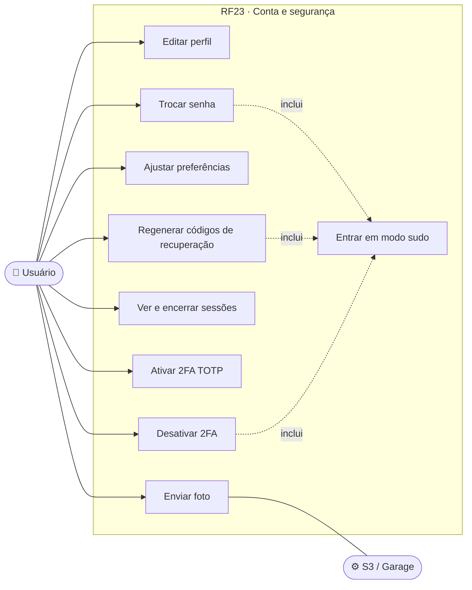
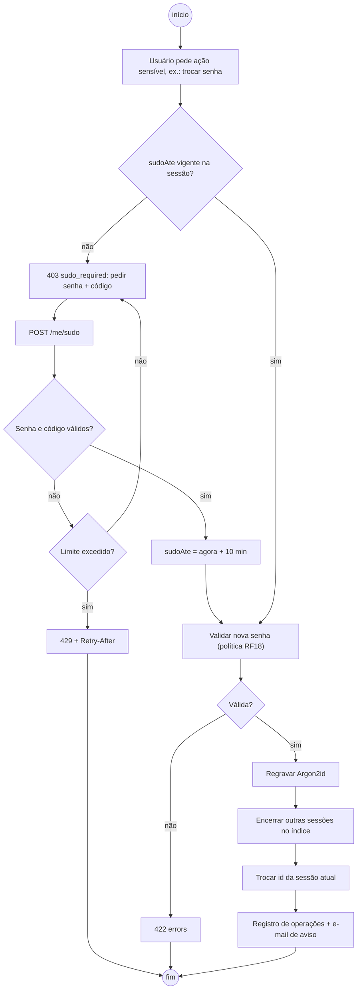
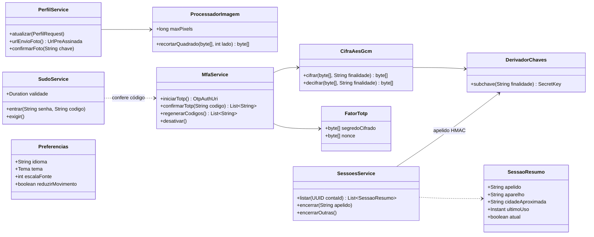
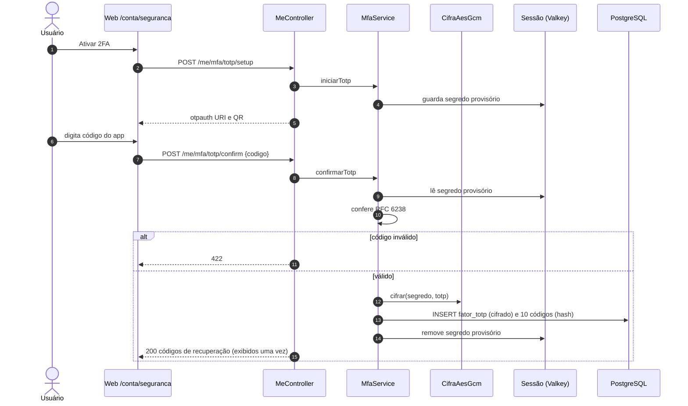
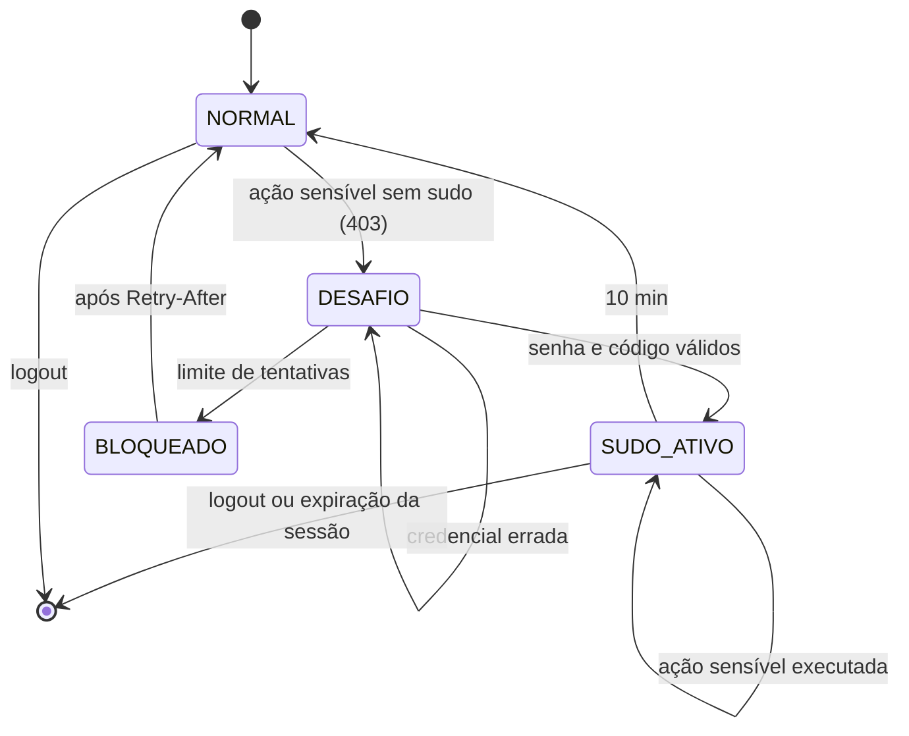
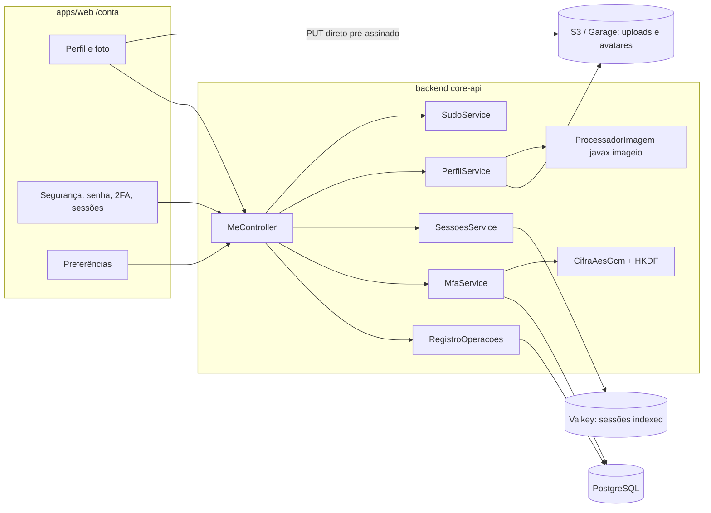

# RF23 · Perfil, segurança da conta, sessões e modo sudo

> Área `/api/v1/me/*`: perfil e foto, preferências, troca de senha, sessões ativas, 2FA (TOTP + códigos de
> recuperação) e **modo sudo** — confirmação recente de senha + código exigida antes de ações sensíveis.

## 1. Descrição

**Perfil e foto.** `PATCH /me/profile` (nome, telefone, registro profissional — mudança volta o selo a `PENDING`,
RF21). Foto: `POST /me/photo/upload-url` devolve **URL pré-assinada** S3 (15 min, tipo `image/jpeg|png|webp` e
tamanho ≤ 5 MB na assinatura, chave em `uploads/`); `POST /me/photo/confirm` processa com `javax.imageio`:
formato detectado pelos bytes, limite de pixels **antes** de decodificar (≤ 40 MP), orientação EXIF aplicada,
recorte quadrado central de **512 px**, regravado **sem EXIF**, tudo em memória; o original em `uploads/` expira
em 1 dia (lifecycle).

**Preferências.** Idioma (pt-BR padrão), tema (claro alto contraste / escuro / sistema), tamanho de fonte
(85–150 %), redução de movimento, alertas por e-mail.

**Troca de senha.** `POST /me/password` exige **modo sudo**; aplica a política de senha (RF18), regrava em
Argon2id e **derruba todas as outras sessões** do usuário (índice do Spring Session).

**Sessões.** `GET /me/sessions` lista aparelho (user-agent resumido), cidade aproximada pelo IP (sem guardar o
IP completo), criada em, último uso e `atual`. O id exposto é um **apelido** (HMAC do id real com subchave
`sessao-apelido`), nunca o id real. `DELETE /me/sessions/{apelido}` encerra uma; `DELETE /me/sessions` encerra
todas exceto a atual. Novo login em aparelho desconhecido gera **alerta por e-mail**.

**2FA.** `POST /me/mfa/totp/setup` gera segredo (160 bits), devolve `otpauth://` e QR; o segredo fica na sessão
até a confirmação. `POST /me/mfa/totp/confirm {codigo}` grava o segredo **cifrado com AES-256-GCM** (subchave
derivada de `CCA_APP_SECRET` por HKDF, finalidade `totp`, nonce de 96 bits) e gera **10 códigos de recuperação**
mostrados uma única vez e guardados como hash Argon2id. `POST /me/mfa/recovery-codes` regenera (sudo).
`DELETE /me/mfa` desativa (sudo), recusado se o 2FA for obrigatório para algum papel da pessoa.

**Modo sudo.** `POST /me/sudo {senha, codigo}` (código TOTP se 2FA ativo; senão código por e-mail) grava
`sudoAte = agora + 10 min` na sessão. Ações sensíveis sem sudo vigente → `403` com
`type=/problemas/sudo-necessario` (`sudo_required`). Ações sensíveis: trocar senha, trocar e-mail, desativar ou
regenerar 2FA, exportar dados (RF25), excluir conta (RF26), transferir titularidade (RF22), conceder acesso do
suporte (RF21).

## 2. Atores

| Ator | Pode |
|---|---|
| Usuário autenticado | gerenciar perfil, foto, preferências, senha, sessões, 2FA, entrar em sudo |
| Valkey | guardar sessões (indexed) e o estado sudo |
| S3 / Garage | receber o envio direto da foto |

## 3. Critérios de aceite

- [ ] **CA-01** Segredo TOTP gravado só cifrado (AES-256-GCM); coluna nunca contém o segredo em claro; trocar
  `CCA_APP_SECRET` sem migração torna o 2FA ilegível (teste documenta a rotação).
- [ ] **CA-02** 10 códigos de recuperação, uso único, hash; mostrados uma vez; regenerar invalida os anteriores.
- [ ] **CA-03** Sudo vale 10 min na sessão; ação sensível sem sudo → `403 sudo_required`; sudo não passa para
  outras sessões.
- [ ] **CA-04** Troca de senha derruba as outras sessões (removidas do índice `indexed`); a atual continua com
  novo id.
- [ ] **CA-05** `GET /me/sessions` não expõe o id real; encerrar por apelido inexistente → `404`.
- [ ] **CA-06** Foto: arquivo que não é imagem pelos bytes, > 5 MB ou > 40 MP → `422`; resultado 512×512 sem
  metadados EXIF.
- [ ] **CA-07** Desativar 2FA obrigatório (dono/admin/aprovador) → `409`.
- [ ] **CA-08** Mudança de nome/registro com selo `VERIFIED` → selo `PENDING` (RF21).
- [ ] **CA-09** Tentativas de sudo contam no limite por conta (RF19) → `429` + `Retry-After`.
- [ ] **CA-10** Troca de senha, e-mail, 2FA e encerramento de sessões geram registro de operações e e-mail de
  aviso.

## 4. Regras de negócio

- **RN-01** Trocar e-mail exige sudo e verificação do novo e-mail (RF18) antes de efetivar; o antigo recebe aviso.
- **RN-02** Preferências de acessibilidade valem também no mobile (sincronizadas).
- **RN-03** Foto de perfil não é usada para treinar classificadores (consentimento separado, RF24).
- **RN-04** Código TOTP usado no sudo não pode ser reaproveitado no mesmo passo (replay).

## 5. Base legal e normas

- LGPD Art. 18, III (correção dos dados pelo titular), Art. 46 (segurança), Art. 6º, III (necessidade: sem EXIF,
  sem IP completo).
- RFC 6238 (TOTP), RFC 5869 (HKDF), NIST SP 800-38D (GCM).
- OWASP ASVS 5.0 V6 (MFA e recuperação), V7 (sessões: listar e encerrar), V12 (upload de arquivos).

## 6. API

| Método e rota | Descrição | Respostas |
|---|---|---|
| `GET/PATCH /api/v1/me/profile` | Perfil | 200, 422 |
| `POST /api/v1/me/photo/upload-url` | URL pré-assinada | 200, 422 |
| `POST /api/v1/me/photo/confirm` | Processa a foto | 200, 422 |
| `GET/PATCH /api/v1/me/preferences` | Preferências | 200 |
| `POST /api/v1/me/sudo` | Entra em modo sudo | 204, 401, 429 |
| `POST /api/v1/me/password` | Troca senha (sudo) | 204, 403, 422 |
| `GET /api/v1/me/sessions` | Lista sessões | 200 |
| `DELETE /api/v1/me/sessions/{apelido}` | Encerra uma | 204, 404 |
| `DELETE /api/v1/me/sessions` | Encerra todas menos a atual | 204 |
| `POST /api/v1/me/mfa/totp/setup` | Gera segredo e QR | 200 |
| `POST /api/v1/me/mfa/totp/confirm` | Ativa e devolve códigos | 200, 422 |
| `POST /api/v1/me/mfa/recovery-codes` | Regenera (sudo) | 200, 403 |
| `DELETE /api/v1/me/mfa` | Desativa (sudo) | 204, 403, 409 |

## 7. Diagramas

### 7.1 Casos de uso

### 7.2 Atividades

### 7.3 Classes

### 7.4 Sequência (ativar 2FA)

### 7.5 Máquina de estados (ModoSudo)

### 7.6 Componentes

## 8. Testes previstos

| Tipo | Caso |
|---|---|
| Unitário | `CifraAesGcm` ida e volta; nonce diferente a cada cifra; finalidade errada falha |
| Unitário | `ProcessadorImagem`: JPEG com EXIF de rotação → 512×512 rotacionado, sem EXIF; PNG gigante rejeitado antes de decodificar |
| Integração `*IT` | trocar senha sem sudo → `403 sudo_required`; com sudo → 204 e outra sessão do mesmo usuário passa a `401` |
| Integração `*IT` | sudo expira após 10 min (relógio fixo) |
| Integração `*IT` | `GET /me/sessions` não contém o id real presente no Valkey |
| Integração `*IT` | ativar TOTP, usar código de recuperação no login (RF19), reusar → falha |
| Integração `*IT` | foto enviada ao Garage por URL pré-assinada e confirmada |

## 9. Rastreabilidade

| Camada | Artefato | Status |
|---|---|---|
| Documento | `docs/rf/RF23-perfil-sessoes-modo-sudo.md` | ✅ |
| Card | [Trello u9tL8Fqy](https://trello.com/c/u9tL8Fqy) | ✅ |
| Web | `apps/web/src/app/(app)/conta/{perfil,seguranca,preferencias}/` | ⏳ |
| Aplicação | `identidade/PerfilService.java` (perfil, foto por URL pré-assinada, preferências, troca de senha em sudo derrubando as outras sessões, sessões por apelido HMAC), `MfaService.java` (TOTP + 10 códigos de recuperação), `SudoService.java` (10 min) | ✅ |
| Cripto | `seguranca/CifraAesGcm.java`, `seguranca/DerivacaoChaves.java` (HKDF), `identidade/AdaptadoresIdentidade.CifradorTotpAesGcm` (segredo TOTP cifrado, AAD = id da conta) | ✅ |
| Infra | `sessao/RepositorioSessoesRedis.java` (FindByIndexNameSessionRepository), `AdaptadoresIdentidade.TotpSamstevens` (RFC 6238) | ✅ |
| API | `api/identidade/MeController.java` (`/me/profile`, `/me/photo/*`, `/me/preferences`, `/me/sudo`, `/me/password`, `/me/sessions`, `/me/mfa/**`) | ✅ |
| Banco | `V1__contas_empresas_obras.sql` (preferencia, conta.mfa_segredo_cifrado, codigo_recuperacao_mfa) | ✅ |
| Testes | `LoginIT` (setup/confirm TOTP, códigos de recuperação, sudo_required, troca de senha encerra outras sessões) | ✅ |
| Pendente | processamento da foto (recorte 512 px, sem EXIF) na confirmação; alerta de login | 🟡 |

## Auditoria 2026-10

Auditoria pelo uso real do app ([relatório](../auditoria/AUDITORIA_2026-10.md)). Nota (conclusão 30%, precisão 25%, clareza
20%, feedback 15%, consistência/acessibilidade 10%): **7,5 → 8,7**.

- **Corrigido:** Desativar 2FA obrigatório → 409; confirmar o 2FA atualiza a sessão sem novo login.
- **Evidência:** j1 CA-02/03/05/07; j3 sudo-email.
- **Pendente:** —
