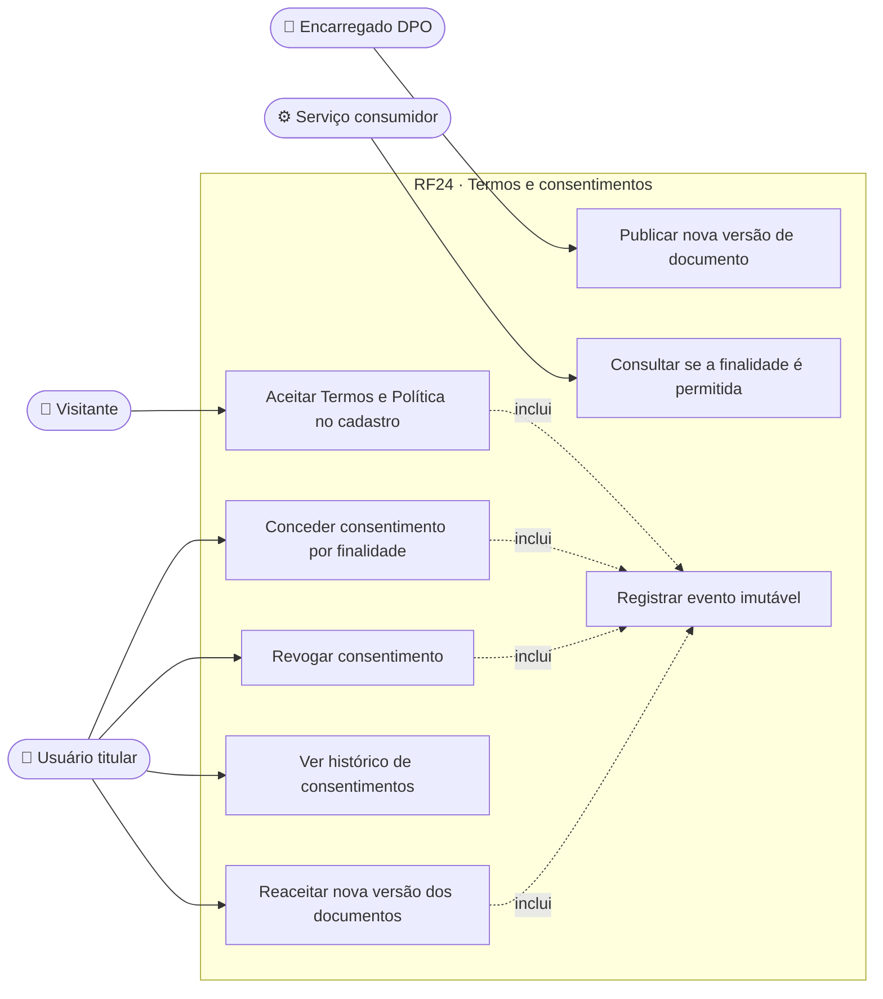
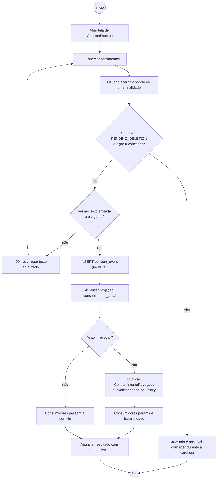
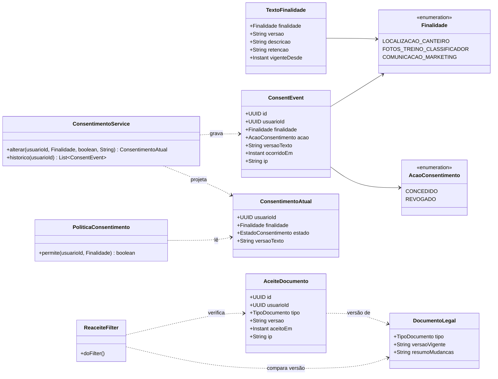
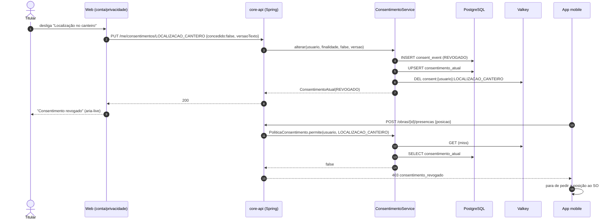
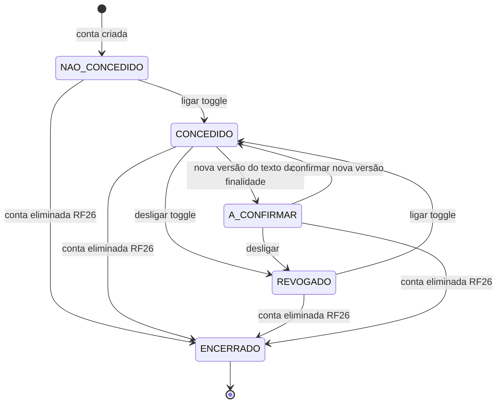
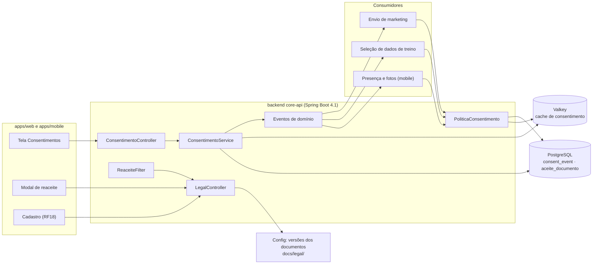

# RF24 · Termos versionados e consentimentos por finalidade

> Cada pessoa aceita os Termos de Uso e a Política de Privacidade **na versão vigente**, e escolhe, uma a uma,
> as finalidades que dependem de consentimento. Tudo começa **desligado**; revogar é o mesmo gesto de dar; e
> cada mudança vira um evento imutável em `consent_event`.

## 1. Descrição

Há dois tipos de registro, com bases legais diferentes:

1. **Aceite de documentos** (Termos de Uso e Política de Privacidade). É condição para usar o app
   (execução de contrato, Art. 7º, V) e prova de que o titular foi informado (Art. 9º). A versão vigente de
   cada documento fica em configuração (`app.legal.termos.versao`, `app.legal.politica.versao`) e o texto em
   `docs/legal/`. Quando a versão muda, o próximo acesso mostra um **bloqueio de reaceite**: a pessoa só usa o
   app depois de ler o resumo das mudanças e marcar a caixa (desmarcada por padrão).
2. **Consentimentos por finalidade** (Art. 7º, I e Art. 8º). Finalidades iniciais:

   | Código | Finalidade | Efeito quando ligado |
   |---|---|---|
   | `LOCALIZACAO_CANTEIRO` | usar a localização do aparelho para registrar presença e fotos dentro do perímetro da obra | o app mobile pede permissão do SO e envia a posição só ao registrar presença/foto |
   | `FOTOS_TREINO_CLASSIFICADOR` | usar fotos do canteiro enviadas pela pessoa para treinar classificadores internos | as fotos dela entram no conjunto de treino; sem consentimento, são excluídas na seleção |
   | `COMUNICACAO_MARKETING` | receber novidades e ofertas por e-mail | inclusão na lista de envio |

   Cada finalidade tem um **toggle** na tela de Consentimentos. Todos começam desligados; ligar e desligar são
   o mesmo controle (Art. 8º §5º: revogação tão fácil quanto o consentimento). O estado atual é derivado do
   último evento de cada finalidade; a tabela `consentimento_atual` é só uma projeção para leitura rápida.

Revogar tem efeito **imediato**: o backend publica `ConsentimentoRevogado` e os consumidores param de usar o
dado (ex.: o app deixa de coletar localização na próxima abertura, a seleção de treino exclui as fotos e o
envio de marketing remove o endereço). O que já foi tratado com consentimento válido continua lícito (Art. 8º
§5º), mas a pessoa pode pedir a eliminação pelo RF25.

Consentimentos são **por pessoa**, não por empresa: a construtora não pode ligar um consentimento em nome do
trabalhador. Dado de saúde (ASO, afastamento) nunca é tratado com base em consentimento por este fluxo; segue a
base legal do Art. 11, II, "a" (obrigação legal da construtora) e não aparece nesta tela.

## 2. Atores

| Ator | Pode |
|---|---|
| Visitante (no cadastro, RF18) | aceitar Termos e Política na versão vigente |
| Usuário (titular) | ver e alterar seus consentimentos, ver o histórico, reaceitar nova versão |
| Encarregado (DPO) | publicar nova versão dos documentos (via configuração + deploy) e consultar estatísticas agregadas |
| Serviços consumidores (sistema) | consultar `PoliticaConsentimento.permite(usuario, finalidade)` antes de tratar |

## 3. Critérios de aceite

- [ ] **CA-01** No cadastro, as caixas de Termos e de Política vêm **desmarcadas**, com links para o texto
  vigente; sem as duas marcadas, o `422` lista os dois erros juntos.
- [ ] **CA-02** Cada aceite grava `aceite_documento` com documento, versão, data (UTC), IP e user-agent truncado.
- [ ] **CA-03** A tela de Consentimentos mostra um toggle por finalidade, todos **desligados** para uma conta
  nova, com texto claro da finalidade, do que é coletado e de como revogar.
- [ ] **CA-04** Ligar ou desligar gera um evento imutável em `consent_event` (finalidade, ação
  `CONCEDIDO`/`REVOGADO`, versão do texto da finalidade, data, IP); não existe `UPDATE` nem `DELETE` nessa tabela
  (garantido por permissão do usuário do banco e por teste).
- [ ] **CA-05** Revogação para o tratamento imediatamente: depois de revogar `LOCALIZACAO_CANTEIRO`, a API
  rejeita posição enviada pelo app (`403` com motivo `consentimento_revogado`) e o app não pede mais a posição.
- [ ] **CA-06** Nova versão dos Termos ou da Política: `GET /api/v1/auth/session` devolve
  `reaceitePendente: [TERMOS]`; toda rota fora de `/auth/*`, `/me/legal/*` e `/me/deletion` responde
  `403 reaceite_pendente` até o reaceite.
- [ ] **CA-07** O histórico de consentimentos é exibido ao titular em ordem cronológica e entra na exportação
  do RF25.
- [ ] **CA-08** Mudança no **texto de uma finalidade** gera nova versão da finalidade; consentimentos dados na
  versão anterior ficam `A_CONFIRMAR` e o toggle volta desligado até nova concessão.

## 4. Regras de negócio

- **RN-01** Consentimento nunca é pré-marcado nem condição para usar funções que não dependem dele.
- **RN-02** Uma finalidade por toggle; proibido agrupar finalidades em um único aceite (Art. 8º §4º).
- **RN-03** O evento guarda IP em claro por 6 meses (Marco Civil, Art. 15) e depois só o prefixo /24 (IPv4) ou
  /48 (IPv6).
- **RN-04** Consumidores consultam `PoliticaConsentimento` com cache de no máximo 60 s no Valkey, invalidado pelo
  evento `ConsentimentoRevogado`.
- **RN-05** Usuário em `PENDING_DELETION` não pode conceder novos consentimentos; pode revogar.
- **RN-06** Mudança de versão dos documentos é decisão do Encarregado e vem com resumo das alterações em pt-BR.

## 5. Base legal e normas

| Tema | Fundamento |
|---|---|
| Aceite dos Termos | LGPD Art. 7º, V (execução de contrato) e Art. 9º (informação ao titular) |
| Consentimento por finalidade | Art. 7º, I · Art. 8º caput, §4º (finalidade determinada) e §5º (revogação facilitada) |
| Ônus da prova do consentimento | Art. 8º §2º → eventos imutáveis com data, versão e IP |
| Privacidade por padrão | Art. 46 §2º → todos os toggles desligados |
| Guarda de registros de acesso | Marco Civil da Internet (Lei 12.965/2014), Art. 15 |
| Dado sensível (ASO) | Art. 11, II, "a" — fora deste fluxo |

## 6. API

| Método e rota | Descrição | Respostas |
|---|---|---|
| `GET /api/v1/me/consentimentos` | Estado atual de cada finalidade + texto e versão | 200 |
| `PUT /api/v1/me/consentimentos/{finalidade}` | `{ "concedido": true\|false, "versaoTexto": "2026-10" }` | 200, 409 (versão do texto mudou), 422 |
| `GET /api/v1/me/consentimentos/historico` | Eventos do titular, paginado | 200 |
| `GET /api/v1/legal/documentos` | Versões vigentes e links dos textos (público) | 200 |
| `POST /api/v1/me/legal/reaceite` | `{ "documento": "TERMOS", "versao": "3.0" }` | 204, 409 (versão não é a vigente), 422 |

Escritas com `X-XSRF-TOKEN`. Erros em Problem Details (RFC 9457), títulos em pt-BR.

## 7. Telas

| Tela | Conteúdo | Base legal |
|---|---|---|
| Cadastro · Termos e Privacidade | duas caixas desmarcadas com links para o texto vigente; versão exibida ao lado do link | Art. 7º, V · Art. 8º |
| Consentimentos (`/conta/privacidade/consentimentos`) | um card por finalidade: título, o que coletamos, para quê, por quanto tempo, toggle (role `switch`, rótulo visível, estado em texto "Ligado/Desligado" além da cor), link "Ver histórico" | Art. 7º, I · Art. 8º §5º · Art. 46 §2º |
| Reaceite (modal bloqueante) | resumo das mudanças, link para o texto completo, caixa "Li e aceito a versão X" desmarcada, botão habilita só depois da caixa; saída alternativa "Excluir minha conta" (RF26) | Art. 9º |

Acessibilidade: toggles com alvo ≥ 48 px, foco visível, anúncio `aria-live="polite"` "Consentimento revogado"
após a mudança; nenhum padrão enganoso (botões de mesmo peso para ligar e desligar).

## 8. Diagramas

### 8.1 Casos de uso

### 8.2 Atividades

### 8.3 Classes

### 8.4 Sequência

### 8.5 Máquina de estados (Consentimento por finalidade)

### 8.6 Componentes

## 9. Testes previstos

| Tipo | Caso |
|---|---|
| Unitário (Java) | conta nova → todas as finalidades `NAO_CONCEDIDO` |
| Unitário (Java) | conceder com `versaoTexto` antiga → `409` |
| Integração `*IT` | conceder e revogar com login real (`ApiClient`) → dois eventos em `consent_event`, projeção atualizada |
| Integração `*IT` | `UPDATE`/`DELETE` em `consent_event` com o usuário da aplicação → erro de permissão do PostgreSQL |
| Integração `*IT` | após revogar `LOCALIZACAO_CANTEIRO`, `POST /presencas` com posição → `403 consentimento_revogado` |
| Integração `*IT` | mudar `app.legal.termos.versao` → rotas protegidas respondem `403 reaceite_pendente` até `POST /me/legal/reaceite` |
| E2E (Playwright + axe) | tela de Consentimentos navegável por teclado, toggles com estado em texto, sem violação axe |

## 10. Rastreabilidade

| Camada | Artefato | Status |
|---|---|---|
| Documento | `docs/rf/RF24-termos-e-consentimentos.md` | ✅ |
| Card | [Trello HbUcwgdJ](https://trello.com/c/HbUcwgdJ) | ✅ |
| Web | `apps/web/src/app/(app)/conta/privacidade/consentimentos/page.tsx`, `ModalReaceite.tsx` | ⏳ |
| Mobile | `apps/mobile/app/(conta)/consentimentos.tsx` | ⏳ |
| API | `lgpd/consentimento/ConsentimentoController.java`, `ConsentimentoService.java`, `PoliticaConsentimento.java` | ⏳ |
| API | `lgpd/termos/LegalController.java`, `ReaceiteFilter.java` | ⏳ |
| Banco | `V4__lgpd_consentimentos.sql` (consent_event, consentimento_atual, aceite_documento, texto_finalidade) | ⏳ |
| Legal | `docs/legal/TERMOS_DE_USO.md` (texto-fonte com marcadores `{{…}}` e versão em `app.legal.termos.versao`, conforme DN-01) | 🟡 |
| Legal | `docs/legal/POLITICA_DE_PRIVACIDADE.md`, `docs/legal/CHANGELOG.md` | ⏳ |
| Testes | `ConsentimentoIT`, `ReaceiteIT`, `consentimentos.spec.ts` | ⏳ |
