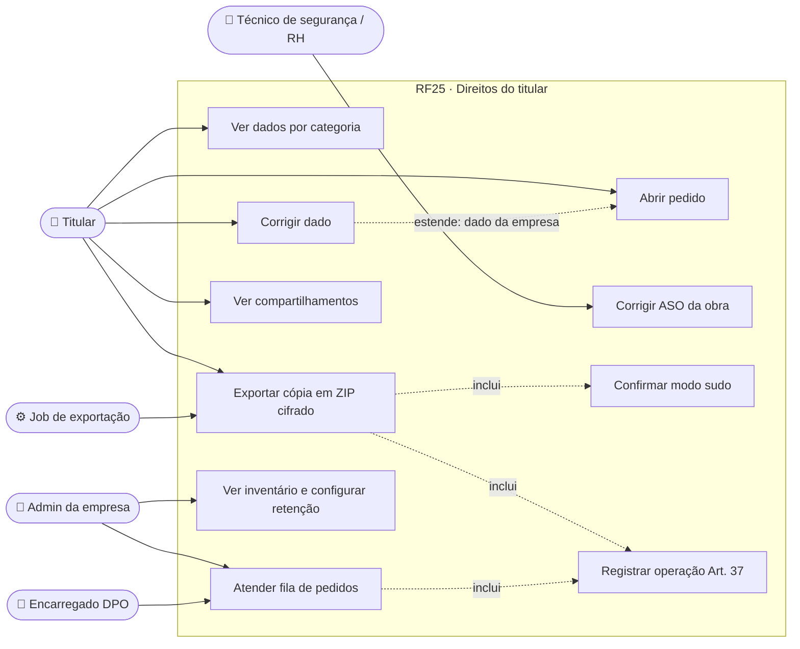
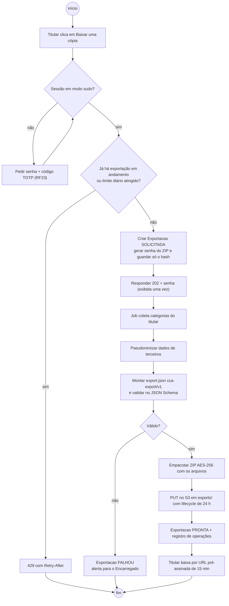
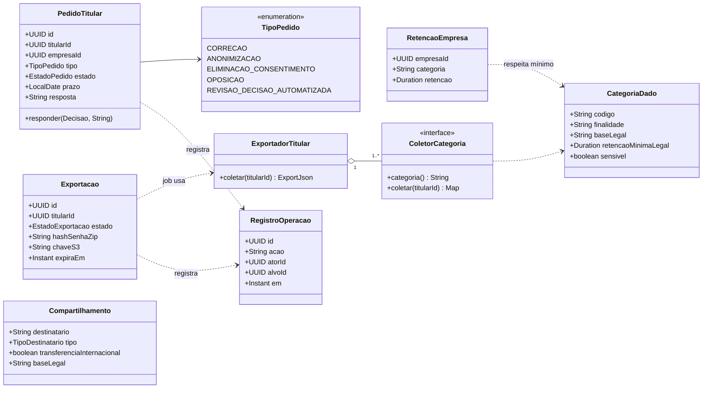
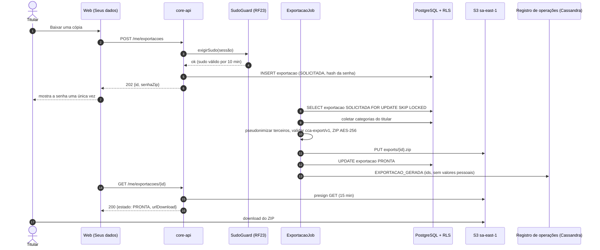
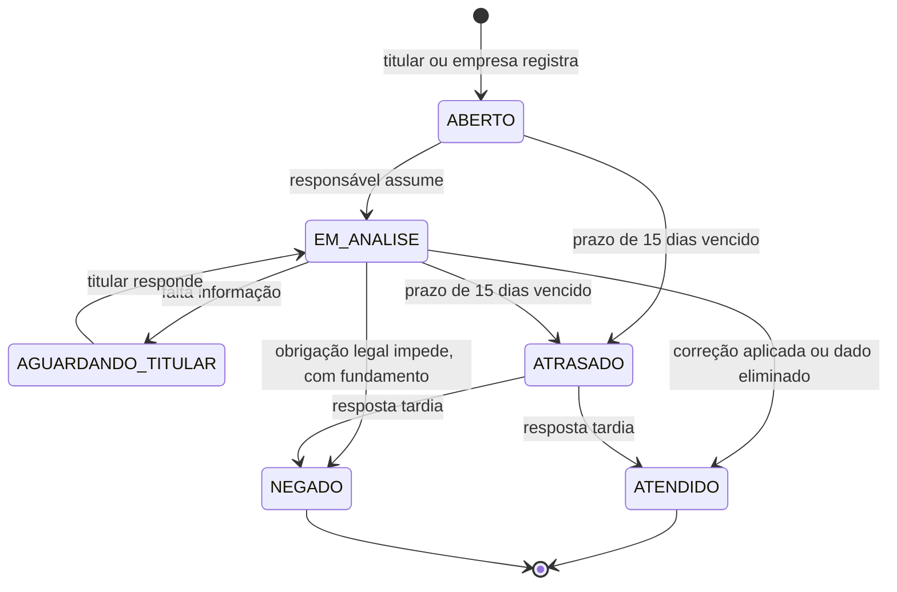
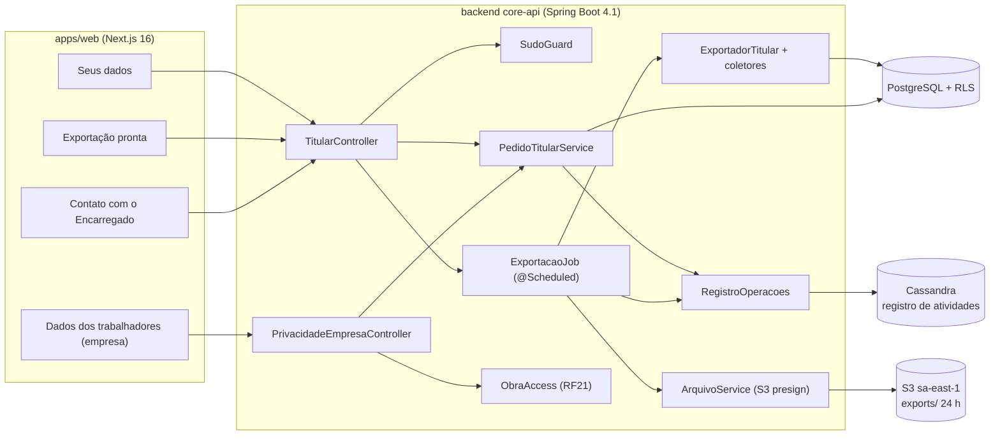

# RF25 · Direitos do titular: ver, corrigir, exportar e saber compartilhamentos

> A pessoa vê o que o CivilConstructorAI guarda sobre ela, corrige o que estiver errado, baixa uma cópia
> completa e sabe com quem os dados foram compartilhados. A construtora, como controladora dos dados dos seus
> trabalhadores, tem o inventário desses dados e uma fila para atender os pedidos dos titulares.

## 1. Descrição

O RF cobre os direitos do Art. 18 em duas visões:

**Visão do titular — tela "Seus dados"** (`/conta/privacidade/seus-dados`):

1. **Ver** (Art. 18, I e II): resumo por categoria — conta e perfil, empresas e papéis por obra, registros
   profissionais (CREA/CAU), consentimentos (RF24), sessões ativas, comandos e aprovações de autoria própria,
   fotos enviadas, presença. Cada categoria mostra finalidade, base legal e prazo de retenção.
2. **Corrigir** (Art. 18, III): campos de perfil editáveis direto; dados mantidos por uma empresa (ex.: cadastro de
   trabalhador, função, presença) geram um **pedido de correção** para aquela empresa, porque ela é a
   controladora. Correção de nome ou registro em conta com selo `VERIFIED` volta o selo a `PENDING` (RF21).
3. **Exportar** (Art. 18, V): job assíncrono gera `export.json` (schema versionado `cca-export/v1`) com todas as
   categorias + os arquivos do titular, empacotados num **ZIP cifrado (AES-256)**; a senha aleatória é mostrada
   **uma única vez** na tela, e o arquivo fica no S3 sob `exports/` por 24 h, baixado por URL pré-assinada de
   15 min. Exige **modo sudo** (RF23).
4. **Compartilhamentos** (Art. 18, VII): lista das entidades com quem os dados foram compartilhados — empresas
   e obras onde a pessoa é membro, operadores (provedor de nuvem, provedor de e-mail, Anthropic para a camada
   de IA — com indicação de transferência internacional, Art. 33) — e o histórico de exportações feitas pela
   empresa que incluíram dados dela.
5. **Pedidos** (Art. 18, IV, VI e IX; Art. 20): abrir pedido de anonimização, eliminação de dado tratado com
   consentimento, oposição ou revisão de decisão automatizada (encaminha para RF27). Eliminação da conta inteira
   é o RF26.

**Visão da empresa — "Dados dos trabalhadores"** (`/empresa/{id}/privacidade`), só dono/admin:

- **Inventário** (Art. 37): por categoria de dado de trabalhador (identificação, contato, função, presença,
  fotos, documentos trabalhistas, ASO/afastamento), com finalidade, base legal, prazo de retenção configurado
  pela empresa e quem acessa. Dado de saúde aparece só como **categoria e contagem**, nunca o conteúdo.
- **Fila de pedidos dos titulares** (Art. 18 §3º–§5º): pedidos dirigidos à empresa, com prazo de **15 dias**
  (Art. 19, II), estado e resposta registrada.
- Canal do **Encarregado** da plataforma (Art. 41) para pedidos sobre dados que o CivilConstructorAI trata como
  controlador (conta, login, cobrança).

Dado de saúde (ASO, afastamento): o titular vê os próprios; na empresa, só técnico(a) de segurança e RH da obra
veem o conteúdo (RF21). Nunca entra em URL, log, analytics, notificação push nem no contexto da IA.

## 2. Atores

| Ator | Pode |
|---|---|
| Titular (usuário com conta) | ver, corrigir, exportar, ver compartilhamentos, abrir pedidos |
| Trabalhador sem login | pedir pelo canal do Encarregado ou pela empresa; a empresa registra o pedido em nome dele |
| Dono / administrador da empresa (controladora) | ver inventário, configurar retenção, atender a fila de pedidos |
| Técnico(a) de segurança / RH da obra | ver e corrigir ASO dos trabalhadores daquela obra |
| Encarregado (DPO) da plataforma | atender pedidos sobre dados de conta; acompanhar prazos vencendo |
| Job de exportação (sistema) | gerar ZIP, publicar no S3, expirar |

## 3. Critérios de aceite

- [ ] **CA-01** "Seus dados" lista todas as categorias com finalidade, base legal e retenção; nenhuma categoria
  existente no banco fica fora (teste compara o inventário com o mapa de entidades pessoais).
- [ ] **CA-02** Correção de perfil grava e devolve `200`; correção de dado mantido pela empresa cria
  `PedidoTitular(tipo=CORRECAO)` para aquela empresa, visível na fila dela.
- [ ] **CA-03** Exportar exige modo sudo (sem sudo: `403 sudo_required`); o job gera ZIP cifrado com
  `export.json` válido contra o JSON Schema `cca-export/v1` e os arquivos do titular.
- [ ] **CA-04** A senha do ZIP aparece uma única vez; o servidor guarda só o hash; a URL pré-assinada vale
  15 min; o objeto expira em 24 h por lifecycle do bucket.
- [ ] **CA-05** Exportação, download e atendimento de pedido vão para o registro de operações (Art. 37) **sem**
  valores pessoais (só ids, tipo, data, resultado).
- [ ] **CA-06** Pedido de titular tem prazo de 15 dias; faltando 3 dias, o Encarregado e o admin da empresa
  recebem alerta; vencido sem resposta fica destacado como `ATRASADO`.
- [ ] **CA-07** ASO aparece para o próprio titular e para técnico de segurança/RH da obra; para os demais, o
  inventário mostra só "Dado de saúde · N registros"; nenhuma rota leva id de ASO na URL.
- [ ] **CA-08** "Compartilhamentos" mostra empresas, operadores e transferência internacional (Anthropic,
  EUA) com a base do Art. 33 indicada.
- [ ] **CA-09** Máximo de 1 exportação em andamento por titular e 3 por dia (`429` + `Retry-After`).

## 4. Regras de negócio

- **RN-01** O CivilConstructorAI é **operador** dos dados que a construtora guarda dos trabalhadores e
  **controlador** dos dados de conta; o pedido vai para quem é controlador do dado (Art. 18 §5º).
- **RN-02** Resposta a pedido sempre em formato simplificado imediato ou completo em até 15 dias (Art. 19).
- **RN-03** O `export.json` não inclui dados de **outras** pessoas (ex.: nomes de colegas em um RDO viram
  `pessoa:<pseudônimo>`).
- **RN-04** A empresa não pode configurar retenção abaixo do prazo legal das categorias trabalhistas e de
  segurança; os mínimos são os da [DN-03](../DECISOES_DE_NEGOCIO.md#dn-03--prazos-de-retenção-de-dados-de-trabalhadores):
  saúde ocupacional e treinamentos de segurança **20 anos** após o desligamento (NR-7, NR-1), documentos
  trabalhistas **5 anos** (CLT), fotos com trabalhadores identificáveis obra + 5 anos, contato operacional
  membro + 90 dias. Configurar abaixo → `422` com a base legal na mensagem.
- **RN-05** Exportação gerada com chave de dados do usuário (DEK) — se a conta for eliminada (RF26) antes do
  download, o arquivo fica ilegível e é apagado.

## 5. Base legal e normas

| Tema | Fundamento |
|---|---|
| Confirmação e acesso | LGPD Art. 18, I e II · Art. 19 |
| Correção | Art. 18, III |
| Anonimização, bloqueio, eliminação | Art. 18, IV e VI |
| Portabilidade / cópia | Art. 18, V |
| Informação sobre compartilhamento | Art. 18, VII |
| Prazo de resposta (15 dias) | Art. 19, II |
| Registro das operações | Art. 37 |
| Encarregado | Art. 41 |
| Dado sensível (saúde) | Art. 5º, II · Art. 11 |
| Transferência internacional | Art. 33 |
| Segurança | Art. 46 (cifra do ZIP, URL curta) |

## 6. API

| Método e rota | Descrição | Respostas |
|---|---|---|
| `GET /api/v1/me/dados` | Resumo por categoria (finalidade, base legal, retenção) | 200 |
| `PATCH /api/v1/me/perfil` | Correção direta de perfil | 200, 422 |
| `POST /api/v1/me/pedidos` | `{tipo, empresaId?, categoria, descricao}` | 201, 422 |
| `GET /api/v1/me/pedidos` | Meus pedidos e estado | 200 |
| `POST /api/v1/me/exportacoes` | Inicia exportação (modo sudo) → `{id, senhaZip}` (uma vez) | 202, 403 `sudo_required`, 429 |
| `GET /api/v1/me/exportacoes/{id}` | Estado do job; quando pronto, `urlDownload` (15 min) | 200, 404 |
| `GET /api/v1/me/compartilhamentos` | Empresas, operadores, transferências | 200 |
| `GET /api/v1/empresas/{empresaId}/privacidade/inventario` | Inventário por categoria (admin) | 200, 403, 404 |
| `PUT /api/v1/empresas/{empresaId}/privacidade/retencao/{categoria}` | Configurar retenção | 200, 422 |
| `GET /api/v1/empresas/{empresaId}/privacidade/pedidos` | Fila de pedidos | 200, 403, 404 |
| `POST /api/v1/empresas/{empresaId}/privacidade/pedidos/{id}/resposta` | `{decisao, resposta}` | 200, 409, 422 |

## 7. Telas

| Tela | Conteúdo | Base legal |
|---|---|---|
| Seus dados | categorias em acordeão; botão "Corrigir" por campo; "Baixar uma cópia" (pede senha + código: modo sudo); aba "Compartilhamentos"; aba "Meus pedidos" com prazo | Art. 18 |
| Exportação pronta | senha do ZIP exibida uma vez com botão copiar e aviso "não mostraremos de novo"; link de download com contador de validade | Art. 18, V · Art. 46 |
| Dados dos trabalhadores (empresa) | inventário por categoria com retenção editável, contagem de registros; fila de pedidos ordenada por prazo, com selo de estado (ícone + texto + cor) | Art. 37 · Art. 39 |
| Contato com o Encarregado | nome/canal do Encarregado, prazo de resposta, formulário | Art. 41 |

## 8. Diagramas

### 8.1 Casos de uso

### 8.2 Atividades

### 8.3 Classes

### 8.4 Sequência

### 8.5 Máquina de estados (PedidoTitular)

### 8.6 Componentes

## 9. Testes previstos

| Tipo | Caso |
|---|---|
| Unitário (Java) | cada entidade com dado pessoal tem `ColetorCategoria` (reflexão sobre o mapa de entidades) |
| Unitário (Java) | `export.json` valida contra `cca-export/v1`; dados de terceiros pseudonimizados |
| Integração `*IT` | exportar sem sudo → `403 sudo_required`; com sudo → `202`, job → `PRONTA`, ZIP abre com a senha e não abre sem ela |
| Integração `*IT` | URL pré-assinada expira em 15 min; objeto com tag de lifecycle `exports-24h` no Garage |
| Integração `*IT` | usuário sem papel de segurança/RH na obra não vê conteúdo de ASO no inventário (só contagem) |
| Integração `*IT` | admin de outra empresa consulta fila de pedidos → `404`; RLS devolve zero linhas |
| Integração `*IT` | registro de operações da exportação não contém nome, CPF nem e-mail |
| E2E (Playwright + axe) | fluxo "Baixar uma cópia" com sudo, senha exibida uma vez, sem violação axe |

## 10. Rastreabilidade

| Camada | Artefato | Status |
|---|---|---|
| Documento | `docs/rf/RF25-direitos-do-titular.md` | ✅ |
| Card | [Trello BQtSoryZ](https://trello.com/c/BQtSoryZ) | ✅ |
| Web | `apps/web/src/app/(app)/conta/privacidade/seus-dados/page.tsx`, `apps/web/src/app/(app)/empresa/[empresaId]/privacidade/page.tsx` | ⏳ |
| API | `lgpd/titular/TitularController.java`, `lgpd/titular/PedidoTitularService.java` | ⏳ |
| API | `lgpd/exportacao/ExportadorTitular.java`, `ExportacaoJob.java`, `lgpd/inventario/InventarioService.java` | ⏳ |
| Schema | `backend/src/main/resources/schemas/cca-export-v1.json` | ⏳ |
| Banco | `V5__lgpd_titular.sql` (pedido_titular, exportacao, retencao_empresa, categoria_dado) | ⏳ |
| Testes | `ExportacaoIT`, `PedidoTitularIT`, `InventarioAsoIT`, `seus-dados.spec.ts` | ⏳ |
