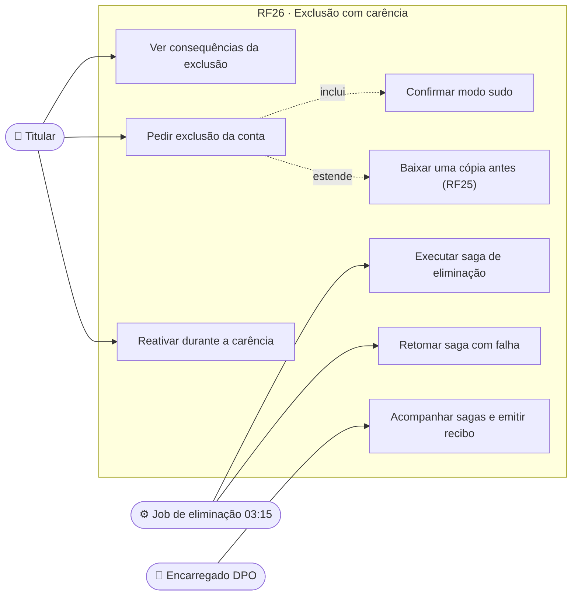
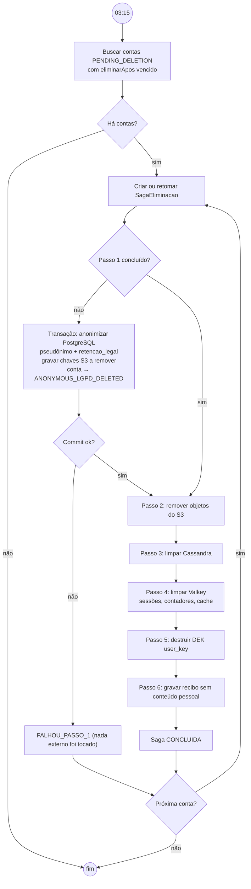
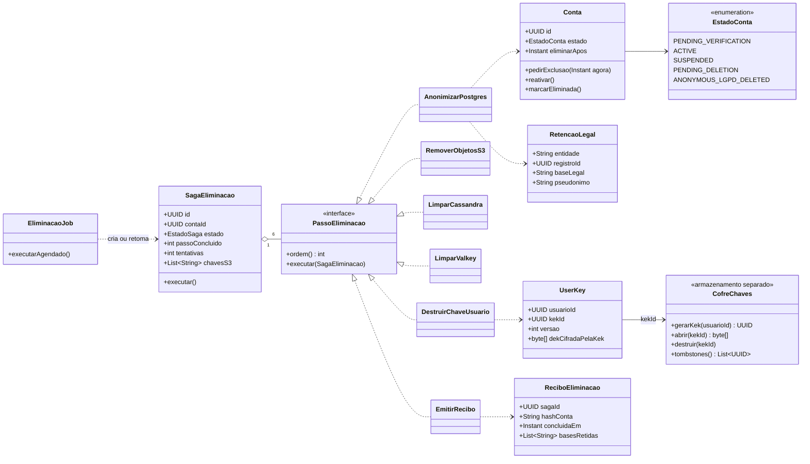
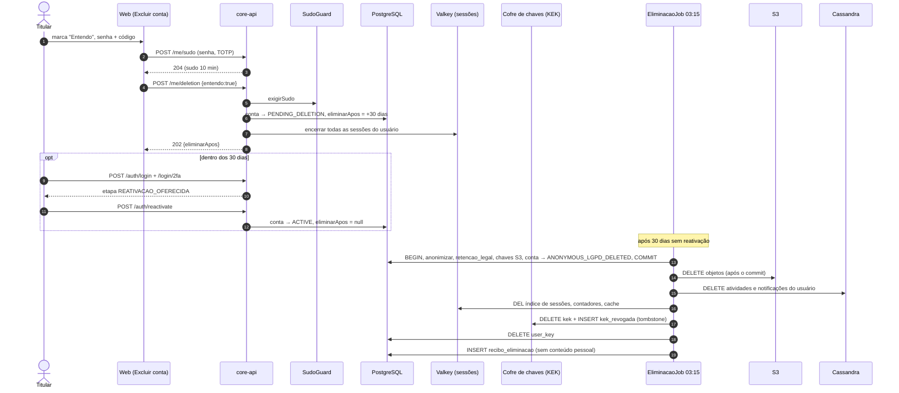
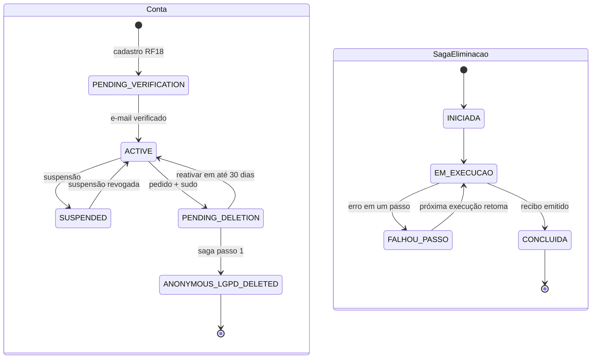
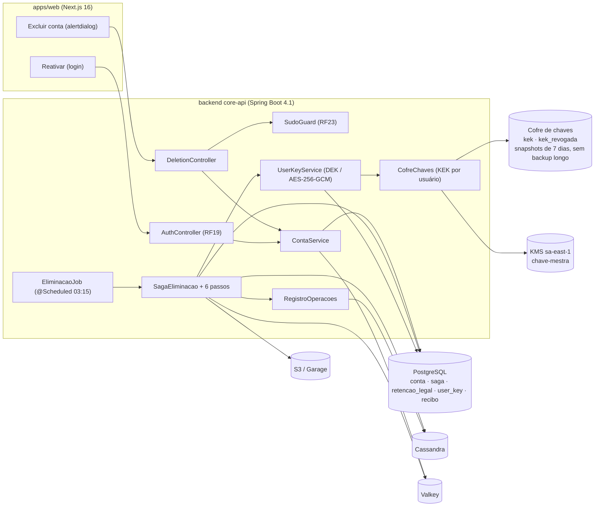

# RF26 · Exclusão de conta com carência, reativação e saga de eliminação

> A pessoa pede a exclusão da conta, confirma com senha e código, e tem **30 dias** para mudar de ideia
> entrando de novo. Passado o prazo, um job diário executa uma **saga idempotente** que anonimiza o que pode
> ser anonimizado, mantém só o que a lei obriga a guardar e destrói a chave de dados da pessoa
> (*crypto-shredding*), deixando inclusive os backups ilegíveis.

## 1. Descrição

**Pedido** (`POST /api/v1/me/deletion`, modo sudo): a tela "Excluir conta" é um `alertdialog` que explica as
consequências — o que some (perfil, foto, preferências, sessões, consentimentos, fotos enviadas, histórico de
login) e o que **fica com a empresa por obrigação legal** (ex.: autoria de aprovações técnicas vinculadas a
ART/RRT, registros de presença e de segurança do trabalho pelo prazo legal) —, mostra a **data final da
carência**, oferece "Baixar uma cópia" (RF25) e só habilita o botão depois da caixa "Entendo" + senha + código
TOTP. A conta vai para `PENDING_DELETION` com `eliminarApos = agora + 30 dias`, todas as sessões são
encerradas, convites pendentes enviados por ela são revogados e notificações param.

**Reativação** (RF19): durante a carência, o login com senha (e 2FA) devolve a etapa `REATIVACAO_OFERECIDA`;
`POST /api/v1/auth/reactivate` volta a conta a `ACTIVE`, cancela o agendamento e registra o evento. Sem
reativar, a pessoa não entra.

**Saga de eliminação** (job `@Scheduled(cron = "${app.lgpd.eliminacao.cron:0 15 3 * * *}")`, 03:15
America/Sao_Paulo): para cada conta com `eliminarApos <= agora`, cria (ou retoma) uma `SagaEliminacao` e
executa os passos em ordem, cada um idempotente e marcado como concluído antes do próximo:

1. **Anonimizar no PostgreSQL** (uma transação): nome → `Usuário removido #<hash curto>`, e-mail, telefone,
   CPF, data de nascimento, foto, segredo TOTP e códigos de recuperação → `NULL`/apagados; consentimentos e
   sessões removidos; membros de obra marcados `REMOVIDO`. Registros que a lei obriga a empresa a guardar
   recebem **pseudônimo estável** e a base legal em `retencao_legal` (ex.: aprovação de cálculo com ART →
   mantém nº do CREA e nome do responsável técnico, Art. 16, I, por exigência do CONFEA/Lei 6.496/1977).
   Conta → `ANONYMOUS_LGPD_DELETED`.
2. **Remover objetos do S3** **depois do commit** do passo 1 (foto de perfil, fotos sem retenção legal,
   exportações), por lista de chaves gravada no passo 1.
3. **Limpar Cassandra** (registro de atividades e notificações com o id da pessoa; o TTL já cobre o resto).
4. **Limpar Valkey** (índice de sessões do Spring Session, contadores de tentativa, cache de consentimento).
5. **Destruir a chave da pessoa** (crypto-shredding de verdade, não só `DELETE`). A DEK fica em `user_key`
   **cifrada por uma KEK por usuário**, e a KEK **não mora no PostgreSQL principal**: mora no **cofre de
   chaves** (`chaves/CofreChaves`), um armazenamento separado com ciclo de vida próprio — réplica síncrona,
   snapshots de no máximo 7 dias e **sem backups de longo prazo** —, com a KEK por sua vez cifrada pela
   chave-mestra do KMS (AWS KMS `sa-east-1` em produção; cofre local nos perfis `dev`/`it`). O passo 5:
   (a) apaga a KEK do cofre e grava um **tombstone** (`kek_revogada`: id da KEK, data) que o procedimento
   de restauração do cofre aplica obrigatoriamente; (b) apaga a linha `user_key`. Restaurar um backup do
   banco principal devolve `user_key` e os dados cifrados, mas a DEK só abre com a KEK, que não existe
   mais em lugar nenhum — por isso os backups ficam ilegíveis.
6. **Recibo**: grava `recibo_eliminacao` com id da saga, hash do id da conta, data, passos e bases legais
   do que ficou retido; **nenhum conteúdo pessoal** no recibo nem no log.

Falha em qualquer passo mantém a saga em `FALHOU_PASSO_n`; a próxima execução retoma do passo pendente.

## 2. Atores

| Ator | Pode |
|---|---|
| Titular | pedir exclusão, baixar cópia antes, reativar durante a carência |
| Job de eliminação (sistema) | executar e retomar a saga |
| Encarregado (DPO) | acompanhar sagas com falha, emitir recibo ao titular sob pedido |
| Dono/admin da empresa | é avisado de que um membro saiu; não pode impedir a exclusão |

## 3. Critérios de aceite

- [ ] **CA-01** O diálogo é `role="alertdialog"` com foco inicial no título, lista de consequências, data final
  da carência (formato longo pt-BR), link "Baixar uma cópia", caixa "Entendo", senha e código; o botão
  "Excluir conta" fica desabilitado até a caixa ser marcada.
- [ ] **CA-02** `POST /me/deletion` sem sudo → `403 sudo_required`; com sudo → `202` com `eliminarApos`; conta
  `PENDING_DELETION`; todas as sessões encerradas (inclusive a atual).
- [ ] **CA-03** Login durante a carência leva à etapa de reativação; `POST /auth/reactivate` → `ACTIVE`; sem
  reativar, nenhuma rota fora de `/auth/*` responde.
- [ ] **CA-04** Dono único de uma empresa não pode pedir exclusão sem transferir a posse ou encerrar a
  empresa (`409 transferir_posse`).
- [ ] **CA-05** A saga é **idempotente**: rodar duas vezes, ou retomar depois de falha em qualquer passo, deixa
  o mesmo estado final e um único recibo.
- [ ] **CA-06** Objetos do S3 só são removidos depois do commit do passo 1 (teste injeta rollback e verifica que
  nada foi apagado).
- [ ] **CA-07** Após a saga, a KEK não existe no cofre (nem num snapshot dele depois de aplicados os tombstones)
  e um dado cifrado com a DEK não decifra **mesmo restaurando um backup do banco principal que contenha a
  linha `user_key`** (o teste restaura dados + `user_key` num container limpo e tenta decifrar).
- [ ] **CA-08** O que fica retido tem base legal registrada em `retencao_legal`; o recibo e os logs não contêm
  nome, e-mail, CPF nem IP.
- [ ] **CA-09** `ANONYMOUS_LGPD_DELETED` é terminal: qualquer transição a partir dele lança
  `TransicaoInvalidaException`.

## 4. Regras de negócio

- **RN-01** Carência de 30 dias corridos; configurável só para mais (`app.lgpd.eliminacao.carencia`).
- **RN-02** Durante a carência a conta não aparece em buscas de membros, não recebe convites e não aprova nada.
- **RN-03** Aprovações técnicas com ART/RRT continuam válidas e atribuídas ao profissional (nome + registro),
  pois são documento de responsabilidade técnica; os demais dados dele são anonimizados.
- **RN-04** Dados de trabalhador mantidos pela construtora seguem a retenção da empresa (RF25); a exclusão da
  conta remove o **login**, não o cadastro trabalhista que a empresa é obrigada a manter.
- **RN-05** Cada passo da saga grava `passoConcluido` antes de iniciar o seguinte; efeitos externos (S3,
  Cassandra, Valkey) usam operações que aceitam repetição (delete de chave inexistente = sucesso).
- **RN-06** Saga com falha por 3 execuções seguidas gera alerta para o Encarregado.

## 5. Base legal e normas

| Tema | Fundamento |
|---|---|
| Eliminação a pedido | LGPD Art. 18, VI |
| Término do tratamento e eliminação | Art. 15 e Art. 16 |
| Conservação por obrigação legal | Art. 16, I (ex.: responsabilidade técnica — Lei 6.496/1977, ART; NR-7/NR-18 para segurança do trabalho) |
| Uso exclusivo do controlador, anonimizado | Art. 16, IV |
| Anonimização | Art. 5º, XI e Art. 12 |
| Segurança e backups | Art. 46 (crypto-shredding) |
| Registro das operações | Art. 37 (recibo sem conteúdo pessoal) |
| Registros de acesso | Marco Civil, Art. 15 (6 meses, depois eliminados pela saga) |

## 6. API

| Método e rota | Descrição | Respostas |
|---|---|---|
| `GET /api/v1/me/deletion/preview` | Consequências: o que some, o que fica e por quê, data final | 200 |
| `POST /api/v1/me/deletion` | `{ "entendo": true }` + sessão em sudo | 202 `{eliminarApos}`, 403 `sudo_required`, 409 `transferir_posse`, 422 |
| `POST /api/v1/auth/reactivate` | Reativar durante a carência (etapa do login) | 200, 409 (fora da carência) |
| `GET /api/v1/admin/lgpd/sagas?estado=FALHOU` | Sagas com falha (Encarregado) | 200, 403 |

## 7. Telas

| Tela | Conteúdo | Base legal |
|---|---|---|
| Excluir conta (`/conta/privacidade/excluir`) | `alertdialog` com consequências, o que fica com a empresa por obrigação legal, data final da carência, "Baixar uma cópia", caixa "Entendo" + senha + código; botão destrutivo só habilita depois da caixa | Art. 16 · Art. 18, VI |
| Reativar (`/login/reativar`) | aviso "Sua conta será excluída em DD de mês de AAAA", botões "Reativar minha conta" e "Manter exclusão e sair" com o mesmo peso visual | — |
| Confirmação | e-mail ao titular no pedido e no fim da carência, sem dados além do necessário | Art. 9º |

## 8. Diagramas

### 8.1 Casos de uso

### 8.2 Atividades

### 8.3 Classes

### 8.4 Sequência (exclusão com carência)

### 8.5 Máquina de estados (Conta e SagaEliminacao)

### 8.6 Componentes

## 9. Testes previstos

| Tipo | Caso |
|---|---|
| Unitário (Java) | `Conta`: todas as transições válidas; qualquer transição a partir de `ANONYMOUS_LGPD_DELETED` lança exceção |
| Unitário (Java) | `SagaEliminacao` retoma do passo seguinte a `passoConcluido` |
| Integração `*IT` | pedido sem sudo → 403; com sudo → 202, sessões encerradas (Valkey sem chaves do usuário) |
| Integração `*IT` | login na carência → etapa de reativação; `reactivate` → `ACTIVE` |
| Integração `*IT` | relógio avançado 30 dias → saga completa; rodar de novo → mesmo estado, um único recibo |
| Integração `*IT` | falha injetada no passo 3 → `FALHOU_PASSO`; próxima execução conclui sem repetir os passos 1–2 |
| Integração `*IT` | rollback no passo 1 → nenhum objeto removido do Garage |
| Integração `*IT` | `CryptoShreddingIT`: dump de dados + `user_key` antes da saga; após a saga, restaura o dump num container limpo e aplica os tombstones do cofre → decifrar lança `AEADBadTagException` / chave ausente |
| Integração `*IT` | aprovação com ART mantém nome + CREA do responsável técnico e base legal em `retencao_legal` |
| E2E (Playwright + axe) | `alertdialog` com foco correto, botão desabilitado até "Entendo", sem violação axe |

## 10. Rastreabilidade

| Camada | Artefato | Status |
|---|---|---|
| Documento | `docs/rf/RF26-exclusao-conta-carencia.md` | ✅ |
| Card | [Trello 9s245tLM](https://trello.com/c/9s245tLM) | ✅ |
| Domínio | `lgpd/SagaEliminacao` (INICIADA → EM_EXECUCAO → FALHOU_PASSO/CONCLUIDA, passo atual), `RetencaoLegal`, `ReciboEliminacao`, `UserKey` (DEK cifrada pela KEK), `EstadoContaLgpd` | ✅ |
| Serviço | `ExclusaoContaService` (consequências para o alertdialog, pedido com sudo + "Entendo", reativação na carência), `SagaEliminacaoService` + `PassosEliminacao` (6 passos, cada um em REQUIRES_NEW; S3 só depois do commit do passo 1), `EliminacaoJob` (`app.lgpd.eliminacao-cron`, 03:15) | ✅ |
| API | `api/lgpd/DeletionController` (`GET/POST /me/deletion`); `POST /auth/reactivate` (módulo de identidade) chama `ExclusaoContaService.reativar` | ✅ / 🟡 integração com o login |
| Domínio | `identidade/conta/Conta.java` (máquina de estados completa) — módulo de identidade | ⏳ |
| Cripto | `ChavesUsuarioImpl` (DEK por usuário, AES-256-GCM), `Portas.CofreChaves` + `CofreChavesLocal` (KEK por usuário em `cofre_kek`, tombstones em `kek_revogada`) | ✅ local · 🟡 KMS sa-east-1 + armazenamento separado em produção |
| Banco | `V1` (`user_key`), `V6__lgpd_eliminacao.sql` (`saga_eliminacao`, `retencao_legal`, `recibo_eliminacao`, `cofre_kek`, `kek_revogada`) | ✅ |
| Cassandra | `Portas.RegistroAtividades` (no-op sem Cassandra; implementação Spring Data Cassandra no profile `full`) | 🟡 |
| Testes | `MaquinasDeEstadoLgpdTest` (saga retoma do passo), `EliminacaoIT` (falha injetada no passo 3 → FALHOU_PASSO; retoma sem repetir 1–2; conta ANONYMOUS_LGPD_DELETED; recibo; **crypto-shredding**: `user_key` "restaurada de backup" não decifra porque a KEK foi revogada) | ✅ |
| Web | `apps/web/src/app/(app)/conta/privacidade/excluir/page.tsx`, `apps/web/src/app/(auth)/login/reativar/page.tsx` | ⏳ |
