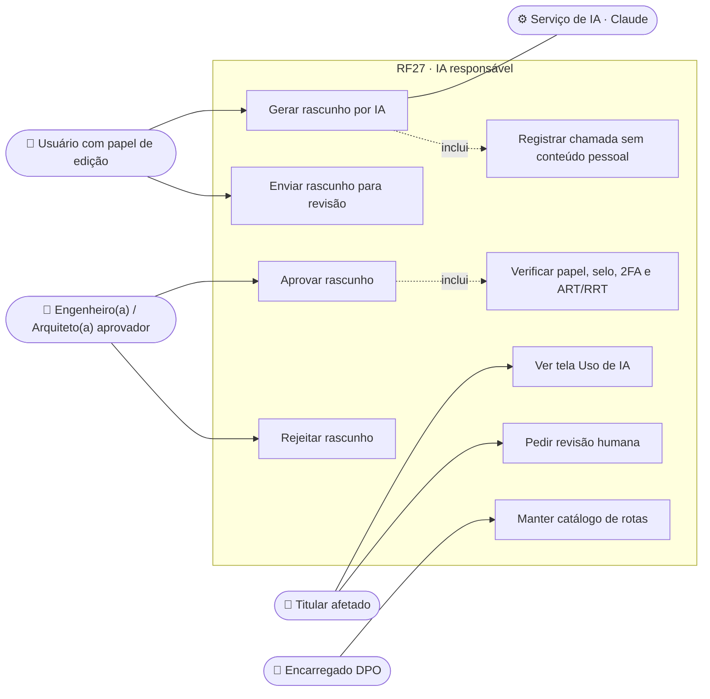
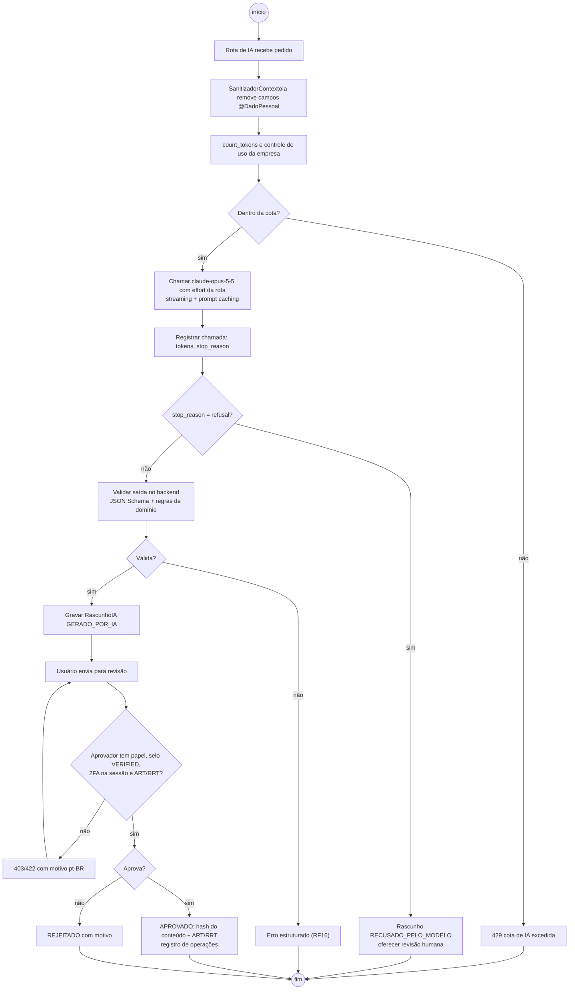
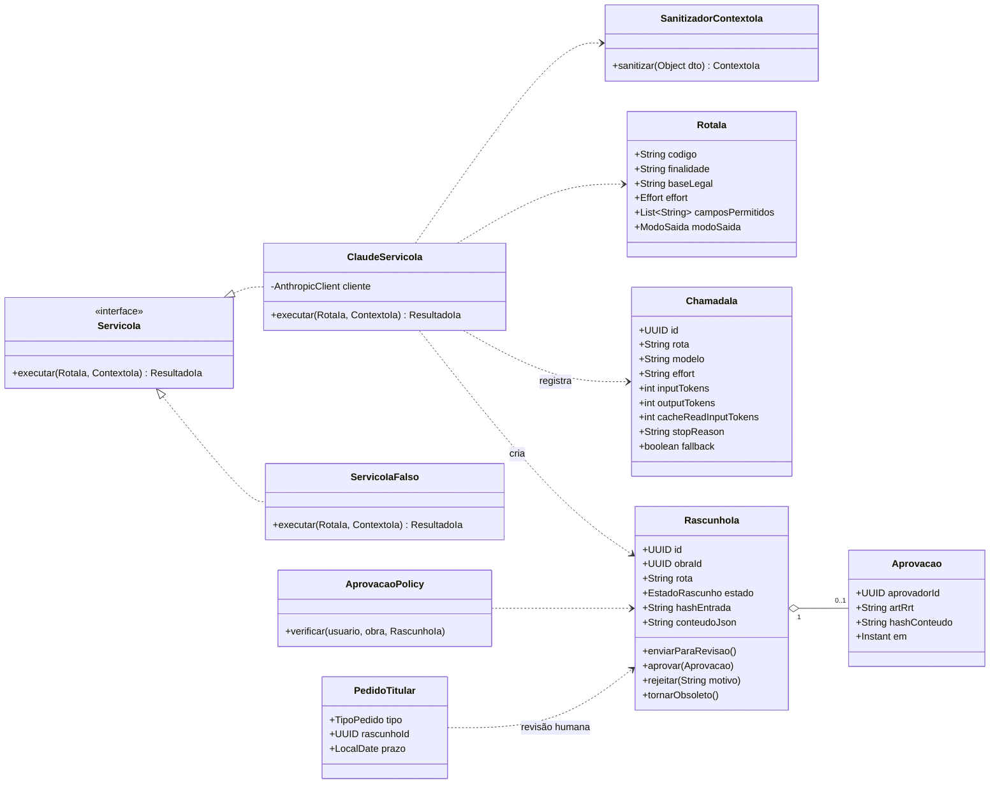
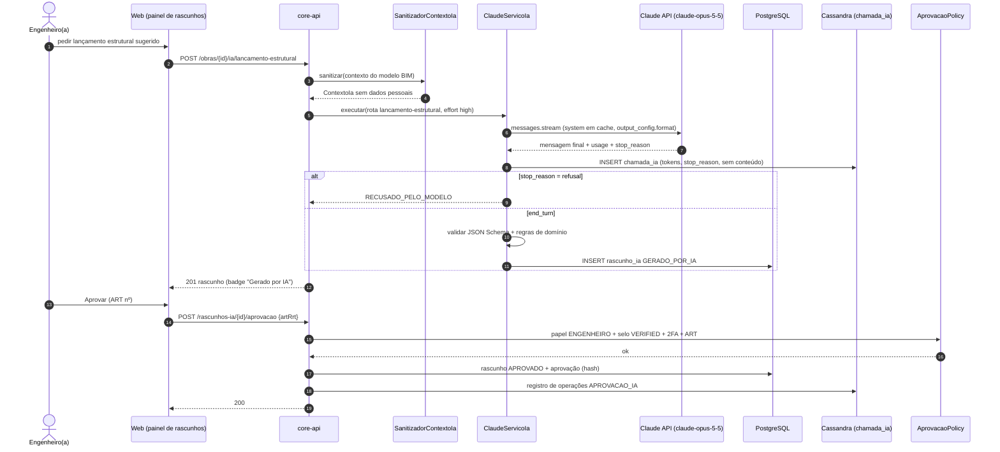
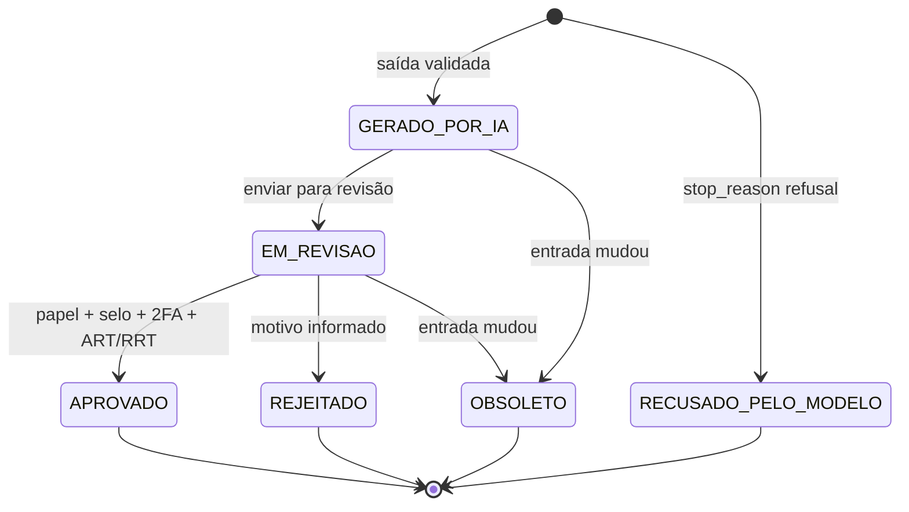
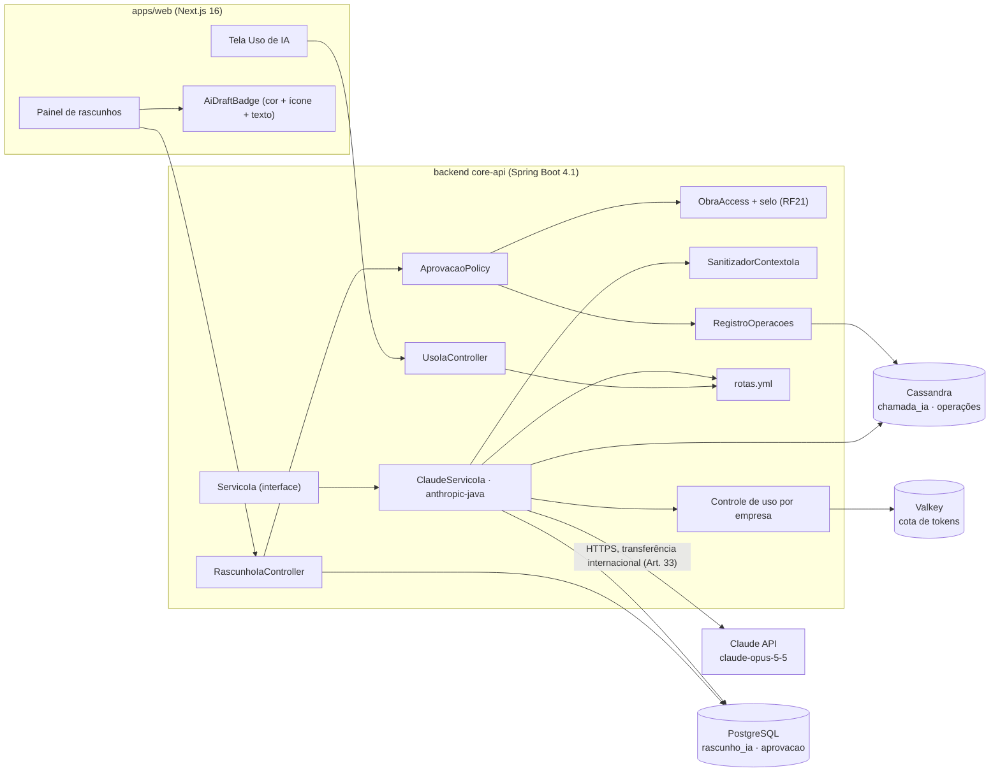

# RF27 · Transparência do uso de IA, rascunho "gerado por IA" e revisão humana

> Tudo o que a IA produz nasce como **rascunho marcado "gerado por IA"** e só passa a valer depois que um
> profissional habilitado aprova. A pessoa sabe o que vai para o modelo, para quê, onde é processado e por
> quanto tempo, e pode pedir **revisão humana** de qualquer decisão automatizada.

## 1. Descrição

**Rotas de IA** (catálogo em `backend/src/main/resources/ia/rotas.yml`, cada uma com finalidade, base legal,
`effort` e dados permitidos):

| Rota | RF | Finalidade | `effort` | Saída |
|---|---|---|---|---|
| `comando-vi` | RF02 | traduzir texto natural em comando VI | `medium` | structured outputs (JSON Schema do comando) |
| `lancamento-estrutural` | RF04 | sugerir lançamento de pilares/vigas/lajes | `high` | structured outputs |
| `extracao-boletim-spt` | RF09 | ler boletim de sondagem (PDF) | `high` | extração estruturada, depois citações (página e trecho) em chamada separada |
| `associacao-sinapi` | RF12 | sugerir composição SINAPI por quantitativo | `high` | tool use (`strict: true`) + structured outputs |
| `correcao-auditoria` | RF16 | corrigir comando reprovado pelo auditor | `high` | structured outputs |

Modelo padrão `claude-opus-5-5` pelo SDK oficial `com.anthropic:anthropic-java`; troca de modelo ou `effort`
por rota só com avaliação (conjunto de avaliação por rota). Pensamento adaptativo sempre ligado; sem
`temperature`/`top_p`/`top_k`; sem prefill; `tool_choice` sempre `auto`.

**O que nunca vai para o modelo**: CPF, ASO/afastamento, nome de trabalhador, e-mail, telefone, localização de
pessoa. O `SanitizadorContextoIa` remove esses campos por tipo (não por regex no texto) e um teste de
contrato falha se um DTO enviado à IA tiver campo marcado `@DadoPessoal`.

**RascunhoIA**: todo resultado de IA é gravado como `RascunhoIA` com estado `GERADO_POR_IA`, vinculado à
entrada (hash da versão do modelo BIM, do quantitativo ou do PDF). Na tela, o rascunho usa os tokens
`--ai-draft-bg/line/text` **mais** ícone `Sparkles` (Lucide) **mais** o texto "Gerado por IA · aguardando
aprovação" (a cor nunca é o único sinal). Fluxo:

1. Usuário com papel de edição pode **enviar para revisão** (`EM_REVISAO`).
2. **Aprovar** exige: papel na obra compatível (ex.: `ENGENHEIRO` para cálculo e orçamento; `ARQUITETO` para
   arquitetura), selo profissional `VERIFIED` (CREA/CAU), sessão com 2FA validado nesta sessão, e nº de
   ART/RRT da obra informado. A aprovação grava quem, quando, ART/RRT e o hash do conteúdo aprovado, e vai
   para o registro de operações (Art. 37).
3. **Rejeitar** exige motivo. Se a entrada muda (nova versão do modelo, nova tabela SINAPI), rascunhos não
   aprovados viram `OBSOLETO`; aprovados permanecem, mas o resultado novo nasce como novo rascunho.

**Registro por chamada** (`chamada_ia`, Cassandra com TTL de 2 anos): rota, finalidade, base legal, obra,
usuário (id), modelo, `effort`, `input_tokens`, `output_tokens`, `cache_creation_input_tokens`,
`cache_read_input_tokens`, `stop_reason` (e `stop_details` em `refusal`), latência, se houve fallback do
servidor, id do rascunho. **Sem** o conteúdo do prompt nem da resposta.

**Revisão humana (Art. 20)**: o titular afetado por uma decisão automatizada (ex.: comando recusado pela IA,
classificação automática) abre um pedido; um profissional humano da empresa revisa em até **15 dias** e a
resposta fica registrada. O pedido usa o mesmo fluxo de `PedidoTitular` (RF25) com tipo
`REVISAO_DECISAO_AUTOMATIZADA`.

**Tela "Uso de IA"**: o que é enviado ao modelo por rota, para quê, onde é processado (Anthropic, EUA —
transferência internacional, Art. 33, com as garantias do contrato), retenção de dados na conta da API
(verificada e documentada), botão "Pedir revisão humana".

## 2. Atores

| Ator | Pode |
|---|---|
| Usuário com papel de edição | gerar rascunho por IA, enviar para revisão |
| Engenheiro(a) / Arquiteto(a) aprovador | aprovar ou rejeitar (papel + selo `VERIFIED` + 2FA + ART/RRT) |
| Titular afetado | ver a tela Uso de IA, pedir revisão humana |
| Encarregado (DPO) | manter o catálogo de rotas (finalidade, base legal), acompanhar pedidos de revisão |
| Serviço de IA (sistema) | chamar o modelo, gravar rascunho e registro da chamada |

## 3. Critérios de aceite

- [ ] **CA-01** Nenhum resultado de IA é persistido fora de `RascunhoIA`; teste de arquitetura (ArchUnit) proíbe
  `ia..` de escrever direto nas entidades de domínio.
- [ ] **CA-02** Todo rascunho na UI mostra cor + ícone + texto "Gerado por IA"; o componente `<AiDraftBadge>` é
  obrigatório (lint de componente) e passa axe.
- [ ] **CA-03** Aprovar sem papel adequado → `403`; sem selo `VERIFIED` → `403 selo_nao_verificado`; sem 2FA
  nesta sessão → `403 mfa_required`; sem ART/RRT → `422`.
- [ ] **CA-04** Aprovação grava aprovador, data, ART/RRT e hash do conteúdo; alterar o conteúdo depois da
  aprovação é impossível (novo rascunho).
- [ ] **CA-05** Mudança na entrada torna rascunhos `GERADO_POR_IA`/`EM_REVISAO` em `OBSOLETO`.
- [ ] **CA-06** Cada chamada ao modelo gera um registro com rota, finalidade, base legal, modelo, `effort`,
  tokens (incluindo `cache_read_input_tokens`) e `stop_reason`; teste garante ausência de texto do prompt e de
  campos pessoais no registro.
- [ ] **CA-07** `stop_reason` é checado antes de ler o conteúdo; `refusal` gera rascunho `RECUSADO_PELO_MODELO`
  com mensagem pt-BR e possibilidade de revisão humana; fallback do servidor ligado
  (`server-side-fallback-2026-07-01`).
- [ ] **CA-08** Pedido de revisão humana tem prazo de 15 dias, aparece na fila da empresa e a resposta é
  registrada.
- [ ] **CA-09** DTO enviado ao modelo com campo `@DadoPessoal` faz o teste de contrato falhar.
- [ ] **CA-10** A tela Uso de IA lista todas as rotas de `rotas.yml` com finalidade, base legal, dados enviados,
  local de processamento e retenção.

## 4. Regras de negócio

- **RN-01** Rascunho aprovado é imutável; correção = novo rascunho que substitui o anterior (histórico mantido).
- **RN-02** Quem gerou o rascunho pode aprovar só se também cumprir todos os requisitos de aprovação.
- **RN-03** Cada rota declara a base legal (em regra Art. 7º, V — execução do contrato com a construtora) e a
  lista de campos permitidos; rota sem declaração não sobe (validação na inicialização).
- **RN-04** Saída estruturada é validada de novo no backend (JSON Schema + regras de domínio) antes de virar
  rascunho.
- **RN-05** Controle de uso por empresa no Valkey (tokens/mês); excedeu → `429` com mensagem pt-BR.
- **RN-06** Citações e structured outputs não são usados na mesma chamada: "responder com fonte" e "extrair
  dado" são chamadas separadas.

## 5. Base legal e normas

| Tema | Fundamento |
|---|---|
| Informação clara sobre o tratamento | LGPD Art. 9º |
| Revisão de decisão automatizada | Art. 20 (e §1º: critérios e procedimentos informados) |
| Transferência internacional | Art. 33 (cláusulas contratuais) e Art. 34–36 |
| Minimização | Art. 6º, III (necessidade) |
| Registro das operações | Art. 37 |
| Dado sensível nunca enviado | Art. 11 |
| Responsabilidade técnica | Lei 6.496/1977 (ART, CREA) · Lei 12.378/2010 (RRT, CAU) |

## 6. API

| Método e rota | Descrição | Respostas |
|---|---|---|
| `GET /api/v1/obras/{obraId}/rascunhos-ia?estado=` | Rascunhos da obra | 200, 404 |
| `POST /api/v1/obras/{obraId}/rascunhos-ia/{id}/revisao` | Enviar para revisão | 200, 403, 409 |
| `POST /api/v1/obras/{obraId}/rascunhos-ia/{id}/aprovacao` | `{artRrt}` — exige papel + selo + 2FA | 200, 403 (`selo_nao_verificado`, `mfa_required`), 409, 422 |
| `POST /api/v1/obras/{obraId}/rascunhos-ia/{id}/rejeicao` | `{motivo}` | 200, 403, 409, 422 |
| `GET /api/v1/ia/uso` | Catálogo de rotas (finalidade, base legal, dados, local, retenção) | 200 |
| `POST /api/v1/me/pedidos` | `{tipo: REVISAO_DECISAO_AUTOMATIZADA, rascunhoId}` (RF25) | 201, 422 |
| `GET /api/v1/empresas/{empresaId}/ia/consumo` | Tokens por rota e mês (admin) | 200, 403, 404 |

## 7. Telas

| Tela | Conteúdo | Base legal |
|---|---|---|
| Uso de IA (`/conta/privacidade/uso-de-ia`) | por rota: o que é enviado, o que nunca é enviado, finalidade, base legal, local de processamento (transferência internacional), retenção; aviso "gerado por IA"; botão "Pedir revisão humana" | Art. 9º · Art. 20 · Art. 33 |
| Painel de rascunhos (na obra) | lista com `<AiDraftBadge>` (cor + ícone + texto), comparação antes/depois, botões "Enviar para revisão", "Aprovar" (pede ART/RRT e 2FA se necessário), "Rejeitar" (motivo) | Art. 20 |
| Pedido de revisão humana | formulário curto, prazo exibido, acompanhamento do estado | Art. 20 |

## 8. Diagramas

### 8.1 Casos de uso

### 8.2 Atividades

### 8.3 Classes

### 8.4 Sequência

### 8.5 Máquina de estados (RascunhoIA)

### 8.6 Componentes

## 9. Testes previstos

| Tipo | Caso |
|---|---|
| Unitário (Java) | `RascunhoIa`: transições válidas; aprovado é imutável; obsoleto por mudança de `hashEntrada` |
| Unitário (Java) | `SanitizadorContextoIa` remove todo campo `@DadoPessoal` (teste de contrato sobre todos os DTOs de IA) |
| Unitário (Java) | `ClaudeServicoIa` com `refusal` → `RECUSADO_PELO_MODELO`, sem ler `content` |
| Arquitetura (ArchUnit) | pacote `ia..` não acessa repositórios de domínio exceto `RascunhoIaRepository` |
| Integração `*IT` | `ServicoIaFalso` determinístico → rascunho gerado; aprovação sem selo → 403; sem 2FA → 403; com tudo → 200 |
| Integração `*IT` | registro `chamada_ia` contém tokens e `stop_reason` e não contém texto do prompt |
| Integração `*IT` | pedido de revisão humana entra na fila da empresa com prazo de 15 dias |
| Avaliação (fora do CI padrão) | chamada real à API por rota com o conjunto de avaliação |
| E2E (Playwright + axe) | badge "Gerado por IA" com texto e ícone; tela Uso de IA sem violação axe |

## 10. Rastreabilidade

| Camada | Artefato | Status |
|---|---|---|
| Documento | `docs/rf/RF27-transparencia-ia-revisao-humana.md` | ✅ |
| Card | [Trello 7dTIZbIs](https://trello.com/c/7dTIZbIs) | ✅ |
| Domínio | `ia/RascunhoIa` (GERADO_POR_IA → EM_REVISAO → APROVADO/REJEITADO, OBSOLETO, RECUSADO_PELO_MODELO; aprovar exige ART/RRT), `PedidoRevisaoHumana` (Art. 20, 15 dias), `ChamadaIa` (só metadados) | ✅ |
| Porta | `ia/ModeloLinguagem` + `RotaIa` (as 5 rotas da DN-04 com finalidade, base legal, `effort`, dados permitidos) | ✅ |
| Serviço | `ia/ServicoIa` (fachada: registra chamada, checa `stop_reason`/recusa, valida campos obrigatórios), `RascunhoIaService` (aprovação = papel aprovador + selo VERIFIED + 2FA + ART; obsoleta anteriores da mesma entidade), `UsoIaService` (catálogo da tela "Uso de IA", consumo por rota/mês) | ✅ |
| Infra | `ia/ClaudeModeloLinguagem` (SDK oficial `anthropic-java` 3.3.0: `claude-opus-5-5`, `output_config.effort` + `format` JSON Schema, streaming com `MessageAccumulator`, `cache_control` na parte fixa, fallback do servidor via beta `server-side-fallback-2026-07-01`, exceções tipadas), `FakeModeloLinguagem` (dev/it) | ✅ (real) · 🟡 teste contra a API real fora do CI |
| API | `api/ia/RascunhoIaController` (`GET/POST /obras/{obraId}/rascunhos-ia/**`: revisão, aprovar, rejeitar, revisão-humana), `IaController` (`GET /ia/uso`, `GET /empresas/{id}/ia/consumo`) | ✅ |
| Config | catálogo das rotas em `RotaIa` (código); `rotas.yml` substituído pelo enum para validar na compilação | ✅ |
| Banco | `V8__rascunho_ia.sql` (`rascunho_ia`, `pedido_revisao_humana`, `chamada_ia` — RLS por tenant) | ✅ |
| Cassandra | `chamada_ia` com TTL de 2 anos | 🟡 (PostgreSQL por enquanto; job de expurgo pendente) |
| Testes | `ServicoIaTest` (registro sem conteúdo, recusa, truncamento, campos obrigatórios), `MaquinasDeEstadoLgpdTest`, `RascunhoIaIT` (sem selo → 403 com motivo, ART vazia → 422, aprovação, revisão humana 201, `GET /ia/uso`, consumo) | ✅ |
| Web | `apps/web/src/app/(app)/conta/privacidade/uso-de-ia/page.tsx`, `apps/web/src/components/ia/AiDraftBadge.tsx` | ⏳ |
