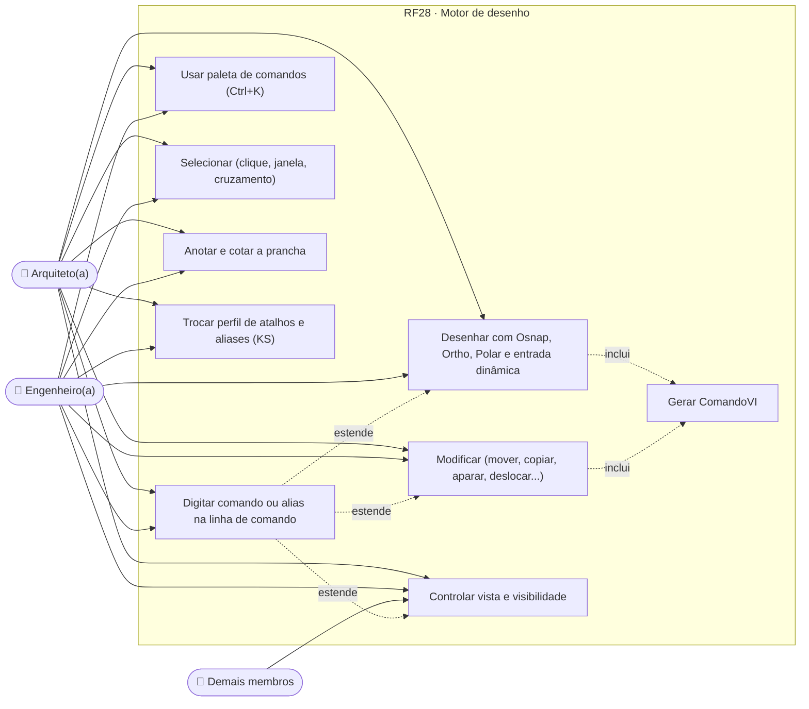
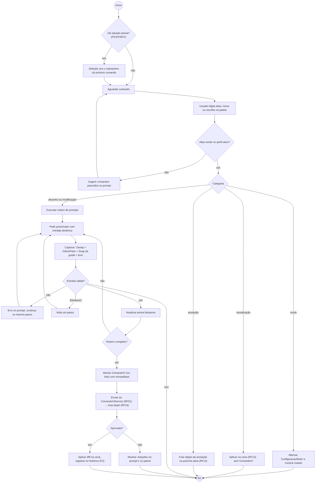
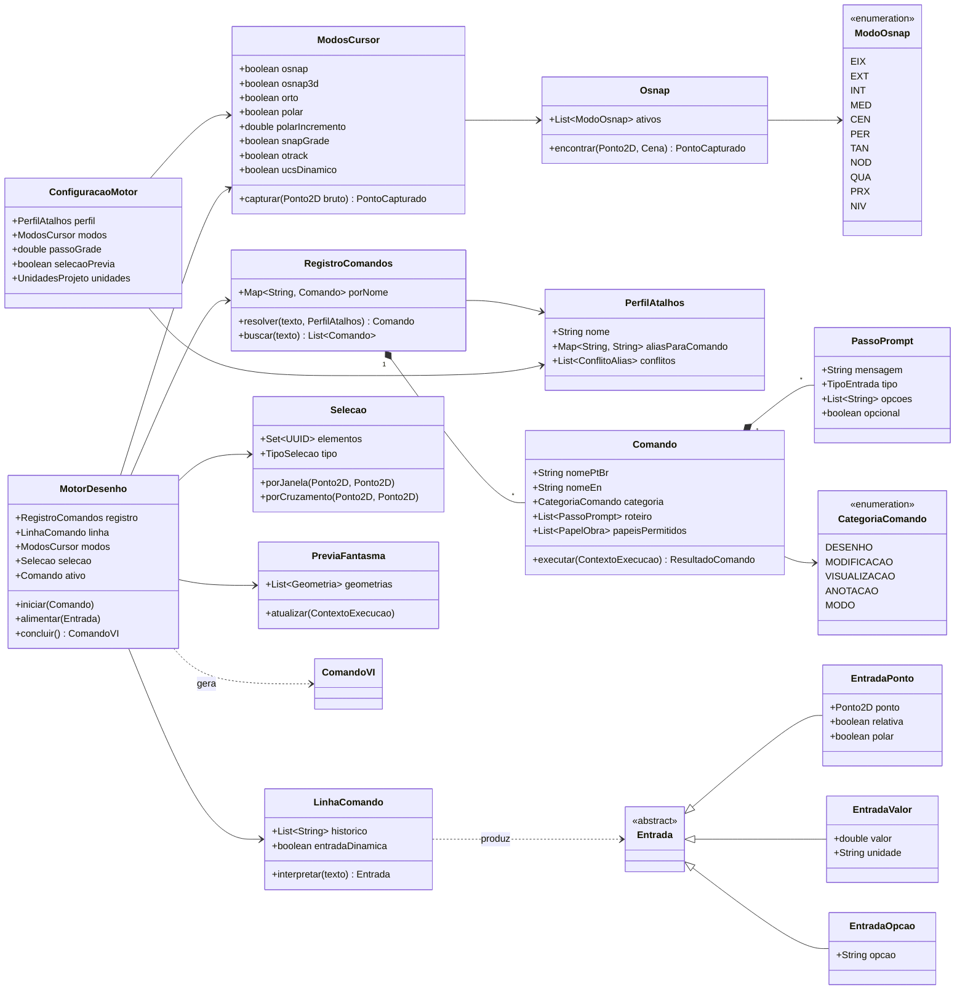
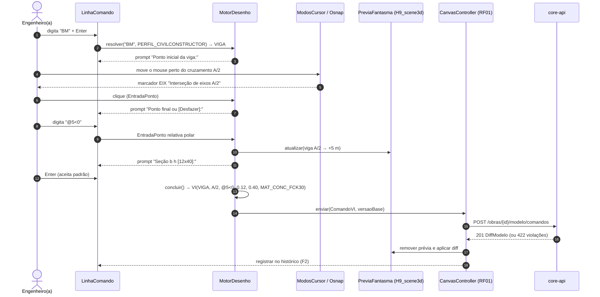
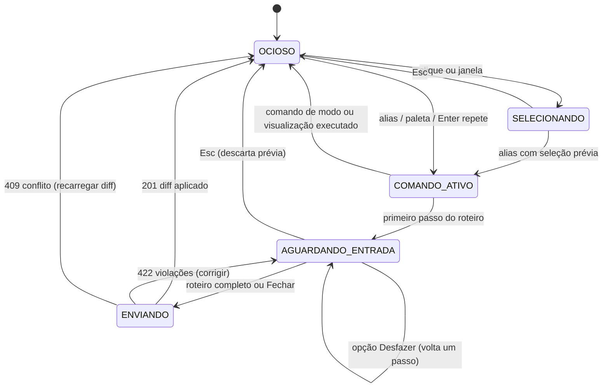
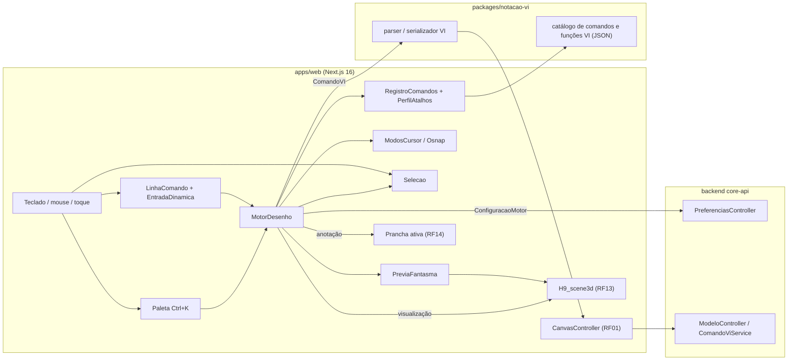

# RF28 · Motor de desenho 2D/3D com linha de comando, atalhos e modos de cursor

> O canvas (RF01) ganha o **modelo de interação do AutoCAD e do Revit**: uma linha de comando com aliases,
> entrada dinâmica junto ao cursor, modos de cursor (Osnap, Ortho, Polar, Snap, Otrack), seleção
> substantivo-verbo e comandos de modificação. Todo comando que muda o modelo é traduzido para uma função da
> **Tabela B** da Notação VI, exatamente como no console de texto (RF02), e passa pelo loop duplo (RF16). O
> catálogo completo está em [`docs/CATALOGO_COMANDOS.md`](../CATALOGO_COMANDOS.md).

## 1. Descrição

O motor de desenho é a camada entre o teclado/mouse e o `CanvasController` do RF01. Ele tem quatro partes:

1. **Registro de comandos** (`RegistroComandos`): cada comando tem nome pt-BR, nome em inglês, aliases por
   perfil (`PERFIL_CIVILCONSTRUCTOR`, `PERFIL_AUTOCAD`, `PERFIL_REVIT`), categoria (desenho, modificação,
   visualização, anotação, modo) e um **roteiro de prompts** (quais pontos/valores pede e em que ordem, com
   opções entre colchetes como `[Desfazer/Fechar]`).
2. **Linha de comando e entrada dinâmica**: campo fixo no rodapé (histórico com `F2`) e, com `entrada.dinamica`
   ligada, o mesmo prompt flutuando junto ao cursor, aceitando coordenadas absolutas (`3,4`), relativas
   (`@2,0`) e polares (`@5<30`), em metros.
3. **Modos do cursor** (`ModosCursor`): Osnap 2D/3D com os pontos notáveis do catálogo (seção 4), Ortho,
   Polar, Snap de grade, Otrack e UCS dinâmico, todos com tecla de função ou alias alternativo quando o
   navegador reserva a tecla (F1, F5, F11, F12).
4. **Seleção e transação**: `PICKFIRST` ligado por padrão (seleciona, depois comanda), seleção por clique,
   janela (esquerda→direita = contido) e cruzamento (direita→esquerda = cruzado); cada comando concluído vira
   **um** `ComandoVI` (ou um lote para `COPIAR`/`MATRIZ`) com prévia fantasma até confirmar.

Os comandos de **visualização e visibilidade** (`HH`, `HI`, `VG`, `Z`, `P`...) agem só na cena (RF13) e nunca
geram `ComandoVI`; os de **anotação** (`DLI`, `DAL`, `TX`, `TG`...) agem sobre a prancha ativa (RF14).

## 2. Atores

| Ator | Papel na obra | Pode |
|---|---|---|
| Arquiteto(a) | `ARQUITETO` | todos os comandos de desenho/modificação de arquitetura e anotação |
| Engenheiro(a) responsável | `ENGENHEIRO` | todos os comandos, inclusive estruturais (`BM`, `CL`, `SB`, `BR`, `FD`) |
| Demais membros | qualquer outro | só visualização (`Z`, `P`, `HH`, `HI`, `VG`, `LA`) |
| Auditor Python | sistema | valida o `ComandoVI` resultante (RF16) |

## 3. Critérios de aceite

- [ ] **CA-01** Todo comando do catálogo responde pelo alias do perfil ativo, pelo nome em pt-BR e pelo nome em
  inglês do guia; a paleta (`Ctrl+K`) busca por qualquer um dos três.
- [ ] **CA-02** Linha de comando aceita coordenadas absolutas, relativas (`@dx,dy`) e polares (`@d<ang`) em
  metros, com vírgula ou ponto decimal; valor inválido mostra o erro no próprio prompt, sem sair do comando.
- [ ] **CA-03** `Esc` cancela o comando ativo sem gravar nada; `Enter`/espaço repete o último comando;
  `[Desfazer]` dentro do comando volta um ponto.
- [ ] **CA-04** Osnap (F3) prioriza, nesta ordem: `EIX` > `EXT` > `INT` > `MED` > `CEN` > `PER` > `PRX`;
  marcador e dica textual indicam o ponto capturado (cor + ícone + texto).
- [ ] **CA-05** Ortho (F8) e Polar (F10) são mutuamente exclusivos; Polar usa `polar.incremento` (padrão 15°).
- [ ] **CA-06** Teclas reservadas pelo navegador (F1, F5, F11, F12) têm alias alternativo documentado na
  paleta e nunca são capturadas de forma que quebre o navegador.
- [ ] **CA-07** Perfis de atalho trocáveis em `KS`; conflito de alias entre perfis (`BR`, `EL`, `CO`) resolvido
  pelo perfil ativo e exibido com nome por extenso.
- [ ] **CA-08** Comandos de modificação sobre elementos construtivos respeitam as regras do domínio: `SC` e `X`
  bloqueados para elementos construtivos; `S` sobre pilar vira `M`; `E` em parede apaga as aberturas
  hospedadas e avisa.
- [ ] **CA-09** Um comando concluído gera exatamente um `ComandoVI` (ou lote) com `versaoBase`, prévia fantasma
  antes e diff depois (RF01 CA-03/CA-05).
- [ ] **CA-10** Comandos de visualização/visibilidade não geram `ComandoVI` e são por sessão (não persistem no
  modelo); `RE` reconstrói a cena a partir do modelo.
- [ ] **CA-11** Unidades do projeto (`UN`) em SI: metros, kN, MPa; conversão só na exibição.
- [ ] **CA-12** Acessibilidade: tudo opera por teclado; foco visível; a linha de comando é uma `role="log"`
  com anúncio dos prompts para leitor de tela; alvo de toque ≥ 48 px na paleta.

## 4. Regras de negócio

- **RN-01** O motor é determinístico: nenhum comando do catálogo chama a IA.
- **RN-02** O motor nunca escreve no modelo; só produz `ComandoVI` para o `ComandoViService` (RF01/RF02).
- **RN-03** Mesma função VI, mesma validação: `WA` no canvas e "faça uma parede de 5 m" no console produzem
  `VI(PAREDE, ...)` idêntico.
- **RN-04** `MOVER`/`COPIAR`/`MATRIZ` de pilares reancoram ao eixo mais próximo dentro da tolerância de snap
  (RF03) e o resultado passa pela Disciplina Z (RF17).
- **RN-05** Preferências do motor (`ConfiguracaoMotor`: perfil, modos, incremento polar, passo da grade) são
  por usuário, salvas em `/api/v1/me/preferencias`, sem dado pessoal além do id.
- **RN-06** Camadas padrão: `arquitetura`, `estrutura`, `fundacao`, `desenho` (auxiliares), `anotacao`,
  `ia-rascunho` (somente leitura para o usuário).

## 5. Base legal e normas

- WCAG 2.2 AA: 2.1.1 teclado, 2.4.11 foco visível, 2.5.8 alvo mínimo, 1.4.1 uso da cor, 4.1.3 mensagens de
  status (prompts da linha de comando).
- NBR 10126 (cotagem) e NBR 8403 (linhas) para os comandos de anotação que chegam às pranchas (RF14).
- NBR 6492 (representação de projetos de arquitetura).
- LGPD: preferências do motor não são dado pessoal sensível; seguem a retenção da conta (RF26).

## 6. API

O motor roda no cliente. Só usa a API para persistir preferências e para enviar comandos:

| Método e rota | Descrição | Respostas |
|---|---|---|
| `GET /api/v1/me/preferencias/motor` | `ConfiguracaoMotor` do usuário | 200 |
| `PUT /api/v1/me/preferencias/motor` | Salva perfil, modos, incrementos, aliases próprios | 200, 422 |
| `GET /api/v1/catalogo/comandos?perfil=` | Catálogo de comandos e aliases do perfil (gerado de `packages/notacao-vi`) | 200 |
| `POST /api/v1/obras/{obraId}/modelo/comandos` | (RF01) recebe o `ComandoVI` produzido pelo motor | 201, 403, 404, 409, 422 |
| `POST /api/v1/obras/{obraId}/modelo/comandos/lote` | Lote atômico (`COPIAR` múltiplo, `MATRIZ`) | 201, 409, 422 |

## 7. Diagramas

### 7.1 Casos de uso

### 7.2 Atividades

### 7.3 Classes

### 7.4 Sequência

### 7.5 Máquina de estados (MotorDesenho)

### 7.6 Componentes

## 8. Testes previstos

| Tipo | Caso |
|---|---|
| Unitário (web) | `LinhaComando.interpretar` aceita `3,4`, `@2,0`, `@5<30`, `3.5` e `3,5` (decimal) corretamente |
| Unitário (web) | `RegistroComandos.resolver("BR")` → CONTRAVENTAMENTO no perfil padrão e QUEBRAR no `PERFIL_AUTOCAD` |
| Unitário (web) | `Osnap.encontrar` prioriza `EIX` sobre `EXT` quando ambos estão na tolerância |
| Unitário (web) | Ortho e Polar nunca ficam ligados ao mesmo tempo |
| Unitário (web) | `MotorDesenho` com roteiro de VIGA produz `VI(VIGA, ...)` igual ao do console de texto (RF02) para a mesma entrada |
| Integração `*IT` | lote de `COPIAR` múltiplo → um único `POST /comandos/lote` atômico; falha em um item reverte todos |
| E2E (Playwright + axe) | desenhar parede só por teclado (`WA`, coordenadas, Enter); prompts anunciados em `role="log"`; sem violações axe |
| E2E | F5/F11/F12 não são capturados; aliases alternativos funcionam |

## 9. Rastreabilidade

| Camada | Artefato | Status |
|---|---|---|
| Documento | `docs/rf/RF28-motor-desenho-comandos.md`, `docs/CATALOGO_COMANDOS.md` | ✅ |
| Card | [Trello 7lSEtX9P](https://trello.com/c/7lSEtX9P) | ✅ |
| Pacote | `packages/notacao-vi/catalogo/comandos.json`, `funcoes-tabela-b.json` | ⏳ |
| Domínio | `cca-domain · notacao/CatalogoComandos.java` (catálogo completo do `docs/CATALOGO_COMANDOS.md`: categorias, perfis, passos, osnap EIX>EXT>…>PRX>NIV, teclas reservadas, conflitos, `resolver(texto, perfil)`), `modelo/ModeloBim.java` (funções da Tabela B) | ✅ |
| Web | `apps/web/src/motor/{MotorDesenho,LinhaComando,RegistroComandos,ModosCursor,Osnap,Selecao}.ts` | ⏳ |
| API | `cca-web · api/notacao/CatalogoController.java` (`GET /catalogo/comandos?perfil&q`, `GET /catalogo/comandos/resolver`), `api/modelo/ModeloController.java` (`POST /modelo/comandos/lote`); `me/PreferenciasController.java` | 🟡 |
| Testes | `CatalogoComandosTest`, `ModeloComandoIT`; `motor.spec.ts`, `linha-comando.test.ts` | 🟡 |

## Auditoria 2026-10

Auditoria pelo uso real do app ([relatório](../auditoria/AUDITORIA_2026-10.md)). Nota (conclusão 30%, precisão 25%, clareza
20%, feedback 15%, consistência/acessibilidade 10%): **6,7 → 8,6**.

- **Corrigido:** `CONCORDAR` e `CHANFRAR` passaram a respeitar raio e distâncias; `LINHA_DETALHE` e `LINHA_QUEBRA` criavam nada e agora gravam; F2 expande o histórico; `ANEL` com raio interno igual nos dois motores; catálogo verificável: 73 de 85 comandos implementados e testados (eram 21 pelo mesmo critério).
- **Evidência:** catálogo verificável 73/85; estado.test.ts; paridade 34 casos.
- **Pendente:** `ESTILO_COTA`, `BLOCO`, `INSERIR`, `LOCALIZAR` só avisam; `BLOCO` é ambíguo com o bloco de fundação.

## Auditoria 2026-10 · 2ª rodada

Estrutura, materiais e conformidade ([relatório](../auditoria/AUDITORIA_2026-10_ESTRUTURA_INSTALACOES_MATERIAIS.md)).

- **Corrigido:** formulário de ações filtra materiais pela aplicação do catálogo (regressão da categoria antiga); seletor de material no painel de propriedades; códigos canônicos nos padrões.
- **Evidência:** `acoes.test.ts` (36 testes do app), j5.
- **Pendente:** —

## Auditoria AUD-CC-3D-001

([relatório](../auditoria/AUDITORIA_AUD-CC-3D-001.md)) Biblioteca na barra lateral (busca por medida, prévia, inserir), "Conectar E1 a…" a partir do
conector, `?sel=` para abrir o modelo com elementos selecionados, 1ª pessoa com W/A/S/D sem a linha de comando
capturar as teclas. Corrigido o nome acessível do link "Minha conta" (WCAG 2.5.3); axe da tela do modelo sem
violações graves.
